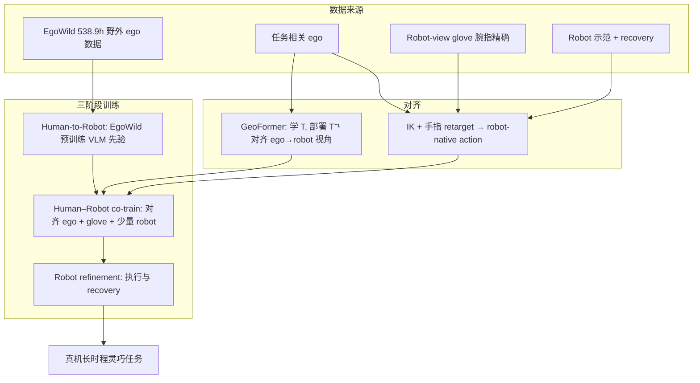

# EgoWild2Dex：从野外人类经验学习灵巧操作 / Learning Dexterous Robotic Manipulation from In-the-Wild Human Experience（arXiv:2609.23755v1）

**EgoWild2Dex**（*Learning Dexterous Robotic Manipulation from In-the-Wild Human Experience*，[arXiv:2609.23755](https://arxiv.org/abs/2609.23755)，[项目页](https://mmlab.hk/egowild2dex/)）由 **香港大学** 与 **Kinetix AI** 等提出：从 **未脚本化、野外第一视角** 人类行为中学习，经 **GeoFormer** 对齐动态 ego 与固定 robot 相机，再用 **渐进人–机训练** 把 broad human prior 压进 **双手灵巧 VLA**（flow-matching 动作头）。

## 一句话定义

**用 538.9 小时野外 ego 建先验，用轻量单应 warp 对齐视角，用 <1 小时/任务的 robot 示范完成长时程多指灵巧真机闭环。**

## 英文缩写速查

| 缩写 | 英文全称 | 简要说明 |
|------|----------|----------|
| VLA | Vision-Language-Action | 视觉–语言–动作策略；本文共享 VLM + action expert |
| FM | Flow Matching | 各训练阶段统一的动作生成目标 |
| IK | Inverse Kinematics | 将腕部位姿映射为臂关节命令 |
| EgoWild | In-the-wild egocentric dataset | 本文 538.9 h 野外双手数据集 |
| GeoFormer | Geometric Transformer | 学习 ego↔robot 单应 warp 的轻量网络 |
| OOD | Out-of-Distribution | 未见物体零样本评测 |

## 为什么重要

- **数据从 staged → in-the-wild：** 家庭、工厂、药店等 **原生 clutter** 与 **15.93°/s** 量级头动，逼模型学可迁移的操作模式而非桌面捷径。
- **灵巧 DoF 而非夹爪：** 面向 **多指协调** 的长时程（开箱、热胶、制冰），补 gripper-VLA 常见空白。
- **样本效率：** 每任务 **<1 h** robot 轨迹仍达 **96.7%** 平均成功率，强调 **对齐配方** 而非无限堆 robot teleop。
- **与 EgoDex 等互补：** [EgoDex](./paper-notebook-egodex-learning-dexterous-manipulation-from-larg.md) 偏大规模桌面 Vision Pro 轨迹；EgoWild2Dex 强调 **野外 + 真机闭环 + 视角/embodiment 双对齐**。

## 核心信息

| 项 | 内容 |
|----|------|
| **机构** | 香港大学（Ping Luo*）；Kinetix AI；Kunyang Lin† project lead |
| **arXiv** | [2609.23755](https://arxiv.org/abs/2609.23755) |
| **项目页** | <https://mmlab.hk/egowild2dex/> |
| **开源** | **待发布** — 论文：data / models / code will be released；2026-11-10 复核项目页仍未提供官方 EgoWild2Dex 训练代码 / 权重 / 数据集下载入口 |

### 流程总览

## 方法要点

### GeoFormer

- **原文 v1 §III-A / 附录 A.3：** GeoFormer 学到的是 **robot→ego** 的单应变换 T，使用 **T⁻¹** 才将 ego 帧向 robot 相机对齐。图像必须来自**同一个任务的图像池**；所谓“unpaired”只是无需逐帧同步，并非任意任务随机混配。
- **实现规格：** 5 级独立 CNN+MLP、每级预测 8 维残差，8 维参数构造迹为 0 的 3×3 生成矩阵并取矩阵指数；训练输入 240×320、5000 iter，判别器为 Wasserstein critic，包含残差与有效覆盖率正则。

- 无配对 ego/robot 图像，级联预测 **8 维单应残差**；训练时 warp robot 内容合成进 ego 帧（对抗 critic + 尺度/重叠正则）。
- 策略训练阶段 **冻结 GeoFormer**，对 ego 帧用 **\(T^{-1}\)** 得到接近 robot 固定相机的观测；相对 3D 投影+inpaint **约 21.9×** 更快。

### 渐进人–机训练

- **主实验具身：** 两条 6-DoF Piper 机械臂 + 两只 6 通道 Revo2 手，合计 **24 维**机器人原生命令；三台 RealSense D435（顶部 1 + 腕部 2），控制 30 Hz。政策输出 **50 步 action chunk**，三阶段始终使用 flow-matching 训练目标。
- **可重定向监督：** 初始 VR/机器人标定 → 相对手腕位姿 → 约束 IK → 机械臂关节位置目标；手指追踪 / mHandPro 数据 → 标定手指重定向 → 手电机命令。**commanded action ≠ 接触后的 measured state**：受阻时目标命令仍携带施力意图。
- **采样：** 每个任务 Stage 2 使用 1,000 条 task-specific ego、1,000 条 robot-view glove 和 100 条机器人专家示范，batch 三路比例约 **1:1:1**。Stage 3 加入 **10 条 DAgger 恢复片段**，不是再采集 1,000 条机器人数据。

| 阶段 | 数据 | 作用 |
|------|------|------|
| 1 Human-to-Robot | 全量 EgoWild | 广域视觉–操作先验 |
| 2 Co-training | 任务 ego（GeoFormer 对齐）+ glove + 少量 robot |  grounding 到目标 workflow |
| 3 Robot refinement | Robot + recovery | 接触动力学与失败恢复 |

Stage 2/3 数据时长约为 Stage 1 的 **1.6% / 0.1%**（论文 Fig.1 口径）。

### EgoWild 数据集

- **采集与筛选：** PICO 4 Ultra 头显 + 每手一个辅助校准 tracker；原始行为在家庭、超市、包裹站、工厂、药店和办公室等自然场景采集，但 Stage 1 使用经过运动/清晰度/追踪/双手活动过滤的 **操作片段**（30 Hz），不是无条件直接利用原始全部长视频。两手追踪将 3D reach 测试指尖误差中位数由 **4.21 cm** 降至 **0.66 cm**。
- **语言与数据边界：** atomic action、segment 和 complete skill 三层带时间戳标注；包含 **58.2M 帧**。生成机器人动作监督依赖手/腕追踪、标定与 retarget，不是仅靠 RGB 视频自动恢复动作。

- **538.9 h**，179,049 episodes，125,961 唯一任务描述，1,282 物体类。
- 2048×1536 第一视角视频 + 双手轨迹 + 原子/片段/技能级语言；校准追踪后指尖中位误差 **0.66 cm**。

## 工程实践：训练、接管与数据预算（arXiv v1 附录 A–B）

| 模块 | 已核实设置 | 工程意义 |
|---|---|---|
| GeoFormer | 240×320、5 级 warp、8 参数、5000 iter、batch 8 | 不做 3D 重建；它仅修正可观察的二维视角几何 |
| Stage 1 | 100k steps、global batch 512、peak LR 7e-5、**32× A100** | 用 538.9 h EgoWild 学通用先验，训练算力并不小 |
| Stage 2 | 50k steps、batch 128、peak LR 3.5e-5、**8× A100** | 已冻结 GeoFormer，ego/glove/robot 约 1:1:1 |
| Stage 3 | 50k steps、batch 128、peak LR 2.5e-5、**8× A100** | 用 robot 专家数据和 10 条 DAgger 恢复轨迹细化 |
| 执行控制 | Mixed Integrated Torque Control + 关节柔顺 PD；相邻 action chunk 重叠线性 blend | 保留接触命令意图并缓解不连续 |
| 在线接管 | **Anchored Delta-Cmd**：接管瞬间锚定机器人**当前指令**，仅加入操作者后续相对手臂/手指运动 | 防止绝对 retarget 导致的接管命令跳变 |

**Anchored Delta-Cmd 手指更新（附录 Eq. 20）：** `m_exec(t) = clip(m_robot(t_take) + H_hand(b_t) − H_hand(b_t_take), motor_limits)`。在 `t=t_take` 时增量为零；实际系统还需手柄 pivot 标定、限速/滤波、IK 不可达与丢包保护。该式用于**接管轨迹采集**，不是训练 flow-matching 的新损失函数。

## 评测

| 任务 | 要点 | 报告结果（论文/项目页） |
|------|------|-------------------------|
| Open-Box | 刀、割胶带、开四盖、取未知物 | 长时程子技能链 + 物体泛化 + 抗扰/自恢复 |
| Glue-Figure | 热胶枪、出胶、摆件 | 工具姿态 + 精细接触 |
| Ice-Water | 铲冰、杯对齐、出水 | 双物体协调 |
| **汇总** | 每任务 **<1 h** robot 示范 | 平均成功率 **96.7%** |
| 零样本物体 | 未见物体 | 平均 **33.3%** 物体级成功率 |
| 跨本体 | Tianji Marvin Pro 等 | 项目页 Cross-Embodiment 视频 |

### 原文 Table I–IV、IX 数据口径

| 任务 | Ego（1000 条） | Glove（1000 条） | Robot（100 expert + 10 recovery） | 真机成功 |
|---|---:|---:|---:|---:|
| Open-Box | 5.81 h | 5.11 h | 0.64 h | **9/10 = 90%** |
| Glue-Figure | 4.16 h | 4.37 h | 0.48 h | **10/10 = 100%** |
| Ice-Water | 3.09 h | 3.07 h | 0.51 h | **10/10 = 100%** |

- **96.7% = 29/30 次任务级成功**，三个任务每个仅 10 次独立试验；“每任务 <1 h robot”包括 100 条专家与 10 条恢复轨迹，**不包含** 538.9 h 通用 EgoWild、人类任务相关示范、设备与训练算力。
- **Open-Box 消融（Table II）：** 仅 robot 0%；Stage 1 + robot 20%；Stage 2 + robot 40%；Stage 1+2+robot 70%；**加 DAgger → 90%**。此 DAgger 消融并非跨三任务的独立验证。
- **视角校正（Table III）：** MoGe+LaMa **162.58 ms** vs GeoFormer **7.43 ms**，处理延迟 **21.9×**，Open-Box 成功率 80%→90%；**不是**端到端 VLA/真机推理加速 21.9×。
- **泛化（Table IV）：** 仅针对开箱换内容物，三个未见物体平均零样本成功 **33.3%**；三个“已见”物体在补充各自少于 100 条示范后平均 70%。Marvin Pro 换臂、保留 Revo2 手，Task I 成功 **60%**。

## 结论

**野外 ego 可以当灵巧机器人主监督，但必须把「乱动的头载视角」和「人手 motion」同时翻译成 robot 相机 + robot-native 高 DoF 动作。**

- 先 **GeoFormer** 再共训，比让单一策略硬吃 ego/robot 混帧更省算力（21.9× vs project+inpaint）。
- **EgoWild 开放段 + 任务段 + glove + 极少量 robot** 的分阶段配方，比一步端到端更稳地收敛长时程灵巧链。
- **Flow-matching VLA** 作为统一骨架，使三阶段仅换数据与 schedule，而非换架构。
- 物体零样本 **33.3%** 说明泛化仍难，需与更多 robot recovery 或 on-policy 数据结合。
- 数据/代码 **待发布** 前，复现应跟踪 [项目页](https://mmlab.hk/egowild2dex/) 与 arXiv 更新。

## 源码运行时序图

**不适用**（截至 2026-11-10：官方项目页未提供 EgoWild2Dex / GeoFormer 可运行训练与部署代码；论文仅承诺 data/models/code 将发布。没有可核对的具体函数入口，不应凭论文算法伪造“源码运行时序图”）。

## 与其他工作对比

| 工作 | 相对 EgoWild2Dex |
|------|------------------|
| [EgoDex](./paper-notebook-egodex-learning-dexterous-manipulation-from-larg.md) | 829 h **桌面** Vision Pro 轨迹 + 手预测基准；**无** GeoFormer/真机长时程闭环配方 |
| [EgoVerse](../entities/paper-egoverse.md) | 联盟 **1,362 h** ego + 多实验室 **BC/CFM 共训**；强调共训缩放，非野外 clutter + 灵巧 VLA |
| [EgoWAM](../entities/paper-egowam-egocentric-human-wam-co-training.md) | **WAM 动力学** 分支缓解 misalignment；EgoWild2Dex 用 **GeoFormer + glove + 渐进 robot** |
| Gripper VLA / 遥操作 IL | 常见 **平行夹爪** 动作空间；本文 **高 DoF 手–臂** + flow-matching |

## 局限与风险

- **论文 §VI 明确：** 仅靠 human data 尚不足以完成长时程接触丰富的任务，仍需要真机微调；二维 GeoFormer 单应变换 **不能填回头部转动后视野外消失的内容**；未验证更高 DoF（例如 22 DoF）商用灵巧手。
- **比较条件：** 相比直接在 100 条 robot 示范上微调预训练 π₀ / π₀.₅ / GR00T-N1.7，这里完整系统还使用了大规模 human 数据、task-specific ego/glove、DAgger 和昂贵训练资源，不能将 96.7% 简单解读为同等数据预算或同等算力上的直接比较。
- **待发布资产：** 无 GitHub/HF 链时无法复现 GeoFormer 与 EgoWild 下载。
- **硬件绑定：** 真机结果为特定 **双手灵巧 + 固定 robot 相机** 工位；跨 [Marvin Pro](https://mmlab.hk/egowild2dex/) 需验证 retarget 与相机外参。
- **Glove 通道依赖：** co-training 仍要 **robot 视角 glove** 数据，非纯 ego→robot 零样本。
- **Wild 标注成本：** 125k 任务描述与追踪校准背后仍有大量采集与后处理工程。

## 关联页面

- [VLA](../methods/vla.md)
- [Motion Retargeting](../concepts/motion-retargeting.md)
- [流匹配与具身策略](../concepts/flow-matching-embodied-policy.md)
- [EgoDex](./paper-notebook-egodex-learning-dexterous-manipulation-from-larg.md)
- [双臂操作](../tasks/bimanual-manipulation.md)
- [跨本体迁移策略](../queries/cross-embodiment-transfer-strategy.md)

## 参考来源

- [egowild2dex_arxiv_2609_23755.md（v1 全文与附录通读）](../../sources/papers/egowild2dex_arxiv_2609_23755.md)
- [mmlab-egowild2dex.md](../../sources/sites/mmlab-egowild2dex.md)

## 推荐继续阅读

- arXiv v1 全文 HTML（可检索附录与表格）：<https://arxiv.org/html/2609.23755v1>

- arXiv：<https://arxiv.org/abs/2609.23755>
- 项目页：<https://mmlab.hk/egowild2dex/>
