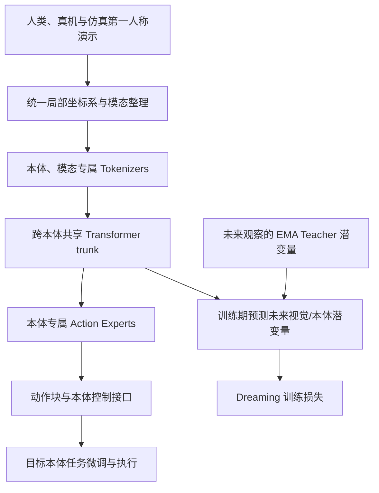
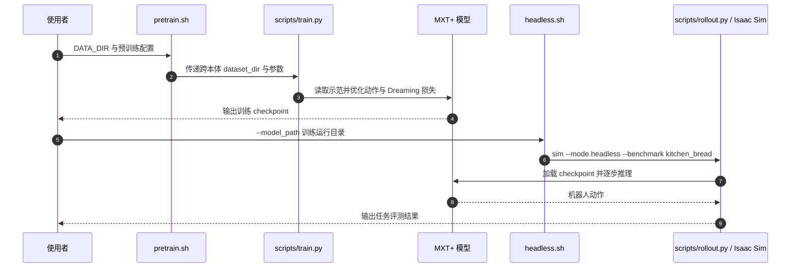

# EgoX：用本体梦想预测实现第一人称跨本体操作
*EgoX: Egocentric Cross-Embodiment Manipulation with Embodiment Dreaming*

## 一句话定义

**EgoX**：把人类、实体机器人和模拟机器人数据组织为统一的第一人称模态接口，利用 MXT+ 的共享 Transformer 和本体专属输入/动作模块实现跨本体预训练、目标本体微调。

## 英文缩写速查

| 缩写 | 英文全称 | 简要说明 |
|---|---|---|
| EgoX | Egocentric Cross-Embodiment | 第一人称跨本体学习 |
| MXT+ | Modularized Cross-Embodiment Transformer with Embodiment Dreaming | 共享干路与专属模块架构 |
| EMA | Exponential Moving Average | 未来表征教师参数平滑 |
| OOD | Out-of-Distribution | 测试分布外场景 |

## 为什么重要

不同机械手、夹爪、移动底盘的状态/动作维度不能直接拼接；共享干路与模态专属接口兼顾知识复用和实体差异。

## 核心信息

| 维度 | 核对信息 |
|---|---|
| 原始论文 | [arXiv:2611.16728v1](https://arxiv.org/html/2611.16728v1) |
| 机构 | 卡内基梅隆大学、博世人工智能中心等 |
| 论文作者 | Yaru Niu、Binghong Chen、Changwei Yao 等 |
| 官方项目 | [项目页](https://egox-dream.github.io/) |
| 开源状态（2026-11-16） | [官方源码](https://github.com/egox-dream/egox)；已部分开源：训练与 G1 仿真评测可用；数据、VR 管线、示例 checkpoint 及大部分真机部署未发布。 |

## 核心原理

把视觉、躯干、左右腕及末端作用点表示成一致的局部参考系及模态 token；每个本体分别编码所具有的模态，经共享 Transformer trunk 融合，再由专属 action experts 预测动作块。训练期 Embodiment Dreaming 从当前表征预测未来视觉和本体状态的潜变量，以 EMA teacher 为目标；推理时去掉 dreaming 分支。混合人类、真机和仿真轨迹预训练，随后用目标本体任务示范微调。

### 流程总览

> 图示基于论文的方法和监督流向；训练与部署路径应区分，图中模块不代表源码调用关系。

## 实验与评测

论文 5 类任务、6 种机器本体、13 个任务–本体组合；平均归一化任务进度 0.63→0.80（相对从零训练）；分布外 OOD 平均进度 0.53→0.77。Dreaming 消融在七组设置中使任务进度 0.63→0.78。这里的进度值不是二元成功率。

## 与其他工作对比

| 工作 | 关键接口与训练阶段 | 边界与取舍 |
|---|---|---|
| 本文 | 把人类、实体机器人和模拟机器人数据组织为统一的第一人称模态接口，利用 MXT+ 的共享 Transformer 和本体专属输入/动作模块实现跨本体预训练、目标本体微调。 | 论文实验数据为团队采集，尚未证明更大数据规模泛化；仿真只覆盖一个人形本体和两个厨房任务。 |
| [SALA](./paper-sala-latent-actions.md) | 同领域相关研究，侧重不同的学习或动作接口 | 不能把不同基准、度量或硬件结果直接横比 |
| [STVLA](./paper-stvla-spatial-temporal-memory.md) | 从另一维度处理学习、记忆或控制问题 | 验收须按论文各自协议建立独立基线 |

## 结论

**把人类、实体机器人和模拟机器人数据组织为统一的第一人称模态接口，利用 MXT+ 的共享 Transformer 和本体专属输入/动作模块实现跨本体预训练、目标本体微调。 但必须按论文的实验协议和开源边界解读其效果。**

1. 统一的是语义/模态结构，不是强行统一所有机器人关节维数。
2. Dreaming 是训练阶段的未来潜变量监督，并非部署期画面生成器。
3. 复现可先跑仿真 G1-Sim-Dex3；真实部署、数据与权重不能视作已开放。

## 源码运行时序图

> 时序依据官方仓库 README 与入口脚本；依赖外部环境/数据未在此声称实机复现。

## 工程实践

| 项目 | 实施与检查点 |
|---|---|
| 接入输入 | 核实论文定义的观察模态、坐标系、动作/控制接口，不能照搬其他本体 |
| 基线与指标 | 复用论文评测协议；另外记录成功率、任务进度、执行耗时和失败分布各自口径 |
| 训练/执行成本 | 区分模型预训练成本、开发期调用次数、在线决策延迟及实际通信开销 |
| 代码可得性 | 已部分开源：训练与 G1 仿真评测可用；数据、VR 管线、示例 checkpoint 及大部分真机部署未发布。 |
| 复现路径 | 以[官方论文](https://arxiv.org/html/2611.16728v1)与[项目页](https://egox-dream.github.io/)为准，缺失的数据/权重/控制接口需要单列阻塞 |

## 局限与风险

论文实验数据为团队采集，尚未证明更大数据规模泛化；仿真只覆盖一个人形本体和两个厨房任务。开源了训练与 G1-Sim-Dex3 评测代码，但 README 明确数据集、VR 数据采集管线、示例 checkpoint 未发布，其他真机部署适配未完成。

- **跨实验不可直接排名：** 论文分别使用跨本体进度、VLA 成功率、真机 episode 成功率或 RoboDojo 子集得分，不具备共同分母。
- **工程安全边界：** 真机动作链需另行评估碰撞、限位、通信中断与异常恢复；论文实验成绩不构成部署安全保证。

## 关联页面

- [SALA](./paper-sala-latent-actions.md)
- [STVLA](./paper-stvla-spatial-temporal-memory.md)
- [VLA 学习纵深路线](../../roadmap/depth-vla.md)
- [跨本体迁移纵深路线](../../roadmap/depth-cross-embodiment.md)

## 参考来源

- [论文原文与核对归档](../../sources/papers/egox-arxiv-2611-16728.md)
- [官方项目页核对](../../sources/sites/egox-project-20261116.md)
- [官方源码与运行入口核对](../../sources/repos/egox-official-20261116.md)
- [arXiv HTML v1（包含实验与局限）](https://arxiv.org/html/2611.16728v1)

## 推荐继续阅读

- [官方项目页](https://egox-dream.github.io/)
- [论文 PDF](https://arxiv.org/pdf/2611.16728)
- [官方代码](https://github.com/egox-dream/egox)
