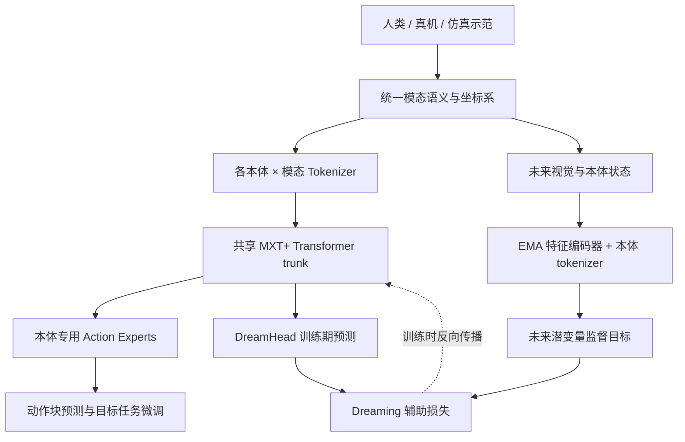
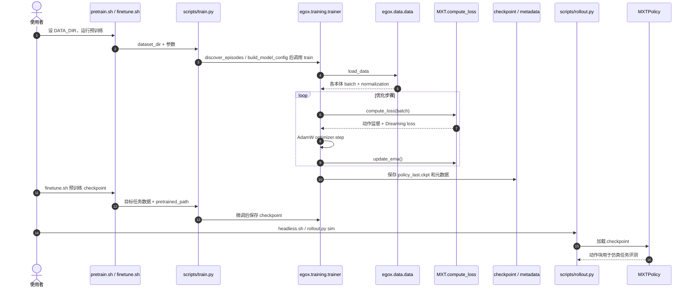

# EgoX：基于 Embodiment Dreaming 的第一视角跨本体操作学习

## 一句话定义

**EgoX**（*Egocentric Cross-Embodiment Manipulation with Embodiment Dreaming*）把人类、真机和仿真的第一视角示范对齐到共同模态语义，使用本体专用 tokenizers / action experts 与共享 Transformer 主干构成 **MXT+**，再用训练期未来本体潜变量预测提高下游机器人操作迁移效果。

## 英文缩写速查

| 缩写 | 英文全称 | 简要说明 |
|---|---|---|
| EgoX | Egocentric Cross-Embodiment Manipulation | 本文跨本体操作学习框架 |
| MXT+ | Modularized Cross-Embodiment Transformer with Embodiment Dreaming | 共享 Transformer + 模态接口 + Dreaming |
| EMA | Exponential Moving Average | 训练期间生成稳定未来潜变量目标的教师更新方式 |
| OOD | Out-of-Distribution | 目标任务示范分布外的评测 |
| GW | Gromov–Wasserstein | 跨本体潜在几何分布距离 |
| ACT | Action Chunking with Transformers | 官方对照的动作块模仿学习基线 |

## 为什么重要

跨本体示范中的关节维度、末端工具、摄像头与控制接口差异巨大。EgoX 不直接统一关节动作，而让同义的腕姿态、末端关键点及视觉在共享网络里互相借鉴，保留每个本体的编码与动作输出接口；Dreaming 则鼓励共享主干掌握与未来状态相关的表征。

## 核心信息

| 项目 | 一手资料确认 |
|---|---|
| 机构 | 卡内基梅隆大学（CMU）、博世人工智能中心、德克萨斯大学阿灵顿分校、加州大学伯克利分校、英伟达（NVIDIA） |
| 预训练本体 | Human-Dex5、G1-Dex5、xArm7-Dex4、G1-Sim-Dex3、LocoMan-Dex2、R1Lite-Gripper、Z1-Tool |
| 实验范围 | 5 项操作任务、6 种机器人（5 真机、1 仿真人形）、13 个任务–本体组合 |
| 代码开放情况 | 模型、训练、微调、G1 仿真评测公开；论文数据及 VR 采集流水线暂未发布 |
| 原文核验 | 官方 PDF **37 页通读**（方法、实验、参考文献、附录 A.1–A.11）；官网与官方源码交叉核验 |
| 数据集规模 | 4,851 条轨迹 / 34.38 小时；人类 2,396 条、五真机 1,706 条、仿真 749 条（论文附录 A.8，表 6） |

## 方法与核心原理

1. **统一坐标约定：** 躯干姿态与速度命令在 root frame，腕姿态在 egocentric frame，末端关键点在 wrist frame；关节状态仍属于各自本体。
2. **模块化输入与动作：** 各本体可用的观测模态通过独立 tokenizer 生成 token，共享 Transformer encoder-decoder trunk 融合，专用动作专家产生对应动作块。
3. **Embodiment Dreaming（论文 §3.3 / Eq. 6–9）：** 当前观测的学生 embodiment tokenizer 用 **8 个可学习查询**汇聚各模态特征，将这些 token 送入共享 trunk；EMA 教师对未来相机图像、机器人关节和末端关节观测编码，形成无梯度的目标；DreamHead 从 trunk 预测未来 tokens，并以余弦方向距离与带权范数 smooth-L1 监督。
4. **训练与推理分离（论文 §3.4）：** 每个本体在同一 optimizer step 中贡献相同大小 batch，动作回归与 Dreaming 一起优化，随后 EMA 更新。**推理时保留学生 embodiment tokenizer**，只移除 DreamHead 与 EMA 教师，避免混淆“移除预测分支”与“移除本体表征”。
5. **关键训练设定（附录 A.3 / 表 1）：** 30 Hz、动作块 **H=60**（2s），Dreaming 偏移 **K={20,40,60}** 帧，EMA 衰减 **α=0.999**、Dreaming 权重 **0.3**。非图像观测和动作在本体/字段内分别标准化；缺失模态按掩码处理。

### 流程总览

此图与**论文 Fig. 3、§3.1–3.4、附录 A.1–A.3**及官方模型源码逐项核对；图中的 EMA/DreamHead 仅训练期使用，学生本体 tokenizer 在推理时保留。

## 源码运行时序图

依据 [官方仓库的实际入口与实现](../../sources/repos/egox-dream.md) 编写；不代表已执行 GPU 或仿真测试。

## 工程实践

| 阶段 | 可核查入口与注意事项 |
|---|---|
| 环境 | bash scripts/setup_conda_policy.sh --name egox，仿真加 --sim 安装 Isaac Sim / Isaac Lab |
| 预训练 | scripts/training_scripts/G1-Sim-Dex3/kitchen-Bread/pretrain.sh 排除目标 Kitchen-Bread，保留目标本体其他任务；数据需用户自备 |
| 微调 | 同目录 finetune.sh PRETRAINED_CHECKPOINT；从零训练可用 train-from-scratch.sh |
| 仿真评测 | headless.sh --model_path /path/to/run；需要 policy_last.ckpt、all_configs.json 与 dataset_stats.pkl |
| 真机 | README 说明需对应 embodiment 的 controller integration，不能将 G1 仿真 rollout 当通用真机部署程序 |

## 实验与评测

| 对照（官方项目页） | 平均归一化任务进度 |
|---|---|
| 13 个任务–本体组合：MXT+ 从零训练 → 跨本体预训练 | **0.63 → 0.80** |
| 同一组的 OOD 任务 | **0.53 → 0.77** |
| 7 组独立 Dreaming 消融：MXT → MXT+ | **0.63 → 0.78** |
| Scoop 潜变量几何消融 | Dreaming 后跨本体 GW 距离均值 **下降 38.52%** |

- 官方对照还包括 ACT 与 π₀.₅；预训练 MXT+ 在 13 组中的 12 组平均任务进度居首。
- 真机每任务–本体对 20 次试验（13 ID、7 OOD）；仿真 50 次（32 ID、18 OOD）。
**原文附录 A.10 / 图 20 还单独报告成功率：**

| 指标 | 对照 | 平均成功率 |
|---|---|---|
| 13 组跨本体预训练 | MXT+ 无预训练 → 有预训练 | **0.35 → 0.56** |
| 13 组 OOD 成功率 | 无预训练 → 有预训练 | **0.18 → 0.52** |
| 13 组 ID 成功率 | 无预训练 → 有预训练 | **0.44 → 0.58** |
| 7 组 Dreaming 消融 | MXT → MXT+ | **0.39 → 0.62** |

- **进度与成功率应分开：** 附录 A.9 进度为各阶段分值与最终成功奖励归一化 P=(s+b)/Smax，附录 A.10 成功率是完成的试验占比；都不能当成毫米级末端定位误差。Dreaming 消融与预训练消融也不能把收益直接相加。
- **OOD 的严格定义：** 目标本体目标任务的微调示范未见的物体与场景，但**其他本体的预训练示范可能见过**；不能称为所有训练数据都未见。
- **预训练组成：** human-only → human+other robots → full（再加目标本体非目标任务示范）；论文 Fig. 6 报告组合越丰富总体越有利，不能把 full 的增益完全归因于人类视频。

## 结论

**EgoX 已公开的结果支持跨本体共享模态表征和未来潜变量监督有利于操作任务进度，但不足以直接证明毫米级精度或开箱即用的跨平台部署。**

1. **主要改进发生于 OOD：** 项目页报告任务进度 0.53→0.77。
2. **共享网络不等于共享关节空间：** 不同本体依然需要专用模态 tokenizer 和动作专家。
3. **训练与部署开销需区分：** Dreaming 使用 EMA/预测辅助分支，部署时移除 DreamHead/EMA 教师，**保留学生 embodiment tokenizer**。
4. **GW 距离是潜空间诊断，不是终端操作指标：** 应结合 ID/OOD 任务进度共同读。
5. **复现依赖外部数据和权重：** 官方代码并未包含论文全部数据及 VR 采集栈。

## 与其他工作对比

| 工作 | 对比定位 |
|---|---|
| [EXE](./paper-exe-cross-embodiment.md) | EXE 将潜在动作拆成共享/本体特有因子；EgoX 保持本体专用模态与动作接口、共用 trunk 并辅以 Dreaming |
| [操作学习](../tasks/manipulation.md) | EgoX 聚焦用异构操作示范预训练，再针对目标机器人任务微调 |
| [移动操作](../tasks/loco-manipulation.md) | Kitchen-Cleanup 含速度命令，粒度过粗的动作专家容易丢失关键控制通道 |

## 局限与风险

- **原文通读已完成但未完整复现：** 已核对 PDF 全 37 页，含公式、表格、Appendix A.1–A.11；尚未安装 GPU/仿真栈或重训，因此不能宣称实测复现结果。
- **论文明确的采样偏差：** 4,851 条数据分配极不均衡：LocoMan-Dex2 仅 37 条、0.35h，但预训练仍按本体等量取 batch，小本体可能反复采样导致过拟合。
- **新本体不是零适配：** 仍需手动指定坐标变换、模态对应和低层控制接口；仿真只有一个 G1 本体与两个厨房任务（论文 §5）。
- **部分开源：** 官方 README 明言数据集和 VR 数据采集流水线尚未发布；缺少兼容数据与训练产物就无法直接复现全部实验。
- **外推边界：** 所报告的 5 项任务、6 种机器人不能外推为任意灵巧手的毫米级精度保证。
- **无实跑结论：** 本次没有运行 GPU 训练、Isaac Sim 或真机部署，仅核查静态源码入口与控制流。

## 关联页面

- [EXE：第一视角跨本体潜在动作预训练](./paper-exe-cross-embodiment.md)
- [机器人操作任务](../tasks/manipulation.md)
- [移动操作](../tasks/loco-manipulation.md)

## 参考来源

- [EgoX 37 页论文全文与通读归档](../../sources/papers/egox-embodiment-dreaming.md)
- [官方项目页归档](../../sources/sites/egox-dream.md)
- [官方源码归档](../../sources/repos/egox-dream.md)
- [官方 PDF](https://egox-dream.github.io/assets/egox.pdf)

## 推荐继续阅读

- [EgoX 官方项目页面与演示](https://egox-dream.github.io/)
- [EgoX GitHub 源码与安装指南](https://github.com/egox-dream/egox)
