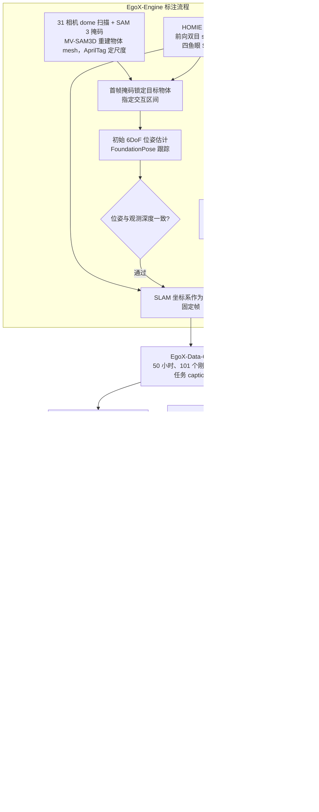

# EgoXperience：世界坐标系中的第一视角重建

## 流程总览

图依据：论文 §3.1 / §3.2 / §3.3、Fig.3 / Fig.4

## 一句话定义

以统一世界坐标系联合重建第一视角视频中的相机、场景、手和物体。

## 英文缩写速查

| 缩写 | 英文全称 | 简要说明 |
|------|----------|----------|
| SLAM | Simultaneous Localization and Mapping | 同步定位与建图 |
| 6DoF | Six Degrees of Freedom | 六自由度位姿 |
| MANO | Model with Articulated and Non-rigid defOrmations | 参数化手模型 |

## 核心原理

EgoX-Engine 通过几何验证的物体跟踪与 SLAM 对齐构造多模态监督；EgoX-Data-6M 包含 50 小时、约 540 万帧，EgoX 接收单目视频和首帧物体掩码，一次前向联合预测。

## 评测与结果

作者在 HOT3D、EgoX-Bench、HOI4D 和 H2O 上评估多项重建指标；论文报告相较所测最强基线，相机、手和深度误差分别下降 68.9%、65.6% 和 42.9%。

## 结论

以统一世界坐标系联合重建第一视角视频中的相机、场景、手和物体。

- 优先核对评测协议、输入条件与基线设置，再比较指标。
- 场景几何质量和感知误差会影响下游结果。
- 项目结果不能直接等同于真实机器人闭环任务表现。

## 源码运行时序图

不适用：官方仓库当前没有可运行的项目实现。

## 工程实践与局限

官方仓库目前为项目说明，代码、数据、基准和权重均列为待发布；不能据此认定可复现。

## 与其他工作对比

| 工作 | 输入与输出 | 与 EgoXperience 的差异 |
|------|------------|------------------------|
| [HOT3D](./dataset-hot3d.md) / [HOI4D](./dataset-hoi4d.md) | 头戴/第一视角采集的手-物数据集 | 二者是本文评测所用的外部基准；EgoXperience 自建 EgoX-Data-6M 训练集，目标是单目视频下一次前向同时输出相机、手、物体与深度 |
| [R3D](./paper-sa-2607-02921-r3d-quantitative-3d-spatial-reasoning-for-egocen.md) | 第一视角问答 + 空间工具调用 | R3D 做定量空间问答，几何来自工具；EgoXperience 直接回归世界坐标系几何，可作为此类工具的上游感知 |
| [Ropedia W0](./paper-ropedia-w0.md) | 相机位姿 + 投影骨架的跨本体世界模型 | 同一团队；W0 消费相机位姿与骨架做世界建模，EgoXperience 负责从第一视角视频恢复这类世界坐标信号 |
| [Ropedia Xperience 2](./paper-ropedia-xperience-2.md) | 将现场米制 3D 扫描与同场景第一视角行为配准的数据基座 | Xperience 2 连接环境资产与行为记录，EgoXperience 学习联合几何重建；二者不是同一个模型或数据集。Xperience 2 的下游 Real-to-Sim、重定向演示不等于 EgoXperience 已发布可运行实现 |

按 [2026-11-13 Xperience 2 来源复核](../../sources/papers/ropedia_xperience_2_arxiv_2611_17060.md)，论文的 1,589 个保留扫描和 4,230 条录像是采集统计；HF 当时分批上传、首批列 126 个场景，不能把全量采集数写成已开放下载数。

选型上，若下游需要「手–物–相机」在同一世界坐标系对齐的监督，EgoXperience 的联合重建思路比逐模块拼接（SLAM + 手部姿态 + 物体位姿）更直接；但代码与数据尚未发布，当前只能当作方法参考，在感知栈中对应「2D→3D 提升」层，见[感知栈选型闭环](../queries/robot-perception-stack-selection-loop.md)。

## 关联页面

- [Ropedia Xperience 2](./paper-ropedia-xperience-2.md) — 场景扫描、第一视角行为与配准资产。
- [Ropedia W0](./paper-ropedia-w0.md) — 跨本体第一视角世界模型。
- [DONIC](./paper-donic.md) — 从人类示范学习双手跟踪控制。
- [机器人视觉感知栈选型闭环](../queries/robot-perception-stack-selection-loop.md) — 感知栈选型闭环知识链枢纽

## 参考来源

- [Ropedia Xperience 2 原文与分批发布口径复核](../../sources/papers/ropedia_xperience_2_arxiv_2611_17060.md)
- [论文归档](../../sources/papers/egoxperience.md)
- [项目页归档](../../sources/sites/egoxperience.md)
- [官方仓库归档](../../sources/repos/egoxperience.md)
- [arXiv PDF](https://arxiv.org/pdf/2610.26625)：已通读方法部分（实验与附录以略读为准）：§1、§3.1–§3.3、§4 开头与主结果（附录未读）

## 推荐继续阅读

- [论文原文](https://arxiv.org/abs/2610.26625)
- [官方仓库](https://github.com/Ropedia/EgoXperience)
