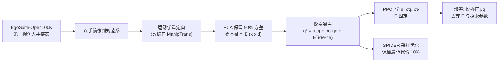
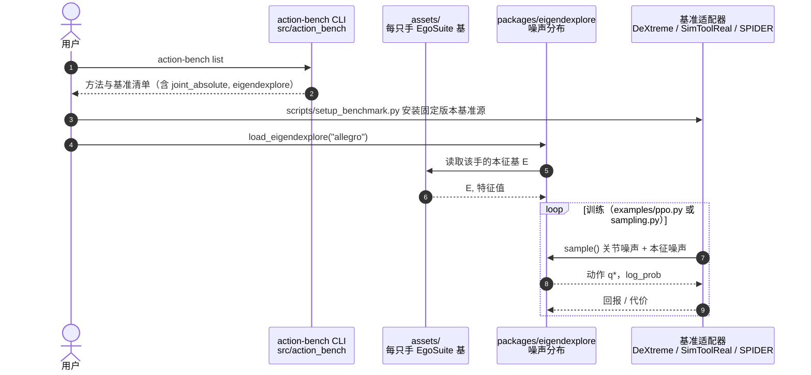

# EigenDEXplore

**EigenDEXplore**（*Structured Exploration for Dexterous Manipulation with Human Priors*，arXiv:2610.07681，2026-10-06，Stanford）提出：人类运动先验最适合用来 **结构化探索**，而不是改动作表示。它在独立的关节空间高斯噪声上，叠加沿“人手本征向量”的相关扰动，策略仍直接输出全部关节的目标位置，部署时先验完全丢弃。

## 英文缩写速查

| 缩写 | 英文全称 | 简要说明 |
|------|----------|----------|
| PCA | Principal Component Analysis | 对重定向后的人手关节角求主成分，得到本征向量 |
| PPO | Proximal Policy Optimization | 论文 RL 实验所用的策略梯度算法 |
| DoF | Degrees of Freedom | 手的自由度，Sharpa 22、Wuji 20、Allegro 16、XHand 12、Schunk 9、Inspire 6 |
| ADD-AUC | Average Distance (of model points) - Area Under Curve | DexMachina 的物体跟踪指标 |
| SPIDER | Scalable Physics-Informed DExterous Retargeting | 采样式轨迹优化/重定向框架，论文用作轨迹优化实验 |
| IID | Independent and Identically Distributed | 逐关节独立同分布噪声，对应 Joint-Space 基线 |

## 为什么重要

- **高维灵巧动作空间的探索效率：** 逐关节独立加噪很难偶然采到协调的手指动作，大量样本浪费。
- **不牺牲表达力：** 先前的低维协同空间（Eigen-Space）压缩动作空间，在 DeXtreme 上被限制在 16 关节中的 10 维子空间而表现差；EigenDEXplore 保留完整关节空间。
- **同时适用于 RL 与采样优化：** 同一噪声模型可用于 PPO 与 SPIDER 轨迹优化，且在奖励塑形和课程设计有限时增益更大。
- **工程成本低：** 部署时无需任何先验模块，只是训练时的探索分布不同。

## 方法栈与流程总览

## 方法

- **本征基：** 来源默认 Lightwheel EgoSuite-Open100K 的手部姿态（另比较 GRAB、ARCTIC）；经镜像、重定向后对关节角做 PCA，保留累计方差 90%（Sharpa k=9、XHand k=6），E 位于归一化到 [−1,1] 的关节坐标。
- **噪声模型：** q⋆ = a_q + σ_q⊙η_q + Eᵀ(σ_e⊙η_e)；σ_e,i ∝ √λ_i 使初始本征噪声与人手姿态散布一致；重缩放使总初始方差与 Joint-Space 相同，两项各占一半；等效协方差 Σ = diag(σ_q²) + Eᵀ diag(σ_e²) E。动作空间仍是绝对归一化关节位置目标（维度 d）。
- **RL：** PPO 学习策略参数、σ_q 与 σ_e，E 固定，对数概率与熵按 Σ 计算；部署只执行均值 μ_q。
- **轨迹优化：** SPIDER 每轮采样 N 条候选（N 未报告），保留代价最低 10%，按权重更新目标；σ 固定并遵循 SPIDER 噪声调度。
- **对照动作空间：** Joint-Space（d）、Eigen-Space（k）、Eigen-Residual（d+k），附录含 delta 动作变体。绝对 σ、PPO 超参、学习率未报告。

## 实验与评测

| 实验 | EigenDEXplore | 对比 |
|------|------|------|
| SimToolReal（Sharpa，9B 帧，6 cm/50°，5 种子）平均连续成功 | 10.6 | Joint-Space 7.9 |
| SimToolReal 60B 帧课程（至 1 cm/8°，单次中位运行） | 14.1 | Eigen-Residual 12.0；Joint-Space 4.9；Eigen-Space 早期占优后衰减 |
| DeXtreme（Allegro 立方体重定向，2B 帧 + ADR，5 种子） | 12.3 | Joint-Space 8.8；Eigen-Space 表现差 |
| DexMachina（仅任务奖励，Allegro 盒子 ADD-AUC） | 0.80 | Joint-Space 0.46 |
| DexMachina（课程+辅助奖励，Schunk 盒子） | 0.84 | Joint-Space 0.59；其余手与基线接近 |
| SPIDER 重定向代价降幅（OakInk2 十任务，10 种子） | 平均 16% | Wuji 31%、Sharpa 25%、Allegro 22%、XHand 14%、Schunk 4%、Inspire 0.4% |
| 真机 Sharpa 工具任务平均进度（锤、擦、舀、刷） | 82% | Joint-Space 33% |
| 真机 Allegro 立方体 40 次平均连续成功 | 11.90（最长 41） | Joint-Space 8.45（最长 32） |

- **先验来源：** SimToolReal 9B 帧下 EgoSuite 10.6、ARCTIC 9.8、GRAB 9.4、Joint-Space 7.9，说明更大规模的人类数据略优。
- **方差保留消融（Sharpa，SPIDER）：** 仅 50% 方差的纯本征噪声（0.126）比 Joint-Space（0.089）差；与关节噪声叠加时 90% 最优（0.066，约低 25%）。随机正交方向（同特征值）比 Joint-Space 更差，增益来自人类派生方向。
- **口径提醒：** 项目页给出真机工具任务进度 71% 对 42%，论文正文为 82% 对 33%，原因未核实；真机策略只训了原预算（120B 帧）的一半（60B）。

## 源码运行时序图

官方仓库 [hgupt3/eigendexplore](https://github.com/hgupt3/eigendexplore)（MIT，归档见 [eigendexplore.md](../../sources/repos/eigendexplore.md)）按下图的入口组织（据仓库首页与目录浏览整理，未运行）：

## 工程实践

- **接入：** `pip install ./packages/eigendexplore .`，`action-bench list` 验证；`examples/ppo.py --updates 4` 做最小烟测；各基准装在独立仿真环境，需 Linux + NVIDIA GPU + Conda。
- **噪声起点：** 仓库建议 IID σ 从 √0.5 起；可选 `correlation` 参数（默认 0）不在论文内，作者称初测有效但未验证。
- **选 k：** 默认保留 90% 方差；低自由度手（Schunk、Inspire）收益很小，不必强行使用。
- **复现范围：** DexMachina 适配未见 docs 指南；真机复现需 Sharpa/Allegro 手与 FoundationPose 或 ArUco 位姿估计。

## 结论

**EigenDEXplore 说明：把人手协同结构放进探索噪声而不是动作空间，能在不损失表达力的前提下提升高自由度手的 RL 与采样优化效率；自由度越高收益越大。**

1. **加性而非替代** — 纯 Eigen-Space 在 DeXtreme 上差，纯本征噪声在 50% 方差下比 Joint-Space 还差；只有与关节噪声叠加才稳。
2. **90% 方差是默认甜点** — 论文在 {50,70,80,90,95,100}% 中选 90%。
3. **方向才是关键** — 随机正交方向（同特征值）反而更差。
4. **收益随自由度增大** — SPIDER 降幅 Wuji 31% 到 Inspire 0.4%。
5. **奖励/课程越少越有用** — DexMachina 仅任务奖励时提升大，有完整课程时接近基线。
6. **真机提升明显但样本有限** — 82% 对 33%（工具）与 +41%（立方体）；对照口径与项目页不一致需留意。

## 与其他工作对比

| 对照 | 差异读法 |
|------|----------|
| [DexMachina](./paper-dexmachina.md) | 论文用其作双手跟踪基准；EigenDEXplore 改探索噪声而非奖励/课程 |
| [SPIDER 重定向](../methods/spider-physics-informed-dexterous-retargeting.md) | 论文用 SPIDER 做采样式轨迹优化实验，直接替换其噪声分布 |
| [EgoSuite-Open100K](./egosuite-open100k.md) | 默认人类先验来源 |
| 协同动作空间（Eigen-Space 类先前工作） | 缩维换探索效率；本文保留全关节空间，用相关噪声取其利 |

## 局限与风险

- **开源状态：** 已开源（MIT），仓库含包、CLI、六只手的拟合基与三个基准指南；仅浏览首页，未运行；仅 1 次提交。
- **作者列出：** 线性本征基固定，非线性协同与数据缺失模式靠关节噪声发现；依赖运动学重定向，形态差异大的手可能迁移差；低自由度手收益小；噪声逐步独立采样，时间相关探索留作未来工作。
- 单位：Stanford（作者列表）；周报称含哥伦比亚大学，arXiv 页与项目页均只写 Stanford，故不据此标注。

## 关联页面

- [周报汇总：Manipulation 2026-10-05 至 10-09](../overview/frontier-manipulation-2026-10-05-10-09.md)
- [PPO](../methods/ppo.md)、[强化学习](../methods/reinforcement-learning.md)
- [手内重定向](../methods/in-hand-reorientation.md)
- [灵巧手运动学](../concepts/dexterous-kinematics.md)、[接触丰富操作](../concepts/contact-rich-manipulation.md)
- [Manipulation 任务](../tasks/manipulation.md)

## 参考来源

- [eigendexplore_arxiv_2610_07681.md](../../sources/papers/eigendexplore_arxiv_2610_07681.md) — 论文归档
- [eigendexplore-project.md](../../sources/sites/eigendexplore-project.md) — 项目页
- [eigendexplore.md](../../sources/repos/eigendexplore.md) — GitHub 仓库归档
- [frontier_manipulation_2026_10_05_10_09.md](../../sources/blogs/frontier_manipulation_2026_10_05_10_09.md) — 周报线索
- 论文：<https://arxiv.org/abs/2610.07681>

## 推荐继续阅读

- [EigenDEXplore 项目页](https://eigendexplore.github.io/)
- [EigenDEXplore GitHub](https://github.com/hgupt3/eigendexplore)
- [arXiv HTML 全文](https://arxiv.org/html/2610.07681v1)
