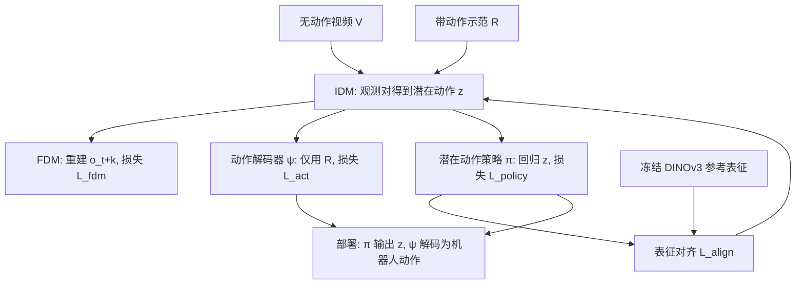

# ELA（arXiv:2611.05571）

**ELA**（*ELA: End-to-End Latent Action Policy Learning from Video Demonstrations*，Cheng-Chun Hsu、Peter Stone，德州大学奥斯汀分校，CoRL 2026，[arXiv:2611.05571](https://arxiv.org/abs/2611.05571)，[项目页](https://end2end-latent-action.github.io/)）。线索来自 [具身智能小站 2026-11-05 盘点](../../sources/blogs/wechat_embodied_station_43_papers_grasp_mesa_airoa_2026-11-05.md)，并列入 Glen Berseth 的 CoRL 2026 阅读清单 P0 档。本页依据 arXiv v1 全文（含附录）通读整理，见 [来源归档](../../sources/papers/ela_arxiv_2611_05571.md)。

## 一句话定义

**把“视频两帧之间发生了什么”这个潜在动作，同时训练成策略容易预测、解码器又能还原成连续机器人动作的表示，从而让无动作标签视频参与模仿学习。**

## 英文缩写速查

| 缩写 | 英文全称 | 简要说明 |
|------|----------|----------|
| ELA | End-to-End Latent Action policy learning | 本文方法；LAM、策略、解码器联合训练 |
| LAM | Latent Action Model | 潜在动作模型，由 IDM 与 FDM 组成 |
| IDM | Inverse Dynamics Model | 由 (o_t, o_t+k) 推断潜在动作 z_t |
| FDM | Forward Dynamics Model | 由 o_t 与 z_t 预测 o_t+k，约束 z 足以解释转移 |
| FSQ / iFSQ | Finite Scalar Quantization / improved FSQ | 把潜在动作离散化的信息瓶颈（§3.3） |
| DP | Diffusion Policy | 基线之一，不能使用无动作数据 |
| UWM | Unified World Model | 联合视频与动作扩散的世界动作模型基线 |
| BC | Behavior Cloning | 行为克隆 |
| LIBERO-10 | LIBERO 长时程子集 | 10 个长时程桌面任务（仿真） |
| REPA | Representation Alignment | 表征对齐损失的来源思路（§3.4 引用 [31, 32]） |

## 为什么重要

- 带动作标签的机器人数据贵，无标签视频（人类视频、无标签机器人轨迹）多；现有潜在动作方法多为“先学潜在动作、再当固定目标训策略”的两阶段（§1）。
- ELA 的做法是让潜在动作同时服务于策略监督与动作执行，并给出两个可度量的性质：modelability（策略能预测）与 decodability（解码器能还原），图 5(c) 把二者画在同一张图上。
- 对现有 BC 方法是增量式的：作者称不改策略结构与训练目标，只加一个约 4M 参数的动作解码器（摘要、图 1）。

## 核心原理与流程总览

作者自述的设计（§3）：

- **数据：** 无动作视频集 V（可来自同本体或人类视频）与较小的带动作集 R（目标本体）。策略分解为 Π(a_t:t+k | o_t) = ψ(a | z)·π(z | o)，π 与 IDM 可用 V 与 R，ψ 只用 R（§3.2）。
- **LAM：** IDM 用 Transformer 编码器加 register token，iFSQ 量化；FDM 重建 o_t+k，损失 L_fdm（§3.3）。
- **联合训练防塌缩：** 单步联合优化会塌缩，故用冻结 DINOv3 的参考表征，对策略中间层特征做余弦对齐，并交替“LAM 更新通道”与“策略更新通道”（§3.4，图 3）。
- **三阶段训练（附录 D，表 7）：** LAM 预热 5k 步 → 联合预训练 200k 步 → 冻结 LAM 与解码器，逐任务微调策略 10k 步。

## 工程实践

以下均为论文给出的设置，复现前仍应以作者发布的代码为准（截至 2026-11-12 未见代码，见下）。

- **潜在动作规格：** k=16 个 register token、每 token 4 维；FSQ 水平 [9,9,9,9]（6561 码）；k 与码本消融见附录 A 表 4（均在 LIBERO-10 的 soup-cheese 与 book-caddy、N=10 上做）。
- **下游策略：** 潜在扩散 Transformer（12 层 AdaLN），ResNet-18 编码两帧观测，DDPM 训练 50 步 / 推理 10 步（附录 D）。
- **夹爪单独处理：** 夹爪开合在图像对里变化细微，不放进潜在空间，改由专用头按二值夹爪信号监督；因此这一维仍需动作标签（附录 D）。
- **真机：** Franka Panda，OSC 控制 10 Hz，动作为末端位姿增量，单个场景相机（附录 B.1）。
- **规模：** ELA_DP 的 IDM 为 6M 参数、训练数据 250 条轨迹（表 1）；对比的 LAPA、Villa-X、UniVLA 使用公开检查点，训练数据 1M+ 轨迹。
- **开源：** 论文与项目页（2026-11-12 复查）未给出论文代码仓库，项目页只有模板仓库链接，故本页 frontmatter 不写 `code:`。

## 与清单说法的核对

清单（Glen Berseth《My CoRL 2026 Reading List》，P0，据作者说由 LLM 依摘要起草）对本文的一句话：“联合训练潜在动作模型、潜在策略与动作解码器，使潜在动作为控制而优化，来自视频示范。”

| 清单说法 | 论文核对 |
|----------|----------|
| 联合训练 LAM、潜在策略、动作解码器 | 属实（摘要、§3.2、§3.4）。 |
| 潜在动作“为控制而优化” | 基本属实，但有限定：脚注 1 说明“端到端”不表示梯度穿过所有模块；策略梯度不直接回传 LAM，而是通过 DINOv3 表征对齐与交替更新通道间接塑形（§3.4，图 3）。 |
| 来自视频示范 | 部分限定：仿真（LIBERO-10）里无标签部分是同一批机器人演示去掉动作；真机里才是人类视频（40 条）加 10 条机器人带标签演示（§4.1–§4.2）。解码器与夹爪头仍需带标签数据（§3.2，附录 D）。 |
| 清单未提及的结果 | 仿真 N=5 时 UWM 19%→59%、DP 31%→54%（§4.1）；真机平均 0.70 对 DP 0.48（表 5），open-oven 上无增益（0.30 对 0.35）。 |

此外，小站公众号转述（本库原页面内容）称“在仿真和真机任务中用少量带动作标注的示范校准”，与论文一致；原页面把本文归入灵巧操作并打 dexterous 标签，但论文 §5 明确“评测不含高灵巧或高精度任务”，故已去掉该标签。

## 局限

论文自述（§5，附录 C.1）：

- 尚未大规模验证，跨本体大数据集（如 DROID、EgoVLA 一类）留作未来工作。
- 只用原始 RGB，不含深度或 3D 先验。
- 评测不含高灵巧或高精度任务；真机 open-oven 上 ELA_DP 没有优于 DP，作者归因为该任务的精确连续控制超出 IDM 在人类示范视频上的建模能力。

我看到的未验证之处（判断，非作者所述）：

- 真机只有 1 台 Franka、5 个任务、每任务 20 次试验，且报告的是单次评测成功率，没有报告方差（表 5）；小样本下 0.70 对 0.48 的差距置信区间未给出。
- 真机基线（LAPA、Villa-X、UniVLA）直接使用公开检查点，训练数据与任务分布与 ELA 不同（表 1、附录 B.2），论文只通过 Villa-X 微调 / 从头训练与 Dynamo 做了部分控制；“预训练规模不足以保证下游表现”的结论仅限本文少样本设置。
- 对齐消融（0.83→0.45）只在真机任务子集上做（图 5b），未给逐任务数与试验次数；“交替通道”与“对齐损失”各自的贡献没有分开消融（推测，论文未单独报告）。
- LIBERO-10 的 N=20 设置下增益较小，且 moka-moka 等个别任务 ELA_DP 低于 DP（表 6，N=20：0.26 对 0.43）。
- 论文称 4M 参数解码器开销与策略大小无关；但表 1 中 ELA_DP 的 IDM 为 6M，总额外参数应不止解码器（推测：4M 指解码器，不含 IDM 与 FDM）。
- 代码尚未公开，复现细节（数据划分、人类视频采集）只能依据附录文字。

## 关联页面

- [imitation-learning](../methods/imitation-learning.md)：模仿学习总览，ELA 是其“从无动作视频学习”分支
- [diffusion-policy](../methods/diffusion-policy.md)：ELA_DP 的基础策略与对照基线
- [world-action-models](../concepts/world-action-models.md)：UWM 一类世界动作模型，作为 ELA 的另一基础策略
- [libero-benchmark](../entities/libero-benchmark.md)：仿真评测基准
- [LAPA](../entities/paper-shenlan-wm-03-lapa.md)、[UniVLA](../entities/paper-rcl-2505-06111-univla-learning-to-act-anywhere-with-task-centri.md)、[CLAM](../entities/paper-rcl-2505-04999-clam-continuous-latent-action-models-for-robot-l.md)：潜在动作方法的前置工作
- [UWM](../entities/paper-shenlan-wm-08-uwm.md)：本文 ELA_UWM 的底座
- [manipulation](../tasks/manipulation.md)
- [具身智能小站 11-05 期 43 篇阅读坐标](../overview/embodied-station-2026-11-05-43-papers-technology-map.md)

## 参考来源

- [ela_arxiv_2611_05571.md](../../sources/papers/ela_arxiv_2611_05571.md)
- [ela.md（项目页归档）](../../sources/sites/ela.md)
- [wechat_embodied_station_43_papers_grasp_mesa_airoa_2026-11-05.md](../../sources/blogs/wechat_embodied_station_43_papers_grasp_mesa_airoa_2026-11-05.md)
- [arXiv:2611.05571](https://arxiv.org/abs/2611.05571)

## 继续阅读

- [arXiv PDF](https://arxiv.org/pdf/2611.05571)
- [项目页](https://end2end-latent-action.github.io/)
