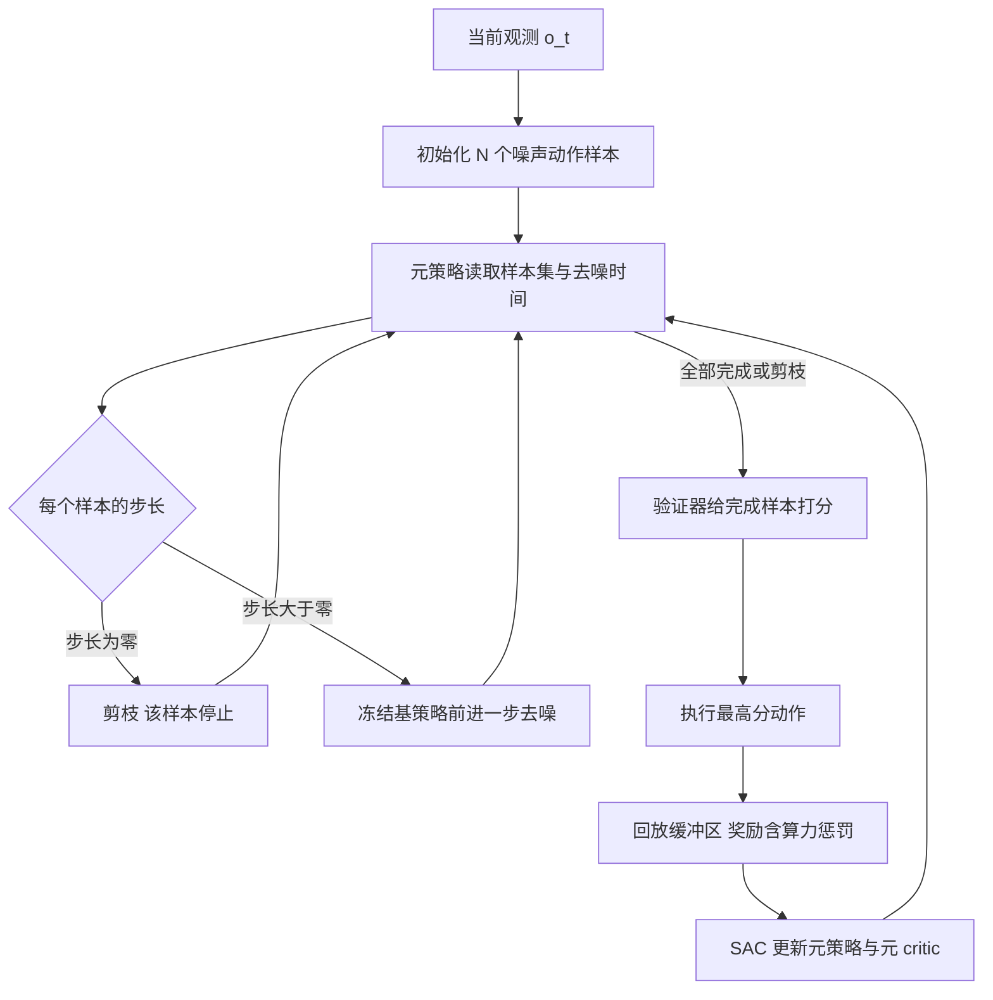

# ELASTIC：为生成式控制策略学习自适应的测试时算力分配（arXiv:2606.31132）

**ELASTIC**（*Efficiently Learning to Adaptively Scale Test-Time Compute for Generative Control Policies*，Li, Swamy, Bisk, Bajcsy，CMU，[arXiv:2606.31132](https://arxiv.org/abs/2606.31132)，v1 2026-06-30）。本页依据 v1 全文撰写，详见 [来源归档](../../sources/papers/elastic_arxiv_2606_31132.md)。

## 一句话定义

**一个训练在冻结基策略之上的「元策略」：在扩散 / 流式动作生成的每个去噪迭代里，逐状态决定每个并行样本走多大步长（顺序轴）或直接停掉（并行轴剪枝），目标是在任务成功与算力（延迟）之间取得更好的折中（论文 §4）。**

## 英文缩写速查

| 缩写 | 英文全称 | 简要说明 |
|------|----------|----------|
| GCP | Generative Control Policy | 以迭代去噪方式生成动作块的策略，含扩散策略与流式 VLA（§3） |
| VLA | Vision-Language-Action | 视觉-语言-动作模型，此处为 π0.5 |
| MDP | Markov Decision Process | 马尔可夫决策过程；元 MDP 的「动作」是去噪步长 |
| BoN | Best-of-N | 并行采 N 个样本并由验证器选最优 |
| SAC | Soft Actor-Critic | 训练元策略所用的离策略 RL 算法（§4.3） |
| FiLM | Feature-wise Linear Modulation | 用物理状态调制基策略观测嵌入的条件化层 |
| DDIM | Denoising Diffusion Implicit Models | 扩散策略默认 10 步采样器（附录 7.5.1） |
| V-GPS | Value-Guided Policy Steering | 论文在 VLA 实验里微调为验证器的价值函数（§5.3） |
| CQL / Cal-QL | (Calibrated) Conservative Q-Learning | 训练验证器的保守 Q 学习（附录 7.5.2） |

## 为什么重要

- 测试时扩展在机器人里直接变成控制延迟：顺序轴增加去噪步数，并行轴受限于板载并行度与显存带宽（§1）。现有方法通常把算力固定在保守设定（§1）。
- 论文的出发点是最优分配随任务、状态、策略能力而变，例如逼近抓取阶段需要更多顺序精修，模式有歧义时更需要并行探索（摘要、§1）。
- 学习目标不要求访问基策略的训练数据，基策略保持冻结（摘要）。

## 核心原理与流程总览

**元 MDP（§4.1）。** 状态含物理状态 x、N 个部分去噪的动作样本、各样本的去噪时间 τ 与活跃掩码 m。动作是各样本本步前进的 Δτ，Δτ = 0 即永久停止该样本。样本全部去噪完或被剪枝后，验证器 Q_ϕ 在剩余样本中挑最高分的动作执行（算法 1）。

**奖励（§4.2，式 1）。** r = Q_task(x,u) - α·L - β·(P - 1)，其中 L 是最慢样本的去噪长度（顺序成本），P 是时间平均活跃样本数（并行成本）。环境级 Q 函数作为去噪轨迹末端价值，缓解「整条真实回合只有一比特反馈」的信用分配问题。

**训练（§4.3、附录 7.3）。** 用 SAC 训练元策略与元 critic，关键设计：对样本集用注意力（actor 置换等变、critic 置换不变）、集中式 actor / critic 以便样本之间协同剪枝、对基策略观测嵌入做 FiLM；两阶段混合 RL（离线 critic 预训练，再在线），并以反事实子采样扩充回放。

## 工程实践

- **扩散策略任务（§5.1）：** PushT、PushT Obstacle（测试时加入策略看不见但验证器训练数据里可见的障碍）、Robomimic Square PH / MH、Can Paired、Can Reverse（作者把 70% 训练轨迹在拿起后随机时间步反转以加重错误模式）。基策略用原 Diffusion Policy 检查点（PushT、Square），Can 系列自训；验证器为 Bellman 残差最小化训练的两层 MLP（附录 7.5.1）。每任务 200 个固定初始条件；N = 4（Can Reverse 为 8）。
- **VLA（§5.3）：** π0.5 的 LIBERO-10（RTX 4090）与 Franka + π0.5-DROID 真机（RTX 6000）；元策略条件于 π0.5 观测嵌入（无特权状态）；验证器为微调的 V-GPS，真机用 Cal-QL，否则分不开选错杯子的失败模式（附录 7.5.2）。
- **超参（§5.3、附录 7.6）：** 仿真 α = 0.13、β = 0.1；真机测 (0.13,0.1)、(0.2,0.1)、(0.13,0.2)；真机用 60 条离线 demo 与 30 次在线 rollout；延迟为客户端 infer() 往返时间，含元策略、基策略与验证器（附录 7.4）。
- **学到的行为（§5.2，作者自述）：** Can Paired 中拿起阶段顺序步数升高，模式分叉处并行样本升高，之后两轴都回落；Square MH 比 PH 整体分到更多算力。

## 与清单说法的核对

清单（Glen Berseth CoRL 2026 阅读清单，序号 043，P1）对本文的一句话摘要为「Learns to allocate test-time compute between more denoising steps and more parallel samples for diffusion and flow VLA policies, per state」。该摘要由 LLM 据摘要起草，排序是清单作者按自己研究兴趣打分，不代表论文质量。逐项核对：

| 清单说法 | 论文实际 | 判断 |
|----------|----------|------|
| 在更多去噪步与更多并行样本之间分配算力 | 属实：顺序轴步长 + 并行轴剪枝，由元策略联合决定（§4.1） | 对得上 |
| per state（逐状态） | 属实：元策略以状态与去噪状态为输入（§4.1），§5.2 给出分配时间线；但元策略按任务训练（§6） | 基本对得上，需补「按任务训练」 |
| diffusion 与 flow VLA 策略 | 扩散策略（DDIM）全部在仿真；只有 π0.5（基于流的 VLA）一个 VLA，且真机仅一个双杯子任务（§5.3） | 概括偏宽，实验覆盖面比摘要措辞窄 |
| 「学习」得到的分配 | 属实，SAC 训练元策略，基策略冻结（§4.3） | 对得上 |
| 未提及的限定 | 依赖学得的验证器 Q_ϕ；扩散策略实验用低维特权状态；成果以「匹配算力的 Pareto」与「延迟 -34%（对 BoN）」表述；LIBERO-10 上基策略已很强，增益有限（图 11） | 清单摘要略去 |

## 局限

**论文自述（§6）：**
- 主要瓶颈是学得的验证器 Q_ϕ；噪声验证器会削弱元策略优化与并行扩展的效果。
- 元策略按任务训练，对多任务 VLA 代价高；能否泛化到未见环境尚未检验。
- 附录 7.5.1 还提到元策略在部分任务上会利用验证器漏洞（验证器给高分但真实回报差），靠 LayerNorm 与保守 Q 正则缓解。

**我读到的未验证之处（作者判断与论文分开）：**
- 真机只有一个任务、每方法 20 次，基策略 45%；样本量小，没有给置信区间。图 5 的成功率只能从散点图读出（读图约 80% 上下，推测，非论文文字数值）。
- 扩散策略结果以散点图呈现，正文没有成功率表，增益大小需看图；比较的 Fixed 以 ELASTIC 自己的平均 (L,P) 定算力，验证器与基策略相同。
- LIBERO-10 上各方法成功率相近（图 11），仅在任务 8、9 有可见差异，该实验更多说明延迟可以降，而非成功率可以升。
- 论文没有给出代码链接，复现细节只能依赖附录。
- 本节「VLA 加速」只在 π0.5 一种架构上验证，不能外推到其他 VLA。

## 关联页面

- [Diffusion Policy（方法）](../methods/diffusion-policy.md) 与 [Diffusion Policy 论文页](./paper-diffusion-policy.md)：本文的基策略之一
- [VLA 方法页](../methods/vla.md)、[π0.5 论文页](./paper-pi05-open-world-vla.md)：真机与 LIBERO 的基策略
- [SAC](../methods/sac.md)：元策略训练算法
- [基于价值的强化学习](../methods/value-based-reinforcement-learning.md)：验证器与 Q 函数
- [奖励设计](../concepts/reward-design.md)：式 1 的任务项与算力惩罚组合
- [FASTER（价值引导的快速采样）](./paper-faster.md)：本文相关工作中对比的早停式验证器工作
- [LIBERO 基准](./libero-benchmark.md)
- [TTCO：人形 BFM 的测试时算力](./paper-ttco-test-time-compute-humanoid-bfm.md)：另一条测试时算力线索

## 参考来源

- [来源归档：elastic_arxiv_2606_31132.md](../../sources/papers/elastic_arxiv_2606_31132.md)
- [arXiv:2606.31132](https://arxiv.org/abs/2606.31132)

## 继续阅读

- [arXiv PDF](https://arxiv.org/pdf/2606.31132)
- [FASTER 论文页](./paper-faster.md)
- [Diffusion Policy 论文页](./paper-diffusion-policy.md)
