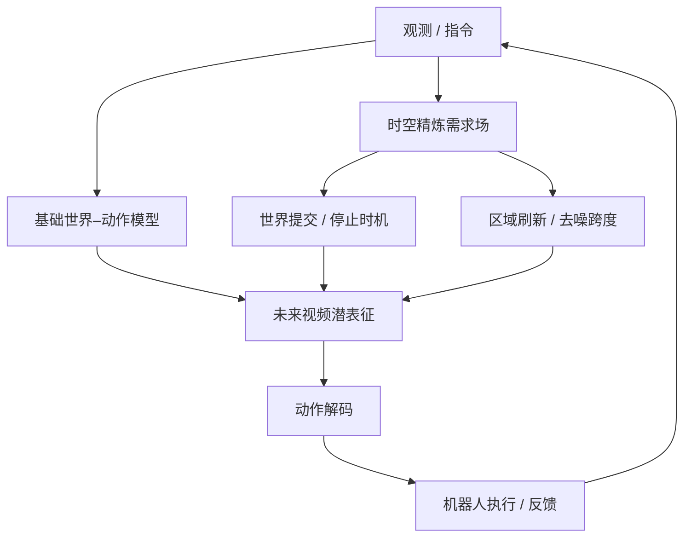

# Elastic-WAM： 自适应时空想象的高效机器人控制

## 一句话定义

Elastic-WAM 是为世界–动作模型动态分配视频未来想象计算的控制方法，决定何时停止、做多少步、更新哪些区域。

## 英文缩写速查

| 缩写 | 英文全称 | 简要说明 |
|---|---|---|
| WAM | World Action Model | 视频未来与机器人动作耦合模型 |
| KV | Key-Value Cache | 复用注意力键值中间状态 |
| OOD | Out of Distribution | 分布外任务/对象测试 |
| RL | Reinforcement Learning | 机器人学习评测中的常见训练范式 |

## 为什么重要

视频扩散通常是 WAM 的计算瓶颈，固定时空分辨率和固定去噪步数对所有场景一视同仁；该方法为不同区域和阶段分配不同计算量。

## 核心原理

在预训练世界–动作模型之上，学习时空精炼需求场，将 196 个未来 token 划分为 64 组，以共享 Beta 时间基和组级权重表示各区域的精炼需求。用共享时间分布和区域权重指导未来去噪的停止时机（world commit）、采样/精炼跨度以及局部 token 刷新；与缓存复用配合，随后动作模块读取已完成的未来表征生成控制。

## 流程总览

> **注意：** 此图仅抽象论文所述方法模块与数据/控制流，非未公开代码的实际调用路径。

## 实验与评测

论文列出 LIBERO 98.8%、LIBERO-Plus 73.7%、LIBERO-Pro 54.1%；RoboCasa-GR1 成功率 57.4%，相应推理约 388.2ms，所比较 Joint-WAM 为 55.0% / 572.6ms。RoboCasa 上并非比所有优化基线都快，Fast-WAM 在论文对比中约 331ms。真实机器人茶饮等任务展示了不同干扰条件下的表现，仍需结合任务表看泛化。

## 结论

**Elastic-WAM 强调模型该花多少时间、在哪些区域预测未来应由当前交互需求决定，而不是固定全帧扩散预算。**

1. 对照相同骨干模型和硬件报告实际时延。
2. 关注世界预测误差与动作闭环成功率的取舍，而非仅用视频指标。
3. 单独检验快速接触变化时稀疏区域更新是否遗漏关键信息。
4. 目前未核实到完整可运行官方仓库。

## 与其他工作对比

[MetaWAM](paper-metawam.md) 以频域元帧建立视频–动作统一输入，而 LaST0.5 通过交互中心潜变量连接世界与动作专家。

## 源码运行时序图

官方项目主页未提供已核实的可运行源码仓库或训练、推理入口；暂不绘制源码调用时序图。

## 工程实践

论文附录披露精炼需求场默认 196 future token 分成 64 组、每次稀疏刷新 K=96 token、commit 阈值 0.5；真机两台 xArm7 评测的是同一项 4 阶段泡茶任务，每个条件 20 次测试，不是多任务泛化证明。[原文归档](../../sources/papers/elastic-wam_arxiv_2611_14257.md)。

优先在同一 GPU、同一动作块与相同精度条件下测量世界去噪耗时、动作输出时延及成功率，分别消融时空需求场、局部更新、KV 缓存机制。项目主页未发现公开可运行仓库或官方权重；论文测速使用 NVIDIA H800，不能将结果当成跨 GPU 的统一延迟。

## 局限与风险

方法与底座 WAM 和区域粒度耦合，稀疏刷新有遗漏关键接触变化的风险；速度不能在不同 GPU/模型的表格间直接比较；代码待公开。

## 关联页面

- [World Action Models](../concepts/world-action-models.md)
- [MetaWAM](paper-metawam.md)
- [LaST0.5](paper-last05.md)
- [VLA](../methods/vla.md)

## 参考来源

- [arXiv:2611.14257 归档](../../sources/papers/elastic-wam_arxiv_2611_14257.md)
- [官方项目页核验](../../sources/sites/elastic-wam.md)

## 推荐继续阅读

- [论文原文](https://arxiv.org/abs/2611.14257)
- [项目主页](https://lihaitian.com/Elastic-WAM/)

> **复核状态（2026-11-12）：** 已通读并核对 arXiv v1 HTML 正文、实验与附录，数据均按作者论文口径记录；本次未独立复现其训练、推理、性能指标。
