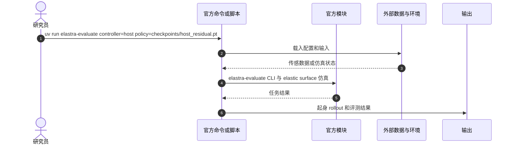

# Elastra: A Simulation Framework for Elastic Bodies｜Elastra：弹性床面与蹦床的机器人起身仿真

## 一句话定义

**Elastra：弹性床面与蹦床的机器人起身仿真**：将床垫/蹦床建模为竖向运动的弹性单元，训练起身控制器在软地面上的残差修正。

## 英文缩写速查

| 缩写 | 英文全称 | 简要说明 |
|---|---|---|
| PPO | Proximal Policy Optimization | 近端策略优化 |
| HoST | Humanoid Standing-up Transformer | 人形起身控制器 |
| RL | Reinforcement Learning | 强化学习 |

## 为什么重要

将床垫/蹦床建模为竖向运动的弹性单元，训练起身控制器在软地面上的残差修正。 比起单一 benchmark 排名，研究与工程落地需要分清楚是否具有动作控制闭环、是否能复现以及硬件/数据前提。

## 核心信息

| 条目 | 原始证据 |
|---|---|
| 论文 | [arXiv:2611.15112v1](https://arxiv.org/abs/2611.15112) |
| 开源入口 | [官方源码](https://github.com/yichg/elastra)（详见源码归档的部分/整体边界） |

## 核心原理

相邻竖直弹性 cell 以弹簧、弯曲与阻尼表示可恢复形变；用外部连续模型、压痕数据与 Warp 独立实现核验表面响应；在既有 HoST/ProtoMotions 控制器上用 PPO 训练残差策略。

### 流程总览

流程图来自一手论文方法链；与实际源码包之间的映射如下。

## 源码运行时序图

源码运行入口按 [README 和脚本核对归档](../../sources/repos/elastra-2611-15112.md) 标注，以下只代表已发布模块的调用范围。

## 工程实践

1. 依据原文方法核对输入传感器、控制/评估接口、样本分布及实验硬件。
2. 执行前检查[源码归档](../../sources/repos/elastra-2611-15112.md)提到的实际可运行入口、外部依赖与许可。
3. 将论文成绩、真机误差、系统延迟与安全要求分开验收，复现前明确失败标准。

## 实验与评测

采用原有起身控制器与多个床垫、蹦床弹性参数在仿真中比较任务达成；载荷–位移和独立模拟交叉核验物理响应，不是实机起身测试。

## 结论

**将床垫/蹦床建模为竖向运动的弹性单元，训练起身控制器在软地面上的残差修正。**

1. 保留相同模型与数据预算下的可比口径，不跨基准简单求平均。
2. 优先复核最可能出现数据泄漏、接触失败或部署延迟的环节。
3. 对论文未检验的部署条件单列验证计划。

## 与其他工作对比

- **对比体积有限元软体仿真（MuJoCo flex / Isaac Sim PhysX 软体，§2）：** 对 0.1 m 接触斑块大小的床垫，传统体积线性有限元网格需约 `10⁴` 自由度以捕捉局部压陷；Elastra 将表面简化为仅保留单竖直自由度 + 弯曲与阻尼耦合的弹性单元，仅用 **380 个自由度**即可显式输出表面高度状态并满足大规模并行 RL 吞吐，且已与独立 Warp 求解器和解析弹簧定律对照标定静态/动态响应（§5）。
- **对比冻结预训练刚体起身基线（[HoST](./paper-host-humanoid-standingup.md) 与 ProtoMotions 跟踪器，§6）：** 在刚性地面与三款较硬床垫上，原始 HoST 与残差策略均能稳定起身（95–96/96）；但在软床垫（`α=8` / `α=4`）上，加残差后 HoST 成功率分别由 **25% → 94%**、**6.3% → 45%**，在蹦床上由 **55% → 89%**（`α=1`）和 **50% → 88%**（`α=2`）。在 400 次未见跌倒姿态测试中，ProtoMotions 总体起身成功率由 **19.0% 提至 45.0%**（两款蹦床分别由 10%/15% 升至 52.5%/60%），但全部为仿真验证。

## 局限与风险

竖向弹性单元无法涵盖所有三维接触与侧向滑移；当前起身效果只在模拟 G1 和固定初始姿态分布上验证。

## 关联页面

- [本期 29 篇具身论文选型地图](../overview/embodied-frontier-29-papers-2026-11-16.md)
- [ManiLadder：任务难度分层评测](./paper-maniladder-manipulation-benchmark.md)
- [Residual Policy Learning（残差策略学习）](../methods/residual-policy-learning.md)：Elastra 在预训练刚体人形起身控制器之上用 PPO 训练残差策略，使既有起身策略能够适应床垫与蹦床等弹性支撑面的形变响应。
- [Robot Simulation Integration · 机器人仿真环境集成](../methods/robot-simulation-integration.md)：Elastra 将竖向弹性单元模型集成进 MuJoCo 仿真并与 HoST 及 ProtoMotions 控制接口对接，形成可运行与评测的软地面起身验证环境。

## 参考来源

- [原论文核对归档](../../sources/papers/elastra-2611-15112.md)
- [源码及运行入口](../../sources/repos/elastra-2611-15112.md)

## 推荐继续阅读

- [arXiv HTML](https://arxiv.org/html/2611.15112v1)
- [官方源码仓](https://github.com/yichg/elastra)
