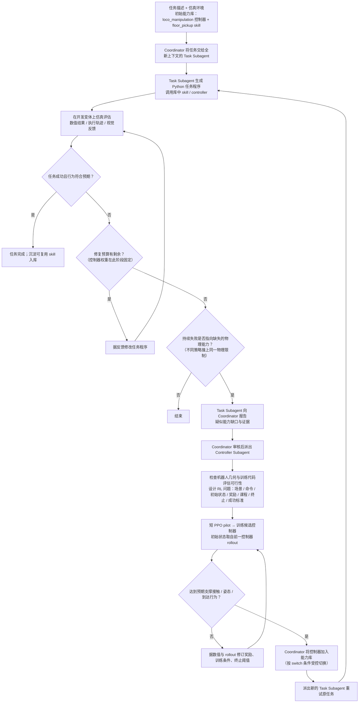

# ELEVATE（arXiv:2610.38388）

**ELEVATE**（*ELEVATE: Agentic Controller Acquisition from Task Failure for Quadrupedal Manipulation*，[arXiv:2610.38388](https://arxiv.org/abs/2610.38388)，[项目页](https://agentic-quad-elevate.github.io/public/)）来自 [具身智能小站 2026-10-30 盘点](../../sources/blogs/wechat_embodied_station_28_papers_event2reward_progress_rewards_2026-10-30.md)，属「运动控制与落脚」组。

## 一句话定义

**ELEVATE 将持续任务失败作为寻找缺失全身控制能力的信号，再获取新控制器并更新任务程序。**

## 英文缩写速查

| 缩写 | 英文全称 | 简要说明 |
|------|----------|----------|
| ELEVATE | ELEVATE: Agentic Controller Acquisition from Task Failure for Quadrupedal Manipulation | 本文方法 / 基准的简称 |

## 为什么重要

- 反复失败后，为四足机械臂补齐控制能力。方法面向超出初始工作空间的操作，真机迁移证据限定在所测任务和平台。
- 开源结论：**项目页未列 GitHub**（步骤 2.5，2026-10-30）。项目页 HTTP 200，未列 GitHub，也无 coming soon 字样（脚本扫描）。
- 同期同组工作见 [进度奖励、接触监督与规划验证：具身智能小站 10-30 期 28 篇阅读坐标](../overview/embodied-station-2026-10-30-28-papers-technology-map.md)。

## 流程总览

图依据：论文 §III（III-A/B/C）、Fig. 2 / Fig. 3、Table I；“结束”分支（无缺口时）为按 Fig. 2 判定框的读法。

## 核心机制

| 项 | 内容 |
|----|------|
| **arXiv** | [2610.38388](https://arxiv.org/abs/2610.38388) |
| **开源** | **项目页未列 GitHub** |
| **要点** | ELEVATE 将持续任务失败作为寻找缺失全身控制能力的信号，再获取新控制器并更新任务程序。 |
| **文内指标** | 公众号转述：方法面向超出初始工作空间的操作，真机迁移证据限定在所测任务和平台。 |

## 源码运行时序图

**不适用（项目页未列 GitHub）** — 项目页 HTTP 200，未列 GitHub，也无 coming soon 字样（脚本扫描）。 不编造运行脚本；代码公开后再补。

## 实验与评测

- 公众号转述：方法面向超出初始工作空间的操作，真机迁移证据限定在所测任务和平台。
- **读法：** 本页为索引级摘要，依据公众号转述的官方摘要与仓库信息整理；逐项数字与 baseline 以原文 PDF 为准。

## 与其他工作对比

- 横向索引见 [进度奖励、接触监督与规划验证：具身智能小站 10-30 期 28 篇阅读坐标](../overview/embodied-station-2026-10-30-28-papers-technology-map.md)；同 arXiv 不重复造页。

## 结论

**反复失败后，为四足机械臂补齐控制能力：方法面向超出初始工作空间的操作，真机迁移证据限定在所测任务和平台。**

1. 开源边界：**项目页未列 GitHub** — 项目页 HTTP 200，未列 GitHub，也无 coming soon 字样（脚本扫描）。
2. 核心机制：ELEVATE 将持续任务失败作为寻找缺失全身控制能力的信号，再获取新控制器并更新任务程序。
3. 复现与选型前核对任务协议、硬件与基准口径，勿直接横比公众号摘录数字。

## 关联页面

- [locomotion](../tasks/locomotion.md)
- [reinforcement-learning](../methods/reinforcement-learning.md)
- [sim2real](../concepts/sim2real.md)
- [embodied-station-2026-10-30-28-papers-technology-map](../overview/embodied-station-2026-10-30-28-papers-technology-map.md)

## 参考来源

- [elevate_arxiv_2610_38388.md](../../sources/papers/elevate_arxiv_2610_38388.md)
- [wechat_embodied_station_28_papers_event2reward_progress_rewards_2026-10-30.md](../../sources/blogs/wechat_embodied_station_28_papers_event2reward_progress_rewards_2026-10-30.md)
- [arXiv:2610.38388](https://arxiv.org/abs/2610.38388)
- [arXiv PDF](https://arxiv.org/pdf/2610.38388)：已通读方法部分（实验与附录以略读为准）：摘要、§I、§II、§III（A–C，Fig. 2/3、Table I）、§IV-A 实验设定，附录仅略读标题

## 推荐继续阅读

- [arXiv PDF](https://arxiv.org/pdf/2610.38388)
- [项目页](https://agentic-quad-elevate.github.io/public/)
