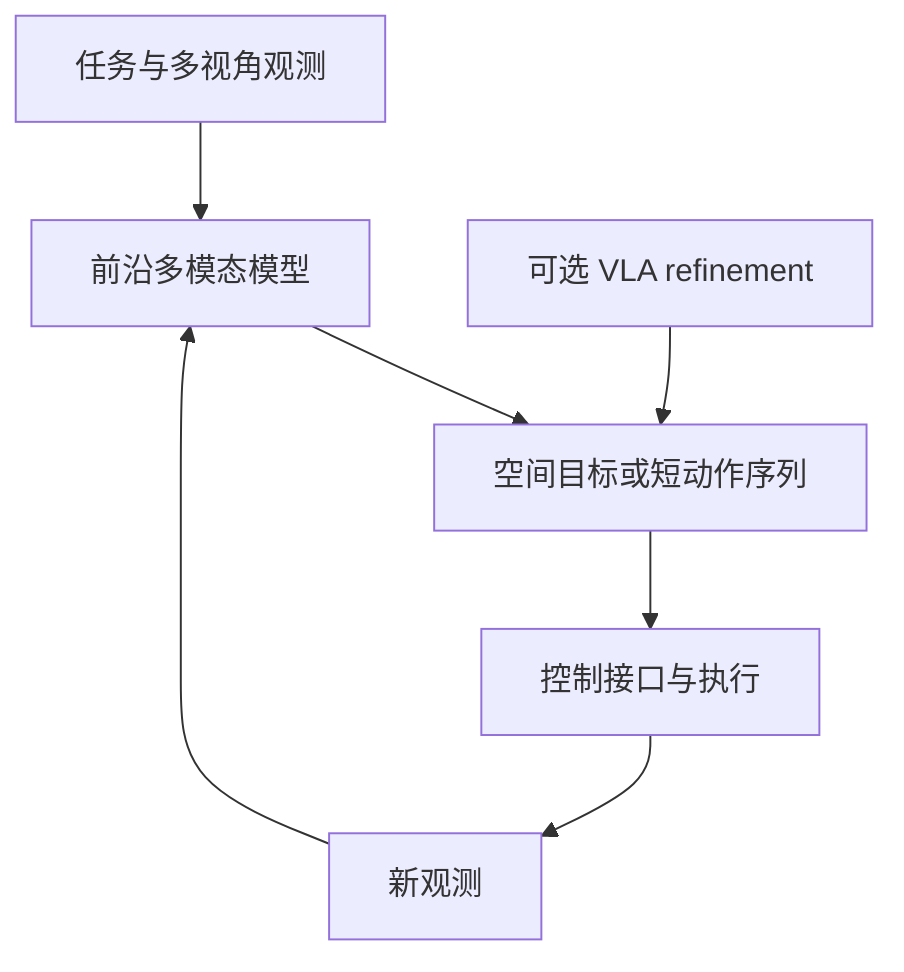
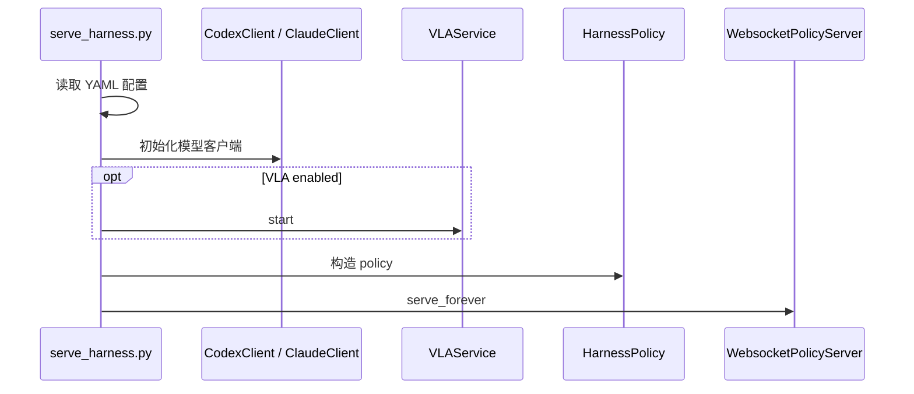

# Embo-Harness: Towards Understanding Frontier-Model-as-Policy Harness｜前沿多模态模型直接作为机器人策略的执行框架

## 一句话定义

研究视觉输入、规划、动作执行和工具接口如何影响前沿多模态模型直接闭环控制机器人的表现。

## 英文缩写速查

| 缩写 | 英文全称 | 简要说明 |
|---|---|---|
| EEF | End Effector | 末端执行器 |
| IK | Inverse Kinematics | 逆运动学 |
| VLA | Vision-Language-Action | 视觉语言动作模型 |

## 为什么重要

同一个前沿模型换用不同的相机输入、动作表示和低层执行接口，闭环表现也会显著变化。应把模型选型与执行框架消融分开，不能把端到端成绩全部归因于模型权重。

## 核心信息

| 项目 | 内容 |
|---|---|
| 机构 | 南洋理工大学 S-Lab、ACE Robotics、商汤研究院、厦门大学、联想机器人实验室、康涅狄格大学 |
| 发布 | 2026-11-23（v1） |
| 原文 | [arXiv:2611.31201](https://arxiv.org/abs/2611.31201) |
| 项目 | [主页](https://dravenalg.github.io/projects/Embo-Harness/) |
| 源码 | [GitHub](https://github.com/DravenALG/Embo-Harness) |

## 核心原理

实验逐步考察动作空间与 chunk、推理强度、隐式规划、图像分辨率与多视角、短多动作工具和 VLA refinement。闭环模型依据当前观测选择空间目标；IK 或控制接口执行目标，下一次观察再修正。作者的干预实验支持空间定位精度的重要性，而非证明低层动作学习无价值。

## 流程总览

## 源码运行时序图

`python scripts/serve_harness.py --config config/harness/robolab.yaml`：读取配置，构造 CodexClient/ClaudeClient，可选 VLAService，构造 HarnessPolicy 后启动 WebsocketPolicyServer。README 另给 RoboLab client 与批量启动脚本；未运行。 此图仅覆盖已核对入口，内部完整调用关系待复核。

## 评测与实验

论文 Table 2：RoboLab-120 SR 83.3%、Score 89.2；SenseNova-RoboRSI 为 57.1%、69.9。Table 3 真机四任务依次 5/5、5/5、2/5、3/5，共 15/20。开发子集与完整基准不可混用。

## 工程实践

复测时单独记录任务成功率、子任务得分、定位误差和执行时间。§3 用 20 个任务、每任务三次的开发子集逐步选项，完整 RoboLab-120 是另一组结果。双视角和较高分辨率优先检验；固定 8 步动作块只是在该设置胜出，不是通用默认。若评估 VLA 接入，分别测试模型选择委派与模型修正 VLA 提案：论文中前者更快但表现下滑，后者最佳。

## 对比

Table 1 的开发子集中，单视角 30.0% 对比双视角 65.0%；Table 4 在其对照条件下直接关节生成 20.0%，IK 辅助 43.3%。结果支持让模型给出空间目标并把数值执行交给控制接口，不是低层动作无需学习的证明。与 [Motion Mamba 2.0](./paper-motion-mamba-2.md) 对比，前者闭环选择操作目标，后者合成身体运动参考，由跟踪控制器执行；两者不在同一控制层。

## 结论

当前证据支持将此工作作为相应方法的工程参考，而非通用真机性能保证。

- 先比较空间目标与低层动作接口。
- 分别报告开发子集和完整基准。
- 将真机样本量与许可边界纳入选型。

## 局限与风险

真机任务仅 20 次；精细定位和对齐仍易失败。模型调用时间、成本与闭环控制频率须另评。官方代码采用 NTU S-Lab License 1.0，用户提供的非商业条款仍待 LICENSE 全文核验。

## 关联页面

- [视觉语言动作模型](../methods/vla.md)：论文把 VLA 提案修正与把动作选择交给 VLA 分别消融。
- [移动操作任务](../tasks/loco-manipulation.md)：本文主要验证桌面抓手操作，不能据此外推到全身移动操作。
- [具身大模型评测基准选型闭环](../queries/embodied-eval-benchmark-selection-loop.md)：按评测任务和接口区分仿真与真机证据。
- [paper-uni-robot-agent](./paper-uni-robot-agent.md)
- [paper-worldleague](./paper-worldleague.md)
- [纵深路线](../../roadmap/depth-vla.md)

## 推荐继续阅读

- [官方项目](https://dravenalg.github.io/projects/Embo-Harness/)

## 参考来源

- [论文归档](../../sources/papers/embo-harness.md)
- [项目页归档](../../sources/sites/embo-harness.md)
- [源码归档](../../sources/repos/embo-harness.md)
