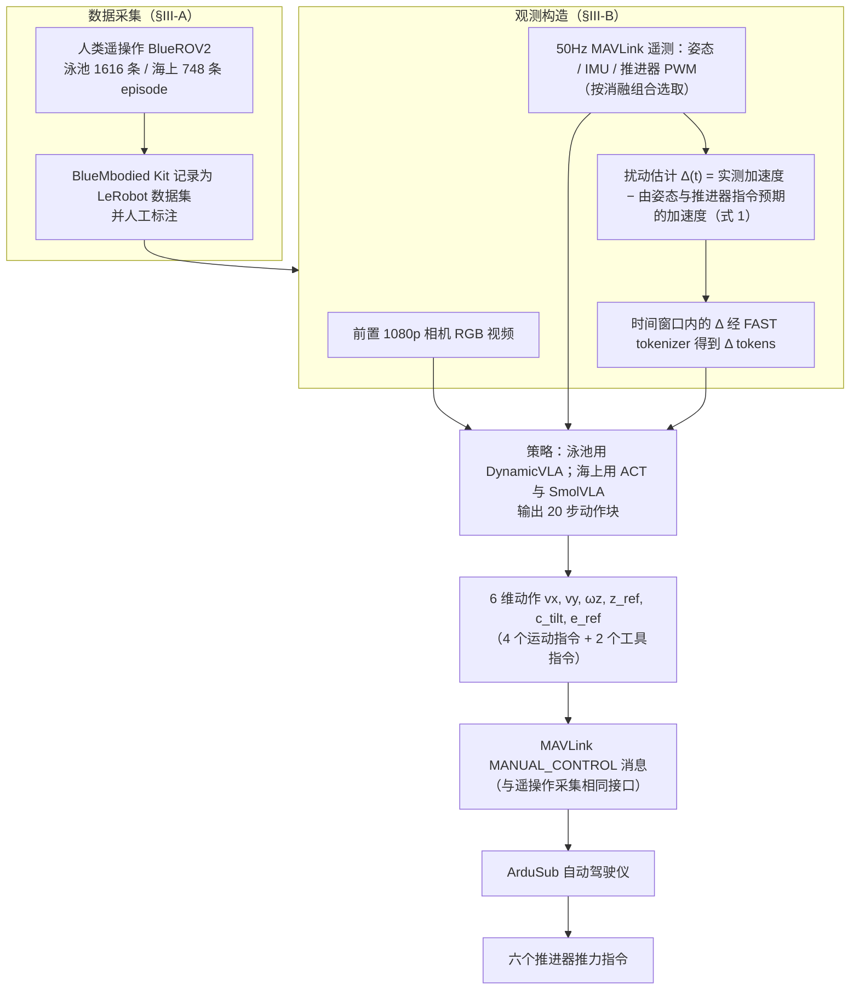

# Embodied at Sea（arXiv:2610.38199）

**Embodied at Sea**（*Embodied at Sea: Imitation Learning for Multi-Task Underwater Manipulation*，[arXiv:2610.38199](https://arxiv.org/abs/2610.38199)，[项目页](https://lair-research-nyu.github.io/Embodied-at-Sea/)）来自 [具身智能小站 2026-10-30 盘点](../../sources/blogs/wechat_embodied_station_28_papers_event2reward_progress_rewards_2026-10-30.md)，属「示范数据与评测」组。

## 一句话定义

**研究比较水下操作中的观测设计和策略架构，并报告海域作业案例。**

## 英文缩写速查

| 缩写 | 英文全称 | 简要说明 |
|------|----------|----------|
| Embodied at Sea | Embodied at Sea: Imitation Learning for Multi-Task Underwater Manipulation | 本文方法 / 基准的简称 |

## 为什么重要

- 把模仿学习带入泳池与真实海域。泳池最优模型的总体成功口径包含部分成功，不能与真实海域的任务成功率直接合并。
- 开源结论：**待发布**（步骤 2.5，2026-10-30）。项目页 HTTP 200，Paper、Code、Dataset 均标注 Coming soon。
- 同期同组工作见 [进度奖励、接触监督与规划验证：具身智能小站 10-30 期 28 篇阅读坐标](../overview/embodied-station-2026-10-30-28-papers-technology-map.md)。

## 流程总览

图依据：论文 §III-A/B（数据、观测与动作空间、Eq. 1）、Fig. 6 图注；“20 步动作块”仅来自 Table I 图注。

## 核心机制

| 项 | 内容 |
|----|------|
| **arXiv** | [2610.38199](https://arxiv.org/abs/2610.38199) |
| **开源** | **待发布** |
| **要点** | 研究比较水下操作中的观测设计和策略架构，并报告海域作业案例。 |
| **文内指标** | 公众号转述：泳池最优模型的总体成功口径包含部分成功，不能与真实海域的任务成功率直接合并。 |

## 源码运行时序图

**不适用（待发布）** — 项目页 HTTP 200，Paper、Code、Dataset 均标注 Coming soon。 不编造运行脚本；代码公开后再补。

## 实验与评测

- 公众号转述：泳池最优模型的总体成功口径包含部分成功，不能与真实海域的任务成功率直接合并。
- **读法：** 本页为索引级摘要，依据公众号转述的官方摘要与仓库信息整理；逐项数字与 baseline 以原文 PDF 为准。

## 与其他工作对比

- 横向索引见 [进度奖励、接触监督与规划验证：具身智能小站 10-30 期 28 篇阅读坐标](../overview/embodied-station-2026-10-30-28-papers-technology-map.md)；同 arXiv 不重复造页。

## 结论

**把模仿学习带入泳池与真实海域：泳池最优模型的总体成功口径包含部分成功，不能与真实海域的任务成功率直接合并。**

1. 开源边界：**待发布** — 项目页 HTTP 200，Paper、Code、Dataset 均标注 Coming soon。
2. 核心机制：研究比较水下操作中的观测设计和策略架构，并报告海域作业案例。
3. 复现与选型前核对任务协议、硬件与基准口径，勿直接横比公众号摘录数字。

## 关联页面

- [embodied-data-collection-four-layers-taxonomy](../concepts/embodied-data-collection-four-layers-taxonomy.md)
- [imitation-learning](../methods/imitation-learning.md)
- [simulation-evaluation-infrastructure](../concepts/simulation-evaluation-infrastructure.md)
- [embodied-station-2026-10-30-28-papers-technology-map](../overview/embodied-station-2026-10-30-28-papers-technology-map.md)
- [Query：具身大模型评测基准选型](../queries/embodied-eval-benchmark-selection-loop.md)

## 参考来源

- [embodied_at_sea_arxiv_2610_38199.md](../../sources/papers/embodied_at_sea_arxiv_2610_38199.md)
- [wechat_embodied_station_28_papers_event2reward_progress_rewards_2026-10-30.md](../../sources/blogs/wechat_embodied_station_28_papers_event2reward_progress_rewards_2026-10-30.md)
- [arXiv:2610.38199](https://arxiv.org/abs/2610.38199)
- [arXiv PDF](https://arxiv.org/pdf/2610.38199)：已通读方法部分（实验与附录以略读为准）：§I–II 略读、§III（数据采集、模型、观测/动作空间）、§IV 表题与图注

## 推荐继续阅读

- [arXiv PDF](https://arxiv.org/pdf/2610.38199)
- [项目页](https://lair-research-nyu.github.io/Embodied-at-Sea/)
