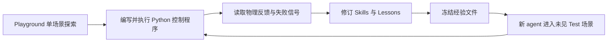
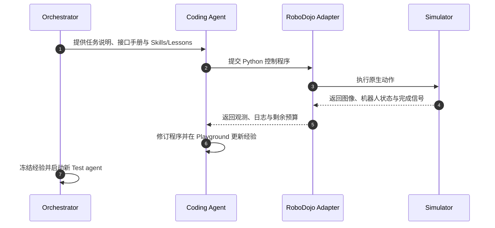

# EmbodiedEvo：让 coding agent 把具身交互经验变成可复用程序

**EmbodiedEvo**（*Self-Evolving Coding Agent For Physical Intelligence*，[arXiv:2610.18867](https://arxiv.org/abs/2610.18867)，[项目页](https://lab.einsia.ai/embodiedevo/)，[源码](https://github.com/Einsia/EmbodiedEvo)；Navers Lab、Einsia AI、清华大学）研究一种具身 agent harness 演进方式：模型权重、任务目标和机器人接口固定，agent 将 Playground 交互经验保存为 Skills / Lessons，再冻结并交给新 agent 在未见场景复用。

## 一句话定义

**EmbodiedEvo 将交互中的可执行操作与适用条件分别固化为代码技能和诊断经验，让新 agent 带着经验进入新场景，并继续通过闭环反馈调整当前控制程序。**

## 英文缩写速查

| 缩写 | 英文全称 | 简要说明 |
|------|----------|----------|
| LLM | Large Language Model | 生成并修订 Python 控制程序的 agent 模型 |
| RGB | Red, Green, Blue | 机器人相机提供的彩色图像观测 |
| SR | Success Rate | RoboDojo 测试场景的任务成功率 |
| API | Application Programming Interface | agent 查询状态、执行动作和重置场景的固定接口 |

## 核心信息

| 字段 | 内容 |
|------|------|
| **机构** | Navers Lab、Einsia AI、清华大学（Tsinghua University） |
| **论文** | [arXiv:2610.18867 v2](https://arxiv.org/abs/2610.18867)（2026-10-14） |
| **环境** | RoboDojo-Sim；单任务一个 Playground 场景采集经验，再在未见 Test 布局评测 |
| **自我改进对象** | harness 中的 Skills / Lessons；实验不更新模型权重或固定机器人 primitive |
| **开源** | **源码公开，许可与复现有边界：** 官方仓库提供运行入口，但尚无项目级许可证；需单独配置 RoboDojo / Isaac Sim 资产、GPU 和模型凭据。见[项目页归档](../../sources/sites/embodied-evo.md)与[源码归档](../../sources/repos/embodied-evo.md) |
| **接口观测** | RGB、关节状态、末端位姿和夹爪命令状态；不直接提供物体真值位姿、深度图或相机标定 |

## 为什么重要

- **把单回合调试变成跨场景经验：** 一个场景发现的 grasp / carry 操作和失败条件不必随 episode 结束而丢失。
- **同时保存做法和适用边界：** Skills 描述如何组合固定动作原语；Lessons 记录何时适用、观察到的失败和恢复建议。
- **可以跨模型传经验：** Astra 探索得到的经验帮助 Sol、Luna 等较弱执行器，说明经验获取能力与经验使用能力可分开评估。
- **改善的是起点而非底层动作能力：** 新 agent 仍需观察、执行程序并处理反馈，精确接触操作仍是短板。

## 方法栈

### 两级程序化机器人接口
- **L1 环境原语：** get_instruction、get_observation、step、reset。观测含图像与机器人状态；底层控制器处理逆运动学和插值。reset 仅在 Playground 开放。
- **L2 可执行程序：** agent 组合 Python 变量、函数、循环和条件分支，形成一个或多个原生动作组成的控制片段；执行后读取图像、状态、输出、错误和完成信号，再决定是否修改程序。
- **固定与可变部分：** robot interface 与原语固定；Playground 可修改控制代码和 Skills / Lessons；Test 中经验只读，但控制代码仍可针对场景反馈调整。

### 流程总览

流程的关键是经验跨回合保留、测试场景彼此隔离：Test agent 每次从冻结经验开始，场景内继续闭环适配，但不写回共享经验或 reset 重试同一场景。

## 源码运行时序图

仓库 README 将 freeze/Test 生命周期放在 orchestrator，将 Python 执行和 RoboDojo 适配放在 environments、simulators；该图描述论文的运行时交互，不代表训练模型权重的过程。

## 实验与评测
项目页 **2026-10-09 RoboDojo leaderboard 快照**报告下列结果。各参评系统协议不完全相同，不能解释为严格同条件排名。

| 分组 | 平均分 | 成功率 |
|------|------:|------:|
| 全集 | 44.48 | 37.82% |
| Generalization | 34.12 | 29.67% |
| Precision | 23.65 | 13.25% |
| Long-Horizon | 37.20 | 23.50% |
| Memory | 71.90 | 69.67% |
| Open | 55.52 | 53.00% |

配对实验中，继承经验后成功率从 **8.50%** 提高到 **30.17%**。Astra 经验迁移至 Sol / Luna 后，成功率分别增加 **8.86 / 5.50 个百分点**。Skills / Lessons 与原始交互历史的成功率为 **30.17% / 29.78%**，论文估算每回合成本从 **$12.203** 降至 **$5.732**（下降 53.0%）。

## 与其他工作对比

| 工作 | 改进 / 评测对象 | 经验载体 | 与 EmbodiedEvo 的差异 |
|------|-----------------|----------|------------------------|
| **EmbodiedEvo** | coding agent 的 harness 经验（权重冻结） | 代码 Skills + 诊断 Lessons，冻结后跨场景复用 | — |
| [CodeActionBench](./paper-codeactionbench.md) | 通用 agent 单 episode 内写 / 改控制代码的能力 | 无跨 episode 经验沉淀 | 同属 Code-as-Policy 评测，但只测「当场写对」；EmbodiedEvo 测「经验能否带进新场景」 |
| [RoboHarness](./paper-robo-harness.md) | 异构机器人策略的编排 | 能力路由与交接规则 | 侧重调度已有策略；EmbodiedEvo 让 agent 自己写并积累控制程序 |
| [ASENA](./paper-asena-self-evolving-agents.md) | 具身导航 agent 的自我演进 | 环境反馈驱动的导航经验 | 任务域为导航；EmbodiedEvo 面向操作，经验以可执行代码表示 |

## 结论

**EmbodiedEvo 的贡献是让具身 coding agent 的经验在 harness 中跨场景复用；当前证据支持 RoboDojo 仿真中的迁移，尚未说明精细操作或真机可靠性已解决。**

1. 相近任务复用 Skills 时，检查代码是否含可执行步骤和成功验证条件。
2. 将 Lessons 写为可检验的前置条件、失败信号和恢复动作，并分开记录事实与推测。
3. 评估时隔离 Playground 与未见 Test 场景，避免把同场景记忆误当作泛化。
4. 同时报任务分组成功率、成本和失败类型，总平均值会掩盖接触与长时程短板。
5. 单独测量跨模型迁移；增益仍受底层原语与执行精度约束。
6. 复现前确认 simulator assets、模型凭据和项目许可证；公开源码不表示仿真数据开箱可复现。

## 局限与风险
- **仿真外推：** 报告的基准是 RoboDojo-Sim，不能替代真机验证。
- **接触精度：** Precision 成功率为 13.25%；到达目标位姿不等于稳定抓取或精密接触。
- **长时程：** Long-Horizon 成功率为 23.50%；中间步骤进展不保证最终任务完成。
- **成本口径：** 53.0% 是按论文模型 token 费率估算，不是实际账单保证。
- **开源边界：** 官方源码已公开，但项目级许可证未选定，运行还依赖独立模拟器资产、GPU 和模型服务。

## 关联页面
- [RoboHarness](./paper-robo-harness.md) — 编排异构机器人策略，侧重能力路由与交接。
- [ASENA](./paper-asena-self-evolving-agents.md) — 使用环境反馈改进具身导航 agent，任务和经验表示不同。
- [RAX](./rax-scaling-online-exploration.md) — 冻结 coding agent 经机器人 API 在线探索，再把成功经验编译成可复用的感知—规划—控制程序。
- [行为树 × VLA 编排](../concepts/behavior-tree-vla-orchestration.md) — 具身 agent 的任务分解与执行编排。

## 参考来源
- [论文来源归档](../../sources/papers/embodied_evo_arxiv_2610_18867.md)
- [官方项目页归档](../../sources/sites/embodied-evo.md)
- [官方代码仓归档](../../sources/repos/embodied-evo.md)

## 推荐继续阅读
- [arXiv HTML v2](https://arxiv.org/html/2610.18867v2)
- [项目页与结果展示](https://lab.einsia.ai/embodiedevo/)
- [官方 GitHub 仓库](https://github.com/Einsia/EmbodiedEvo)
