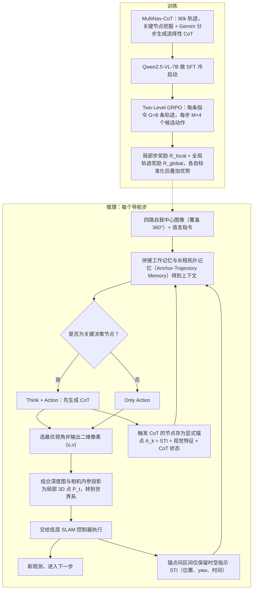
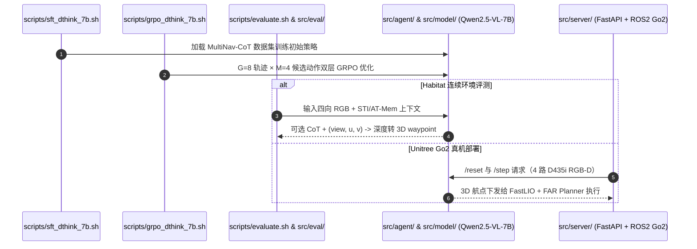

# Embodied-Navigator：用像素目标、选择性推理与记忆做导航

**Embodied-Navigator**（方法名 **TAMP-Nav**；[arXiv:2608.17512](https://arxiv.org/abs/2608.17512)，[项目页](https://zju-omniai.github.io/Embodied-Navigator/)，[代码](https://github.com/ZJU-OmniAI/Embodied-Omni)）由浙江大学与浙江人形机器人创新中心团队提出。它把导航接口、推理调度、长程记忆和策略优化放进同一个 VLN 框架：VLM 在 RGB 图像上选像素目标，深度将其投影为三维 waypoint，低层 SLAM 控制器负责执行。

## 一句话定义

**让 VLM 在熟悉的二维图像空间“指路”，再由几何感知与 SLAM 执行器把像素目标落到三维环境；把思考与高保真记忆留给关键节点。**

## 英文缩写速查

| 缩写 | 英文全称 | 简要说明 |
|------|----------|----------|
| TAMP-Nav | TAMP-Nav | 论文提出的统一 VLN 框架 |
| CoT | Chain-of-Thought | 逐步推理；该方法选择性触发 |
| STI | Space-Time Indicator | 以轻量时空标记压缩冗余轨迹历史 |
| GRPO | Group Relative Policy Optimization | 论文双层策略优化所用算法 |
| VLN | Vision-and-Language Navigation | 视觉与语言条件下的具身导航 |
| SR / SPL | Success Rate / Success weighted by Path Length | 成功率 / 路径长度加权成功率 |

## 为什么重要

- **弥合 VLM 二维预训练与三维几何执行鸿沟：** VLM 直接回归度量坐标效果很差（SFT 消融显示 R2R-CE SR 仅 30.9%），改为 2D 像素点选择并由深度反投影给 SLAM 后即跃升至 **55.7%**，充分利用了预训练视觉定位能力。
- **推理算力集中在刀刃上：** 通过 MultiNav-CoT 学会只在路口、房间切换等关键节点展开 CoT（触发密度 **26.3%**），把 RL 对齐前后走廊上的冗余推理从 38% 降到 11%，平均只需约 **9 次**交互即可走完一条轨迹。
- **可落地的强基线与真机零样本迁移：** 在 R2R-CE（**66.2% SR**）与 RxR-CE（**65.7% SR**）刷新记录，且未经目标机器人微调即在 **Unitree Go2**（4 路 RGB-D + Hesai XT16）**100 次**实机试验取得 **60.0%** 零样本成功率。

## 流程总览

图依据：论文 §2（MultiNav-CoT）、§3 方法 / Fig. 1、Fig. 2、§3.1–§3.3。

## 方法结构

### 1. Point：Pixel-to-3D Action Formulation

VLM 从观测图像选一个二维像素点。系统读取该点的深度并投影至三维空间，将几何目标交给固定的低层 SLAM 控制器。这样把高层模型的动作接口贴近其二维视觉预训练能力，同时保留可执行的三维导航目标。

### 2. Think：按需触发推理

模型学习在导航关键决策处生成 CoT，而不是每一步都展开推理。论文报告，R2R-CE 上自动触发 CoT 的比率为 **26.3%**，SR 为 **66.2%**；密集 CoT 的 SR 为 **66.8%**，但推理比率为 100%。这些数值来自同一论文评测设置。

### 3. Memorize：锚点轨迹记忆

Anchor-Trajectory Memory（AT-Mem）以关键节点作为长程记忆锚点，高保真保留重要轨迹；冗余部分压缩为 STI，帮助模型在长距离导航中维持时空信息。论文长程子集实验中，AT-Mem 变体 SR 为 **49.8%**；消融结果显示去掉 STI 会降低成功率，说明压缩表示是方法组成部分。

### 4. Align：双层 GRPO

训练把全局轨迹结果奖励与细粒度过程奖励叠加，令导航策略同时受到任务结果和局部决策反馈约束。论文在 R2R-CE Val-Unseen 报告双层 GRPO 相对仅 SFT 将 SR 从 **55.7% 提至 66.2%**；此比较对应论文控制实验，不能泛化为对所有 SFT 模型的保证。

## 论文报告结果

| 基准 / 设置 | 结果 |
|-------------|------|
| R2R-CE Val-Unseen | SR 66.2%，SPL 58.8% |
| RxR-CE Val-Unseen | SR 65.7%，SPL 56.9% |
| 训练数据 | 90k 条训练轨迹，约 700k 次交互 |
| 平均交互长度 | 约 9 次 / 轨迹；论文对比 DualVLN 与 StreamVLN 约 30 次 |
| 推理速度 | 单张 A800 平均 16.58 秒 / 任务 |
| 长程子集 | AT-Mem 变体 SR 49.8%（专家路径 >12.5 m 的子集） |

数值仅按论文对应的验证集、轨迹子集和硬件设置解读。跨基准的 SR、SPL 或推理耗时不宜直接横向比较。

## 与其他工作对比

- [SuperNav](./paper-supernav-agentic-navigation.md) 同样用视觉点目标连接高层模型与移动执行，但重点是预训练 MLLM 的 agent harness、工具与 Skills；TAMP-Nav 的重点是对导航策略进行训练，并结合选择性 CoT、锚点记忆和双层 GRPO。
- **DualVLN / StreamVLN：** 论文对比的平均交互长度约 30 次 / 轨迹，TAMP-Nav 约 9 次（仅为论文报告口径，未与相同硬件下的端到端耗时逐项对齐）。
- **密集 CoT 变体：** SR 66.8% 略高于选择性 CoT 的 66.2%，但推理比率为 100% 对 26.3%；TAMP-Nav 的取舍是以极小 SR 代价换推理开销。

## 开源与复现状态

论文 v2 与官方仓库 `ZJU-OmniAI/Embodied-Omni`（子目录 `embodied_navigator/`）及 Hugging Face 权重 `UnderTides/Embodied-Navigator-7B-GRPO` 均已公开发布：完整开放了 MultiNav-CoT 处理、SFT、Two-Level GRPO 训练脚本、R2R-CE/RxR-CE 评测脚本与真机 FastAPI+ROS2 服务代码；完整 90k MultiNav-CoT 全集、HM3D 场景与 100 次真机全程录像需另行申请/下载。

## 源码运行时序图

`ZJU-OmniAI/Embodied-Omni/embodied_navigator` 按「SFT 冷启动 → Two-Level GRPO 对齐 → 仿真评测 / Unitree Go2 真机闭环」组织执行：

## 工程实践

- **环境配置：** 官方依赖 Python 3.10+、PyTorch 2.0+、Habitat-Lab 0.3.0 与 Transformers 4.40+；预训练权重可直接拉取 `UnderTides/Embodied-Navigator-7B-GRPO`。
- **训练与评测入口：** SFT 运行 `bash scripts/sft_dthink_7b.sh config/sft_dthink_7b.yaml`，Two-Level GRPO 运行 `bash scripts/grpo_dthink_7b.sh config/grpo_dthink_7b.yaml`，验证评测运行 `bash scripts/evaluate.sh config/eval_r2r_ce.yaml`。
- **真机部署链路：** 借助 `src/server/` 提供的 FastAPI (`/reset`, `/step`) 与 ROS2 客户端对接 4 路 D435i 与 Hesai XT16，底层依赖 FastLIO 里程计与 FAR Planner 局部避障（深度不直接输入 VLM，仅在后处理阶段反投影）。

## 常见误区或局限

- **误区：完全不需要深度与里程计** — VLM 虽然只看四路 RGB，但像素到 3D 航点投影仍依赖对齐深度图，STI 时空编码依赖里程计 `(t, x, y, sin yaw, cos yaw)`。
- **对感知遮挡敏感：** 真机失败案例显示，当目标位于四相机视角死角外且接近终点区域时，策略可能幻觉判停导致过早停止；当深度出现 0.2 倍乘性噪声时 SR 由 66.2% 微降至 63.4%。
- **局部奖励依赖仿真真值：** Two-Level GRPO 的测地距离、Oracle 成功与 SPL 等奖惩信号依托 Habitat 仿真状态，直接迁到真实世界 RL 训练仍需改造奖励来源。

## 结论

**TAMP-Nav 把导航 VLM 的动作接口、推理时机和轨迹记忆共同纳入优化。**它的可借鉴点是二维像素目标降低高层动作表示难度，关键节点推理和记忆锚点控制长程上下文，而双层 GRPO 对局部执行过程提供更密集反馈。

## 关联页面

- [视觉–语言导航（VLN）](../tasks/vision-language-navigation.md) — 任务定义、数据集与相关方法
- [VLA 方法页](../methods/vla.md) — 更一般的视觉–语言–动作模型
- [SuperNav](./paper-supernav-agentic-navigation.md) — 同用视觉点目标的 agentic 导航 harness

## 参考来源

- [论文摘录（原文通读）](../../sources/papers/embodied_navigator_arxiv_2608_17512.md)
- [项目主页](https://zju-omniai.github.io/Embodied-Navigator/)
- [作者代码仓库](https://github.com/ZJU-OmniAI/Embodied-Omni)
- [arXiv PDF v2](https://arxiv.org/pdf/2608.17512)

## 推荐继续阅读

- [Embodied-Navigator-7B-GRPO 权重卡](https://huggingface.co/UnderTides/Embodied-Navigator-7B-GRPO)
- [Embodied-Omni 官方源码目录](https://github.com/ZJU-OmniAI/Embodied-Omni/tree/main/embodied_navigator)
