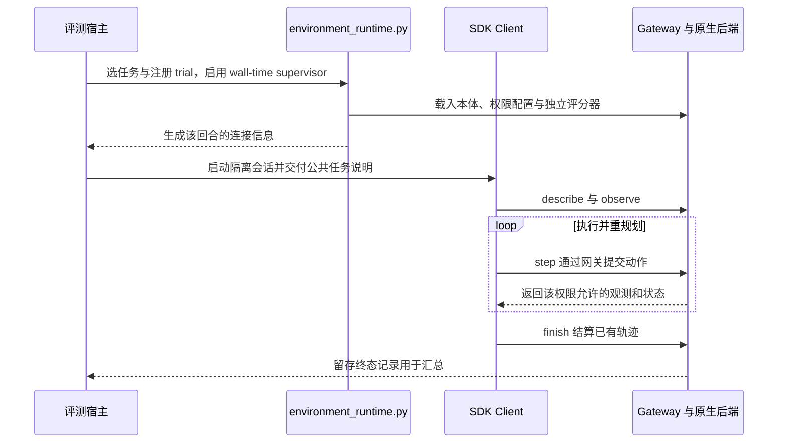

# Embodied Playground：物理、策略与空间推理的长时程具身基准 | Embodied Playground: A Long-Horizon Agentic Robotics Benchmark for Physical, Strategic, and Spatial Reasoning

## 一句话定义

Embodied Playground 测的是 agent 在多阶段机器人仿真任务中，能否根据执行反馈持续调整计划，同时完成目标、遵守规则并满足物理条件；不是只测模型答题或一段动作的成功率。

## 英文缩写速查

| 术语 | 英文 | 含义 |
|---|---|---|
| EP-100 | Embodied Playground 100 | 从全集策展选出的 100 个代表任务 |
| SDK | Software Development Kit | 测试 agent 调用观测和动作的公共客户端 |
| IK | Inverse Kinematics | 逆运动学；外部工具需要明确授权 |
| Pass@K | Pass within K opportunities | 同一条件前 K 次有效机会内至少一次成功 |

## 为什么重要

例如，汉诺塔最后摆对并不够：中途的移动顺序、圆环是否到位和最终稳定性也会被检查。短回合或只检查终态的基准，很难区分计划正确但执行失稳、执行稳定但违反任务约束等问题。

## 核心原理

全集 410 指任务配置与机器人本体的组合，使用 MuJoCo、Isaac Lab 和 ManiSkill。EP-100 含 Launch、Tower、Lock、Cube、Home 五套件（34/21/16/12/17 个任务），覆盖 16 类；每任务四个独立条件，共 400 条。EP-Easy / EP-Hard 各 50 项，按任务工作量分；EP-20 各取 10 项，其中部分选择参考过先导结果，不宜外推全榜。

权限等级和任务难度是两回事。L0 是公开观测与自编程序；L1 加显式批准的感知或规划工具；L2 加抓取/接触模型；L3 加声明为只读的仿真状态。实际启用哪些观测与工具仍须记录，不允许直接改仿真状态。论文主实验未提供现成动作控制器或参考解法。

## 工程实践

先按官方建议用 EP-20 做诊断，或用一个非发射类任务检查连接。每个条件和尝试由宿主创建独立环境及被测会话，被测侧只接收公开任务约定、SDK 与允许的观测。把环境版本、权限、初始化、有效重试口径、超时机制和覆盖率固定下来；存在未解决条件时报告 partial，不把缺失项当作成功或直接删除分母。

### 源码运行时序

`environment_client.py` 只发中性保持动作检查连接，不是基线求解器。这里核对了固定源码和不启动模拟器的任务清单，不把连接检查或清单验证当作榜单复现。

## 实验与评测

| EP-100 模型 | Pass@1 | Pass@2 | 有效尝试数 |
|---|---:|---:|---:|
| GPT-6-Astra | 13.80% | 19.94% | 736 |
| Opus-5.5-extra | 29.22% | 35.85% | 683 |

论文 v2 表 5 先平均四条件，再平均套件内任务，最后五套件等权。GPT-6-Astra 的简单条件池化值是 64/400 和 91/400（16.00% 和 22.75%），不是上表口径。四个条件不是重试；主实验同一条件只取前两次有效机会、成功即停。Launch 主结果只用预装起始条件。30M token、100 张图像是每次允许上限，不是实际使用量。

## 与其他工作对比

[VLA](../methods/vla.md) 策略评测常以给定观测直接输出动作；本基准评测会写控制程序并不断回看反馈的整套 agent。与[机器人操作](../tasks/manipulation.md)真机验证不同，结果不回答硬件稳定性、控制带宽或跨本体迁移。

## 结论

比较模型前先对齐权限、有效尝试、套件权重与覆盖率；需要找失败原因时，还要检查任务约定是否把限制讲清楚。

## 局限与风险

论文审计中，GPT-6-Astra 645 次计分失败里 574 次涉及规则或阈值披露不足（88.99%）。这些判定仍计入结果，但不能把这 574 次都归因于模型，也不能假定补充披露就会成功。视频是参考运行或复现，不自动等于计分轨迹；基准结果限仿真。

## 关联页面

- [仿真评测基础设施](../concepts/simulation-evaluation-infrastructure.md)
- [具身大模型评测基准选型闭环](../queries/embodied-eval-benchmark-selection-loop.md)
- [动作分块](../methods/action-chunking.md)
- [机器人操作](../tasks/manipulation.md)
- [原策展页](../overview/embodied-station-2026-10-31-50-papers-technology-map.md)

## 参考来源

- [论文归档](../../sources/papers/embodied_playground_arxiv_2610_27039.md)
- [固定源码和许可](../../sources/repos/embodied_playground.md)
- [项目页与结果数据](../../sources/sites/embodied-playground.md)

## 推荐继续阅读

- [论文 v2 全文](https://arxiv.org/html/2610.27039v2)：§5–6 的协议、表 5 和失败归因；附录给出完整任务索引。
- [作者项目页](https://winniechen2002.github.io/Agent-bench-website/)：看任务、结果及其证据边界。
