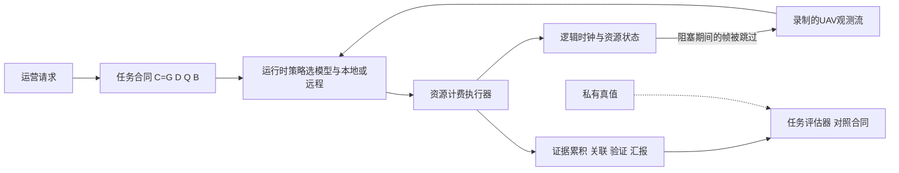

# EmbodiedIntentBench（arXiv:2611.10498）

**EmbodiedIntentBench**（*EmbodiedIntentBench: Benchmarking Intent-Driven Runtime Adaptation for Mobile Robotic Missions*，[arXiv:2611.10498](https://arxiv.org/abs/2611.10498)，加州大学尔湾分校与延世大学，v1 自注「正在审稿」）是一个**基准 / 评测方法论论文**，不是新的机器人策略或强化学习算法。

## 一句话定义

**用结构化「任务合同」描述无人机任务要什么（覆盖、证据、时限、汇报、电量），在固定仿真轨迹的回放里让每次计算都占用时间与能量并挤掉后续观测，以「任务整体是否完成」而非单帧精度来评测运行时感知 / 计算策略。**

## 英文缩写速查

| 缩写 | 英文全称 | 简要说明 |
|------|----------|----------|
| UAV | Unmanned Aerial Vehicle | 无人机，本文唯一的仿真工作负载 |
| Mask R-CNN | Mask Region-based CNN | 实例分割模型，本文用 ResNet-50-FPN v2 检查点 |
| YOLO11s / YOLO11n | You Only Look Once v11 small / nano | Ultralytics 分割模型 |
| CABiNet | Context Aggregation Bilateral Network | 语义分割模型（UAVid 检查点） |
| IoU | Intersection over Union | 预测掩码与真值匹配阈值取 0.3（§4.4） |
| Wh / J | Watt-hour / Joule | 电池容量与任务能耗单位 |
| no-skip | no-skip counterfactual | 不阻塞丢帧的分析性反事实，非可实现的并行实现（§4.4） |

## 为什么重要

- 作者自述的动机（§1）：单个计算成功不等于任务成功。更准的模型可能更慢，处理期间到来的帧被丢掉，反而拿不到足够证据。
- 在这个基准里，这一点是可量化的：Depot 多阶段任务中全库召回最高（0.875）的配置只完成 1/16，召回较低（0.807）的配置完成 14/16（§5.1、表 3）。
- 与 [LIBERO-Dynamic](./paper-libero-dynamic.md) 同属「把推理延迟计入评测」的方向（论文 §1 / §6 自己也引用了它），但后者是桌面操作，本文是无人机感知与汇报。
- 对强化学习读者的关系（我的判断）：本文没有训练任何策略，所有「自适应策略」是手写的启发式路由器与基于逻辑回归召回估计的规则（§4.3）。它可作为日后在线学习此类调度策略时的评测环境参照，但论文本身不做这件事。

## 核心原理

### 流程总览

### 机制要点

| 项 | 内容（章节） |
|----|--------------|
| **合同** | C = (G, D, Q, B)：目标与证据、时间约束、汇报义务、资源约束；JSON 规范（§2.2）。合同的数值阈值是「明确定义的基准参数」，动机取自搜救手册（§4.1） |
| **工作负载** | Gazebo Harmonic 录制的 RGB、位姿、时间戳；轨迹固定，隔离计算决策的影响，导航与控制不在范围内（§1、§2.3） |
| **动作空间** | a = (模型 m, 本地 / 远程 ℓ)，也允许弃权；策略看不到真值、未来观测与未选模型的输出（§2.3） |
| **因果执行** | 串行阻塞：处理完成时刻 f_i 之后第一个观测才可处理，期间的帧记为未处理机会不排队（式 5）；迟到结果仍计费（§2.4） |
| **能量** | 机载能量 = 飞行 + 计算 + 通信 + 支持项的积分 / 求和（式 6）；假设 30 Wh 电池、120 W 恒定飞行功率、15 W 机载推理（§4.2，均为建模假设） |
| **成功判据** | 合同全部要求的合取（式 7）；另记覆盖、确认、重复 / 错误汇报、超时请求等诊断量（§2.5） |
| **回放** | 预先算好的预测库只对被选动作开放；CPU 即可回放，不需再跑神经网络或仿真（§3.1） |

## 实验与评测

### 实验设计（§4）

- **多阶段研究：** Lake 6 段 + Depot 4 段录制，每段 120 s、60 帧；两份合同（快速勘察 / 核验巡检）、两种初始电量（34% / 65%）；九种感知配置来自四个预训练检查点；Lake 21 个策略 504 次运行，Depot 22 个策略 352 次运行（表 2）。
- **动态紧迫度研究：** 6 段 42 s Lake 录制 × 3 紧迫度计划 × 2 网络 × 2 电量；9 个策略 648 次运行；远程执行的服务时间与网络为建模，未部署真实服务器（§4.2）。
- **验证分析：** 合同敏感性、可行性界、因果消融、失败归因（§4.4）。

### 作者报告的主要结果

| 结果 | 数值（章节 / 表） |
|------|------------------|
| 高召回但低完成度 | Mask R-CNN 并集 0.875 召回 → 1/16；分块 YOLO11s 0.807 → 14/16；分块 + 旋转 0.785 → 14/16；gamma 变体 0.797 → 6/16，主因是阶段级误检上限（§5.1、表 3） |
| 自适应 vs 固定 | Lake 自适应策略 6–13/24，Depot 2–7/16；最强固定配置 16/24 与 14/16；ApproxDet 启发的对照 Depot 2/16（§5.1）。即在此基准上手写的自适应策略**不如**最好的固定配置 |
| 紧迫度感知 | 25/48 vs 盲版 24/48 vs 固定远程 22/48；迟到请求 90→0；任务能耗 198→168 J（§5.2） |
| 连通性 | 固定远程 Mask R-CNN 良好链路 18/24，退化链路 4/24（§5.2） |
| 电量 | 固定本地 Mask R-CNN 电量充足 6/24，受限 0/24（全部违反储备）（§5.2） |
| 因果消融 | 因果 218 vs no-skip 255；顺序反转 41/72 vs 38/72 → 45/72 vs 48/72（§5.3） |
| 可行性 | 72 个条件中 12 个被证明对该模型池不可行；参考策略完成 43，事后搜索再找到 8 个，9 个未决（§5.4） |
| 合同敏感性 | 144 个合同设定中，事后选出的最佳自适应策略在 128 个上相对两个固定 Mask R-CNN 有「实质优势」（至少多 3 个成功条件，且无录制偏向对照类）（§5.5） |
| Jetson 与停止规则 | 见下节「工程实践」 |

## 与其他工作对比

| 对照 | 评测什么 | 与 EmbodiedIntentBench 的区别 |
|------|----------|-------------------------------|
| 单帧精度 / 召回评测 | 每次推理是否准确 | 本文按合同评任务整体完成度：Depot 召回 0.875 的配置仅 1/16，召回 0.807 的配置 14/16（表 3） |
| [LIBERO-Dynamic](./paper-libero-dynamic.md) | 桌面操作中把实测推理延迟与目标运动计入评测 | 同属「延迟计入评测」，但本文是无人机感知与汇报，还额外计入电量、远程链路与汇报义务 |
| ApproxDet 启发的自适应对照 | 按内容自适应选检测配置 | 本文作基线，Depot 仅 2/16，低于最强固定配置 14/16（§5.1） |
| MAVBench、RobotPerf、A2Perf 等（本库无页） | 论文 §1 / §6 引用的相关系统基准 | 本页未逐条核对其设定，仅列出供延伸阅读 |

## 结论

**在计算会挤掉后续观测、并消耗电量的移动机器人任务里，单帧最准的感知配置不一定最能完成任务；评测应以任务合同的整体完成度为准。**

1. Depot 上召回最高（0.875）的配置只完成 1/16，主因是 6.91 s 建模延迟造成观测被跳过并叠加电量储备违规。
2. 手写自适应策略在多阶段研究中不如最好的固定配置（Depot 2–7/16 vs 14/16），仅在动态紧迫度研究中小幅领先（25/48 vs 24/48）。
3. 因果消融显示 no-skip 回放会把策略排序反转（41/72 vs 38/72 → 45/72 vs 48/72），说明必须按因果阻塞执行评测。
4. 轨迹固定、延迟与能耗多为建模假设，且多阶段 artifact 未公开，核心 Depot 数字暂不可复跑。

## 工程实践

- **复现入口：** 仓库 README 称 Linux、Python 3.11+，`python tools/artifact.py verify / smoke / full`，不需 GPU、模型下载或仿真器；完整运行此前约 27 分钟（4 进程）。（仅读 README，本页未运行。）
- **能复现什么：** artifact 只含动态 Lake 研究、Jetson 与意图驱动分析；多阶段 Lake / Depot 的录制与预测库待论文接收后发布（脚注 1、附录 A）。因此表 3 与图 4 的核心数字（Depot 1/16 vs 14/16）**目前无法由公开 artifact 复跑**；论文称仅提供 Depot 的数值 case 与帧提取用于核验（附录 A.1）。
- **Jetson 剖面（A.5）：** AGX Orin、MODE_15W、JetPack 6.1、FP32；每个模型处理 24 帧、热身 5 次；本地回放延迟取经验 95 分位；功率为监测导轨之和，乘以延迟得到估计能耗，「不是直接测得的单次调用能量」。24 帧抽样中 GPU 上 Mask R-CNN 与存储掩码精确一致 21/24（平均 IoU 0.9997）。
- **意图驱动停止规则（A.6）：** 每阶段内，已完成汇报的不同运行时标签数达到合同要求人数后跳过后续感知；标签不一定对应不同的人。上机实验是帧同步推理、非推理阶段为仿真、停止规则**未在设备上在线执行**，任务结果用存储预测离线打分。能耗 109.1→74.4 J（推理期间，确认合同）与 107.9→84.6 J（严格合同）；整段 323.7→298.9 J 与 323.8→305.3 J。
- **扩展接口（表 1）：** 合同、工作负载、感知配置、运行时策略、执行后端、证据与评估六类组件可替换；分割推理（split inference）需自行实现阶段与代价（§3.2）。

## 局限

**论文自己承认的：**

- 轨迹固定，导航与物理控制不在评测范围；未来才做闭环与实测边云部署（§1、§7）。
- 同一批仿真录制被反复复用，条件之间不独立，「不是独立的机器人部署」（§3.3、§4.1）。
- 动态研究仅 6 段录制（2 段开发、4 段对比评测），「不构成未见地图泛化」（§4.4）。
- 机载 / 远程延迟与能耗多为建模假设（开发主机 CPU 计时、15 W、120 W 等），远程服务不真实部署（§4.2）；Jetson 能耗是估计值（A.5）。
- no-skip 是分析性消融，非可实现的并行实现（§4.4、附录 A.4）。
- 阶段级误检上限等阈值是「基准参数」，144 合同网格是在看过五合同结果后确定的，「只刻画这些已检视录制上的敏感性」（§5.5、A.3）。
- 完整多阶段 artifact 尚未公开（脚注 1）。

**我看到的未验证之处（判断，非论文原话）：**

- 「召回最高却完成最少」在 Depot 上同时混有两个因素：6.91 s 的建模延迟（观测被跳过）与电量储备违规（8/16 合规）。该配置的延迟是配置值而非本文实测，因此 1/16 这一数字对延迟 / 电量假设很敏感；论文用 no-skip 消融与 5.3 的延迟倍率分析了前一因素，但没有对 Depot 单独做同样的分离。
- 质量估计器与真值差距很大（例如旋转分块 YOLO11s 预测召回 0.007，观测 0.785；CABiNet 预测 0.548，观测 0），所以自适应策略的弱表现有一部分来自估计器，而不只是「调度」本身（图 4b）。
- 基准的自适应策略均为手工规则，没有学习型策略，也未与强化学习方法比较；「自适应优于固定」在多阶段结果里并不成立（§5.1），仅在动态研究里有 1–3 个条件的小优势（25/48 vs 24/48），统计显著性论文未给出。
- 小站摘要的措辞与论文数字一致；但「也可能错过整场任务」的原因，论文归于延迟造成观测被跳过加上电量 / 误检约束，不单是延迟（§5.1）。
- 仅读了 artifact 的 README 前半，其余文档与代码未核实。

## 关联页面

- [边云协同（edge-cloud robotics）](../concepts/edge-cloud-robotics.md)：本文的本地 / 远程执行取舍背景
- [具身基础模型的延迟与泛化权衡](../concepts/embodied-fm-latency-generalization-tradeoff.md)
- [仿真评测基础设施](../concepts/simulation-evaluation-infrastructure.md)
- [仿真与真机评测差距](../concepts/sim-vs-real-eval-gap.md)
- [LIBERO-Dynamic](./paper-libero-dynamic.md)：同样把推理延迟计入评测（操作场景）
- [Gazebo 仿真](./gazebo-sim.md)：本文工作负载所用仿真器的 wiki 入口（本文用 Gazebo Harmonic）
- [具身大模型评测基准选型闭环](../queries/embodied-eval-benchmark-selection-loop.md)：本文以任务合同完成度而非单帧精度评测，可作「延迟/资源受限场景选基准」的一个参照。

## 参考来源

- [embodiedintentbench_arxiv_2611_10498.md](../../sources/papers/embodiedintentbench_arxiv_2611_10498.md)
- [arXiv:2611.10498](https://arxiv.org/abs/2611.10498)
- 小站说法（具身智能小站 2026-11-10）与论文逐条核对：机构、数字均与论文一致。

## 继续阅读

- [arXiv PDF（v1）](https://arxiv.org/pdf/2611.10498v1)
- [公开 artifact 仓库](https://github.com/rajatbh21/EmbodiedIntentBench-artifact)
- 论文引用的相关基准：MAVBench、RobotPerf、A2Perf、LIBERO-Dynamic、ApproxDet、DEEP（§1、§6）
