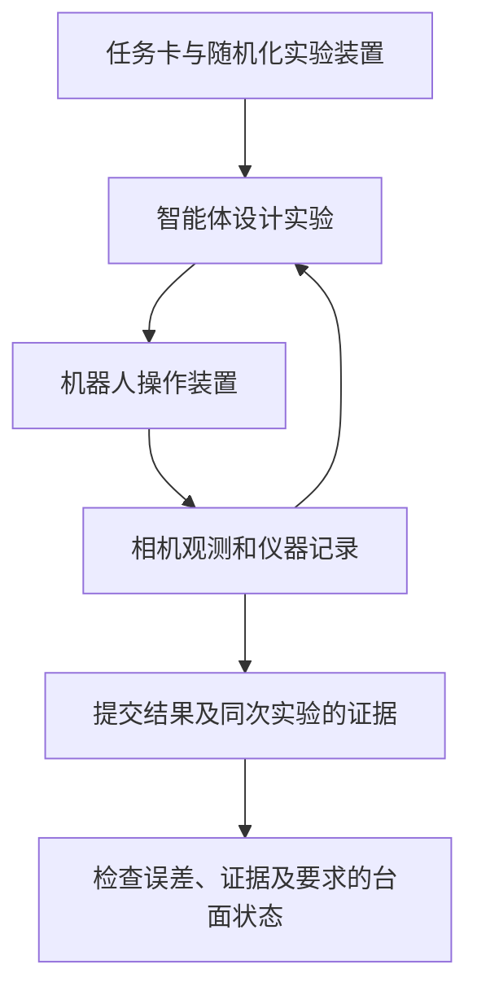
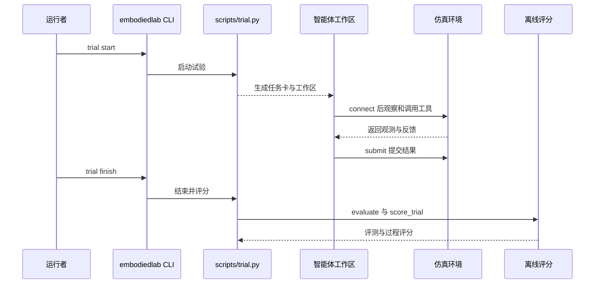

# EmbodiedLab：通过行动获取知识的具身智能体基准

*EmbodiedLab: Benchmarking Embodied Agents That Act to Know*

**EmbodiedLab**（*EmbodiedLab: Benchmarking Embodied Agents That Act to Know*，[arXiv:2610.35385](https://arxiv.org/abs/2610.35385)，[代码](https://github.com/HexaFuture/EmbodiedLab)）来自 [具身智能小站 2026-10-28 盘点](../../sources/blogs/wechat_embodied_station_59_papers_human_video_to_robot_experience_2026-10-28.md)，属「评测与基准」组。

## 一句话定义

**以物理实验室为评测场，智能体需自主选择实验步骤、操作仪器并从读数得出结论。**

## 英文缩写速查

| 缩写 | 英文全称 | 简要说明 |
|------|----------|----------|
| RGB | Red-Green-Blue | 彩色相机图像 |
| IK | Inverse Kinematics | 逆运动学 |
| API | Application Programming Interface | 智能体调用环境的接口 |

## 为什么重要

- 让机器人通过操作获得新知识。区分知道答案与能够完成实验，实验参数重采样，避免把记忆中的结果当成发现。
- 开源结论：**已开源**（步骤 2.5，2026-10-28）。仓库可达（git ls-remote）。
- 同期同组工作见 [潜在动作、免渲染事件仿真与机器人评测：具身智能小站 10-28 期 59 篇阅读坐标](../overview/embodied-station-2026-10-28-59-papers-technology-map.md)。

## 流程总览

依据 [论文 v1](https://arxiv.org/html/2610.35385v1) 第 3 节：每次实例重采样隐藏参数，智能体只获得目标、装置及规则。

## 核心机制

| 项 | 内容 |
|----|------|
| **arXiv** | [2610.35385](https://arxiv.org/abs/2610.35385) |
| **开源** | **已开源** |
| **要点** | 以物理实验室为评测场，智能体需自主选择实验步骤、操作仪器并从读数得出结论。 |
| **文内指标** | 公众号转述：区分知道答案与能够完成实验，实验参数重采样，避免把记忆中的结果当成发现。 |

## 源码运行时序图

根据官方 README、`embodiedlab` 入口、`scripts/trial.py` 和 `benchmark/evaluation/process.py` 整理；完整调用链仍待逐模块核验。

官方仓库说明 v0.1.0 提供 T0、T1；论文中的 T2 操作技能库未包含在该发布版中。README 建议 24 GB 显存的 NVIDIA RTX GPU，T1 还需 SAM3 和 cuRobo。

## 实验与评测

- 论文 v1：30 个实验、5 个学科、14 类装置；在 Isaac Sim 中使用 Franka Panda 机械臂及三路相机。
- T0 仅提供 RGB、机器人状态、关节控制与运动学 IK；T1 增加分割、特权深度与避障规划；T2 在论文诊断实验中再加入操作技能。
- 论文报告 T0 下 Claude Opus 5.5 为 43.3%，GPT-6 Astra 为 40.0%；结果按实验先汇总再跨 30 个实验平均。T1 的提升最多 10 个百分点，T2 技能对较弱智能体的帮助更大。
- 成功要求提交结果误差在容差内，且符合实验记录证据和任务要求的台面状态。过程分为 L1–L6，权重分别为 10、10、10、10、30、30。

## 与其他工作对比

- 横向索引见 [潜在动作、免渲染事件仿真与机器人评测：具身智能小站 10-28 期 59 篇阅读坐标](../overview/embodied-station-2026-10-28-59-papers-technology-map.md)；同 arXiv 不重复造页。

## 结论

**让机器人通过操作获得新知识：区分知道答案与能够完成实验，实验参数重采样，避免把记忆中的结果当成发现。**

1. 开源边界：**已开源** — 仓库可达（git ls-remote）。
2. 核心机制：以物理实验室为评测场，智能体需自主选择实验步骤、操作仪器并从读数得出结论。
3. 复现与选型前核对任务协议、硬件与基准口径，勿直接横比公众号摘录数字。

## 关联页面

- [具身大模型评测基准选型闭环](../queries/embodied-eval-benchmark-selection-loop.md) — 本页可归入其 ① 具身大脑/MLLM 认知评测层：实验室场景下自主选步骤、操作仪器并从读数下结论
- [simulation-evaluation-infrastructure](../concepts/simulation-evaluation-infrastructure.md)
- [vla](../methods/vla.md)
- [manipulation](../tasks/manipulation.md)
- [embodied-station-2026-10-28-59-papers-technology-map](../overview/embodied-station-2026-10-28-59-papers-technology-map.md)

## 参考来源

- [embodiedlab_arxiv_2610_35385.md](../../sources/papers/embodiedlab_arxiv_2610_35385.md)
- [wechat_embodied_station_59_papers_human_video_to_robot_experience_2026-10-28.md](../../sources/blogs/wechat_embodied_station_59_papers_human_video_to_robot_experience_2026-10-28.md)
- [arXiv:2610.35385](https://arxiv.org/abs/2610.35385)

## 推荐继续阅读

- [arXiv PDF](https://arxiv.org/pdf/2610.35385)
- [https://github.com/HexaFuture/EmbodiedLab](https://github.com/HexaFuture/EmbodiedLab)
