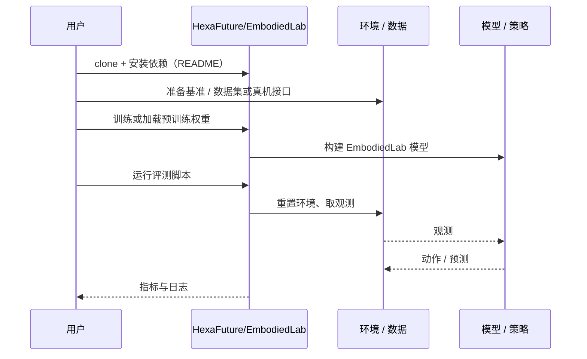

# EmbodiedLab（arXiv:2610.35385）

**EmbodiedLab**（*EmbodiedLab: Benchmarking Embodied Agents That Act to Know*，[arXiv:2610.35385](https://arxiv.org/abs/2610.35385)，[代码](https://github.com/HexaFuture/EmbodiedLab)）来自 [具身智能小站 2026-10-28 盘点](../../sources/blogs/wechat_embodied_station_59_papers_human_video_to_robot_experience_2026-10-28.md)，属「评测与基准」组。

## 一句话定义

**以物理实验室为评测场，智能体需自主选择实验步骤、操作仪器并从读数得出结论。**

## 英文缩写速查

| 缩写 | 英文全称 | 简要说明 |
|------|----------|----------|
| EmbodiedLab | EmbodiedLab: Benchmarking Embodied Agents That Act to Know | 本文方法 / 基准的简称 |

## 为什么重要

- 让机器人通过操作获得新知识。区分知道答案与能够完成实验，实验参数重采样，避免把记忆中的结果当成发现。
- 开源结论：**已开源**（步骤 2.5，2026-10-28）。仓库可达（git ls-remote）。
- 同期同组工作见 [潜在动作、免渲染事件仿真与机器人评测：具身智能小站 10-28 期 59 篇阅读坐标](../overview/embodied-station-2026-10-28-59-papers-technology-map.md)。

## 核心机制

| 项 | 内容 |
|----|------|
| **arXiv** | [2610.35385](https://arxiv.org/abs/2610.35385) |
| **开源** | **已开源** |
| **要点** | 以物理实验室为评测场，智能体需自主选择实验步骤、操作仪器并从读数得出结论。 |
| **文内指标** | 公众号转述：区分知道答案与能够完成实验，实验参数重采样，避免把记忆中的结果当成发现。 |

## 源码运行时序图

以下为按仓库入口（`HexaFuture/EmbodiedLab`）推断的通用运行链路；入库日仅核实仓库可达，未逐文件阅读，具体脚本名以 README 为准。

## 实验与评测

- 公众号转述：区分知道答案与能够完成实验，实验参数重采样，避免把记忆中的结果当成发现。
- **读法：** 本页为索引级摘要，依据公众号转述的官方摘要与仓库信息整理；逐项数字与 baseline 以原文 PDF 为准。

## 与其他工作对比

- 横向索引见 [潜在动作、免渲染事件仿真与机器人评测：具身智能小站 10-28 期 59 篇阅读坐标](../overview/embodied-station-2026-10-28-59-papers-technology-map.md)；同 arXiv 不重复造页。

## 结论

**让机器人通过操作获得新知识：区分知道答案与能够完成实验，实验参数重采样，避免把记忆中的结果当成发现。**

1. 开源边界：**已开源** — 仓库可达（git ls-remote）。
2. 核心机制：以物理实验室为评测场，智能体需自主选择实验步骤、操作仪器并从读数得出结论。
3. 复现与选型前核对任务协议、硬件与基准口径，勿直接横比公众号摘录数字。

## 关联页面

- [simulation-evaluation-infrastructure](../concepts/simulation-evaluation-infrastructure.md)
- [vla](../methods/vla.md)
- [manipulation](../tasks/manipulation.md)
- [embodied-station-2026-10-28-59-papers-technology-map](../overview/embodied-station-2026-10-28-59-papers-technology-map.md)

## 参考来源

- [embodiedlab_arxiv_2610_35385.md](../../sources/papers/embodiedlab_arxiv_2610_35385.md)
- [wechat_embodied_station_59_papers_human_video_to_robot_experience_2026-10-28.md](../../sources/blogs/wechat_embodied_station_59_papers_human_video_to_robot_experience_2026-10-28.md)
- [arXiv:2610.35385](https://arxiv.org/abs/2610.35385)

## 推荐继续阅读

- [arXiv PDF](https://arxiv.org/pdf/2610.35385)
- [https://github.com/HexaFuture/EmbodiedLab](https://github.com/HexaFuture/EmbodiedLab)
