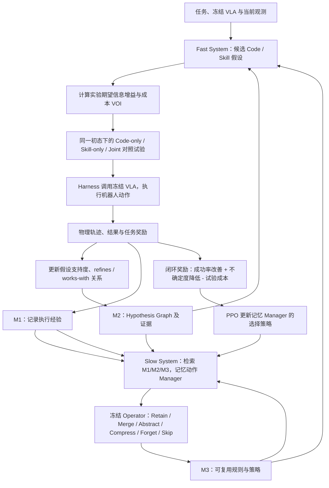

# EmbodiedRSI：通过假设引导的协同进化实现机器人主动持续学习 / Active Continual Robot Learning Through Hypothesis-Guided Co-Evolution

**论文：** [arXiv:2610.10498v1（2026-10-07）](https://arxiv.org/abs/2610.10498) ｜ **项目：** [作者官方主页](https://geeksongs.github.io/agentic_robotics/) ｜ **机构：** 哥伦比亚大学（Columbia University）、普林斯顿大学（Princeton University）

## 一句话定义

**EmbodiedRSI** 是冻结机器人 VLA 模型外面的**自我改进执行框架（agentic harness）**：机器人通过有信息价值的试验校正代码/技能假设，联合保存有效的组合，并把物理证据变成下一轮能复用的记忆。

## 英文缩写速查

| 缩写 | 英文全称 | 简要说明 |
|---|---|---|
| RSI | Recursive Self-Improvement | 基于试验反馈反复修改自身执行框架 |
| VLA | Vision-Language-Action | 冻结权重、负责底层感知动作的机器人模型 |
| VOI | Value of Information | 期望信息增益除以试验成本，选择下次试验 |
| M1/M2/M3 | Memory Levels 1/2/3 | 物理执行记录 / 假设与证据 / 抽象知识 |
| PPO | Proximal Policy Optimization | 学习 Slow System 的记忆管理策略 |
| AUC | Area Under the Curve | 试验过程中的学习成功率曲线面积 |

## 为什么重要

- 对同一任务的盲目重试很昂贵；有竞争性假设时先选**最能区分假设且成本可控**的试验。
- 对长时序操作，控制代码与可复用技能互相作用；只优化一侧会遗漏联合增益。
- 记忆不应只做全文检索：应衡量某次保留、压缩或合并是否**改善后续任务并节省试验**。
- **关键范围：** “自我进化”发生在外部 harness / code / skills / memory，并非本论文证明 VLA 权重自我训练。

## 核心机制

### 1. Fast System：可追溯的假设图与实验选择

- 把候选 code、skill 改动组织为 Hypothesis Graph；节点代表假设，`refines` 边记录迭代修订。
- 用 matched trials（控制相同初始状态、其他调用顺序）观察成功率差异，将各假设的支持/反驳计数写入 Beta 后验，更新置信度。
- 对候选实验 (t) 估算 `VOI(t)=期望假设不确定度降低/成本C(t)`，成本考虑时间、仿真步、GPU 和 reset；优先执行高 VOI 试验（论文 §3.2、式 4–6）。
- 由真实/模拟的物理结果更新下一轮候选与假设，而不是无依据地写死“多探索就会更好”。

### 2. Code-Skill Co-Evolution：用配对试验检查协同增益

同一起始条件比较 `R(code,skill)`、`R(code)`、`R(skill)`。论文定义：

`w_ij = R(C_i,S_j) - max{ R(C_i), R(S_j) }`

正的 `w_ij` 将 code 和 skill 的有效组合固化为 `works-with` 关系；但这是**受控样本中的测量差**，不能保证任意新场景一定更好（§3.2、式 7）。

### 3. Slow System：记忆是策略，不是日志堆积

- **M1 Physical Experience：** 轨迹、工具、VLA 调用时刻、动作、遥测、结果、奖励；每次执行都记录。
- **M2 Hypothesis Graph：** 每条假设的证据与 confidence，以及 `refines` 和 `works-with` 关系。
- **M3 Cognition：** 从多次证据抽象出的规则和策略，帮助后续选择实验。
- **Manager：** 根据当下记录与检索内容选择 Retain / Merge / Abstract / Compress / Forget / Skip；用冻结的 Qwen3-Embedding-0.6B 获取表征、冻结的 Qwen3.5-122B-A10B operator 执行知识更新。
- **Reward-Grounded Memory Learning：** PPO 训练记忆管理策略，以后续成功率提升、假设不确定度下降、试验成本降低的组合奖励衡量记忆是否值得保留（论文 §3.3、式 8–10）。

## 流程总览

依据论文 Figure 1/2、§3.1–3.3 的方法与证据流；箭头是外层 harness 的数据／控制流，**不代表训练基础 VLA 权重**。

## 源码运行时序图

**不适用（论文算法的官方可运行实现尚未核实开放）。** 截至 2026-11-08，作者项目主页没有提供 EmbodiedRSI 训练、实验选择或实体机器人部署代码入口。作者的 [Geeksongs/agentic_robotics](https://github.com/Geeksongs/agentic_robotics) 只是项目**静态网站源码**（README 提供 `python3 -m http.server 8000` 网站预览）；不能将网站构建/页面 JavaScript 伪装成机器人算法运行时序。其他同名非作者仓库不作为本文代码证据。详见[站点核验](../../sources/sites/embodiedrsi-agentic-robotics.md)。

## 工程实践

| 工程问题 | 可迁移做法／约束 |
|---|---|
| VLA 在新指令或物体布局失败 | 先修改上层规划/调用组合，再决定是否值得微调 backbone |
| 哪个试验优先 | 在同初态比较可区分假设的试验，以 expected entropy reduction / cost 排序 |
| 假设如何验收 | 对照 code-only、skill-only 与 joint，保留真实观察到的正联合增益与失败证据 |
| 如何实现记忆 | M1 原始物理证据不可因摘要丢失；M2 管理假设支持关系；M3 提取可迁移规则 |
| 记忆是否有效 | 用后续任务提升/信息收益/成本计算闭环奖励，训练 memory Manager |
| Sim2Real 解释 | 在仿真中演化 harness → 部署 SO-101；不能写成真机连续自动训练底层模型 |
| 复现状态 | 算法源码、所引用附录算法和参数没有可核实公开入口；结论停留在作者报告 |

## 实验与评测

**作者论文结果，未独立复现。** 仿真评测按每任务 10 seeds × 10 trials，进化和评测采用互不重叠种子（§4.1）。

| Benchmark | EmbodiedRSI | 最强文中对照 | 范围 |
|---|---:|---:|---|
| RoboCasa365 Overall | **77.0%** | Harness VLA 63.6% | 所有三类任务总体成功率（Table 1） |
| RoboCasa365 Composite-Unseen | **71.3%** | Harness VLA 40.1% | 未见组合任务，+31.2 pp（Table 1） |
| LIBERO-Pro Overall | **86.8%** | Harness VLA 72.1% | 指令重定向/物体换位（Table 2） |
| RoboCasa365 @50 episodes | **72.9%** | Random Exploration 27.1% | 学习 AUC 0.635 vs 0.309（Table 4） |

**真机 SO-101：** 论文 Table 3 对五任务各运行 30 次，使用 SmolVLA 作为基础模型。评测前每任务先采集 **50 条人工遥操作示范**，并在 4×H200 上微调 **20,000 steps**；模型随后冻结，**零样本迁移的是仿真演化的 Harness**。

| 真机任务 | 冻结 SmolVLA | + EmbodiedRSI |
|---|---:|---:|
| Oreo 放入红碗 | 70.0% | 86.7% |
| 算术挑筹码 | 10.0% | 90.0% |
| 两块蛋糕堆叠 | 63.3% | 76.7% |
| 眼镜桥精密抓取 | **60.0%** | 56.7% |
| 折毛巾 | 26.7% | 46.7% |
| **总体** | **46.0%** | **71.3%** |

消融：Composite-Unseen 联合 code/skill 进化 **71.3% vs 55.6%**（仅 skill）；记忆使用 retrieval-only 61.7%、PPO task reward only 65.2%、完整记忆奖励 71.3%（§4.4、Table 5）。

## 结论

**EmbodiedRSI 的实质进展是让 frozen-VLA 外部执行框架主动选择下一次有价值的物理实验，并同时改代码、技能及记忆，不是底层策略权重的自动重训。**

1. 优先看 **Composite-Unseen**：71.3% 对照 40.1% 更能展示新组合的效果；不要把它错当 Overall。
2. 将试验选择改为**基于 VOI 的有成本假设检验**，而不是按失败列表反复尝试。
3. 对 code/skill 必须使用相同初态的单项与联合对照，避免偶然场景差异制造协同假象。
4. 记忆价值由后续闭环结果衡量；PPO 学习的是记忆管理动作，底层 VLA 仍冻结。
5. 真机总成功率 46.0→71.3，但眼镜桥抓取出现回退，结论不是全任务单调提高。
6. 实机从零开始自行演化、跨平台成本、碰撞安全、公开源码与详细超参数尚不能据本文确证。

## 与其他工作对比

- [RoboDoctor](./paper-robodoctor.md)：同属 frozen-policy 外层干预；RoboDoctor 着重运行时诊断、局部动作修正与经验回放，EmbodiedRSI 着重 VOI 实验选取、code-skill 联合评估与 PPO 记忆策略。
- [递归自我改进（RSI）](../concepts/recursive-self-improvement.md)：EmbodiedRSI 是 harness-level 自我改进，尚未做到 VLA backbone 的参数自进化。
- [VLA](../methods/vla.md)：区分模型动作生成层与可变执行层；不把整体成功率提升等同底层 VLA 提升。
- [强化学习](../methods/reinforcement-learning.md)：此处 PPO 更新的是慢系统管理器，不是低层机器人运动策略。

## 局限与风险

- **作者报告而非独立复现**；论文公开 v1 PDF 12 页，正文引用的附录 A–I 并未随 PDF 发布，算法 1、完整参数配置和实验设置细节无法核验。
- **真机零样本的主体是 Harness**；SmolVLA 使用了人工示范及先行微调。不能表述为从无示范、在真实环境中原地自学。
- **并非所有真机任务收益为正**：眼镜桥抓取 60.0%→56.7%。
- **代码开放度有限**：作者公开的是网站生成/展示代码，不是可执行 EmbodiedRSI 算法仓库。不能凭网页复现论文效果。
- 在实体机器人上主动试验需要额外的碰撞、夹持、越界、复位与紧急停止保护；论文没有给出对任意任务的形式化安全保证。
- 官方项目页的 Abstract 段有 “EmbodiedEvo” 混称；身份以论文标题和 arXiv 编号为准。

## 关联页面

- [递归自我改进 RSI](../concepts/recursive-self-improvement.md)
- [机器人操作 Manipulation](../tasks/manipulation.md)
- [VLA 视觉-语言-动作](../methods/vla.md)
- [强化学习 Reinforcement Learning](../methods/reinforcement-learning.md)
- [RoboDoctor](./paper-robodoctor.md)

## 参考来源

- [arXiv:2610.10498v1 正文通读及证据归档](../../sources/papers/embodiedrsi_arxiv_2610_10498.md)
- [EmbodiedRSI 官方项目主页及开源状态核验](../../sources/sites/embodiedrsi-agentic-robotics.md)
- [作者论文 HTML 全文](https://arxiv.org/html/2610.10498)

## 推荐继续阅读

- [作者 EmbodiedRSI 项目页](https://geeksongs.github.io/agentic_robotics/)
- [arXiv 论文 PDF（公开 v1，未含所引附录）](https://arxiv.org/pdf/2610.10498)
- [作者网站仓库 README（仅站点代码）](https://github.com/Geeksongs/agentic_robotics/blob/website/README.md)
