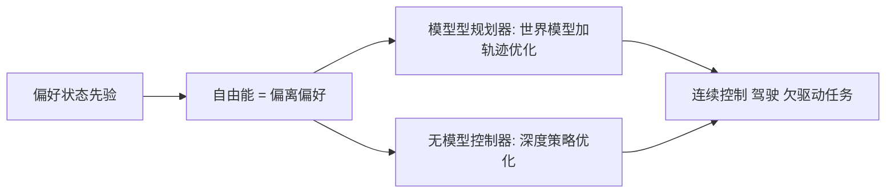

# Emergent Control via Prior-Based Free Energy Minimization

> 草稿：未取得论文全文（OpenReview 403，arXiv 无此条目），以下仅依据摘要级信息，细节未经正文核对。

## 一句话定义

**以「偏离偏好状态先验」（自由能）为目标、而非最大化奖励的控制框架，含模型型规划器与无模型控制器两种实现（作者摘要自述）。**

## 英文缩写速查

| 缩写 / 术语 | 全称 | 含义（摘要语境） |
|---|---|---|
| FE | Free Energy | 此处指相对偏好状态先验的偏离度量，具体公式未读到 |
| RL | Reinforcement Learning | 对照基线范式（奖励最大化） |
| TO | Trajectory Optimization | 规划器用轨迹优化（摘要措辞） |

## 为什么重要

若无需手工奖励即可由偏好先验得到稳定行为，可减少 [奖励设计](../concepts/reward-design.md) 负担。此判断是推测，未经论文实验验证。

## 核心原理与流程总览

据摘要（章节未知）：

具体先验形式、世界模型结构、策略优化算法（是否为 PPO）均未读到。

## 工程实践

未读到全文，无可靠实现细节。未找到代码或项目页。

## 与清单说法的核对

清单（Berseth 阅读清单，P1 / Spotlight）：「Control by minimizing deviation from priors over preferred states (free energy) instead of maximizing reward, model-based and model-free.」

- 「最小化偏离偏好状态先验、而非最大化奖励」：与摘要转述一致。
- 「model-based and model-free」：与摘要中的两部分一致。
- 清单未提及的摘要内容：任务涵盖连续运动、自动驾驶、欠驱动控制；稀疏奖励设定；稳态与运动学先验。
- 无法核对：仿真还是真机、基线与数值、「无显式奖励」的严格程度（先验本身是否隐含奖励）。清单排序来自作者个人兴趣模型，非论文质量评价。

## 局限

- 本页局限：未读全文，结论全部停留在摘要层。
- 论文自述的局限与未验证之处：未知。

## 关联页面

- [奖励设计](../concepts/reward-design.md)
- [Model-Based RL](../methods/model-based-rl.md)
- [PPO](../methods/ppo.md)
- [轨迹优化](../methods/trajectory-optimization.md)

## 参考来源

- [来源归档](../../sources/papers/emergent-control-prior-free-energy_corl2026.md)
- [Berseth CoRL 2026 阅读清单归档](../../sources/blogs/glen-berseth-corl-2026-reading-list-2026-11-10.md)
- 摘要镜像：<https://paperswithcode.co/paper/132867>

## 继续阅读

- OpenReview：<https://openreview.net/forum?id=XY8QpMSxvq>
