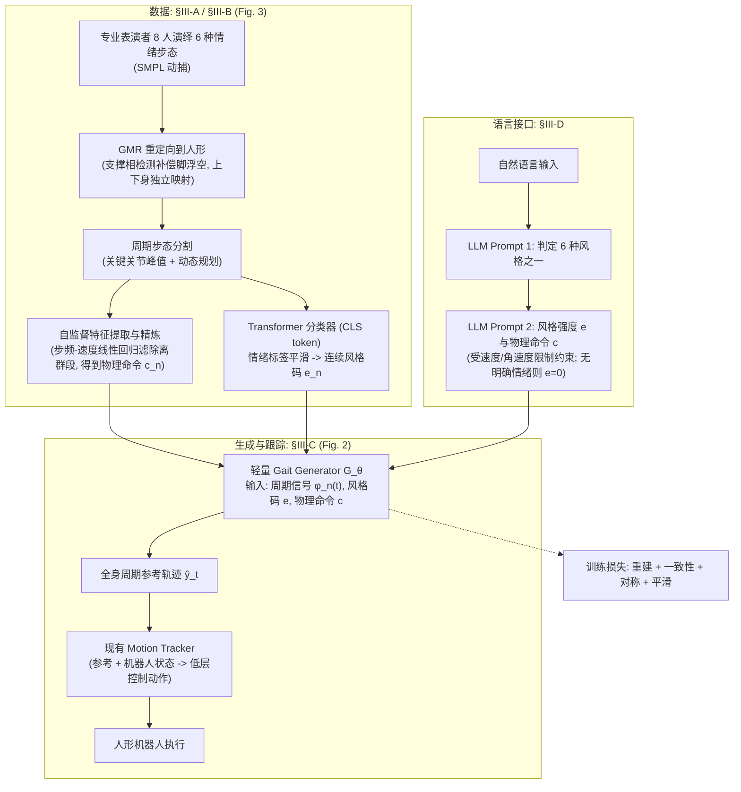

# EMoG：情绪调制人形步态生成

**EMoG**（[arXiv:2609.14432](https://arxiv.org/abs/2609.14432)）——连续情绪风格码与物理步态指令解耦；统一 RL tracker；G1 真机情绪步态演示。

## 一句话定义

**连续情绪风格码与物理步态指令解耦。**

## 英文缩写速查

| 缩写 | 英文全称 | 简要说明 |
|------|----------|----------|
| EMoG | 情绪调制人形步态生成 | 本文方法简称 |
| VLA | Vision-Language-Action | 视觉-语言-动作（若适用） |
| Sim2Real | Simulation to Reality | 仿真到真机迁移（若适用） |

## 为什么重要

- 纳入 [2026-09-15 十篇盘点](../../sources/blogs/wechat_embodied_station_9_papers_resources_effvla_2026-09-15.md) 索引。
- 公众号推荐跟踪方向之一。

## 流程总览

图依据：论文 §III-A 至 §III-D / Fig. 2、Fig. 3。

## 核心原理（方法）

人形 locomotion 通常只优化 **稳定 + 任务执行**，表现力要么没有，要么以牺牲指令跟随为代价。EMoG 的做法是把两者放进 **两个互不干扰的通道**：

| 层 | 内容 | 关键设计 |
|----|------|----------|
| **风格通道** | 强度 **连续可调** 的 emotional-style code | 情绪不是离散标签（开心/悲伤），而是可插值的强度轴——这是「连续调制」主张的前提 |
| **指令通道** | 速度 / 偏航 / 步频等物理指令 | 与风格码正交输入，保证风格变了 **指令仍被跟住** |
| **生成** | **轻量 MLP** 实时产出周期性步态轨迹 | 轻量是为了进控制环；输出是 **参考轨迹** 而非直接力矩 |
| **执行** | **统一 RL 策略** 跟踪轨迹 | 一套 tracker 服务所有情绪，不为每种风格单独训策略 |
| **数据** | 专业表演者的 **情绪标注步态数据集** + 自动化管线抽 **物理一致周期循环** | 表演数据不一定物理可行，管线这一步是能不能上机的关键 |
| **接口** | **LLM parser**：自由文本 → 情绪风格 + 运动参数 | 交互式控制入口，不是核心控制机制 |

**读法：** 真正的技术赌注在「**解耦**」——风格码与物理指令必须互不污染。若风格一加大就跟不住速度指令，整套设计就退化成风格化运动生成。

## 实验与评测

| 维度 | 报告内容 | 读法 |
|------|----------|------|
| **风格连续调制** | 情绪强度连续变化时步态风格随之连续变化，带可感知表达线索 | 这是 **感知层** 主张，本质上需要人评；不要当作可复现的量化指标 |
| **指令跟踪保持** | 风格调制的同时保持命令跟踪 | 解耦是否成立的 **核心验收项**：应在风格强度扫描下看跟踪误差曲线是否平坦 |
| **真机** | Unitree **G1** 情绪步态演示 | feasibility 级证据，未报跨情绪的量化成功率或跟踪误差表 |
| **实时性** | 轻量 MLP 实时生成 | 生成侧延迟与 RL tracker 的控制频率应分开记账 |

**验收提醒：** 本页与 [摘录归档](../../sources/papers/emog_arxiv_2609_14432.md) 均未给出量化表格——abstract 停在定性描述。引用前须回原文；表达力类工作的主观评分尤其无法跨论文横比。截至 2026-09-15 代码 **待发布**，无法独立验数。

## 与其他工作对比

> 下表只做 **定位对照**：表现力类工作多用主观评分或演示视频作证据，与跟踪误差类指标不在同一维度，**不可横比**。

| 对照 | 差异读法 |
|------|----------|
| **只优化稳定与任务执行的 locomotion**（要替代的默认做法） | 表现力被当成副产品或干脆没有；EMoG 把它做成 **显式可调的输入轴**，且承诺不牺牲指令跟随 |
| [ExBody](./paper-exbody-expressive-humanoid.md) | 同做表达性人形，但切分维度是 **空间上的**：上身跟表达参考、下身由速度命令与鲁棒奖励约束。EMoG 的切分是 **语义上的**（风格码 vs 物理指令），全身都受风格调制 |
| [AMP 运动先验](../methods/amp-reward.md) / [AMP 综述](../overview/humanoid-amp-motion-prior-survey.md) | 风格来自 **判别器**「像不像数据集」，强度不可连续调、换风格要换数据或换判别器；EMoG 用连续风格码 + 统一 tracker，可插值且不重训。代价是需要带情绪标注的表演数据 |
| [步态生成](../concepts/gait-generation.md)（CPG / 参数化周期步态） | EMoG 的输出形态与之同族——**周期步态轨迹**，只是参数由神经网络按风格码产生而非人工整定。读本页时应把它看成「可学习的步态参数生成器 + RL 跟踪」，不是端到端策略 |
| [EMOTION](./paper-loco-manip-161-094-emotion.md) | 名字近似但问题不同：那条线做的是从感知恢复表征再生成全身轨迹的 **整链路**；EMoG 只做 **步态风格** 这一层，落点在 HRI 表达而非任务执行 |
| [SONIC](../methods/sonic-motion-tracking.md) 等运动跟踪 | **下游而非竞品**：EMoG 出参考轨迹，物理执行由统一 RL tracker 完成。若要替换 tracker，风格码的表达效果会随跟踪能力变化，两层需分开评估 |

## 结论

**EMoG 的核心贡献需与重建/仿真指标分开读；开源状态为 **待发布**（截至 2026-09-15）。**

1. 先核对项目页与仓库是否已更新（尤其待发布项）。
2. 读数时区分仿真主结果与真机/feasibility 子集。
3. 交叉对比同盘点内相关工作，避免孤立引用单点数字。

## 工程实践

| 项 | 内容 |
|----|------|
| 开源 | **待发布** |
| 复现 | 若有官方仓库，从 README 环境 → 数据 → 训练/评测顺序推进 |

## 局限与风险

- 结论范围以 arXiv 与项目页为准；待发布代码无法独立验数。

## 关联页面

- [十篇资源技术地图](../overview/embodied-resources-10-papers-technology-map.md)

## 参考来源

- [EMoG 论文摘录](../../sources/papers/emog_arxiv_2609_14432.md)
- [具身智能小站 2026-09-15 盘点](../../sources/blogs/wechat_embodied_station_9_papers_resources_effvla_2026-09-15.md)
- [arXiv PDF](https://arxiv.org/pdf/2609.14432)：已通读方法部分（实验与附录以略读为准）：§III 方法（A 情绪风格表示、B 步态采集与精炼、C 情绪步态生成与跟踪、D 语言接口）

## 推荐继续阅读

- [机器人论文阅读笔记：Gated Residual Body-Hand Coordination for Whole-Body Humanoid Teleoperation](https://imchong.github.io/Robot_Learning_Paper_Notebooks/papers/07_Teleoperation/Gated_Residual_Body-Hand_Coordination_for_Whole-Body_Humanoid_Teleoperation/Gated_Residual_Body-Hand_Coordination_for_Whole-Body_Humanoid_Teleoperation.html)
- 论文 PDF：<https://arxiv.org/pdf/2609.14432>
