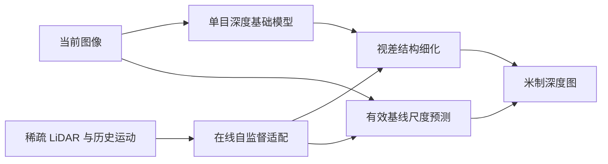

# EM-ViT：机器人运动辅助的单目深度在线尺度适配

## 一句话定义

**把相对深度的局部结构细化与全局尺度预测解耦，用稀疏深度监督、可选机器人自运动和梯度匹配在线调整单目深度。**

## 英文缩写速查

| 缩写 | 英文全称 | 简要说明 |
|------|----------|----------|
| MDE | Monocular Depth Estimation | 单目深度估计 |
| ViT | Vision Transformer | 视觉 Transformer |
| EM | Ego-Motion | 机器人自身运动 |
| LiDAR | Light Detection and Ranging | 激光测距 |

## 为什么重要

在线将单目相对深度校正到米制尺度，关注现有控制、数据或机器人学习方法在复杂任务中的失效点。这里单独建论文实体，避免与其他论文共用详情页；已通读原始论文 HTML 的可用正文和附录；源码执行效果仍需复现。

## 核心机制

读取基础模型的仿射不变逆深度；dRefNet 细化视差图、ViT 预测有效基线尺度；借助稀疏 LiDAR、光度重建和梯度匹配，并可选 odomNet 优化历史相机位姿。

## 方法流程

该流程依据原文方法描述，不等价于源码调用时序。

## 源码运行时序图

**暂不适用**：未核实到官方已发布的完整可运行实现，不以通用模板替代实际调用链。

## 实验与评测

论文在 KITTI 等室内外公开序列评估深度精度与适应速度；结果针对有稀疏测距/运动信息支持的在线校准，不是完全无标定的单目绝对尺度恢复。

## 局限与工程实践

- 动态物体、光度重建退化和稀疏 LiDAR 噪声会影响自监督；项目页 Code 链接在核查时仍指向占位仓库，不能声称已发布运行代码。
- **源码状态：** 项目页 Code 链接指向 github.com/YOUR REPO HERE 占位地址，截至 2026-11-14 不能判定代码开放。
- **原文状态：** 已通读 arXiv HTML 的可用正文和附录；具体复现及跑通情况尚未独立验证。

## 结论

**工程上应分别评估深度相对结构误差与绝对尺度误差，而非只看合并指标。**

1. 使用与论文一致的任务、硬件和评测协议复验，不跨实验口径比较数据。
2. 把方法改善的指标与额外的数据、计算或控制成本分开记录。
3. 对未经独立核查的复现入口，暂不声称完成验证。

## 与相关方法对比

| 对照方法 | 关键区别 | 局限或适用条件 |
|---|---|---|
| 固定单目深度先验 | 换场景后可能产生尺度和结构偏差 | EM-ViT 在线分离视差结构细化和尺度校准 |
| 仅用光度一致性在线适应 | 动态物体与位姿误差会干扰监督 | EM-ViT 利用稀疏深度与可选自运动约束 |

不同基准和硬件的结果不能直接排序。

## 关联页面

- [目标感知的 3D Gaussian 语言地图免训练细化](./paper-target-aware-gaussian-langmap.md)
- [TRACE：具有参考保持约束的对话式人形动作编辑](./paper-trace-conversational-humanoid-motion.md)

## 参考来源

- [论文归档](../../sources/papers/emvit-online-metric-depth_arxiv_2611_14958.md)
- [官方项目页归档](../../sources/sites/emvit-online-metric-depth.md)

## 推荐继续阅读

- [arXiv 原文](https://arxiv.org/abs/2611.14958)
- [官方项目页](https://emvit-mde.github.io/)
