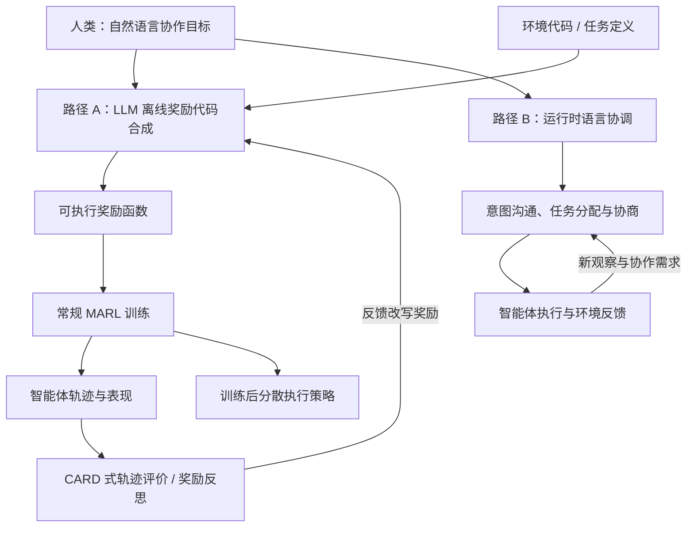

# 奖励工程的终结：大语言模型如何重塑多智能体协作（The End of Reward Engineering）

**论文：** *The End of Reward Engineering: How LLMs Are Redefining Multi-Agent Coordination*，Haoran Su、Yandong Sun、Congjia Yu，New York University / Lerna AI，arXiv:2601.08237v1（2026-01-13）。这是一篇 **perspective / research agenda**，不是给出新 MARL benchmark 成绩的实证论文。

## 一句话定义

**用自然语言描述多智能体协作目标，让 LLM 离线生成/修改奖励函数，或在运行时辅助智能体用语言协商；文章借 EUREKA、CARD、RLVR 说明研究动机，提出三大支柱与待验证实验。**

## 英文缩写速查

| 缩写 | 英文全称 | 简要说明 |
|------|----------|----------|
| LLM | Large Language Model | 将自然语言目标转成奖励代码，或参与运行时语言协调 |
| MARL | Multi-Agent Reinforcement Learning | 多智能体强化学习：论文讨论的奖励归因与非平稳问题 |
| RL | Reinforcement Learning | 通过累计奖励优化策略；离线生成奖励后仍需执行常规训练 |
| RLVR | Reinforcement Learning from Verifiable Rewards | 在可验证任务上训练 LLM 的先行范式，**非直接 MARL 实验证据** |
| CARD | 论文引用的 CARD 奖励设计框架 | 使用语言模型反馈与轨迹偏好评价迭代设计奖励 |
| TPE | Trajectory Preference Evaluation | CARD 利用 LLM 对轨迹质量进行评价 |
| CTDE | Centralized Training, Decentralized Execution | 多智能体集中训练/分散执行基线思路 |
| MAPPO | Multi-Agent Proximal Policy Optimization | 论文在拟议可扩展性实验中列出的 MARL 基线 |
| QMIX | Monotonic Value Function Factorisation | 论文在拟议可扩展性实验中列出的值分解基线 |

## 为什么重要

- **奖励设计仍是多机器人协作瓶颈**：团队奖励下难判贡献；各机器人同时更新造成非平稳；随数量增加，联合动作空间与激励冲突加剧（§1–2）。
- **区分两类 LLM 作用位置**：先用 LLM 生成 reward 再训练，是优化目标工程；让 LLM 运行时协调分工，是通信/规划系统。二者不应混成“让 LLM 直接控制机器人”（§3.3）。
- **对研究选题有用**：论文不是新模型，而是一份将既有成果与未来 MARL 实验连接起来、可证伪的研究议程（§6）。

## 核心信息

| 项 | 一手原文依据 |
|----|------------|
| 作者与机构 | Haoran Su、Yandong Sun（纽约大学，NYU）；Congjia Yu（Lerna AI） |
| 发表形态 | arXiv v1，2026-01-13；观点/研究议程 |
| 贡献 | 两种实现路径、三大支柱、五类挑战、五组建议实验 |
| 证据 | 引用 EUREKA、Text2Reward、CARD、RLVR；**没有自身新实验** |
| 代码状态 | 论文未给出本文专用项目站、代码库或可运行复现入口 |
| 适用范围 | 语言驱动奖励生成 / 多智能体协调假说；实机部署须另做安全论证 |

## 核心原理

### 两条不同的实现路径（§3.3 / Figure 2）

**路径 A — LLM 离线生成多智能体奖励。** 输入：自然语言目标 + 环境描述/源码；LLM 输出可执行的奖励函数；MARL 算法在仿真中采样、更新策略。借鉴 EUREKA 与 Text2Reward，可结合 CARD 式轨迹反馈迭代奖励。**LLM 不需要参与高频策略部署**，与机器人 50–1000 Hz 控制回路相容；但奖励正确性仍须验证。

**路径 B — 运行时自然语言协调。** 多个智能体通过语言共享意图、协商任务或由协调器规划分工；LLM 位于通信/任务层，并非给每个低层动作打数值分。其通信时延、规模化和执行安全性需单独评估。论文将其作为展望，而非已部署方案。

### 流程总览（依据 §3–4；两条路径为概念方案，不是本文发布的训练代码）

上图只复现作者主张的**概念数据流**；路径 A 中的反馈回路借鉴 CARD，不代表这篇观点论文实测过完整多智能体闭环。路径 B 不要求训练出新的奖励函数。

### 三大支柱（§4）

1. **语义奖励规范（Semantic reward specification）**：语言比静态权重表更容易写出“避免重复劳动、主动交接、兼顾安全”等丰富目标，LLM 将其翻译为不同场景可执行的 reward；输出代码仍可能漏掉语义约束。
2. **动态适应（Dynamic adaptation）**：读取新策略轨迹 → 语言化观察与失败分析 → 对照任务目标 → 修改奖励、再次训练。CARD 的 TPE 提供思路；奖励改变过于频繁也可能破坏训练稳定性。
3. **人类对齐（Human alignment）**：文字规范便于人工审查和纠错；但“语言更可读”**不等于**自动保证行为安全、符合人类真实偏好。作者援引 RLVR 的推理训练作启发，明确说 RLVR 与 MARL 不同。

## 工程实践

**把这篇观点论文用作多机器人 MARL 的实验设计检查表，而非开箱即用算法：**

| 步骤 | 建议实施与要看什么 |
|------|--------------------|
| 写清验收目标 | 分开记录任务成功、碰撞率、资源利用、人工调奖励耗时；留独立安全约束 |
| 建立基线 | 人工设计 reward、一次生成的 LLM reward、基于轨迹反馈多轮修改的 LLM reward；同一 MAPPO/独立 PPO 预算 |
| 验证奖励代码 | 静态检查、模拟训练、目标代理指标与真实任务成功率对照，防止 reward hacking |
| 调整非平稳条件 | 在训练中改变队友数量、协作目标或障碍；记录恢复时间、性能曲线面积与人工介入成本 |
| 分离协调模块 | 需要运行时语言协商时另设实验，记录 LLM 调用延迟、token 成本及消息规模 |
| 实机落地 | LLM 只负责低频目标/奖励维护；高频控制、安全停机和可验证约束留在独立控制系统 |

## 源码运行时序图

**不适用。** 本文是研究展望，没有提供自己的训练、推理或部署源码及可核实的运行入口；上方 Mermaid 为**论文概念流程图**，不是虚构的源码调用链。

## 实验与评测（§6：全部为拟议实验）

| 研究实验 | 论文计划的对照 | 指标/证据状态 |
|----------|----------------|---------------|
| E1：LLM vs 人工奖励 | 人工 / 一次生成 / CARD 式精炼 / 自动奖励搜索；Multi-Agent MuJoCo、SMARTS 等 | 成功率、样本效率、设计工时；**未报告实测** |
| E2：跨域迁移 | 变换机器人数量、障碍、任务分布；同一语言描述映射仓储/巡逻/交通 | 迁移成功率、性能退化；**未报告实测** |
| E3：非平稳适应 | 4→6 智能体、目标漂移、环境扰动；周期或触发式修改 vs 人工 | τ90 恢复时间、人工干预；**未报告实测** |
| E4：智能体数量扩展 | n=2/5/10/20/50；MAPPO、QMIX、独立 PPO | 设计工时、收敛、信用归因；文中 O(1) 是**预期** |
| E5：人类对齐/解释性 | 拟招募 60 人，对照看 reward 代码或自然语言规范 | 预测准确率、诊断时间、认知负荷；**尚未执行** |

研究议程中的 10 随机种子、95% 置信区间、参与者数量和 GPU 小时是 **实验方案参数**，不能当成已执行的 benchmark 记录。论文 §6.7 明确承认：若这些实验不支持性能、迁移或可扩展性优势，就应质疑范式转变主张。

## 结论

**这篇论文提出“语言化目标”值得验证的系统路线，但远未证实多智能体不再需要奖励工程。**

1. **别混淆离线奖励合成与运行时协商**：前者有 EUREKA/CARD 的相关先例，后者主要改变通信架构。
2. **仍要训练和验证数值奖励**：路径 A 只是把手工写 reward 转成 LLM 生成/精炼 reward，不是删除环境反馈信号。
3. **RLVR 不是多机器人合作成绩**：它提供可验证目标训练 LLM 的类比，不能替代 MARL 的信用分配验证。
4. **优先做有对照的实验**：特别记录奖励调试人时、团队成功与碰撞、非平稳恢复指标，而非只比较累计 reward。
5. **实机安全不可委托给自然语言**：幻觉、歧义、通信延时和大规模扩展仍是研究难题。

## 与其他工作对比

| 工作 | 本文如何使用该证据 | 不能据此推论 |
|------|--------------------|--------------|
| [EUREKA](./paper-eureka-llm-reward-design.md)（2024） | 环境源码 + 语言提示 → 奖励代码，反思进化；引述 29 机器人仿真任务的既有成绩 | 本文已复现多机器人协作收益 |
| Text2Reward（2024） | 另一条自动编写 dense reward 的先行路线 | 自然语言自动规避安全风险 |
| CARD（2025） | TPE 轨迹偏好评估驱动奖励修改 | 本文已证明 MARL 非平稳环境的在线稳定收敛 |
| RLVR / DeepSeek-R1（2025） | 可验证目标支撑 LLM 推理训练的**类比证据** | RLVR 等于语言型多智能体 credit assignment |
| [传统 Reward Design](../concepts/reward-design.md) | 奖励项、约束、测试与工程调优的现实基线 | 自动生成后无需人工审查 |

## 局限与风险

- **证据性质**：主体是综合文献、推演与研究路线；所有第 6 节的预期结果均非实测，多智能体直接证据尚少。
- **信用分配未解决**：语言可以表达集体目标，但仍需把表现反馈归因到个体策略训练。
- **计算与实时性**：LLM 调用相对于每控制周期远慢；频繁在线修改 reward 可能导致学习不稳。
- **奖励与安全**：代码生成有幻觉，语言规范有歧义，仍需独立检查、仿真验证、人审批。
- **可扩展性与基准**：大规模语言通信开销、不同团队规模/算法下的可泛化性尚未验证。
- **开源复现状态**：未见本文专用官方代码 / demo；因此没有可提供的运行命令或源码时序图。

## 关联页面

- [奖励设计（Reward Design）](../concepts/reward-design.md) — 手工奖励分解及 reward hacking 检查
- [EUREKA：Human-Level Reward Design](./paper-eureka-llm-reward-design.md) — 论文引用的可执行奖励自动生成先例
- [强化学习（Reinforcement Learning）](../methods/reinforcement-learning.md) — PPO 与策略优化主线
- [逆强化学习（Inverse Reinforcement Learning）](../methods/inverse-reinforcement-learning.md) — 从示范推断奖励的其他路线
- [PPO](../methods/ppo.md) — MARL 基线中独立 PPO 的算法基础

## 参考来源

- [arXiv:2601.08237v1 原文通读归档](../../sources/papers/end_of_reward_engineering_arxiv_2601_08237.md) — 记录 §1–8、图注、实验方案与证据边界
- [The End of Reward Engineering（arXiv HTML 全文）](https://arxiv.org/html/2601.08237) — Su、Sun、Yu，2026-01-13
- [原始 arXiv 论文记录](https://arxiv.org/abs/2601.08237)

## 推荐继续阅读

- [EUREKA：Human-Level Reward Design via Coding Large Language Models](https://arxiv.org/abs/2310.12931)
- [DeepSeek-R1: Incentivizing Reasoning Capability in LLMs via Reinforcement Learning](https://arxiv.org/abs/2501.12948)
- [Multi-Agent Deep Reinforcement Learning: A Survey](https://arxiv.org/abs/1911.10635)
