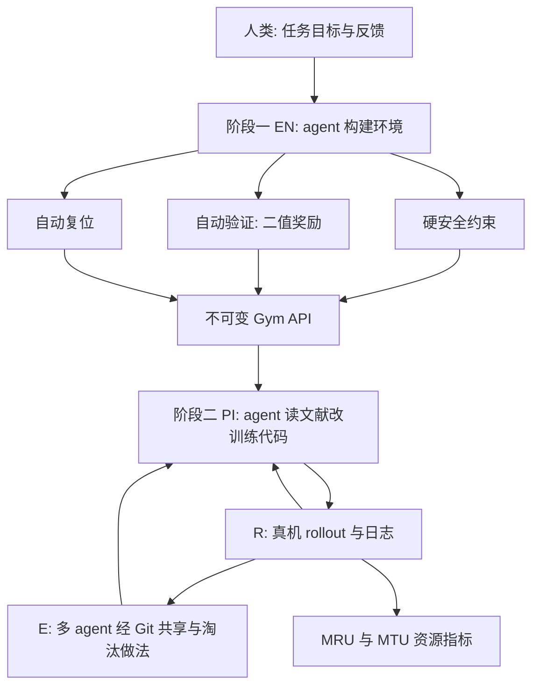

# ENPIRE：真机上的 coding agent 策略自改进（arXiv:2606.19980）

## 一句话定义

**ENPIRE** 是一个给 coding agent 用的 harness：先由 agent 在人类反馈下为某个任务搭好带安全约束、自动验证（二值奖励）、自动复位的真机环境，之后 agent 不再需要人，自己读日志、查文献、改 BC / RL / 启发式代码，在真机上反复「复位、执行、验证、改进」，并可在多台机器人上经 Git 并行（[arXiv:2606.19980](https://arxiv.org/abs/2606.19980)，v1，2026-06-18）。

## 英文缩写速查

| 缩写 | 英文全称 | 简要说明 |
|------|----------|----------|
| ENPIRE | EN + PI + R + E | 论文的系统名，四个模块首字母（摘要）；阶段二常写作 PIRE（第 1 节） |
| EN | Environment module | 硬安全约束 + 自动验证 + 自动复位（第 2.1 节） |
| PI | Policy Improvement module | agent 发起策略改进，如 BC、RL、启发式（第 2.2 节） |
| R | Rollout module | 单机或多机并行评估策略（摘要、第 2.1 节） |
| E | Evolution module | 多 agent 经 Git 选择、复制、合并做法（第 2.2 节） |
| MRU | Mean Robot Utilization | 研究墙钟时间中机器人在执行实验的比例（第 2.2 节） |
| MTU | Mean Token Utilization | 第 2.2 节称「fleet 平均 token 消耗」，第 3.6 节定义为每分钟 token 数 |
| BC | Behavior Cloning | 行为克隆 |
| RL | Reinforcement Learning | 强化学习 |
| VLA | Vision-Language-Action | 视觉语言动作模型，仿真对比对象 GR00T 属此类 |
| YAM | Yet Another Manipulator | I2RT 的 6-DoF 机械臂，实验平台（附录 B.2） |

## 为什么重要

- **作者自述：** 现有 coding agent 的自动算法搜索基本停在数字环境；缺的是一个可重复的真机反馈回路（摘要）。ENPIRE 把「真机调策略」变成 agent 可管理的优化过程，并允许在不同训练配方与不同 agent 之间做公平消融（摘要）。
- 它把 [Karpathy autoresearch](./karpathy-autoresearch.md) 式的「agent 自主做研究」搬到有复位、安全、硬件预算约束的真机上（论文第 1 节引用 autoresearch，第 5.3 节称此前没有系统自主运行并优化物理机器人回路）。
- 提出资源利用率指标（MRU / MTU），把「稀缺的物理机器人时间」作为评价对象（第 5.3 节）。

## 核心原理与流程总览

两阶段（第 2 节）：

1. **阶段一，EN：** coding agent 用过程式 tool call 构造环境。硬安全约束（越界即失败并复位）；自动验证（agent 根据几分钟成功 / 失败演示合成二值奖励，兼顾准确率与延迟，例如 zip-tie 奖励推理延迟压到 150 ms 以内，第 2.1 节）；自动复位（借鉴 CaP-X 用模块化技能把场景直接复位到最难阶段的起点，如插销、装 GPU、抓剪刀）。完成后以不可变 Gym API 暴露。
2. **阶段二，PIRE：** agent 获得训练代码库写权限，目标是最大化真机成功率；可选 BC、迭代 BC、在线 / 离线 / 离线转在线 RL（带 BC 正则）、启发式、代码策略（第 3 节、第 3.2 节）。多机时 N 个 agent 对应 N 台机器人，每个 agent 从同一基线分叉，经 Git 互相 cherry-pick / merge（第 2.2 节、附录 B.1）。

## 工程实践

- **平台（附录 B.2、B.3）：** 每站 2×YAM 6-DoF 臂加 1-DoF 平行夹爪，臂关节 PD 加重力补偿，夹爪限扭矩的柔顺抓取；策略 30 Hz、关节控制 100 Hz；相机为 RealSense D405（顶视 1、腕部 2），GPU insertion 另加 D435i；单站一张 RTX 5090（表 1）。
- **协调（附录 B.1）：** 每站本地 FastAPI（/start、/restart、/home，Push-T 另有 /avoid、/resume）；跨站只经 Git，无中心服务器；agent 沙箱内绕过逐步权限确认并有不受限互联网访问；prompt 要求「50 个连续 episode 100% 成功」（图 10）。
- **真机 RL 管线（附录 B.5）：** 集成 PLD-RL 管线，沿用 SERL 的异步设计，部署 / learner / actor 三层，磁盘缓冲区按动作来源（rl、human）路由，RLPD 式混合在线与演示缓冲。
- **重复样例：** 本文 agent 配置为 Codex（GPT-5.5 xhigh）、Claude Code（Opus 4.7 High）、Kimi Code（Kimi K2.6 thinking）（第 3 节）。
- **源码开放状态：** 项目页列出 GitHub（NVlabs/ENPIRE）链接；本环境访问仓库返回 403，未核对其内容、是否含完整环境 API 与 8 站配置，也无法确认权重 / 数据是否发布。源码运行时序图：**不适用**（仓库内容未能核对，不凭论文臆断入口）。

## 实验与评测

| 项 | 论文内容 | 出处 |
|----|----------|------|
| 成功率定义 | 一次 rollout 在固定重试次数（8）内完成任务；重试发生在看到上次失败之后，作者称其同时衡量精度与情境内恢复 | 第 3 节 |
| 摘要口径 | 前沿 coding agent 可在 PushT、pin box 整理、cutter 剪 zip tie 上自主达到 99% 成功率 | 摘要 |
| Push-T 启发式 | 仿真（Gym-PushT）上三种 agent 都成功，Claude Code 与 Codex 约 2 小时到 95%，Kimi Code 约两倍时间；真机上三个 agent 中两个失败 | 第 3.1 节、图 5 |
| Pin insertion | 间隙 4 mm；要求 50 次连续真机成功；agent 试了 BC、迭代 BC、在线 / 离线 / 离线转在线 RL 加 BC 正则、批大小等超参 | 第 2.2、3.2 节 |
| 想法树 | 少数高影响想法贡献多数进步：BC 正则 +10.8 pp，批大小调参 +0.9 pp，控制器补偿 +1.3 pp | 附录 B.6、图 12 |
| 机器人数缩放 | Push-T 到 1.0 归一化得分约 5h 到 2h（1 到 8 agent）；pin insertion 近乎满成功 1.5h 以上到约 40 分钟 | 第 3.3 节 |
| 经验迁移 | pin insertion 后把 agent 写的 markdown 总结附到 GPU insertion 任务指令，agent 达到高成功率；细节在附录 | 第 3.4 节 |
| 仿真 | RoboCasa365：ENPIRE 生成的脚本对比 GR00T N1.5 和 CaP-X；每任务 40 个固定 seed 三元组，成功用环境原生谓词 | 第 3.5、图 6、D.2 |
| 资源 | 1 到 8 agent：GPU 利用率与 token 消耗升，单机器人利用率降；MTU 在 4 agent 内近线性，8 agent 陡升 | 第 3.6、4 节，图 7 |
| 消融（pusht-simple） | 有原生视觉的 Codex 最先成功；无视觉反而先于「函数调用式视觉」；Codex+GPT-5.5 最快，Codex 加 Opus API 最慢 | 附录 C.3、C.4 |

## 与清单说法的核对

清单一句话摘要：「Harness for coding agents that runs real-world policy self-improvement loops: reset, execute, verify, refine.」（P2，RL Algorithms & Exploration 组；摘要由 LLM 据摘要起草。）

- **harness for coding agents：** 对得上（摘要、第 1 节）。
- **reset, execute, verify, refine：** 与摘要原句一致，是论文自述的「缺失抽象」。
- **real-world：** 主结果为真机；但论文同时含仿真（Gym-PushT 的启发式学习、RoboCasa365）。
- **清单没提到的：** 须先经人类反馈做一次阶段一环境构建，后面「无人」才成立（第 2.1 节）；多机 Git 进化与 MRU / MTU 指标；成功率口径是「8 次重试内」（第 3 节）；摘要的 99% 需结合该口径与任务读，正文 pin insertion 的门槛是 50 连续成功（第 3.2 节），二者关系论文未在文字里直接对齐，推测为不同口径。
- **「Self-improvement」：** 论文里被改进的是由外部大模型 coding agent 写的训练代码与策略，不是策略自己在改自己；这是读题时容易误会之处（判断）。

## 结论

**总判：** ENPIRE 的实质贡献是把真机策略训练的人工环节（复位、判成功、调算法）搬给 coding agent，前提是先投入一次性的人工环境构建；证据以 4 个任务加一个仿真基准为主，规模小而具体。

- 真正的瓶颈是自动复位与验证的质量，而不是算法搜索本身（第 2.1 节、第 3.1 节真机 Push-T 多数 agent 失败）。
- 多机提速是真实但有代价的：墙钟时间下降，token 成本超线性上升（第 4 节、图 7）。
- 想法贡献高度集中，pin insertion 里 BC 正则一个想法 +10.8 pp（附录 B.6）。
- 部署读法：成功率口径含 8 次重试，不能直接等同于单次尝试成功率（第 3 节）。
- 复现读法：agent 沙箱绕过权限提示、可联网，真机安全依赖硬约束与限扭矩夹爪（附录 B.1、B.3）。

## 局限

- **论文自述（第 4 节）：** 机器人与算力利用不足，agent 读日志、写代码、等模型时机器人空闲；规模增大 MRU 下降；token 成本随 fleet 超线性增长。
- **我看到的未验证之处（判断）：**
  - 任务只有 4 个，且阶段一环境仍需人类反馈与离线核验，「完全自主」是阶段二的口径。
  - 对比 human-in-the-loop 方法（第 1 节称 pin insertion 收敛更快，引用论文 [48]）：正文文字里没有给出可核对的数值，我只读了文字层，图未目视，故不写数字。
  - MTU 在第 2.2 节与第 3.6 节两处定义不同（总消耗 vs 每分钟 token），摘要又说 MRU 与 MTU 而正文还加 GPU 利用率。
  - 仿真图 6 的具体成功率数字未读到文字层，不引用。
  - 仓库内容未核对（见工程实践）。

## 关联页面

- [Agentic coding 操作策略（paper-agentic-coding-manipulation）](./paper-agentic-coding-manipulation.md)：本地 coding agent 泛化操作技能，同属 code-as-policy 线
- [Karpathy autoresearch](./karpathy-autoresearch.md)：论文借用的 autoresearch 范式
- [RoboCasa365](./paper-notebook-robocasa365-a-large-scale-simulation-framework-f.md)：仿真评测基准
- [Residual Off-Policy RL（ResFiT）](./paper-notebook-residual-off-policy-rl-for-finetuning-behavior-c.md)：同类真机 RL 微调行为克隆策略
- [Isaac GR00T](./isaac-gr00t.md)：仿真对比的 GR00T 系列
- [Eureka](./paper-eureka-llm-reward-design.md)：LLM 写奖励的先例，论文相关工作引用
- [SERL](./paper-rcl-2401-16013-serl-a-software-suite-for-sample-efficient-robot.md)：真机 RL 异步设计来源
- [安全的真机 RL 微调](../concepts/safe-real-world-rl-fine-tuning.md)
- [奖励设计](../concepts/reward-design.md)
- [行为克隆](../methods/behavior-cloning.md)

## 参考来源

- [ENPIRE 论文归档](../../sources/papers/enpire_arxiv_2606_19980.md)
- 论文：<https://arxiv.org/abs/2606.19980>

## 继续阅读

- 项目页：<https://research.nvidia.com/labs/gear/enpire/>
- 代码：<https://github.com/NVlabs/ENPIRE>
- Karpathy autoresearch：<https://github.com/karpathy/autoresearch>
