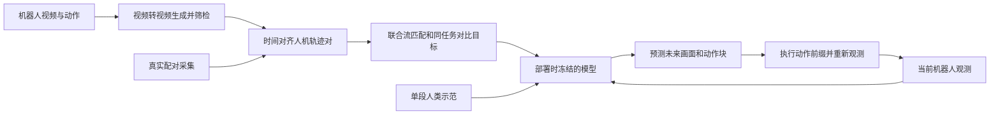

# Entangle: Scaling Human-Video In-Context World-Action Models across Unseen Tasks and Contexts / 面向未见任务和情境的人类视频提示世界动作模型

## 一句话定义

**Entangle** 将单段人类示范视频与当前机器人图像作为上下文，由固定参数的世界动作模型联合预测未来视觉和下一段控制动作。

## 英文缩写速查

| 缩写 | 英文全称 | 简要说明 |
|---|---|---|
| WAM | World-Action Model | 联合预测未来视觉与机器人动作 |
| ICL | In-Context Learning | 部署时以示范作提示，不更新权重 |
| V2V | Video-to-Video | 从机器人视频生成对齐的人类版本 |
| OOD | Out of Distribution | 评估未见任务或情境 |
| InfoNCE | Information Noise-Contrastive Estimation | 将配对动作与同任务其他轨迹区分 |

## 为什么重要

**机构：** 清华大学、GensPI Technology、Motubrain。

只按任务名把人和机器人的视频配在一起，通常没有严格的运动轨迹、速度和接触时刻对应；即使任务相同，不同动作顺序也可能产生同一结果。Entangle 试图让策略遵循视频中展示的做法，而不是仅从画面猜任务。

## 核心原理

1. Ent-Real 使用真实成对示范；Ent-Syn 以源机器人视频提供运动条件、编辑后的关键帧提供人手外观，用 V2V 生成并由视觉语言模型筛检外观及时序一致性，仍保留原机器人动作作为标签。全库 21,269 对、635 个任务；19,115 对训练、2,154 对验证。
2. 在共享视频动作骨干中沿时间拼接示范 token 与机器人 token，保持两路画面的空间坐标系；以条件流匹配联合学习未来视频潜变量与动作。可变长度示范窗覆盖演示的不同阶段。
3. 同任务 InfoNCE 把预测拉向对应示范的动作，并与同任务其他轨迹区分；目的在于削弱只识别任务类别的捷径。部署使用预测动作前缀并取新观测闭环重规划，而非直接回放人手轨迹。

## 实验与评测

- **RoboTwin**：七项未进入有监督微调的任务，按 Zero-WAM 的 demo_clean 协议，每任务每个种子 100 回合，共三个种子，每任务用一个固定生成上下文；平均成功率 69.52%，引用的 Zero-WAM 为 46.95%，差 22.57 个百分点。
- **Astribot S1**：六项未见任务均分 83.5/100（按任务分项计分，不是 83.5% 二元成功率）；替换为同任务非严格配对上下文训练时均分 41.3；移除 InfoNCE 时均分 64.7。
- **Context-OOD**：作者定性展示布局调整及工具替换，例如用香蕉替代刷子扫木块；不将示例转述为大规模统计成功率。

## 工程实践

优先保存源机器人时间戳、对齐片段和质量筛检决定；切分按任务及轨迹验证，避免同一执行越过训练和评测边界。用多路径或多顺序的同任务样本测试示范依赖，单条固定路线无法区分模型是否真正读了视频。论文附录列出推理与同步设置；本次未发现官方可运行代码入口，方法图不代表源码调用链或实测部署。

## 局限

真机只验证一种本体；合成数据受视频转换质量影响，跨场景迁移与生成提示使用主要是定性结果；更长流程的失败恢复及跨本体能力仍待验证。

## 与相关工作对比

对照论文中的 Zero-WAM，Entangle 重点加强人视频与机器人动作的时间对应、同任务不同轨迹的区分。RoboTwin 二元成功率可以按论文同设置比较，但真机分项分数不能直接与其相减。

## 结论

在本论文设置下，训练时做严格时序配对和同任务对比，比把示范当任务身份标签更能支持未见操作的执行。

## 关联页面

- [世界–动作模型纵深路线](../../roadmap/depth-wam.md)

- [动作分块](../methods/action-chunking.md)：预测动作后只执行前缀，以新观测重规划。
- [扩散策略](../methods/diffusion-policy.md)：对照通过生成式目标学习动作序列，但 Entangle 同时建模未来视觉。
- [机器人操作](../tasks/manipulation.md)：区分可达到同一目标的不同操作过程。

## 参考来源

- [论文 HTML v1](https://arxiv.org/html/2611.28732v1)、[论文 PDF](https://arxiv.org/pdf/2611.28732v1)、[原文核对记录](../../sources/papers/entangle-2611-28732.md)。
- [作者项目页](https://entangle-robotics.github.io/)。

- [项目站归档](../../sources/sites/entangle-2611-28732.md)。

## 推荐继续阅读

- 论文第 3.3、5.4、5.6 节及附录 12：数据对齐、消融、情境泛化与复现条件。
