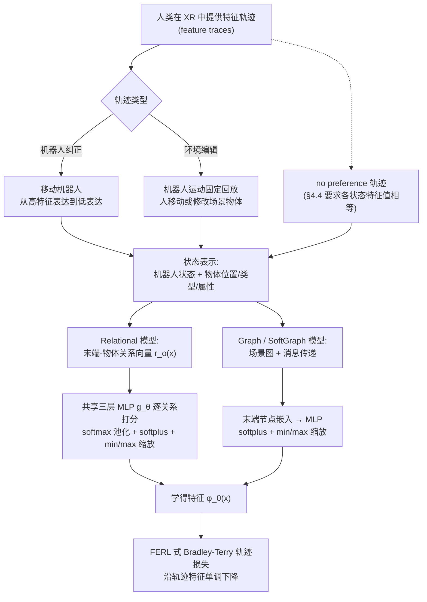

# 环境编辑奖励学习：将环境编辑作为奖励学习的纠正信号

**环境编辑奖励学习**（*Environment Edits as a Corrective Signal for Reward Learning*，[arXiv:2610.35659](https://arxiv.org/abs/2610.35659)）收录于 senlanke「具身运控lab」10-26–10-30 前沿论文动态（Manipulation）。本页依据**周报条目 + arXiv 摘要页**整理，未逐页核对正文 PDF；指标与结论以论文为准。

## 一句话定义

**环境编辑奖励学习：将环境编辑作为奖励学习的纠正信号——提出 FERRET，让人类在机器人运动保持不变时直接编辑环境中的物体。通过结合机器人动作纠正和环境编辑轨迹，学习物体属性、空间关系等偏好信息，减少奖励学习中的特征歧义。**

## 英文缩写速查

| 缩写 | 英文全称 | 简要说明 |
|------|----------|----------|
| RL | Reinforcement Learning | 强化学习 |
| VLA | Vision-Language-Action | 视觉–语言–动作模型 |

## 为什么重要

- 周报所述待解决的问题：人类通过纠正机器人动作表达偏好时，一次动作变化可能同时改变多个状态特征，难以确定用户真正关注的因素。

## 流程总览

图依据：论文 §3.1–3.2 / Fig.1；§4.4（no preference 轨迹）

## 核心机制

| 项 | 内容 |
|----|------|
| **arXiv** | [2610.35659](https://arxiv.org/abs/2610.35659) · [PDF](https://arxiv.org/pdf/2610.35659) |
| **作者（arXiv）** | Ngui, Isaac, McBeth, Courtney, Amato, Nancy M. |
| **机构（周报所述，未逐条核实）** | 待核实（作者：Isaac Ngui、Courtney McBeth、Nancy M. Amato）。 |
| **arXiv 评论栏** | （无） |
| **开源** | arXiv 摘要页与评论未见代码或项目页链接（仅核对 arXiv 摘要页，不代表未发布）（2026-11-02） |
| **周报所述创新点** | 提出 FERRET，让人类在机器人运动保持不变时直接编辑环境中的物体。通过结合机器人动作纠正和环境编辑轨迹，学习物体属性、空间关系等偏好信息，减少奖励学习中的特征歧义。 |

### arXiv 摘要节选（英文原文）

> Robot corrections allow people to adjust a robot's behavior, but a single correction changes many features. Also, preferences about object attributes and relationships between objects cannot be expressed by moving the robot.

## 源码运行时序图

**不适用**：arXiv 摘要页与评论未见代码或项目页链接（仅核对 arXiv 摘要页，不代表未发布），无可对齐的官方代码流程。

## 实验与评测

- 周报与摘要给出的数字/场景已写入上表「创新点」与摘要节选；其余实验细节、基线与成功率定义请回到论文正文。
- 读法：先对齐任务设定、传感器与成功定义（仿真/真机），再解读 headline 数字，勿跨论文直接比较。

## 与其他工作对比

| 维度 | 读法 |
|------|------|
| **同周对照** | 见 [Manipulation周报技术地图](../overview/senlanke-weekly-2026-10-26-30-manipulation-technology-map.md)，按方向浏览同期论文 |
| **开源状态** | arXiv 摘要页与评论未见代码或项目页链接（仅核对 arXiv 摘要页，不代表未发布） |

## 结论

**环境编辑奖励学习：将环境编辑作为奖励学习的纠正信号。**

1. 本页是入库级摘要，复现前请核对论文正文、附录与代码仓库。
2. 指标须连同实验条件解读。
3. 关注 arXiv 版本更新与代码发布。

## 关联页面

- [senlanke-weekly-2026-10-26-30-manipulation-technology-map](../overview/senlanke-weekly-2026-10-26-30-manipulation-technology-map.md)
- [manipulation](../tasks/manipulation.md)
- [vla](../methods/vla.md)

## 参考来源

- [environment-edits-corrective-reward-learning_arxiv_2610_35659.md](../../sources/papers/environment-edits-corrective-reward-learning_arxiv_2610_35659.md)
- [wechat_senlanke_weekly_manipulation_2026-10-26_30.md](../../sources/blogs/wechat_senlanke_weekly_manipulation_2026-10-26_30.md)
- [arXiv:2610.35659](https://arxiv.org/abs/2610.35659)
- [arXiv PDF](https://arxiv.org/pdf/2610.35659)：已通读全文：§1–§5（含 3.1 XR 采集、3.2 Relational/Graph/SoftGraph 模型、4 实验设定）

## 推荐继续阅读

- [arXiv PDF](https://arxiv.org/pdf/2610.35659)
