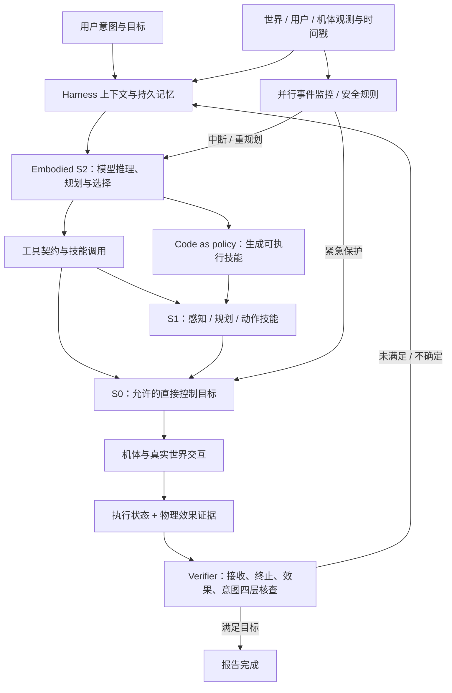

# 展望智能体机器人：机器人系统的新纪元 / Envisioning Agentic Robotics: A New Era of Robotic Systems

## 一句话定义

**Agentic Robotics（智能体机器人）** 围绕人的目标，让基础模型与具身运行框架组织可执行技能，持续观察、执行、独立验证物理效果并按证据改计划；本文给出可检验的架构、评测原则与逐步扩大机器人工作责任的研究路线，而不是一套新训练出的专用策略。

## 英文缩写速查

| 缩写 | 英文全称 | 简要说明 |
|---|---|---|
| S2 | System 2 | 高层意图理解、推理、技能编排和任务结果验证 |
| S1 | System 1 | 可调用的感知、运动规划和动作技能 |
| S0 | System 0 | 关节、底盘或全身的机体接口与本地实时控制 |
| FM | Foundation Model | 给 S2 提供通用知识与推理的基础模型 |
| VLA | Vision-Language-Action | 可供 S1 调用或对照的视觉语言动作策略 |
| WAM | World-Action Model | 世界与动作联合建模路线，可作为执行能力 |

## 为什么重要

- **不同于只把策略换成大模型：** S2 的责任包括解释意图、决定技能、核验任务是否真的完成，以及失败后观察/重规划。
- **物理世界不会暂停：** 推理延迟、观测过时、动作不可逆、机体过热与碰撞使纯数字 agent 的运行假设失效。
- **评测对象不能混淆：** 固定模型更换 harness 就能显著改变系统结果；模型答题分数、仿真闭环成功率、真实实时可靠性不是一个指标。
- **目标由“完成一项操作”上升为“可靠承担持续工作”：** 需要跨任务的进度、持久记忆、交接、异常恢复与可验证完成标准。

## 核心信息

| 项目 | 内容 |
|---|---|
| 论文 | Grid Robotics，arXiv:2611.18359v1，2026-11-13 |
| 性质 | 立场/研究路线与评测框架；汇总既有研究证据 |
| 核心 | Embodied S2 = foundation model + embodied harness |
| 参考架构 | S2（决策与验证）/ S1（可调用技能）/ S0（实时控制）+ 独立事件监控 |
| 评测 | 9 维 / 53 子维度 / 29 个具身相关子维度（作者提出的分类） |
| 官方页面 | [研究路线项目页](https://grid-robotics-official.github.io/agentic-robotics-roadmap/) |

## 核心原理

### Embodied S2 的模块边界

- **基础模型** 提供知识、理解与推理；**具身 harness** 把物体/用户/机体的当前状态构成上下文，并将决策映射到可控、可追踪的机器人调用。
- Harness 五个核心部分：**context manager、tool interface、planner、memory、verifier**；可扩展 safety gate、budget control 和 self-improvement。成功回执不是成功证据，verifier 应读取真实物理效果。
- **三条执行路径：** ① S2 调 S1 技能后向 S0 下达控制目标；② S2 经有权限的接口直接向 S0 发目标（S0 仍保持实时闭环）；③ S2 生成运行时充当 S1 的程序（code as policy）。三者可在一项任务中混用。
- **实时事件监控器独立于 S2/S1/S0：** 监听用户插话、环境变化、机体异常，必要时中断 S2，或依据预置安全规则直接触发 S0 的保护动作；不能等长链思考结束才停机。

### 流程总览

以下为论文的“意图 → 执行 → 证据 → 修正”主干（含并行安全通道），并非某个开源仓库的真实函数调用图：

### 可验证完成不等于工具调用成功

原文“拿红杯→用户改口要蓝杯”的例子说明，**取消调用 ≠ 确认停机**；新目标与在途动作冲突时应确认工具已取消、机体已稳定，再更新观测和规划。对于抓取，“API 已返回”→“调用终止”→“杯子已抓起”→“满足用户意图”是四件事。

## 评测与证据边界

作者将 **知识、理解、推理、工具使用、记忆、跨本体、安全、效率** 八类能力加上 **成本**，形成 9 维 / 53 子维度，其中 29 个与具身相关。建议把各维结果呈现为能力画像而非加权拍成一个总分。

| 核对对象 | 评测要求 |
|---|---|
| 模型能力 | 固定 harness、技能接口、观测、机器人本体、预算，比较基础模型 |
| Harness 效果 | 固定模型，比较接口、验证器、记忆和调度 |
| 实时性 | 单独记录暂停 / 不暂停世界、wall-clock、观测年龄、响应截止时间 |
| 真实成功 | 独立的物理结果证据和用户意图验收，不以模型自报完成代替 |

**证据边界：** 文中列举 RT-Safe 在其特定困难路线与协议下安全成功率 paused **19.8%** vs live **0.7%**，用来指出暂停世界的偏差；这出自**被引用的其他研究**，不是本文自行重做的机器人实验，不能外推到所有系统。部分跨模型高分来自 harness/接口/观测不同的设置，也不应合并排名。

## 从数字 Agent 到物理 Agent：四项前提的变化（原文 §5）

原文指出，数字 Agent 常见的四项有利条件并非机器人可直接继承的保证；**能迁移的是“模型 + 工具 + 反馈”的循环原则，不是能够读全状态、随意回滚的环境假设**。以下「工程落点」是据原文约束提炼的实施建议，不是作者已发布的软件实现。

| 数字 Agent 的有利条件 | 物理环境中的失效点 | 工程落点 |
|---|---|---|
| 原生可读写接口（native interface） | 传感器观测有噪声、遮挡和延迟；动作经执行器与接触才产生效果 | 在 harness 中维护带时间戳、置信度和有效期的状态估计，显式定义 S1/S0 动作接口 |
| 快速可重复验证（verifiable outcomes） | 夹住、放稳、是否损伤等物理效果可能无法从 API 返回值判定 | 建立与控制调用分离的物理结果核验及人工/安全终止机制 |
| 丰富且可复用数据（abundant data） | 机器人交互数据采集慢，力觉/触觉尤其稀缺 | 将真实操作证据、失败样本和仿真数据分开登记，检验 sim↔real 差异 |
| 廉价可复制与重置的环境（cheap environments） | 机器人不能像软件沙箱一样随意快进、克隆、恢复损坏状态 | 预留安全重置、人工接管与真实墙钟预算，不把 paused-world 成绩当实时保证 |

另有**连续世界时钟、不可逆失败、机体磨损和跨本体重验证**等新约束。真实系统不能把一次成功的工具调用视为一次可回滚的软件事务。

## 研究路线：从动作到持续职责

| 等级 | 可委托工作 | 判断标准 |
|---|---|---|
| L1 Primitive | 拿起杯子 | 单项动作的物理效果可核查 |
| L2 Task | 制作并端上咖啡 | 多个技能完成完整任务，失败可恢复 |
| L3 Workflow | 为四个人准备早餐 | 任务相互依赖、共享资源与时限的协调 |
| L4 Standing Role | 每天负责早餐 | 跨天/跨会话维护职责、偏好、库存与连续状态 |

**空间范围是另一维：** workcell → room → building → site，不等同于 L1–L4 的责任等级。论文指出非结构化环境下 L4 尚缺可靠证据，不应把长 episode 或单次演示当成持续自主。

### 四条未来研究方向与可核查证据（原文 §6.2）

下表左两列来自论文 v1 的研究方向及挑战；「建议记录的证据」是面向实验设计的工程化映射，不代表本文已经开展这些实验。

| 方向 | 核心问题 | 建议记录的证据 |
|---|---|---|
| **期限内具身推理**（Embodied Reasoning Under Physical Constraints） | 更长推理链可能错过真实世界的响应时限；应做 capped scaling | 不中断仿真的 success–latency–cost 曲线、最迟响应时间、观测年龄、超时比例 |
| **跨任务/空间的持久可信控制**（Persistent and Verifiable Control） | 任务、房间、楼层乃至跨日的状态如何保持可核验；哪些检查下沉到技能内部 | 跨任务状态一致性、证据与状态有效期、取消后确认停机、交接与恢复成功率 |
| **跨环境/本体的低成本适配**（Efficient Adaptation） | 换场地、传感器、控制模式时，如何减少重标定、重训练和人工介入 | capability card/接口契约、迁移前后成功率、适配所需数据/工时、控制周期与算力预算 |
| **从物理经验持续改进**（Continual Improvement） | 失败归因与更新如何真正惠及后续任务，避免接受无效改动 | held-out 任务收益、旧任务无回归、改动保留/退役记录、物理试验预算；若声称 RSI，额外验证“改进流程本身变好” |

**严格区分三个层级：** *adaptation* 是针对当前任务或场景调整行为；*continual improvement* 要将经验证的变化保留到后续任务；*recursive self-improvement（RSI）* 还须证明**产生与筛选改动的程序本身**在下一轮更有效。原文举例表明，已接受的程序改动数量上升并不等于目标任务获得进展，也不能以自评分替代独立 held-out 验收。

可结合 [RSI 纵深路线 Stage 0–3](../../roadmap/depth-rsi.md) 判断“留存改进 / 递归增益”与“物理验证锚”的区别。

## 源码运行时序图

**不适用（2026-11-16 核查）：** 本文是架构、评测和路线主张，官方 [项目页归档](../../sources/sites/envisioning-agentic-robotics-roadmap.md) 未找到本研究提供的可运行模型/训练/评测源码。上面的 Mermaid 是**论文框架图**，不是源码运行时序；不凭概念图虚构训练与部署脚本。

## 工程实践

1. **控制分层：** S0 负责本地高频稳定与限幅，S1 执行技能，S2 在事件触发时决策；控制周期应按实际平台和实测截止时间设计，文中 50 Hz–1 kHz 只是在不同工作中的参考范围。
2. **工具契约：** 输入的单位、坐标系、前置条件、超时、取消/失败状态以及预期物理效果都要显式定义。
3. **接管与打断：** 事件监控器可先保护 S0；S2 下一动作前须确认在途动作已经停下，不把“已发送 cancel”当作“已停止”。
4. **可比评测：** 模型、harness、skill 及观测权限至少固定其中一侧；报 wall-clock 与 live-world 结果，明确物理成功证据。
5. **长期运行：** 将关键任务进度与失效时间写入持久记忆，区别“过去曾成功抓取”和“此刻仍在握持”；设置回滚、人工接管和再验证入口。

## 结论

**Agentic Robotics 的核心不是模型能否“说出下一步”，而是能否在连续、不可逆的物理世界中，用可控技能把意图转化为经证据核验的结果。**

1. 系统比较时先固定模型或 harness，否则无法独立归因。
2. 只看模型问答与暂停世界中的成功率，无法证明实时物理自主。
3. 工具输出必须区分被接收、终止、物理效果、最终意图满足四层。
4. 自主等级应同时报告职责 L1–L4、空间范围和持续时间。
5. 优先研究物理时限内推理、跨任务可信状态、跨本体适配和利用物理反馈的持续改进。

## 局限与风险

- 这是 **position / roadmap / 评测框架**，不是提出一个训练模型并给出独立复现实验的实证论文；其表格含其他团队和不同实验条件的结果。
- 论文指出现有基准大多限于单任务和单次 episode，长期工作流及持续职责的验证仍不足，真实安全/效率不能由高仿真分推断。
- 具身 harness 的跨任务记忆、验证器误判率、安全门控和取消语义仍需具体工程实现；综述框架本身不保证安全。
- 官方项目页截至 2026-11-16 没有发布本论文的独立可运行源码、数据或权重；不宣称已复现。

## 关联页面

- [Agentic Robotics 六条研究路线对照](../comparisons/agentic-robotics-six-paths-2026.md) — 区分系统验收、推理后训练、VLA、全身跟踪、触觉与 Real2Sim 的接口和评测边界。

- [Agentic Robotics 四类因素对照研究](./paper-agentic-robotics-controlled-study.md) — 以策略自修复的控制变量实验补足本文的系统展望
- [Agentic Manipulation Policies](../methods/agentic-manipulation-policies.md) — 编排与技能执行方法
- [具身模型评测选型 Query](../queries/embodied-eval-benchmark-selection-loop.md) — 区分认知、闭环结果及 sim↔real 外推
- [RSI 纵深路线](../../roadmap/depth-rsi.md) — 区分行为适配、经验留存与真正的递归改进，并定义外部验收锚
- [具身评测纵深路线](../../roadmap/depth-embodied-eval.md) — 从模型能力到可验收系统表现

## 参考来源

- [arXiv v1 全文核对与研究定位](../../sources/papers/envisioning_agentic_robotics_arxiv_2611_18359.md)
- [Grid Robotics 官方项目页与开放状态](../../sources/sites/envisioning-agentic-robotics-roadmap.md)

## 推荐继续阅读

- [论文 HTML 全文及附录](https://arxiv.org/html/2611.18359v1)
- [Grid Robotics 研究路线项目页](https://grid-robotics-official.github.io/agentic-robotics-roadmap/)
