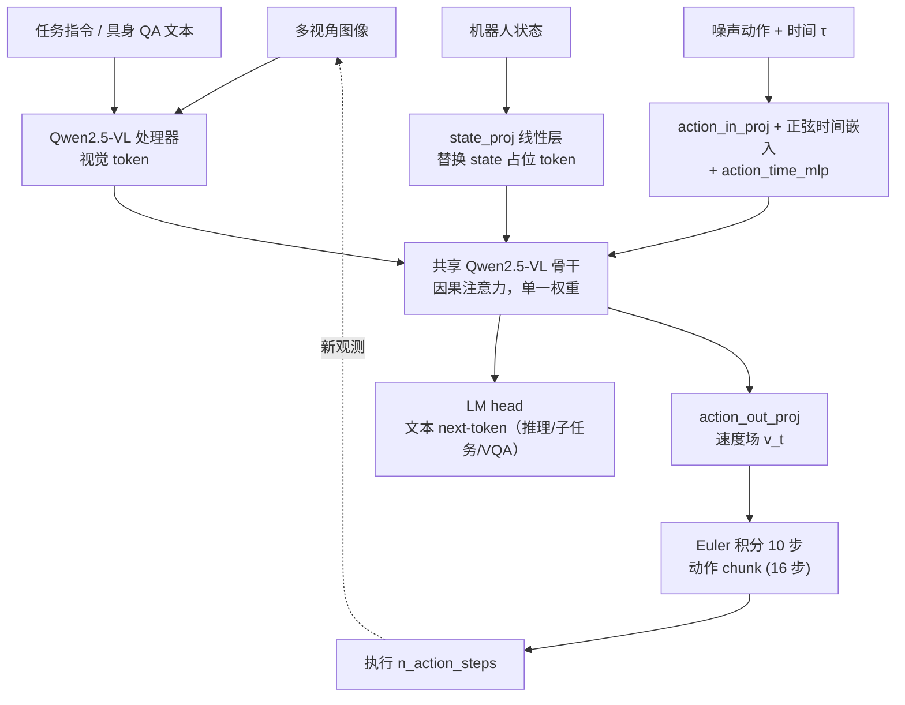
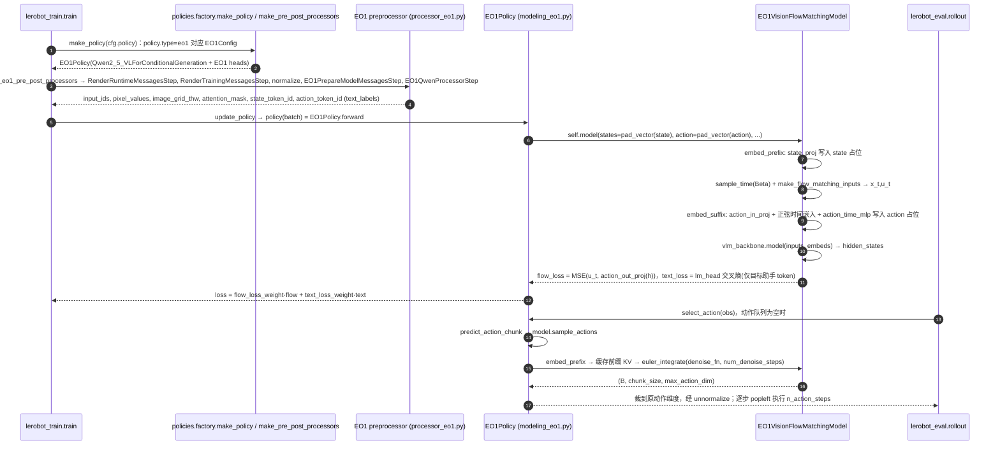

# EO-1（EO-Robotics）

**EO-1**（[arXiv:2508.21112](https://arxiv.org/abs/2508.21112)，[GitHub](https://github.com/EO-Robotics/EO1)）是上海人工智能实验室、复旦大学、智元（AgiBot）等团队的开源具身基础模型。LeRobot 固定提交 `9e5ee98` 的 README 把它列在 VLA 模型里（`docs/source/eo1.mdx`，`policy.type=eo1`）。本页依据论文 v5 正文（已通读 §1–§4、消融与结论）和 LeRobot 源码。

> 标题注意：arXiv 当前标题是 *EO-1: An Open Unified Embodied Foundation Model for General Robot Control*；LeRobot 文档 BibTeX 里还是早期标题 *Interleaved Vision-Text-Action Pretraining for General Robot Control*，同一篇论文。

## 一句话定义

**EO-1 用一个由 Qwen2.5-VL 初始化、不另设动作专家的 decoder-only Transformer，同时做文本自回归（具身推理）和 flow-matching 动作去噪（机器人控制），并在交错的视觉-文本-动作数据上预训练。**

## 英文缩写速查

| 缩写 | 英文全称 | 简要说明 |
|------|----------|----------|
| VLA | Vision-Language-Action | 视觉–语言–动作模型 |
| VLM | Vision-Language Model | 视觉语言模型（此处为 Qwen2.5-VL） |
| EO-Data1.5M | Embodied Onevision Data 1.5M | 论文构建的 >1.5M 条交错视觉-文本-动作样本 |
| EO-Bench | Embodied Onevision Benchmark | 论文自建的具身推理基准（空间/时间两类） |
| LM head / Flow head | Language-Modeling head / Flow-matching head | 文本 logits 头 / 动作速度场输出头 |
| BOI/EOI/BOR/EOR/BOA/EOA | Begin/End of Image / Robot state / Action | 论文交错序列中的边界 token |
| ERQA | Embodied Reasoning QA | 具身推理问答基准（Gemini Robotics 提出） |
| FAST | Frequency-space Action Sequence Tokenization | 基于 DCT 的动作离散化 tokenizer |
| OFT | Optimized Fine-Tuning | OpenVLA-OFT 的微调配方 |

## 为什么重要

- 对比「VLM + 单独 action expert」的 π0 系：EO-1 让动作 token 与文本、图像 token **共享同一套 Transformer 权重**，只多两个 MLP（状态/噪声动作投影、动作输出投影）。
- 它把「先推理、再动作、动作结果再回到推理」写进训练数据格式（交错序列），而不是只在序列末尾输出动作。
- 在 LeRobot 中是少数同时带 `generate_text`（VQA / 子任务生成）与动作采样的策略，可走交互式 `lerobot-rollout`。

## 流程总览

图依据：论文 §2.2 与 Fig.1；LeRobot `modeling_eo1.py` 的 `embed_prefix` / `embed_suffix` / `sample_actions`。

## 核心方法

- **统一序列（§2.2）：** `[BOI] 图像 [EOI] [BOS] 文本 [EOS] [BOR] 状态 [EOR] [BOA] 噪声动作 [EOA]` 循环交错；纯理解数据只有图像+文本，纯控制数据带状态+动作。
- **两个目标（式 2 与 L_ar）：** 文本位置用交叉熵，动作位置回归速度场（论文写作 z0 − a，τ 采样自偏向低 τ 的 Beta 分布，沿用 π0），总损失为二者之和（论文平衡系数 1.0）。LeRobot 默认 `flow_loss_weight=1.0`、`text_loss_weight=0.01`（文档表格），与论文设置不同，属 LeRobot 微调默认。
- **Interleaved rectifying sampling：** 一条含 N 个动作段的序列切成 N+1 条子序列，中间动作段改用干净动作，避免后续 token 看到噪声动作。LeRobot 的机器人控制路径只覆盖「图像+指令+状态→单个动作 chunk」，文档说明完整交错预训练流程在原项目中。
- **数据（§3，作者表述）：** 网络多模态 5.7M 样本/7.1B token；机器人数据 1.2M episode/127.3B token（AgiBotWorld、Open X-Embodiment、RoboMIND、SO100-Community、IPEC-Franka）；交错数据 EO-Data1.5M 1.5M 样本/1.0B token，由 VLM + 人工标注的时序/空间问答与机器人动作按时间顺序拼接而成。

## 源码运行时序图

训练与评测入口是 LeRobot 通用脚本，EO-1 特有逻辑在 `src/lerobot/policies/eo1/`。

要点（均读自源码）：`sample_actions` 先对动作 token 之前的前缀做一次 KV 缓存，再对动作段多步重算（每步裁回前缀长度）；批量推理要求每个样本恰好有 `chunk_size` 个连续动作占位 token。`generate_text` 复用同一骨干的 `vlm_backbone.generate`，用于 VQA 与子任务生成。

## LeRobot 实现要点

- **安装：** `pip install -e ".[eo1]"`（LIBERO 另加 `libero`）；注意力后端 `sdpa` 或 `flash_attention_2`。
- **权重：** `lerobot/eo1-base` 是 [`IPEC-COMMUNITY/EO-1-3B`](https://huggingface.co/IPEC-COMMUNITY/EO-1-3B) 的 LeRobot 原生转换，保留 Qwen 视觉-语言权重和已训练的 flow head，chunk 大小 16；只想从 Qwen 初始化则省略 `policy.path`，设 `policy.vlm_base=Qwen/Qwen2.5-VL-3B-Instruct`（文档）。
- **默认超参（`configuration_eo1.py` / 文档）：** `chunk_size=16`、`n_action_steps=16`、`num_denoise_steps=10`、`max_state_dim=max_action_dim=32`、`tokenizer_max_length=1000`、Beta 时间采样 α=1.5、β=1.0。
- **数据：** 需要图像、`observation.state`、`action` 和 `task` 文本；相机名对不上时用 `rename_map`。
- **语言标注训练：** `policy.recipe` 与 LeRobot 语言列，目标助手 turn 用交叉熵、`low_level` 流用 flow 监督；`recipe=null` 回到纯动作训练。
- **限制：** 本页范围只含机器人控制策略路径；完整的交错预训练、EO-Data1.5M 构建不在 LeRobot 内。

## 实验结果（论文，作者表述）

| 基准 | EO-1 | 对照（同表） |
|------|------|------|
| LIBERO 平均 | 98.2%（Spatial 99.7 / Object 99.8 / Goal 99.2 / Long 94.8） | OpenVLA-OFT 97.1、π0 94.2、GR00T N1 93.9 |
| SimplerEnv WidowX / Google-VM / Google-VA | 72.7% / 76.5% / 63.0% | 文中称分别领先 π0 3.5 / 5.1 / 8.3 个百分点 |
| RoboVQA BLEU-4 / ERQA / EO-Bench Overall | 58.5 / 45.5 / 44.8 | GPT-4o 47.2 / 40.0 / 40.5；Qwen2.5-VL-3B 55.9 / 35.3 / 33.5 |
| 消融：纯自回归 EO-1(fast) vs EO-1(base)，LIBERO | 88.0% vs 98.2% | 论文用以说明引入 flow matching 的精度收益 |

- 论文 Table 5：交错数据版 EO-1(interleaved) 在 AgiBot Sandwich 总分 0.84，高于 base 的 0.77；加入泛用 LLaVA 指令数据反而降到 0.66。
- 这些数字来自论文自述实验，未经本仓库复现；LeRobot 转换权重在 LeRobot 上的成绩未核实。

## 与其他工作对比

- **真机对照**：多平台评测对比 π0-FAST、[π0](./paper-pi0.md) 与 [GR00T N1.5](./paper-gr00t-n1-5.md)，论文报告总体完成分 86.0%，对照依次为 43.0%、68.0%、71.0%（§4.5、图 6）；推理-控制四任务中两个对照接 GPT-4o 作外部规划器，EO-1 用单一解码器同时规划与控制（§4.8、图 11）。完成分为作者自建真机任务口径（长程任务每项 10 次，§4.6），不能与其他论文横比。
- **离散自回归 VLA**：[RT-2](./paper-rt-2.md)、[OpenVLA](./paper-openvla.md) 及 [FAST](./paper-rcl-2501-09747-fast-efficient-action-tokenization-for-vision-la.md) 把连续动作离散成 token，论文认为存在推理延迟与分辨率限制（§5）；同条件消融中纯自回归的 EO-1(fast) 在 LIBERO 为 88.0%，混合解码 EO-1(base) 为 98.2%（§4.9、表 5）。
- **连续动作专家**：[Octo](./paper-octo.md)、π0、GR00T N1 以扩散或 flow matching 动作专家输出连续动作（§5）；EO-1 不设单独动作专家，文本与动作共享同一 Qwen2.5-VL 权重，只加输入/输出两个 MLP（§2.2）。
- **离散与连续结合、协同训练**：[OpenVLA-OFT](./paper-rcl-2502-19645-fine-tuning-vision-language-action-models-optimi.md) 等用两阶段微调或集成组合两种解码；[π0.5](./paper-pi05-open-world-vla.md) 先以 FAST token 多源预训练再训练动作专家，[Knowledge Insulation](./paper-knowledge-insulation.md) 在训练中隔离 VLM 骨干（§5）。论文认为这些方法多在分离的图文对或机器人轨迹上训练，EO-1 的区别在于交错视觉-文本-动作数据（§3.2）。
- **具身推理基准**：RoboVQA、ERQA、EO-Bench 上对比公开 VLM（Qwen2.5-VL、InternVL2.5）、闭源 VLM（GPT-4o、Gemini 1.5 Flash、Claude 3.5）与协同训练 VLA（ChatVLA、Magma），论文称在 VLMEvalKit 统一条件下评测（§4.3、表 2）；EO-Bench 为作者自建。

## 结论

**EO-1 的价值在于证明「共享骨干 + 文本/动作双目标 + 交错数据」这条路线可行，而不是某个单项指标。**

- 论文报告 LIBERO 98.2%，但属论文自述，且预训练+微调口径与 SmolVLA 等不可直接横比。
- 在 LeRobot 里它是 3B 级、Qwen2.5-VL 骨干的重模型，需 `[eo1]` extra；推理固定 10 步去噪。
- 想要文本推理能力须使用语言标注 recipe 训练，纯动作微调不会自动保留交互能力（推测）。
- 论文自述局限：尚未覆盖导航、避障、失败检测，也没有异步的「边想边做」推理。

## 关联页面

- [vla](../methods/vla.md)
- [action-chunking](../methods/action-chunking.md)
- [flow-matching-embodied-policy](../concepts/flow-matching-embodied-policy.md)
- [lerobot](../entities/lerobot.md)
- [libero-benchmark](../entities/libero-benchmark.md)
- [paper-pi0](../entities/paper-pi0.md)
- [paper-smolvla](../entities/paper-smolvla.md)
- [paper-molmoact](../entities/paper-molmoact.md)

## 参考来源

- [eo1_arxiv_2508_21112.md](../../sources/papers/eo1_arxiv_2508_21112.md)
- [lerobot.md](../../sources/repos/lerobot.md)
- [arXiv:2508.21112](https://arxiv.org/abs/2508.21112)
- [EO-1 GitHub](https://github.com/EO-Robotics/EO1)
- LeRobot 固定提交 9e5ee98 的 `docs/source/eo1.mdx` 与 `src/lerobot/policies/eo1/{configuration,modeling,processor}_eo1.py`
