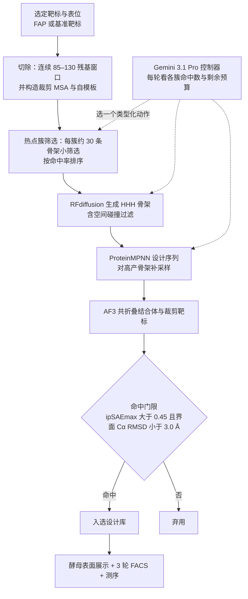

# Agent-guided Epitope Excision（表位切除 + 智能体引导的 de novo 结合体设计）

本页依据 Google Research / DeepMind / Cloud 论文 *Agent-guided epitope excision enables economical de novo binder design*（[PDF](https://www.gstatic.com/science-ai/epitope_excision.pdf)，2026-10-23；[arXiv:2610.33195v1](https://arxiv.org/abs/2610.33195)）。这是生物分子设计论文，本页只转述论文已发表的方法与结果，不补充论文没写的实验操作细节；它与机器人本体无直接关系，收录是因为其「LLM 智能体 + 固定预算 + 湿实验验证」的闭环可与具身与科学智能体工作对照。

## 一句话定义

**表位切除（epitope excision）是把大靶标裁成包含结合体接触残基加一圈 halo 的连续局部窗口，再用窗口代替全长靶标做骨架生成与结构重折叠，以降低 de novo 结合体设计的 GPU 时间；论文再让 LLM 智能体在该流程上做迭代决策。**

## 英文缩写速查

| 缩写 | 英文全称 | 简要说明 |
|------|----------|----------|
| de novo | de novo | 不依赖已有结合体的从头设计 |
| FAP | fibroblast activation protein alpha | 本文实验靶标，胞外域 719 残基（PDB 1Z68 链 B，39–757） |
| AF3 | AlphaFold3 | 结构预测，本文用于把结合体与靶标重折叠并打分 |
| RFdiffusion | RFdiffusion | 骨架扩散生成，本文只用三螺旋束（HHH）支架族 |
| ProteinMPNN | ProteinMPNN | 为骨架设计序列 |
| ipSAE | interprotein score from aligned errors | 基于预测对齐误差的界面置信度；本文用 ipSAEmax 与 ipSAEmin |
| MSA | multiple sequence alignment | 多序列比对 |
| AP / ROC-AUC | average precision / area under ROC | 衡量打分区分真结合体与非结合体 |
| HITL | human-in-the-loop | 人机混合臂（Arm B） |
| HOOTL | human-out-of-the-loop | 全自主智能体臂（Arm C） |
| PI | principal investigator | 项目负责人，Arm A 手工运行基线 |
| FACS | fluorescence-activated cell sorting | 流式细胞分选 |
| KD | equilibrium dissociation constant | 平衡解离常数；本文为酵母表面表观值 |

## 为什么重要

- **瓶颈在重折叠：** 论文指出结合体设计要对每个候选与靶标重折叠并按界面置信度排序，这一步是主要算力开销；AF3 运行时间按 256 token 分桶，靶标越大越贵（Fig. 1c：256/512/768/1024 token 对应 6.9/17.5/35.0/59.3 s）。
- **「经济」的含义：** 全文以 GPU 时间、token 桶和 GPU 小时衡量成本，**没有给出美元数字**。核心数字是 FAP 单个表位簇、85 残基裁剪、A100 上 RFdiffusion / ProteinMPNN / AF3 单位时间降低 89% / 66% / 88%（Supporting Fig. 5a），以及 Arm B 用 77.18 GPU-h 对 Arm A 的 132.87 GPU-h（Table 1）。
- **智能体自主度可量化：** 在同一命中定义和同一预算上限下，对比 PI 单独、人机混合、全自主三档，给出命中率、GPU-h 效率和表位多样性（Table 1）。
- 论文称其结果指向「人定目标区域、智能体管战术参数与算力分配」的分工；这是作者表述。

## 流程总览

图依据：论文 Fig. 4a、Fig. 5c、Methods「Agentic controller」。控制器动作集合为 propose_strategy、propose_clusters、configure、screen、expand、deepen、adjust_crop、backtrack、stop。

## 核心机制

### 表位切除

- 对每个设计，保留与结合体任一原子在接触半径内的靶标残基，再加一圈 halo；保留半径等于 5 Å 接触壳加 halo，halo 0/3/6/9/11 Å 对应半径 5/8/11/14/16 Å；裁剪取主界面链的纯连续序列片段（Methods）。
- 基准中 halo 11 Å 为「shipped operating point」，约 6 Å 是论文识别的安全下限，浅 MSA 靶标约 9 Å（Methods）。
- 用 token 桶模型估算节省：bucket = ceil(token/256) x 256（最小 256）；只有跨过桶边界才有实际节省，15 个基准靶标中 7 个本来就在 256 桶内而无加速（Fig. 1d）。

### 保真度检验

- 15 靶标、3,666 设计、halo 11 Å：界面 Cα RMSD 中位 0.37 Å、均值 0.53 Å；各靶标中位数从 0.20 Å（Mdm2、LTK）到 0.71 Å（EGFR）（Results）。
- 394 个实验确认结合体中 393 个可测界面核心：切除与全靶标的中位 RMSD 均为 0.29 Å，3 Å 门限通过率分别 98.5% 和 97.2%（Results，Fig. 2a–c）。
- HER2 生产运行：切除臂中位 0.64 Å，全域臂 1.02 Å，两者都有 90% 以上设计低于 3 Å（Fig. 4b）。

### 智能体引导（FAP 自主性阶梯）

- Arm A：PI 单独，固定流程；Arm B：PI 定策略（催化口缘），智能体选表位集合、裁剪大小、ProteinMPNN 参数、算力分配与迭代决策；Arm C：智能体读「策略中性」的整靶标表面残基图，自行宣布策略并注册热点集合；B-variant：与 Arm B 同自主度，关闭靶标 MSA 并以 ipSAEmin 排序，用于分离「打分设置」与「自主度」两种效应（Results、Methods）。
- 控制器每轮收到各簇命中数、剩余预算和当前生成设置，且从不看 ncore、鲁棒性或可构建性标记；对会超过剩余预算的动作会拒绝（Methods）。
- Arm C 日志显示智能体自行提出 dcat 小于 15 Å 的口缘遮挡策略，并用 SASA 大于 60、B 因子比小于 1.0 与到催化三联体距离做热点过滤（Results）。

## 实验与评测

| 项目 | 数字 | 出处 |
|------|------|------|
| 多引擎共识（AF3+Boltz-2+ESMFold2）AP | 中位 0.54（仅 AF3 ipSAE）到 0.60（三引擎），后两个引擎共增 +0.02 AP，GPU 约翻倍 | Supporting Fig. 1、Supporting Table 1 |
| 全靶标 vs 切除排序（ipSAEmax，11 靶标） | AP 0.47 到 0.40；ROC-AUC 0.78 到 0.73；关 MSA 后切除 AP 0.454 | Results，Fig. 2d,e |
| 裁剪残基数下限 | 小于约 85 残基通过 3 Å 门限 32%（n=41）；85–200 为 97%（n=553） | Fig. 3d,e |
| FAP 单位时间节省 | RFdiffusion 89%、ProteinMPNN 66%、AF3 88%（一个表位簇、85 残基裁剪、A100 40 GB） | Supporting Fig. 5a |
| 完整 FAP+结合体约 779 token | 落在 1024 桶（59.3 s），裁剪加结合体在 256 桶（6.9 s） | Fig. 5b |

自主性阶梯（Table 1，命中为 ipSAEmax 大于 0.45 且界面 RMSD 小于 3.0 Å；预算上限 132.87 GPU-h）：

| 臂 | 决策者 | 命中 / 设计 | 命中率 | GPU-h | hits/GPU-h | 命中表位数 | 序列多样性 |
|----|--------|-------------|--------|-------|------------|------------|------------|
| A（PI 单独） | 人 | 1,672 / 33,024 | 5.06% | 132.87 | 12.6 | 4 | 0.964 |
| B（混合，HITL） | 人加智能体 | 1,790 / 19,184 | 9.33% | 77.18 | 23.2 | 7 | 0.965 |
| C（智能体单独，HOOTL） | 智能体 | 1,803 / 29,176 | 6.18% | 124.43（约 94%） | 14.5 | 13 | 0.939 |
| B-variant（消融） | 人加智能体 | 7,106 / 21,784 | 32.62%（ipSAEmax 口径） | 90.94 | 78.1 | 12 | 0.966 |

- 论文称 Arm B 相对 Arm A 命中率 +84%，GPU 用量约 58%；所有臂截断到 77.2 GPU-h 时排序不变（Supporting Fig. 5b）。
- B-variant 在自身 ipSAEmin 口径下为 4,206 / 21,784 = 19.31%；论文明确把它排除在自主度比较之外，只用来说明「打分设置对原始命中率很敏感」（Table 1 脚注）。
- 设计数量跨臂不可直接比较，因为每设计成本随裁剪与结合体长度变化（Methods）。

湿实验（酵母表面展示，对 FAP 胞外域）：

- 5,000 条寡核苷酸库，每臂 1,250 条设计，另加 2–3 个核苷酸随机突变；300/150/75 nM 三轮 FACS；测序得 5,361 条富集唯一序列，其中 327 条为与设计氨基酸完全一致的精确匹配，5,034 条为与设计相差 1–14 个氨基酸的相关序列（Fig. 6b,c）。
- 327 条精确设计的臂分布：A 15%（n=50）、B 20%（n=67）、C 32%（n=105）、B-variant 32%（n=105）（Fig. 6e）。论文因此写「HITL 与 HOOTL 臂回收的富集设计多于 PI 单独」，且 C 与 B-variant 多于 A 与 B。
- 四个代表克隆表观 KD 为 3.0–9.1 nM（Fig. 6h）。注意这是酵母表面表观值，论文未做可溶表达蛋白表征。

## 源码运行时序图

**不适用。** 论文 PDF 中没有 Code / Data availability 小节，也未给出官方代码仓库或项目页链接，因此无法依据真实入口绘制时序图。流程图见上文「流程总览」，仅反映论文文字与 Fig. 4a / 5c。

## 工程实践

以下均来自论文 Methods，未补充其他操作细节。

1. **设定命中规则并冻结：** 命中为 ipSAEmax 大于 0.45 且目标界面 RMSD 小于 3.0 Å，任何臂不得改写；鲁棒性、功能遮挡诊断只事后计算，不进入决策。
2. **统一预算货币：** 以 GPU 小时为唯一预算，按子进程计时，控制器拒绝超预算动作。
3. **裁剪策略：** 论文工作流结论为裁成 85–130 残基窗口（或约 6 Å halo）；FAP 流程中裁剪大小是唯一可调旋钮。上限 130 比其基准最小值保守（基准中 130–200 残基通过率 98.8%）。
4. **默认生成策略：** ProteinMPNN 温度 {0.1, 0.3} x 4 批、靶标 MSA 开、结合体 MSA 关；结合体长度上限 71 残基；骨架限三螺旋束族（Methods）。
5. **是否保留靶标 MSA：** 论文建议按靶标逐个决定，深 MSA 靶标关 MSA 通常更好，浅 MSA 靶标（SARS-CoV-2 RBD）相反。
6. **基准数据：** 来自 Overath 等元分析的公开释出（3,766 条，保留 3,760 条）；论文未说明本文自己的 FAP 设计、智能体日志或控制器代码是否公开。
7. **湿实验：** 论文说明酵母展示由作者团队自行与 DuneX Biosciences 合作完成，采用 Boder 与 Wittrup 的方法（参考文献 17）；第一轮用荧光 NeutrAvidin，后续轮用荧光链霉亲和素，并剔除仅链霉亲和素对照中出现的序列。论文没有提到液体处理机器人或自动化实验室。

## 局限

**论文自述：**

- 关闭靶标 MSA 的单序列折叠不适用所有靶标，SARS-CoV-2 RBD 是 11 个靶标中唯一裁剪后变差者。
- Arm C 在预算约 94% 处自行停止，剩余约 6% 未用，若策略耗尽预算可能再有命中。
- 自主性比较只做了一个大酶靶标 FAP、一种骨架类别（三螺旋束）、一个 LLM 控制器，是否泛化是未来工作。
- 未来工作包括可溶表达结合体的结合表征、FAP 结构域特异性和催化抑制实验，说明目前没有这些证据。

**本页核对的补充（推测或口径提醒）：**

- 湿实验结论仅为酵母展示富集与四个克隆的表观 KD，不能写成「抑制 FAP」或「治疗活性」。
- 每臂只有 1,250 条入库设计，且库里含随机突变；各臂富集数的差异未给统计检验（推测：差异是否稳健需要重复实验）。
- B-variant 32.62% 受打分设置影响，不能当作智能体带来的增益。
- Arm B 命中率最高但样本来自一次运行，论文未报告多次重复的方差。
- 论文的生物安全讨论：PDF 中没有专门章节；本页不在此补充。
- 论文内部口径出入（Fig. 5d 图注与 Table 1 对 B-variant 的描述、Arm C 的措辞、摘要 88% 与正文 89%）见 [论文归档](../../sources/papers/epitope_excision_binder_design_gstatic_2026.md)。
- 版本：gstatic PDF 为 18 页，arXiv v1 注释为 24 页；本页以 gstatic PDF 为准。检索未发现正式期刊版本。

## 关联页面

- [扩散模型（概念）](../concepts/diffusion-model.md)：RFdiffusion 属于扩散式生成
- [AI Agent 评测（概念）](../concepts/ai-agent-evaluation.md)：自主度分级与固定预算比较的思路可对照
- [google-grounding-ai-agents-wet-labs](./google-grounding-ai-agents-wet-labs.md) — Google Research 博客：湿实验自主化的三条研究线（接地到机器人 / 适配体闭环 / 蛋白结合剂）
- [paper-verid-semantic-representation-lab-self-play](./paper-verid-semantic-representation-lab-self-play.md) — VERID：自动化实验室的语义表示与智能体自博弈（Google）
- [paper-agentic-aptamer-sandbox](./paper-agentic-aptamer-sandbox.md) — 适配体作为 lab-in-the-loop 智能体分子发现的沙盒（Google）

## 参考来源

- [论文归档](../../sources/papers/epitope_excision_binder_design_gstatic_2026.md)
- [论文 PDF](https://www.gstatic.com/science-ai/epitope_excision.pdf)
- [arXiv:2610.33195](https://arxiv.org/abs/2610.33195)

## 推荐继续阅读

- 论文参考文献 1（RFdiffusion）、2（ProteinMPNN）、4（AlphaFold3）、6（ipSAE）、12（Overath 等 15 靶标基准元分析）、10（Deng 等，离散结构片段用于结合体设计，arXiv:2509.25479）
