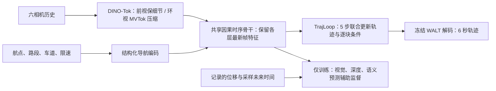

# EponaX：真实道路世界动作模型的训练与部署 / Recipes for Training and Deploying World-Action Models in the Real World

## 一句话定义

EponaX 在约 3.5 万小时真实驾驶数据上联合学习场景预测和轨迹规划，在车上利用六路相机与路线指引直接生成轨迹，不先生成未来视频。

## 英文缩写速查

| 缩写 | 英文全称 | 含义 |
|---|---|---|
| WAM | World-Action Model | 用共享驾驶表征学习环境变化与动作 |
| DiT | Diffusion Transformer | TrajDiT 在轨迹潜空间中迭代预测流速度 |
| GRPO | Group Relative Policy Optimization | 用组内评分信号做轨迹规划后训练 |
| PDMS / EPDMS | PDM Score / Extended PDM Score | NAVSIM v1 / v2 的不同综合规划指标 |

## 为什么重要

前视远距离细节、环视盲区、导航指令和实时预算相互牵制。报告把世界预测用于塑造共享表征，把真正上车的计算留给规划，并同时报告离线综合分与实际介入，便于区分学得好的表征和可用的控制系统。

## 核心原理

1. **保前视细节、压环视。** 六路先用冻结的 DINO-Tok 编码；前视用 2×2 token shuffle 把 2048 个位置降至 512，五路环视用相机几何约束的 MVTok 把 10240 个位置压到 640。加上 9 个导航 token 和 2 个边界 token，每帧共 1163 个位置。路线几何、转向、车道、限速由离线文本改写和字段重建共同对齐，而不是在实车临时让语言模型写指令。
2. **骨干只编码一次。** Qwen3-VL 2B 的语言 Transformer 按时间因果整合历史。TrajLoop 的每个交互块从对应骨干层取最新帧状态作为初值；每步欧拉积分既更新轨迹，又更新同一块的局部条件供下一步使用。共 28 个层对、5 步，不是在每次积分重跑视觉骨干。
3. **训练预测，车端规划。** 联合预训练加入未来 1–20 s 的多视角视觉特征、当前与未来前视深度和语义预测；使用记录的自车位移对齐视点。车端关闭三个辅助头，仅经 TrajLoop 和冻结 WALT 解码器得到 60 个点、覆盖 6 秒。报告的 3.1B 是总参数，部署保留 2.4B。

## 评测结果与局限

| 场景 | 报告结果 | 读法 |
|---|---|---|
| NAVSIM v1 navtest | 91.9 PDMS 监督微调，92.5 Flow-GRPO | 每场景评测一条提交轨迹 |
| NAVSIM v2 navtest / navhard | 91.8 EPDMS（GRPO） / 48.3 合分 | navhard 是带响应交通的两阶段伪闭环，不能与 v1 或实车混算 |
| nuScenes / Bench2Drive | 平均位移误差 0.85 / 1.18 m，平均碰撞率 0.05% / 1.33% | NAVSIM 训练后跨域直测，按 1/2/3 s 汇总，不是全路线闭环通关率 |
| 上海实车 | 四条路线每条三圈，约 240 km；全量 64 次介入，其中安全相关 12 次（合计约 5 次/100 km），导航遵循约 98% | 其余多为信号灯与导航规则相关；R1 安全相关达 10.3 次/100 km，不能把 3–5 当全路线上限 |

## 与其他工作对比

- [EponaV2](./paper-sa-2605-14696-eponav2-driving-world-model-with-comprehensive-f.md) 已用未来外观、深度与语义监督驾驶；EponaX 在这一系列上改造六相机预算和层级轨迹读出。同报告 v2 navhard 合分从 36.1 到 48.3，不能把整套变化归因于 TrajLoop 单模块。
- [X-World 1.6](./paper-xworld-1-6.md) 将生成模型放到驾驶策略外部构成交互环境；EponaX 的预测头是训练辅助，部署时不把生成视频交给后续策略。

## 结论

- 现场验证应分别记录所有干预、子类型和每条路线分母；不要只比较平均里程率。
- 报告的台架 NAVSIM 是单 RTX 4090；车端用两张 RTX 5090 并行实例维持 10 Hz 更新。10 Hz 是系统频率，不是单卡推理延迟。
- R1 单圈全层读出与末层读出为 9 对 76 次干预，但不同圈交通会变化；它提示值得做配对测试，不等于普适因果增益。
- 做预算时先明确未来辅助头只在训练使用，不应把其开销加到部署路径，亦不能把内部轨迹回环当成在线视频推演。

## 工程实践

可以按记录分开规划器预算、输入时间同步、车端控制跟踪与安全监督；模型输出轨迹不是直接的转向和制动命令。

**源码运行时序图：不适用。** 截至 2026-11-28，官方 Hugging Face 按钮只回页首，未见可核实的代码、权重、训练数据下载或部署入口。本文所绘是报告流程而非实际调用栈。

## 关联页面

- [世界动作模型](../concepts/world-action-models.md)
- [流匹配动作策略](../concepts/flow-matching-embodied-policy.md)
- [轨迹优化](../methods/trajectory-optimization.md)
- [GRPO](../methods/grpo.md)：对照 NAVSIM 组相对评分的轨迹后训练；报告同时保留模仿项。
- [世界动作模型路线 · Stage 3](../../roadmap/depth-wam.md)

## 参考来源

- [技术报告归档](../../sources/papers/eponax_technical_report.md)
- [官方项目页归档](../../sources/sites/eponax-horizon-robotics.md)

## 推荐继续阅读

- [官方报告 §3、§4 与 §5.4–5.5](https://garlicba.github.io/EponaX/paper/EponaX_Tech_Report.pdf)
