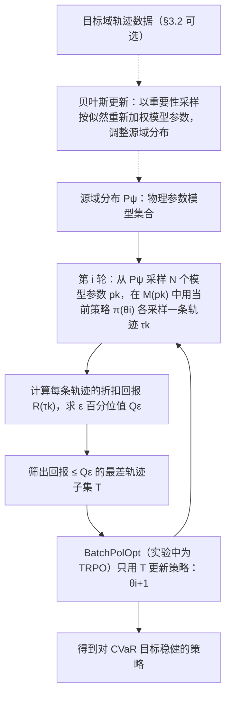

# EPOpt: learning robust neural network policies using model ensembles

**EPOpt: learning robust neural network policies using model ensembles**（[arXiv:1610.01283](https://arxiv.org/abs/1610.01283)）收录于 [自由度FreeDof · Sim2Real 四条路线梳理](../../sources/blogs/wechat_freedof_sim2real_four_routes_dr_to_residual_2026-08-23.md) 参考文献 **[17/44]**，归类 **域随机化**。

## 一句话定义

用模型集成中回报最差样本更新策略，把优化重点从期望移向尾部。

## 英文缩写速查

| 缩写 | 英文全称 | 简要说明 |
|------|----------|----------|
| EPOpt | Epistemic Policy Optimization | 集成模型鲁棒策略优化 |
| CVaR | Conditional Value at Risk | 条件风险价值 |
| RL | Reinforcement Learning | 强化学习 |

## 为什么重要

- 文内鲁棒/对抗训练分支；区别于期望 DR 的尾部风险处理。
- 在 [44 篇技术地图](../overview/freedof-sim2real-44-papers-technology-map.md) 与 [四条路线对比](../comparisons/sim2real-four-routes-identifiability.md) 中作为 **域随机化** 节点。
- 开源结论：**待核实**（步骤 2.5，2026-09-20）。

## 流程总览

图依据：论文 §3.1 Algorithm 1、§3.2。

## 核心机制

| 项 | 内容 |
|----|------|
| **出处** | ICLR 2017 |
| **文内章节** | 域随机化 |
| **要点** | ensemble of simulators + worst-case or CVaR-style policy update。 |
| **开源** | **待核实** |

## 源码运行时序图

**不适用（待核实）** — 截至 2026-09-20 以项目页/论文 Code availability 为准；入库未核验可运行入口。

## 实验与评测

- **本页为索引级节点**（FreeDof 44 篇梳理 [17/44]）：正文固化文内角色与机制要点，**未转存原文实验表**。
- **回原文须核对的证据**：本页要点是「ensemble of simulators + worst-case / CVaR-style policy update」，对应证据是源域/目标域动力学参数偏移下的**回报分布**（尤其分布尾部），而非平均回报。
- **读法：** 先对齐平台、任务、指标定义与成功阈值，再读任何数字；勿从公众号摘录外推。

## 与其他工作对比

| 维度 | 读法 |
|------|------|
| **文内路线** | 归类 **域随机化**；同路线其他节点见 [44 篇技术地图](../overview/freedof-sim2real-44-papers-technology-map.md) 与 [四条路线对比](../comparisons/sim2real-four-routes-identifiability.md) |
| **横比口径** | CVaR 分位数取值直接决定保守程度，不同分位下的曲线不可混读；也不能只看均值回报。 |
| **开源状态** | **待核实** — 部署 / 复现前以项目页或原文 Code availability 为准 |

## 结论

**需要尾部鲁棒时考虑 EPOpt 类方法，但可能更保守。**

1. 文内角色：域随机化 路线上的参考节点，非重复 arXiv 页面。
2. 机制要点：ensemble of simulators + worst-case or CVaR-style policy update。…
3. 部署/复现前请对照原文与项目页，勿直接外推公众号数字。

## 关联页面

- [Sim2Real 四条路线（可辨识性）](../comparisons/sim2real-four-routes-identifiability.md)
- [44 篇技术地图](../overview/freedof-sim2real-44-papers-technology-map.md)
- [Sim2Real](../concepts/sim2real.md)

## 参考来源

- [freedof_sim2real_17_epopt-robust-policies-model-ensembles.md](../../sources/papers/freedof_sim2real_17_epopt-robust-policies-model-ensembles.md)
- [wechat_freedof_sim2real_four_routes_dr_to_residual_2026-08-23.md](../../sources/blogs/wechat_freedof_sim2real_four_routes_dr_to_residual_2026-08-23.md)
- [freedof_sim2real_44_catalog.md](../../sources/papers/freedof_sim2real_44_catalog.md)
- [arXiv PDF](https://arxiv.org/pdf/1610.01283)：已通读方法部分（实验与附录以略读为准）：摘要、§1、§3（3.1 EPOpt-ε 与 Algorithm 1、3.2 源域分布自适应）、§4 实验设定开头；各实验结果略读

## 推荐继续阅读

- [arXiv PDF](https://arxiv.org/pdf/1610.01283)
- [44 篇 Sim2Real 技术地图](../overview/freedof-sim2real-44-papers-technology-map.md)
