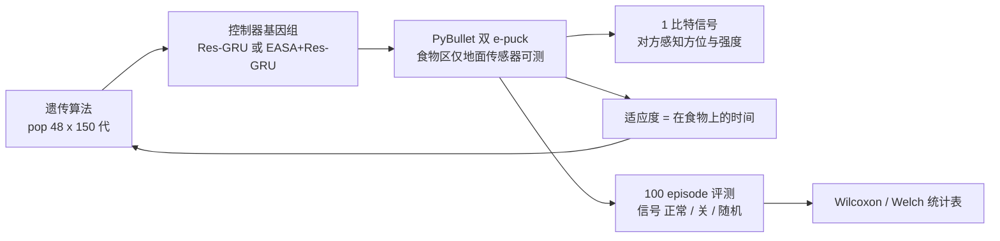
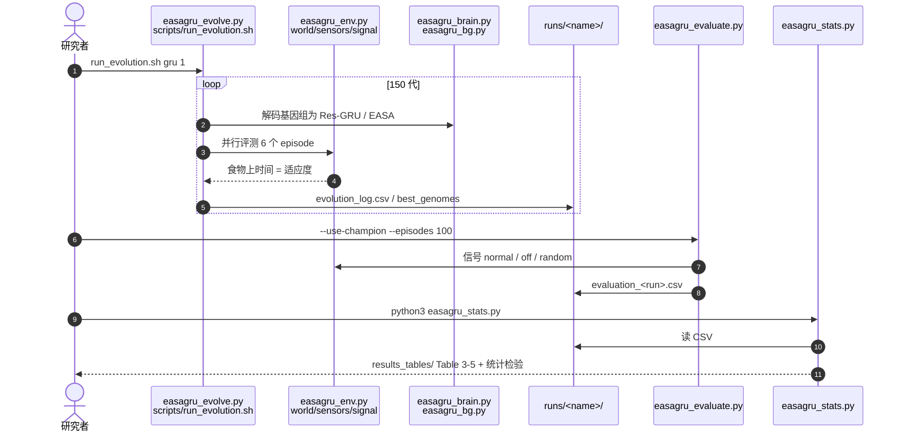

# e-puck 通信价值演化：信号只在带来新信息时出现

**论文：** *The value of information and the emergence of communication in evolved e-puck robots*（[arXiv:2610.13118](https://arxiv.org/abs/2610.13118)，Fernando Montes-Gonzalez，单作者，机构 arXiv 页未列）。两台仿真 e-puck 靠 1 比特信号协作找食物，用遗传算法演化 Res-GRU 控制器，并与带先天反射的 EASA 架构对比。

## 一句话定义

**一个演化机器人学的小规模受控实验：改变「通信能否提供新增信息」（有无食物罗盘、场地大小）和「是否带先天动作选择结构」，观察 1 比特信号是否、以何种形式出现。**

## 英文缩写速查

| 缩写 | 英文全称 | 简要说明 |
|------|----------|----------|
| EASA | Embedded Action Selection Architecture | 受基底神经节启发的动作选择架构，含先天反射通道 |
| GRU | Gated Recurrent Unit | 循环网络；此处带残差输入输出通路（Res-GRU） |
| BG | Basal Ganglia | EASA 的仲裁核心，优先级可手设或演化 |
| GA | Genetic Algorithm | 演化控制器权重的优化器 |

## 为什么重要

- 给「群体里通信何时值得」一个可复现的最小案例：不是有信号通道就会用，信号价值取决于它带来的新增信息。
- 提示为单个体设计的先天脚手架（反射、固定优先级）在社会任务里可能拖累表现。
- 代码、冠军基因组和统计表全部公开，几秒内可重建论文表格。

## 方法栈 / 流程总览

## 方法

- **仿真：** PyBullet 重建 e-puck（对照 Webots 官方模型：直行速度期望 0.1256 m/s、实测 0.1255；原地转速期望 4.83 rad/s、实测 4.62）。物理 120 Hz，控制每 8 步（66.7 ms）一次。
- **任务：** 食物区半径 0.1 m，只有踩上才能由地面传感器测到；小场地 1.0 m / 60 s，大场地 1.5 m / 90 s。每台可发 1 比特信号，对方感知方位与强度（延迟一个控制步）。
- **控制器：** Res-GRU 单独使用，或作为 EASA 的一个通道；EASA 含避障等先天通道，优先级可手设（easa_safe）、含先天进食通道（easa）或演化（easa_evo）。
- **演化：** 同质队伍、隐式适应度（只数食物上的时间）；仓库默认 pop 48、150 代、每个体每代 6 episode、精英 10、变异概率 0.2、σ=0.12。
- **对照条件：** gru、gru_compass（额外给指向食物的罗盘）、easa 三个变体、gru_big（在大场地演化）。

## 源码运行时序图

- **最短复现路径：** `pip install -r requirements.txt` → `python3 easagru_stats.py` 秒级重建表格；用 `easagru_standalone.py --brain gru --genome runs/gru_s1/champion.npy` 回放冠军。重跑一次演化约 6 小时（Mac mini M1，6 worker）。

## 实验与评测

指标为 100 个测试 episode 的食物上时间占比（正常 / 关信号 / 随机信号），来自仓库 `results_tables/`：

- **小场地、Res-GRU：** gru_s1 0.588/0.460/0.353（信号有用，p 约 1e-7）；gru_s2 0.574/0.571/0.566（几乎不发信号）；gru_s3 0.600/0.103/0.203（对信号强依赖）。三次运行表现相近、策略不同。
- **罗盘条件：** gru_compass_s1 为 0.928，三种信号条件完全相同，信号被弃用。
- **EASA：** easa_evo 三次为 0.362/0.356/0.369，easa_safe 0.257，easa 0.336；GRU 复本均值 0.588±0.013 对 EASA 演化 0.362±0.007（Welch t，p=0.00012）。
- **大场地（直接演化）：** gru_big_s1 0.229、s2 0.551、s3 0.387；s2 信号去除后降到 0.378，s3 不发信号。
- **演化后的 BG 优先级：** 例如 avoid←obstacle 手设 +0.90、演化为 +0.53 至 +0.79，说明演化削弱先天反射。
- 论文正文的更多细节（如讨论部分）未读到。

## 工程实践

| 项 | 内容 |
|----|------|
| 开源状态 | **已开源**（MIT），[ferdiex/easagru](https://github.com/ferdiex/easagru)，Zenodo v1.0.0 归档；见 [easagru.md](../../sources/repos/easagru.md) |
| 依赖 | numpy、scipy、pybullet，Python 3.9+ |
| 复现 | 统计表秒级重建；演化重跑约 6 小时/次 |
| 跨平台 | 论文结果来自 Mac mini M1，他机只能得到统计等价而非相同轨迹 |
| 项目页 | Zenodo 归档（[easagru-zenodo.md](../../sources/sites/easagru-zenodo.md)），非独立主页 |

## 结论

**通信是否出现，取决于它能否提供额外信息；有直达目标的罗盘时信号完全被弃用，无罗盘时则出现多种可行策略，其中指示性信号在更大场地最稳。**

1. 研究通信价值时要同时设计「无信号」和「已有更直接信息」的对照（罗盘组 0.928 与信号无关）。
2. 同一条件下不同种子会演化出完全不同的策略（指示信号、信标、不发信号），不要用单一运行下结论。
3. 用「正常 / 关 / 随机」三种信号消融加配对检验判断信号是否真被使用。
4. 先天反射结构可能压低社会任务表现（EASA 0.362 对 GRU 0.588），演化会削弱它们。
5. 想验证结论外推时，把场地做大再比一次；论文发现指示信号泛化最好。
6. 仓库提供 `easagru_stats.py` 可直接核对表格。

## 局限与风险

- 种子数少（多数条件 3 个），策略方差大；结论偏定性。
- 纯仿真，无真机 e-puck 验证；1 比特信号和单一觅食任务离实际群体机器人很远。
- 论文自己指出结论是「为孤立个体设计的脚手架可能妨碍社会任务」的建议，而非普适定律。
- 本页未读到论文正文，数字来自摘要与官方仓库表格。

## 与其他工作对比

| 对照 | 差异读法 |
|------|----------|
| [人形足球群体智能](./paper-humanoid-soccer-swarm-intelligence.md) | 那里是学习式多人形协作；本文是演化 + 最小通信的机理实验 |
| [演化-RL 协同设计](./paper-notebook-evolutionary-continuous-adaptive-rl-powered-co-d.md) | 同属演化思路，但优化的是形态/控制协同，非通信 |
| [人形多机器人协同](../concepts/humanoid-multi-robot-coordination.md) | 本文提供「何时需要通信」的最小对照视角 |

## 关联页面

- [34 篇具身论文空间落地技术地图](../overview/embodied-station-34-papers-spatial-grounding-technology-map.md)
- [人形多机器人协同](../concepts/humanoid-multi-robot-coordination.md)
- [人形足球群体智能](./paper-humanoid-soccer-swarm-intelligence.md)

## 参考来源

- [微信盘点来源](../../sources/blogs/wechat_embodied_station_34_papers_spatial_grounding_2026-10-12.md)
- [easagru_epuck_arxiv_2610_13118.md](../../sources/papers/easagru_epuck_arxiv_2610_13118.md)
- [easagru.md](../../sources/repos/easagru.md)
- [easagru-zenodo.md](../../sources/sites/easagru-zenodo.md)
- [arXiv:2610.13118](https://arxiv.org/abs/2610.13118)

## 推荐继续阅读

- [easagru GitHub](https://github.com/ferdiex/easagru)
- [Zenodo 归档](https://doi.org/10.5281/zenodo.23051976)
- [e-puck 官方 Webots 模型](https://cyberbotics.com/doc/guide/epuck)
