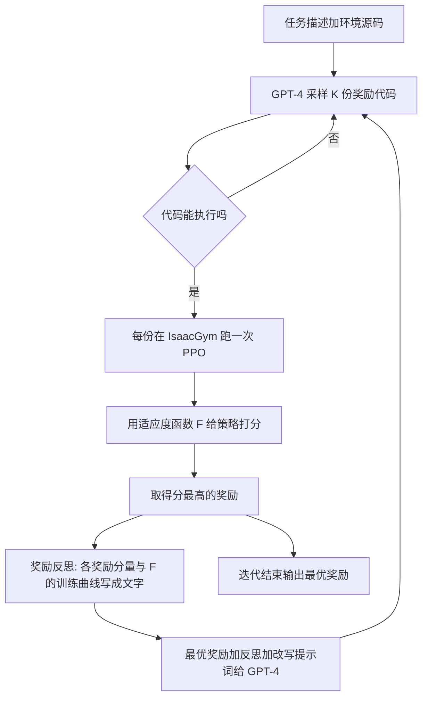

# Eureka：用编程大模型做奖励设计（arXiv:2310.12931）

**Eureka**（*Eureka: Human-Level Reward Design via Coding Large Language Models*，Ma 等，NVIDIA / UPenn / Caltech / UT Austin，[arXiv:2310.12931](https://arxiv.org/abs/2310.12931)，ICLR 2024）是这篇论文的独立深读节点。站内 awesome 清单里的 Eureka 条目见 [Eureka (NVIDIA) 清单索引页](../entities/painode-332-eurekanvidia.md)：那一页只有清单坐标与一句话摘要，**没有**论文细节；本页不重复清单信息，只写论文本身。

## 一句话定义

让编程大模型（论文用 GPT-4）读环境源码和任务描述，直接写出可执行的奖励函数代码，再用「多采样、跑强化学习评估、把训练统计写成文字反馈给模型、让它改写最好的那个」的进化式循环迭代，最后得到的奖励拿去训练策略（摘要、§1、§3）。

## 英文缩写速查

| 缩写 | 英文全称 | 简要说明 |
|------|----------|----------|
| LLM | Large Language Model | 大语言模型；本文用 GPT-4（gpt-4-0314）作骨干（§4） |
| RL | Reinforcement Learning | 强化学习；本文用 PPO 训练策略（§4.2） |
| RDP | Reward Design Problem | 奖励设计问题，四元组 ⟨M, R, A_M, F⟩（§2） |
| F | Fitness function | 适应度函数，只能通过对策略求值来查询，用来给奖励打分（§2） |
| L2R | Language to Rewards | Yu et al. 2023 的模板式 LLM 奖励方法，本文的主要 LLM 基线（§4.1） |
| Human | 人类专家奖励 | 基准环境自带、由 RL 研究者手写的奖励（§4.1） |
| Sparse | 稀疏奖励 | 与适应度函数 F 相同的奖励（§4.1） |
| Eureka-HF | Eureka from Human Feedback | 用人写的文字反思代替自动反思（§4.4） |
| PPO | Proximal Policy Optimization | 近端策略优化（§4.2，见 [PPO](../methods/ppo.md)） |

## 为什么重要

- 奖励设计是 RL 落地的老大难：论文引用一项调查称 92% 的受访者靠手工试错设计奖励，89% 认为自己设计的奖励不是最优（§1，引 Booth et al., 2023，二手引用）。
- Eureka 的卖点是**不需要任务专属提示词、奖励模板或少样本示例**（§1），写出的是自由形式、白盒的奖励代码，人可以读、可以改（§5、附录 G.5）。
- 它把「LLM 写代码」从高层规划推进到低层技能学习的奖励这一层；论文自述此前 LLM 在机器人里多用于高层规划，依赖已有运动基元（§5）。
- 作者自述结论：在 29 个任务上超过人类专家奖励 83%，平均归一化提升 52%（摘要、§1）。这些是作者在自己选定的仿真基准和评估口径下的数字，见下文「局限」对口径的说明。

## 核心机制

### 问题形式（§2）

奖励生成问题：给定描述任务的字符串 l，输出奖励代码 R，使用 R 训练出的策略在适应度函数 F 下得分最高。F 只能被「查询」（训练出策略后用真值指标评估），不能给梯度。

### 流程总览

要点对应：

1. **环境即上下文（§3.1、附录 D）**：直接给环境源码（去掉已有奖励代码），实践中用脚本只抽取暴露状态与动作变量的片段（如 Isaac Gym 的 `compute_observations`），以便塞进上下文窗口并不泄露仿真器内部细节。提示词只含通用的奖励设计与格式提示，例如要求把各奖励分量以字典形式一并返回，且只能使用环境类里的变量（附录 A）。
2. **进化搜索（§3.2、算法 1）**：每轮并行采样 K 份奖励，取最优者连同反思作为下一轮上下文；多次随机重启。全部实验取 5 次独立运行、每次 5 轮、每轮 K=16。对话历史被裁成只保留「上一个最优奖励及其反思」，即改进是马尔可夫式的（附录 D）。
3. **奖励反思（§3.3、附录 A、G.1）**：每个奖励分量要单独暴露出来，训练中按固定间隔记录各分量及成功率、回合长度的最大、均值、最小值，转成文字。动机有二：任务适应度 F 没有信用分配信息，只给总分，说不出一个奖励为什么好或不好；奖励好坏还依赖具体 RL 算法与超参（§3.3）。提示词里附有人工写的分析规则，例如「成功率始终近零则整体重写」「某分量几乎不变说明 RL 没优化到它，可调尺度、重写或删除」（附录 A Prompt 2）。
4. **评估（§4.2、附录 D）**：中间候选奖励只跑 1 次 PPO；最终奖励与各基线一样用同一份 PPO（rl_games）、同一组为人类奖励调好的超参，各跑 5 次，取 10 个检查点上任务指标最大值的平均。

### 笔转：奖励加课程学习（§4.3、图 7、附录 D.1）

在 Isaac Gym 的 Shadow Hand 重定向环境上把方块换成笔，不改物理参数。第一阶段：用 Eureka 奖励训练「把笔转到随机目标朝向」；第二阶段：用同一份奖励在一串预设路点上微调，走完整串路点算一圈。作者称微调后的策略能连续转多圈，而只做预训练或从零训练的策略连一圈都完成不了。这里的「转笔」是**仿真里**的结果，论文展示靠项目页视频（§4.3 写「见项目网站」）。

### 人类参与的两种方式（§4.4）

- **人类初始化**：把人写的奖励当作第 1 轮输出，Eureka 在所选的几个 Dexterity 任务上都比纯 Eureka 和纯人类奖励更好（图 8）。作者的解释是人懂得该用哪些状态变量，但不擅长怎么用它们设计奖励（作者自述，§4.4；这是假设，不是实验检验的因果结论）。
- **人类文字反思（Eureka-HF）**：不用适应度函数，由人看策略视频后用口语写反馈（例如「机器人在用单脚跳着前进，请改成直立奔跑」，附录 G.4）。20 名用户里 15 人更喜欢 Eureka-HF 的 Humanoid，尽管它前进速度更低（5.58 对 7.53，图 9）。

## 实验结果速览（论文数字，带出处）

| 项 | 内容 | 出处 |
|----|------|------|
| 任务集 | 10 种机器人、29 个 IsaacGym 任务：Isaac 9 个加 Dexterity 双手 Shadow Hand 20 个 | §4、附录 B |
| 对 Human | Isaac 全部任务持平或超过，Dexterity 20 个中 15 个持平或超过；总计 83% 的任务胜出 | §4.3、摘要 |
| Dexterity 平均成功率 | Eureka 55.30、L2R 24.40、Human 45.90、Sparse 10.40（由图读数） | 图 4 |
| 对 L2R | L2R 在低维任务（CartPole、BallBalance）上可比，高维任务明显落后；作者称 L2R 实现里用到了人类奖励的分量，对它有利 | §4.1、§4.3 |
| 进化的作用 | 一次性采 32 样本（相当于 2 轮预算）低于 2 轮 Eureka | §4.3、图 5 |
| 反思的作用 | 去掉奖励反思，Isaac 任务平均归一化得分降 28.6% | §4.3 |
| 奖励新颖性 | Eureka 奖励与人类奖励多数弱相关，个别任务为负相关但表现更好；任务越难相关越低 | §4.3、图 6、附录 F、G.2 |
| 换 GPT-3.5 | 性能下降，但在多数 Isaac 任务仍持平或超过人类 | §4.3、附录 F |
| 其他仿真器 | MuJoCo Humanoid：Eureka 7.68 对 Human 5.92 | 附录 E 表 4 |
| 算力 | 单台 8×A100，每次运行不到一天 | 附录 D.4 |

## 工程实践

- **适用前提**：要有环境源码（或能通过 API 提供状态变量）、要有可由人定义的任务适应度 F、要有能高速并行评估的仿真器——论文强调用 GPU 并行的 IsaacGym 评估奖励，才能让搜索规模随算力扩展（§1）。仿真器背景见 [Isaac Gym](../entities/isaac-gym.md)。
- **反思质量取决于奖励代码的可观测性**：Eureka 要求奖励以「总奖励加各分量字典」的形式返回，反思才有素材；人写的奖励一般没有这种结构，做人类初始化时作者要重构代码并去掉无关变量（附录 D.2）。
- **成本**：每个中间候选只跑 1 次 PPO 以省算力，但只有一次种子，单次评估噪声没有在论文中单独量化（推测：这是搜索中的噪声来源，论文未讨论）。
- **与既有奖励设计知识的关系**：Eureka 产出的是 [奖励设计](../concepts/reward-design.md) 里「自动化奖励设计」一类方法的 LLM 版本，前人的做法是在固定奖励模板的参数上做进化搜索（§5，如遗传编程见 [遗传编程](../methods/genetic-programming.md)）。人形运动里的手写奖励组成见 [人形策略奖励函数](../concepts/humanoid-policy-reward-functions.md)。
- **开源**：论文承诺开源提示词、环境与生成的奖励（§1）；项目页有 Code 链接 <https://github.com/eureka-research/Eureka>，仓库内容本站未核实（见来源归档「开源状态」）。

## 局限

**论文自己承认的（附录 H）：**

- 主要在仿真里评估。论文提到有一个「初步真机实验（真机跳跃，Sim2Real）」位于附录 F，但本站核对的 arXiv v2 PDF 附录 F 中没有这一部分；因此本页**不把任何真机结果记作论文证据**。
- 要求存在且易于人定义的适应度函数 F；「稳定步态」这类难以数学化的目标，要靠 Eureka-HF 的人类反馈绕开。
- 只在单一仿真器与固定 RL 算法上做了主实验（MuJoCo Humanoid 是例外）。作者认为 Isaac Gym 有过 Sim2Real 成果，「预示」迁移到真机可行，这是预期不是结果。

**本站读到的未验证之处（读者判断，非论文自述）：**

- **评估口径与奖励的绑定**：所有最终奖励共用为人类奖励调好的 PPO 超参（§4.2），这对 Eureka 偏不利；而 Eureka 的搜索过程是以同一 F 为目标选优，所以「Eureka 在 F 上高」与「行为符合人的意图」是两件事。论文自己在 §4.4 承认 F 可能与人的意图不一致。
- **「超过人类」的范围**：指的是这 29 个任务（且在 GPT-4 知识截止日期之后发布的基准上，§4）、在 F 指标和最大检查点取值的口径下。平均 52% 的数字还对每任务得分做了 [0, 3] 截断（附录 D）。
- **LLM 基线的可比性**：L2R 是作者按自己的模板重新实现的（§4.1、附录 C）。
- **没有「奖励被刷分」的专门分析**：论文没有系统检查生成的奖励是否被策略钻空子。仅有的线索是 Humanoid 例子里自动奖励训出了单脚跳，被人类反思纠正（附录 G.4，§4.4），论文把它当作「更安全、更对齐」的改进来讲，并没有用「钻空子」这个词。
- **GPT-4 版本可得性**：实验用 gpt-4-0314（§4），该版本是否仍可调用、生成结果能否复现，论文没有说明（推测：闭源模型版本更替会影响复现）。
- **真机**：见上，没有可核对的真机证据。

## 关联页面

- [Eureka (NVIDIA) 清单索引页](../entities/painode-332-eurekanvidia.md)：awesome-physical-ai 里的 Eureka 条目，仅有清单坐标；本页是同一工作的论文独立节点，同一 arXiv 的深读以本页为准
- [奖励设计](../concepts/reward-design.md)
- [奖励工程的终结：LLM 与多智能体协作（观点论文）](./paper-end-of-reward-engineering.md) — 将 Eureka 的单智能体奖励生成证据放到两条 MARL 路径与待验证假说中，勿误读为新多智能体实测。
- [人形策略奖励函数](../concepts/humanoid-policy-reward-functions.md)
- [强化学习](../methods/reinforcement-learning.md)
- [PPO](../methods/ppo.md)
- [课程学习](../concepts/curriculum-learning.md)
- [遗传编程](../methods/genetic-programming.md)
- [Isaac Gym](../entities/isaac-gym.md)
- [Shadow Hand](../entities/shadow-hand.md)
- [Sim2Real](../concepts/sim2real.md)

## 参考来源

- [`sources/papers/eureka-llm-reward-design_arxiv_2310_12931.md`](../../sources/papers/eureka-llm-reward-design_arxiv_2310_12931.md)：本页的论文原文归档（含核对范围与通读状态）
- [`sources/repos/pai_awesome_paper_332_eureka-nvidia.md`](../../sources/repos/pai_awesome_paper_332_eureka-nvidia.md)：awesome 清单里的策展摘录
- 论文：<https://arxiv.org/abs/2310.12931>

## 继续阅读

- [arXiv PDF](https://arxiv.org/pdf/2310.12931)
- [项目页（含各环境最佳 Eureka 奖励与策略视频）](https://eureka-research.github.io/)
- [官方代码仓库](https://github.com/eureka-research/Eureka)
- Yu et al. 2023，*Language to Rewards for Robotic Skill Synthesis*，[arXiv:2306.08647](https://arxiv.org/abs/2306.08647)：论文的主要 LLM 奖励基线
- [Isaac Gym / Isaac Lab](../entities/isaac-gym-isaac-lab.md)
