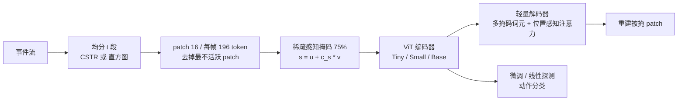

---

type: entity
tags: [paper, event-camera, action-recognition, masked-autoencoder, vision-transformer, self-supervised, perception, foi]
status: complete
updated: 2026-10-12
arxiv: "2610.13856"
project_id: event-action-mae
code: https://github.com/nrthby/event-action-mae
related:
  - ../overview/embodied-station-34-papers-spatial-grounding-technology-map.md
  - ../concepts/vision-transformer.md
  - ../methods/skeleton-action-recognition.md
  - ./paper-microsaccade-inspired-event-camera.md
  - ./paper-sa-2603-06228-low-latency-event-based-object-detection-with.md
sources:
  - ../../sources/blogs/wechat_embodied_station_34_papers_spatial_grounding_2026-10-12.md
  - ../../sources/papers/event_action_mae_arxiv_2610_13856.md
  - ../../sources/sites/event-action-mae-github.md
summary: "arXiv:2610.13856（FOI 瑞典国防研究局）：把事件流切成多帧表示，用稀疏感知掩码、token 选择与多掩码词元的 MAE 预训练 ViT-Tiny，THU-EACT-50 CHL 微调 78.7%（需 DailyDVS-200 预训练）、DailyDVS-200 达 66.9%；识别而非控制，仓库仅空 README。"
---

# 事件相机动作识别：多帧表示上的 MAE 预训练

**论文：** *Event-based Action Recognition by Pre-Training on Multi-Frame Representations*（[arXiv:2610.13856](https://arxiv.org/abs/2610.13856)，Norrby 等，Swedish Defence Research Agency FOI）。针对事件相机上长而复杂的动作序列，把事件序列切成多帧，用掩码自编码预训练视觉 Transformer。研究对象是动作识别，不涉及机器人控制。

## 一句话定义

**把事件流均分为 t 段分别转成帧式表示，在 ViT 上做稀疏感知掩码 + token 选择的 MAE 预训练，再微调分类，以应对单帧事件表示在长序列上的判别力下降。**

## 英文缩写速查

| 缩写 | 英文全称 | 简要说明 |
|------|----------|----------|
| MAE | Masked Auto-Encoder | 掩码自编码自监督预训练 |
| ViT | Vision Transformer | 骨干；默认 ViT-Tiny |
| CSTR | Concatenated Statistics-TimeStamp Representation（推测全称，原文未核对） | 三通道：正事件均值时间戳、事件直方图、负事件均值时间戳 |
| LP / FT | Linear Probing / Fine-Tuning | 冻结编码器线性分类 / 全量微调 |
| THU-EACT-50 CHL | THU Event Action dataset, 50 classes, CHL 子集 | 50 类事件动作数据集 |

## 为什么重要

- 事件相机延迟低、隐私友好，是机器人与监控感知的候选传感器；识别长动作需要比单帧累积更好的时间表示。
- 多帧输入 + MAE 预训练在小模型（ViT-Tiny 约 5.5M 参数）上就能显著提升，适合算力受限场景。
- 提供掩码策略（按事件活跃度）的具体做法，可迁移到其他稀疏模态。

## 方法栈 / 流程总览

## 方法

- **多帧表示：** 均分 t 段，每段单独生成表示并 token 化。CSTR 三通道（正事件平均时间戳、无极性二值直方图、负事件平均时间戳），直方图把正负事件计数分通道；均除以最大值。
- **骨干：** 时空 MAE + ViT；默认 ViT-Tiny（深度 12、嵌入 192、3 头，约 5.5M），另测 ViT-Small 21.7M、ViT-Base 85.8M；每帧 224×224、patch 16、196 token，可学习位置编码，掩码比 75%。
- **token 选择：** 以 patch 内事件绝对值之和为活跃度，删去固定比例最不活跃的 patch。
- **稀疏感知掩码：** s = u + c_s·v，得分最高者保持可见，c_s=0 退化为随机掩码。
- **多掩码词元：** n_t 个可学习掩码词元，两层 MLP（隐层 2048）依据位置嵌入给出 softmax 权重混合；仅预训练使用，无推理开销。解码器细节原文未给。
- **训练：** AdamW，batch 128；预训练 1500 epoch（预热 15 epoch 至 5e-4），微调 100 epoch、学习率 1e-3，从零训练 200 epoch；2×RTX A5000。

## 源码运行时序图

不适用：官方仓库 [nrthby/event-action-mae](https://github.com/nrthby/event-action-mae) 截至 2026-10-12 只有标题 README，无训练/评测入口（核查见 [event-action-mae-github.md](../../sources/sites/event-action-mae-github.md)）。

## 实验与评测

Top-1（%），LP / FT，数据集 THU-EACT-50 CHL 与 DailyDVS-200：

- **多帧 vs 单帧（THU LP）：** CSTR 30.5 → 47.4，直方图 24.1 → 47.1；加稀疏掩码 51.7 / 49.4；再加多掩码词元 52.0 / 52.4。
- **主结果：** CSTR 8 帧 100% token：THU 56.8 / 66.4，DailyDVS 31.0 / 61.7；8 帧 50% token：59.6 / 67.3。DailyDVS-200 预训练后微调 THU 的 8 帧 CSTR 达 78.7（摘要数字）。
- **模型规模（8 帧 50%）：** ViT-Small 68.2 / 64.6，ViT-Base 68.6 / 66.9（THU FT / DailyDVS FT）。
- **不预训练：** 4 帧 THU FT 19.5，DailyDVS FT 20.7，预训练贡献巨大。
- **对比基线：** THU 上 EV-ACT 58.5、EventMamba 59.4、EventBind+POKER 63.7、SMV-EAR 66.7、HoloEv-Net Base 69.9；DailyDVS 上 Darkshake 52.0、SMV-EAR 54.7、HoloEv-Net Base 54.6。
- **不一致提示：** 掩码词元数消融（4 帧 LP）1 个 51.7，2/4/8/12/16 个为 49.3/45.0/46.9/37.3/47.6，只有 6 个（52.0）略高；正文说“持续改善”，表中不清晰支持，以表为准。
- **时长：** DailyDVS 总体 1/4/8 帧 33.1/55.6/61.7；长动作 Tie shoe laces（8.73 s）4 帧 79.2 优于 8 帧 75.0，说明最佳帧数依赖时长。

## 工程实践

| 项 | 内容 |
|----|------|
| 开源状态 | **待发布**：[nrthby/event-action-mae](https://github.com/nrthby/event-action-mae) 仅标题 README |
| 小模型优先 | 默认 ViT-Tiny 约 5.5M 参数，两张 A5000 可训 |
| 预处理 | 计算表示前滤热像素；random crop & resize |
| 评测 | THU-EACT-50 CHL 无官方验证集，需自行留出 20% |
| 源码运行时序图 | 不适用（无代码） |

## 结论

**多帧表示加 MAE 预训练是事件动作识别在长序列上的有效配方，但最高数字依赖外部数据集预训练，且与机器人控制没有直接关系。**

1. 先把事件序列切成多帧再 token 化，比单帧表示明显更好（THU LP 30.5 → 47.4）。
2. 一定要自监督预训练：不预训练 THU FT 仅 19.5。
3. 按活跃度做 token 选择和稀疏感知掩码能同时省算力并提点（50% token 在 8 帧下 LP 56.8 → 59.6）。
4. 帧数要看动作时长，不是越多越好。
5. 引用 78.7% 必须注明使用了 DailyDVS-200 预训练；纯 THU 内部为 67.3% 左右。
6. 多掩码词元数没有通用结论，需按数据调。

## 局限与风险

- 仅两个数据集，THU 缺验证划分。
- 参数 c_s 与掩码词元数无通用推荐，表现非单调。
- 多帧输入的计算复杂度与架构相关；长短动作需不同时间分辨率（作者列为未来工作）。
- 代码待发布，无法复现；Figure 3/4 数值和附录未读到。
- 评测只是分类，离事件相机上的机器人闭环应用有距离。

## 与其他工作对比

| 对照 | 差异读法 |
|------|----------|
| [微扫视启发的事件相机](./paper-microsaccade-inspired-event-camera.md) | 偏传感与成像机制；本文是下游表示与预训练 |
| [低延迟事件目标检测](./paper-sa-2603-06228-low-latency-event-based-object-detection-with.md) | 检测任务；本文是动作识别 |
| [骨架动作识别](../methods/skeleton-action-recognition.md) | 另一路线，用关键点而非原始事件 |
| [Vision Transformer](../concepts/vision-transformer.md) | 本文骨干背景 |

## 关联页面

- [34 篇具身论文空间落地技术地图](../overview/embodied-station-34-papers-spatial-grounding-technology-map.md)
- [Vision Transformer](../concepts/vision-transformer.md)
- [微扫视启发的事件相机](./paper-microsaccade-inspired-event-camera.md)
- [骨架动作识别](../methods/skeleton-action-recognition.md)
- [机器人视觉感知栈选型闭环](../queries/robot-perception-stack-selection-loop.md) — 本页属其 ① 传感模态与 ② 识别模型选型的旁支：事件相机多帧表示 + MAE 预训练 ViT 做动作识别，只到识别层、不涉及下游控制消费

## 参考来源

- [微信盘点来源](../../sources/blogs/wechat_embodied_station_34_papers_spatial_grounding_2026-10-12.md)
- [event_action_mae_arxiv_2610_13856.md](../../sources/papers/event_action_mae_arxiv_2610_13856.md)
- [event-action-mae-github.md](../../sources/sites/event-action-mae-github.md)
- [arXiv:2610.13856](https://arxiv.org/abs/2610.13856)

## 推荐继续阅读

- [arXiv HTML 全文](https://arxiv.org/html/2610.13856v1)
- [MAE 原论文](https://arxiv.org/abs/2111.06377)
- [nrthby/event-action-mae（待发布）](https://github.com/nrthby/event-action-mae)
