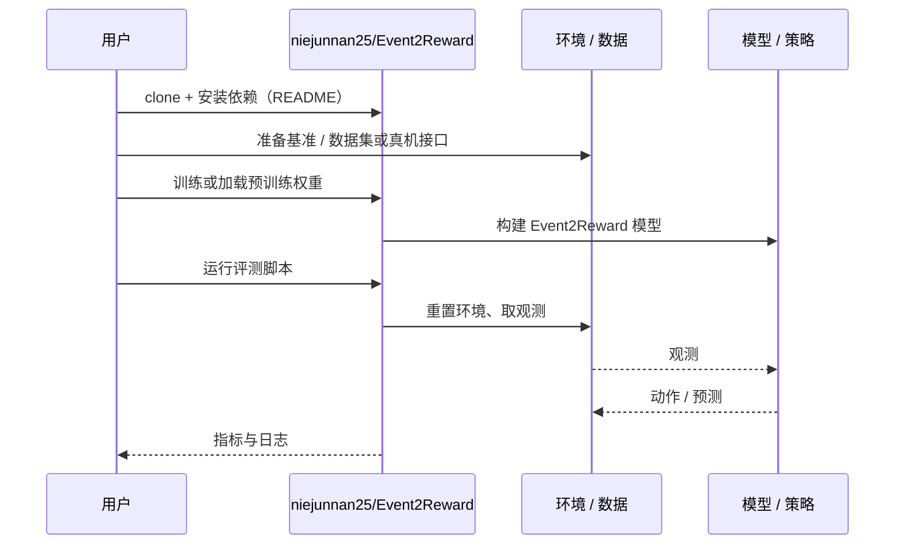

# Event2Reward（arXiv:2610.39212）

**Event2Reward**（*Event2Reward: Learning Robotic Rewards from Progress Relations*，[arXiv:2610.39212](https://arxiv.org/abs/2610.39212)，[项目页](https://niejunnan25.github.io/Event2Reward/)，[代码](https://github.com/niejunnan25/Event2Reward)）来自 [具身智能小站 2026-10-30 盘点](../../sources/blogs/wechat_embodied_station_28_papers_event2reward_progress_rewards_2026-10-30.md)，属「奖励学习与 VLA 策略」组。

## 一句话定义

**机器人探索时会停滞甚至倒退，把示范时间当作进度容易奖励错误动作。**

## 英文缩写速查

| 缩写 | 英文全称 | 简要说明 |
|------|----------|----------|
| Event2Reward | Event2Reward: Learning Robotic Rewards from Progress Relations | 本文方法 / 基准的简称 |

## 为什么重要

- 让奖励分清进步、停滞与倒退。Event2Reward 用成功示范锚定进度尺度，再用失败与次优轨迹中的局部关系校正变化方向，为强化学习提供更可信的稠密奖励。
- 开源结论：**已开源**（步骤 2.5，2026-10-30）。仓库可达（git ls-remote）。项目页 HTTP 200。
- 同期同组工作见 [进度奖励、接触监督与规划验证：具身智能小站 10-30 期 28 篇阅读坐标](../overview/embodied-station-2026-10-30-28-papers-technology-map.md)。

## 核心机制

| 项 | 内容 |
|----|------|
| **arXiv** | [2610.39212](https://arxiv.org/abs/2610.39212) |
| **开源** | **已开源** |
| **要点** | 机器人探索时会停滞甚至倒退，把示范时间当作进度容易奖励错误动作。 |
| **文内指标** | 公众号转述：三项精密插入真机任务、30 分钟训练后平均成功率 60.0%，对比 Robometer 为 37.8%（每任务每条件三次训练，每个检查点评估二十回合）；新增的是对停滞、倒退和恢复事件的局部进度关系监督，无需为次优轨迹逐帧指定绝对进度。 |

## 源码运行时序图

以下为按仓库入口（`niejunnan25/Event2Reward`）推断的通用运行链路；入库日仅核实仓库可达，未逐文件阅读，具体脚本名以 README 为准。

## 实验与评测

- 公众号转述：三项精密插入真机任务、30 分钟训练后平均成功率 60.0%，对比 Robometer 为 37.8%（每任务每条件三次训练，每个检查点评估二十回合）；新增的是对停滞、倒退和恢复事件的局部进度关系监督，无需为次优轨迹逐帧指定绝对进度。
- **读法：** 本页为索引级摘要，依据公众号转述的官方摘要与仓库信息整理；逐项数字与 baseline 以原文 PDF 为准。

## 与其他工作对比

- 横向索引见 [进度奖励、接触监督与规划验证：具身智能小站 10-30 期 28 篇阅读坐标](../overview/embodied-station-2026-10-30-28-papers-technology-map.md)；同 arXiv 不重复造页。

## 结论

**让奖励分清进步、停滞与倒退：三项精密插入真机任务、30 分钟训练后平均成功率 60.0%，对比 Robometer 为 37.8%（每任务每条件三次训练，每个检查点评估二十回合）；新增的是对停滞、倒退和恢复事件的局部进度关系监督，无需为次优轨迹逐帧指定绝对进度。**

1. 开源边界：**已开源** — 仓库可达（git ls-remote）。项目页 HTTP 200。
2. 核心机制：机器人探索时会停滞甚至倒退，把示范时间当作进度容易奖励错误动作。
3. 复现与选型前核对任务协议、硬件与基准口径，勿直接横比公众号摘录数字。

## 关联页面

- [reinforcement-learning](../methods/reinforcement-learning.md)
- [vla](../methods/vla.md)
- [imitation-learning](../methods/imitation-learning.md)
- [embodied-station-2026-10-30-28-papers-technology-map](../overview/embodied-station-2026-10-30-28-papers-technology-map.md)

## 参考来源

- [event2reward_arxiv_2610_39212.md](../../sources/papers/event2reward_arxiv_2610_39212.md)
- [wechat_embodied_station_28_papers_event2reward_progress_rewards_2026-10-30.md](../../sources/blogs/wechat_embodied_station_28_papers_event2reward_progress_rewards_2026-10-30.md)
- [arXiv:2610.39212](https://arxiv.org/abs/2610.39212)

## 推荐继续阅读

- [arXiv PDF](https://arxiv.org/pdf/2610.39212)
- [项目页](https://niejunnan25.github.io/Event2Reward/)
- [https://github.com/niejunnan25/Event2Reward](https://github.com/niejunnan25/Event2Reward)
