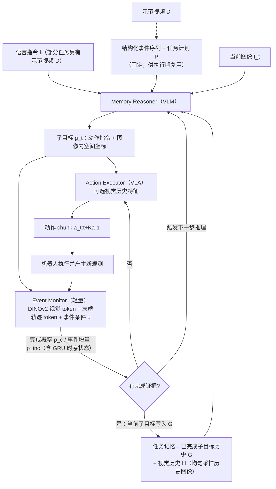

# EventSync（arXiv:2610.27917）

**EventSync**（*EventSync: Event-Driven Memory Updates for History-Dependent Manipulation*，[arXiv:2610.27917](https://arxiv.org/abs/2610.27917)，[项目页](https://zjjjacinthe.github.io/eventsync-project/)）来自 [具身智能小站 2026-10-31 盘点](../../sources/blogs/wechat_embodied_station_50_papers_scenerig_photo_to_sim_2026-10-31.md)，属「策略学习与 VLA」组。

## 一句话定义

**EventSync结合图像和末端轨迹判断子目标是否完成，再写入历史并触发下一步；在RoboMME和四项真机任务验证，避免过早记忆误导后续动作。**

## 英文缩写速查

| 缩写 | 英文全称 | 简要说明 |
|------|----------|----------|
| EventSync | EventSync: Event-Driven Memory Updates for History-Dependent Manipulation | 本文方法 / 基准的简称 |

## 为什么重要

- 确认完成之后，再更新任务记忆。
- 开源结论：**待发布**（步骤 2.5，2026-10-31）。项目页 HTTP 200，Code 按钮标 Coming soon（curl 扫描）。
- 同期同组工作见 [单图重建仿真、VLA 适配评测与跨形态世界模型：具身智能小站 10-31 期 50 篇阅读坐标](../overview/embodied-station-2026-10-31-50-papers-technology-map.md)。

## 流程总览

图依据：论文 §III-A/B/C（Fig.2、式 (1)–(3)）。

## 核心机制

| 项 | 内容 |
|----|------|
| **arXiv** | [2610.27917](https://arxiv.org/abs/2610.27917) |
| **开源** | **待发布** |
| **要点** | EventSync结合图像和末端轨迹判断子目标是否完成，再写入历史并触发下一步；在RoboMME和四项真机任务验证，避免过早记忆误导后续动作。 |
| **文内指标** | 公众号未给具体数字，本页不引用。 |

## 源码运行时序图

**不适用（待发布）** — 项目页 HTTP 200，Code 按钮标 Coming soon（curl 扫描）。 不编造运行脚本；代码公开后再补。

## 实验与评测

- 公众号未给具体数字，本页不引用。
- **读法：** 本页为索引级摘要，依据公众号转述的官方摘要与仓库信息整理；逐项数字与 baseline 以原文 PDF 为准。

## 与其他工作对比

- 横向索引见 [单图重建仿真、VLA 适配评测与跨形态世界模型：具身智能小站 10-31 期 50 篇阅读坐标](../overview/embodied-station-2026-10-31-50-papers-technology-map.md)；同 arXiv 不重复造页。

## 结论

**确认完成之后，再更新任务记忆：EventSync结合图像和末端轨迹判断子目标是否完成，再写入历史并触发下一步；在RoboMME和四项真机任务验证，避免过早记忆误导后续动作。**

1. 开源边界：**待发布** — 项目页 HTTP 200，Code 按钮标 Coming soon（curl 扫描）。
2. 核心机制：EventSync结合图像和末端轨迹判断子目标是否完成，再写入历史并触发下一步；在RoboMME和四项真机任务验证，避免过早记忆误导后续动作。
3. 复现与选型前核对任务协议、硬件与基准口径，勿直接横比公众号摘录数字。

## 关联页面

- [vla](../methods/vla.md)
- [imitation-learning](../methods/imitation-learning.md)
- [reinforcement-learning](../methods/reinforcement-learning.md)
- [embodied-station-2026-10-31-50-papers-technology-map](../overview/embodied-station-2026-10-31-50-papers-technology-map.md)

## 参考来源

- [eventsync_arxiv_2610_27917.md](../../sources/papers/eventsync_arxiv_2610_27917.md)
- [wechat_embodied_station_50_papers_scenerig_photo_to_sim_2026-10-31.md](../../sources/blogs/wechat_embodied_station_50_papers_scenerig_photo_to_sim_2026-10-31.md)
- [arXiv:2610.27917](https://arxiv.org/abs/2610.27917)
- [arXiv PDF](https://arxiv.org/pdf/2610.27917)：已通读方法部分（实验与附录以略读为准）：§III-A 框架概览、§III-B 任务记忆与子目标推理、§III-C 事件监控、§IV-A 实验设定

## 推荐继续阅读

- [arXiv PDF](https://arxiv.org/pdf/2610.27917)
- [项目页](https://zjjjacinthe.github.io/eventsync-project/)
