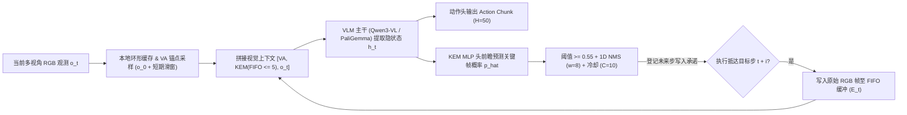
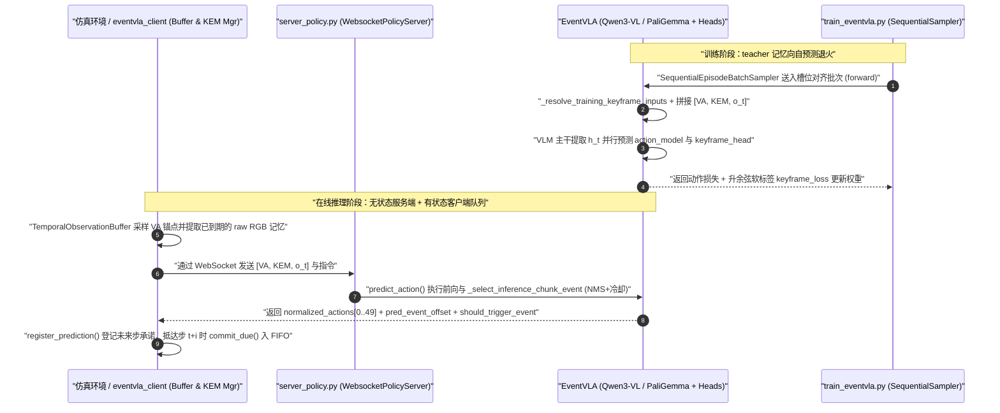

# EventVLA：面向长程非马尔可夫操作的事件驱动视觉证据记忆策略

> 来源：[arXiv:2606.20092 (v3)](https://arxiv.org/abs/2606.20092) · [Project Page](https://ganlin-yang.github.io/EventVLA.github.io/) · [GitHub (`InternRobotics/EventVLA`)](https://github.com/InternRobotics/EventVLA) · [RoboTwin-MeM Dataset](https://huggingface.co/datasets/ganlinyang/RoboTwin-MeM) · CoRL 2026

## 一句话定义

**EventVLA**（USTC、上海人工智能实验室等联合提出，CoRL 2026）是一种针对**非马尔可夫长程机器人操作**的端到端视觉-语言-动作（VLA）架构：它将策略记忆分解为固定采样的**基础视觉锚点（Foundational Visual Anchors, VA）**与从未来动作块隐状态触发写入的**前瞻式关键帧证据记忆（Keyframe Evidence Memory, KEM）**，仅将稀疏关键事件帧以原始 RGB 图像保留在有界 FIFO 缓冲中与当前观测拼接送入 VLM，在 430–1544 步的 **RoboTwin-MeM** 基准取得 **75.2%** 平均成功率。

## 英文缩写速查

| 缩写 | 英文全称 | 简要说明 |
| :--- | :--- | :--- |
| **VA** | Foundational Visual Anchors | 基础视觉锚点，由初始帧 $o_0$ 与固定负偏移短期滑窗组成 |
| **KEM** | Keyframe Evidence Memory | 关键帧证据记忆，由轻量前瞻头选帧并以原始 RGB 图像写入 FIFO 缓冲 |
| **FIFO** | First-In, First-Out | 先进先出有界缓冲队列（论文默认 $N_{\max}=5$），控制多帧上下文上限 |
| **NMS** | Non-Maximum Suppression | 非极大值抑制（1D 半径 $w=8$），在推理时配合冷却窗口防止相邻步重复写帧 |

## 为什么重要

1. **打破“所有历史同等重要或必须压缩”的僵局**：常见长程记忆方案要么靠高层 VLM 规划+底层控制的“慢—快双系统”（延迟超 1 s、误差传播），要么用隐态循环池化造成细节丢失（如揭开盖子一瞬间看见方块颜色后，信息被平均池化冲淡）。EventVLA 证明保留极少数（$N_{\max} \le 5$）高信噪比**原始事件帧**就能让原生 VLM 自注意力准确还原早期视觉线索。
2. **揭示“布局记忆”与“瞬态事件记忆”的本质分化**：作者系统复现并诊断出像 RMBench 这类任务主要依赖全局静态背景布局（仅 VA 即可达 **67.8%**），无法真正测出动态中间记忆；据此开源的 **RoboTwin-MeM** 强制要求跨 430–1544 步精确回溯 $n\in[1,5]$ 个瞬态中间证据（遮挡解除、按压次数计数、临时路径示范）。
3. **单卡可部署的轻量前瞻闭环**：在 `Qwen3-VL-4B-Instruct`（仿真）和 $\pi_{0.5}$ / `PaliGemma`（真机）之上仅挂接单个轻量 MLP 关键帧头，无需额外大模型做在线事件摘要或历史重编码，真机单 chunk 推理 **0.42 s**、显存仅约 **7 GB**。

## 核心原理

### 核心信息

| 属性 | 内容 |
| :--- | :--- |
| **机构与发布** | USTC、上海人工智能实验室、SJTU、大连理工大学、华为、HKU、清华、北大；CoRL 2026 |
| **模型骨干** | 仿真：`QwenOFT`（基于 `Qwen3-VL-4B-Instruct`）；真机：$\pi_{0.5}$（`PaliGemma` 底座），图像统一 $224\times 224$，chunk $H=H_k=50$ |
| **记忆构成** | $M_t = A_t \cup E_t$；仿真锚点 $A_t=\{o_0, o_{t-30}, o_{t-15}\}$、真机 $A_t=\{o_0, o_{t-60}, o_{t-40}, o_{t-20}\}$；事件缓冲 $N_{\max}=5$ |
| **自动化标注** | 离线使用 `Qwen3-VL-235B-A22B-Instruct-FP8`（每轨迹 128 帧 + 2–3-shot ICL JSON 提示）自动提取关键帧 $t^*$ |
| **联合训练** | 升余弦软标签 + chunk BCE 损失（$L=L_{\mathrm{action}}+\lambda L_{\mathrm{kem}},\ \lambda=0.1$）及 teacher→student 混合退火（$\alpha: 1.0 \to 0.0$） |

### 关键机制拆解

1. **视觉证据分解（$M_t = A_t \cup E_t$）**：
   - **基础视觉锚点 $A_t$**：固定纳入初始观察 $o_0$（提供全局布局基准）和紧邻当前步前的若干短期历史帧（提供局部速度与进度线索）。消融表明，若移除 $o_0$ 或移除短期历史，RMBench 成功率分别从 **67.8%** 暴跌至 **33.7%** 与 **23.8%**。
   - **关键帧证据记忆 $E_t$**：不定期捕获转瞬即逝的决策性事件证据（如盖子打开瞬间露出隐藏颜色、机械臂刚按完第 2 下按钮），以无损原始 RGB 图像存入容量为 $N_{\max}=5$ 的 FIFO 缓冲，通过拼接序列 $I_{\mathrm{input}} = \mathrm{concat}([A_t, E_{t-1}, o_t])$ 输入 VLM 视觉编码器，靠多层自注意力跨帧检索细节。
2. **前瞻式 KEM 写入（Prospective Future Chunk Prediction）**：
   - 相比仅在事件“事后发生时”被动作筛选的反应式（Reactive）选帧，EventVLA 直接从融合了视觉历史与动作查询的最后一层隐状态 $h_t \in \mathbb{R}^{H\times d}$ 上挂载一个轻量级 MLP 头，并行输出未来整个动作 chunk（$H_k=50$ 步）内每一步成为任务关键帧的概率 $\hat{\mathbf{p}}_t = \sigma(\mathrm{KEM}_{\mathrm{mlp}}(h_t)) \in [0,1]^H$。
   - 在线推理时，先筛选出 $\hat{p}_t^i \ge \tau_{\mathrm{commit}}$（默认 `0.55`）的峰值位置，经 1D NMS（半径 $w=8$）及写入冷却期（$C=10$ 步）抑制冗余后，登记未来的写入承诺；当机器人执行到该目标时刻 $t+i$ 时，将当步实际采集到的原始观测图像写回 $E_t$。由于策略原本就在规划通向该事件的动作轨迹，**将未来事件预测与当前动作规划耦合在同一隐表征中**，带来了比事后反应式（28.9% vs 75.2%）压倒性的召回优势。
3. **大模型离线标注与 teacher→student 退火**：
   - 训练数据集首先经过 `Qwen3-VL-235B-A22B-Instruct-FP8`（8×A800 vLLM 离线推理）以均匀 128 帧多视角输入标定事件时间戳 $t^*$，在 1500–2000 步长轨迹上相对仿真器 GT 误差 **<10 步**、相对人类标注 **<50 步**。
   - 为缓解时间戳微小偏差造成的梯度的不稳定，监督信号采用半径为 $R$ 的升余弦软标签 $y_t^i = 0.5(1+\cos(\pi|t+i-t^*|/R))$ 计算序列平均二元交叉熵（BCE）。训练早期由 Ground-Truth 关键帧构建历史记忆（$\alpha=1.0$），随步数线性退火至完全由策略自主预测写入（$\alpha=0.0$），确保推理分布一致。

### 流程总览

## 实验与评测

基于原文 v3 Table 1–4 与 Appendix Table 10–11，关键跨基准与消融评测结果汇总如下：

### 1. 主基准跨模型对比（成功率 % ↑）

| 方法 | 内存形态 | RMBench (Table 1) | RoboTwin-MeM (Table 2) | RoboTwin 2.0 Easy/Hard (Table 3) | 真机 ARX 4 任务均值 (Table 11) |
| :--- | :--- | :---: | :---: | :---: | :---: |
| **$\pi_{0.5}$** | 无长程记忆 | `10.4` | `7.8` | `82.7 / 76.8` | 0–10（单项范围） |
| **QwenOFT** | 无长程记忆 | `5.6` | `3.8` | `80.0 / 78.0` | `—` |
| **MemER** | 高/低层双系统文本+关键帧 | `8.7` | `10.5` | `—` | `32.3` |
| **Mem-0** | 记忆库基线 | `42.0` | `0.0` | `—` | `—` |
| **MemoryVLA (QwenOFT)** | 隐式 token merge | `41.7` | `10.8` | `—` | `—` |
| **$\pi_{\mathrm{MEM}}$** | 隐式潜空间记忆 | `—` | `—` | `—` | `37.5` |
| **EventVLA (VA only)** | 仅锚点 $A_t$ | **`67.8`** | `18.0` | `—` | `25.0` |
| **EventVLA (VA + KEM)** | 锚点 + 前瞻原始关键帧 | `66.7` | **`75.2`** | **`83.8 / 81.6`** | **`78.8`** |

- **RoboTwin-MeM 分任务细分（75.2% 均值，平均 430–1544 步）：** Rearrange Blocks Hard `62%`、Put Back Block Hard `93%`、Pick Objects in Order `90%`、Pick the Unhidden Block `54%`、Cover Blocks Hard `94%`、Find Seal and Seal Stamp `63%`、Reproduce Route `98%`、Press Button Keyframe `48%`。
- **真机 ARX ACONE 分任务与部署效率（Table 11, A100 bs=1）：** 4 任务各 20 trials 达 **Find Block Easy `90%`**、**Pick-X-Times `90%`**、**Find Block Hard `60%`**、**Pick in Order `75%`**；单 chunk 延迟 **0.42 s**、显存约 **7 GB**，显著快于且轻量于 MemER（**1.43 s** / ~24 GB）和 $\pi_{\mathrm{MEM}}$（**1.08 s** / ~24 GB）。

### 2. 记忆选帧机理、前瞻视野与标注消融（Table 2, Table 4, Table 10）

| 消融项 | RoboTwin-MeM (%) | 真机 ARX 均值 (%) | 说明 |
| :--- | :---: | :---: | :--- |
| **Heuristic：Random / Periodic (P=100)** | `10.1` / `34.2` | `1.3` / `37.1` | 盲目采样极易漏掉瞬态遮挡瞬间或被冗余帧塞满 |
| **Heuristic：Visual-change / Reactive** | `44.6` / `28.9` | `22.6` / `30.4` | 事后反应式或纯像素变化易把机械臂大幅移动误判为事件 |
| **隐式记忆库 / 硬二值标签 / 去 NMS / $N_{\max}=2$** | `24.9` / `48.8` / `53.4` / `32.0` | `—` | 证明了原始图像无损保留、升余弦软标签、NMS 去重及容量 $N_{\max}=5$ 的必要性 |
| **前瞻视野 $H_k$：`0 -> 1 -> 15 -> 30 -> 50`** | `28.9 -> 28.2 -> 36.8 -> 45.4 -> 75.2` | `30.4 -> 31.1 -> 42.9 -> 50.1 -> 78.8` | 短视野无法提前感知即将完成或打开的瞬间，必须覆盖整个动作块（$H_k=50$） |
| **Oracle / GT 标注上限 vs 自动标注** | `76.3` vs **`75.2`** | `77.7` vs **`78.8`** | `Qwen3-VL-235B` 离线自动标注基本追平甚至略超人工/仿真真值 |

## 结论

**对于需要跨越数百上千步并召回偶发瞬态线索的非马尔可夫操作任务，与动作块共享隐表征的“前瞻式稀疏原图写入（VA + KEM）”比隐态压缩或双系统异步规划更可靠、更轻量。**

1. **区分任务记忆类型后再选模型配置**：纯全局布局持续可见型任务（如 RMBench）用 `raw_anchors_only` 即可拿高分（67.8%）且避免冗余视觉 token；唯有存在遮挡解除、计数或路径复现的非马尔可夫任务才应启用完整 `pure_image_keyframe_memory`。
2. **必须做前瞻而非事后回看（$H_k = H$）**：将关键帧预测视野从单步/短窗口放宽到整段 chunk（$H_k=50$），才能利用规划阶段“即将抵达目标事件”的先验信号避免错过关键一帧（成功率从 28.9% 跃升至 75.2%）。
3. **保留原始图像胜过特征压缩，但必须配合 NMS + 冷却抑制**：无损 RGB 帧配合 FIFO $N_{\max}=5$ 能保留颜色/数字/印章细节；若去掉 NMS 和冷却期，冗余相邻帧会瞬间挤占有限槽位（掉点超 20%）。
4. **训练端必须使用轨迹槽位连续采样器**：依赖 teacher→student 在线记忆退火的策略要求同一 episode 在相邻训练迭代中留在固定 batch slot（仓库 `SequentialEpisodeBatchSampler`），随机打乱单帧无法正确构建时序写入分布。

## 与其他工作对比

| 维度 | EventVLA | KEMO (`paper-kemo`) | MemoryVLA / $\pi_{\mathrm{MEM}}$ | MemER |
| :--- | :--- | :--- | :--- | :--- |
| **触发机制** | 与动作 chunk 联合学习的前瞻式 KEM MLP（+ 1D NMS + 冷却） | 末端运动学停顿/速度极小值/夹爪状态启发式关键帧 | 每步稠密写入后做 token merge 或固定缓存更新 | 高层 VLM 文本规划器主动点名记录关键帧 |
| **存储内容** | 有界 FIFO（$N_{\max}=5$）内的原始 RGB 帧 + 视觉锚点 | 关键帧图像 + Cross-Attention 注入特征 | 压缩特征 token bank / 潜空间记忆 | 文本子任务历史 + 选定关键帧图像 |
| **推理成本** | 单流原生前向；真机 **0.42 s/chunk**、~7 GB 显存 | 轻量化特征交叉融合 | 需维持持续更新的大容量特征库（$\pi_{\mathrm{MEM}}$ 1.08 s / ~24 GB） | 双系统串行推理较重（1.43 s / ~24 GB） |
| **典型短板** | FIFO 容量受限（>10 min 密事件易挤出早期证据） | 运动学变化小但纯视觉变化（如等指示灯）易漏触发 | 强压缩丢失小物体细粒度颜色与印章特征 | 高层 VLM 错误会直接导致底层策略死锁 |

## 源码运行时序图

以下时序严格对齐官方仓库 `InternRobotics/EventVLA` 中的官方训练入口（`train_eventvla.py` + `EventVLA.forward`）与 WebSocket 推理服务端/客户端协同架构（`server_policy.py` + `eventvla_client.py` + `EventVLA.predict_action`）：

## 工程实践

1. **训练数据批采样约束**：官方在 `examples/RoboTwin-Mem/README.md` 与 `train_eventvla.py` 中明确指定只能使用 `SequentialEpisodeBatchSampler`，以保证每个 episode 在连续训练 step 之间对齐固定 batch slot，避免 runtime 记忆张量跨轨迹串位。
2. **记忆模式快速切换**：通过 `eventvla/model/memory_ablation.py` 中的 `MEMORY_ABLATION_MODE` 环境变量可在 `pure_image_keyframe_memory`（RoboTwin-MeM 完整 VA+KEM 模式）与 `raw_anchors_only`（RMBench 纯锚点模式，自动锁定锚点偏移 `(-30, -15, 0)`）间无缝切换，无需改代码分支。
3. **服务端无状态化部署**：推理期 `server_policy.py` 仅做无状态 VLM 推理；所有图像环形缓冲（`TemporalObservationBuffer`, 默认 `maxlen=128`）和待到期关键帧队列（`KeyframeImageMemoryManager`）均运行在评测器或 `eventvla_client.py` 侧，方便真机重启或单臂异常复位时快速清空状态。
4. **真机开源进度核对**：虽然论文已报告完整的 ARX ACONE 真机实验且客户端桥接脚本 `deployment/model_client/eventvla_client.py` 已在仓库内可用，但仓库顶层 README 的 To-Do 列表仍将真机微调模型权重与真机完整评测脚本标注为待发布（`[ ]`），工程复用前须核对对应分支与硬件适配接口。

## 常见误区与局限

1. **误区：只要多塞历史帧进 VLM 上下文就会比 KEM 更好**：Periodic（每 100 步塞一帧）和 Visual-change 在 RoboTwin-MeM 上仅得 `34.2%` 与 `44.6%`，不仅显存开销更高，大量非关键帧还会稀释注意力、淹没只有 1–2 帧出现过的隐藏方块线索。
2. **FIFO 上界引发的超高密度长程遗忘（原文局限）**：论文在 §6 明确指出，当任务持续时间超过 **10 分钟** 且包含大量密集关键事件时，固定容量的 FIFO 缓冲（$N_{\max}=5$）可能达到饱和并过早驱逐早期关键证据，需要后续引入基于重要度的驱逐或分级记忆管理。
3. **跨任务零样本迁移未验证（原文局限）**：当前习得的“什么是值得记住的关键事件”高度依赖训练集内的任务分布，在全新未见任务、全新物体或强视觉干扰物场景下的内存选择泛化性尚未得到充分实验证实。
4. **物理关键帧到达偏差的鲁棒性边界**：由于 KEM 是在执行前预测未来步偏移量 `pred_event_offset`，当实机遭遇外部扰动（人手阻挡、滑动偏离）导致实际到达事件的时间比原动作规划大幅推迟时，提前登记的写入步数可能落在事件发生之前，需结合动作重规划高频更新或混合视觉校验触发器。

## 关联页面

- [长程双臂操作（Bimanual Manipulation）](../tasks/bimanual-manipulation.md)
- [通用操作任务（Manipulation）](../tasks/manipulation.md)
- [视觉-语言-动作模型（VLA）](../methods/vla.md)
- [StarVLA 框架](../methods/star-vla.md)
- [动作块预测（Action Chunking）](../methods/action-chunking.md)
- [KEMO：事件驱动关键帧记忆 VLA](./paper-kemo-event-driven-keyframe-memory-vla.md)
- [RoboTwin 2.0 仿真基准](./robotwin.md)

## 参考来源

- [EventVLA 原文精读归档（arXiv:2606.20092 v3 全文与 Appendix D 核对）](../../sources/papers/eventvla_arxiv_2606_20092.md)
- [InternRobotics/EventVLA 源码架构、记忆控制与真机部署归档](../../sources/repos/internrobotics_eventvla.md)

## 推荐继续阅读

- [FM-VLA](./paper-fm-vla.md)
- [Chronos](./paper-chronos.md)
- [BridgeVLA++](./paper-bridgevla-plusplus.md)
- [KEMO：事件驱动关键帧记忆 VLA](./paper-kemo-event-driven-keyframe-memory-vla.md)
