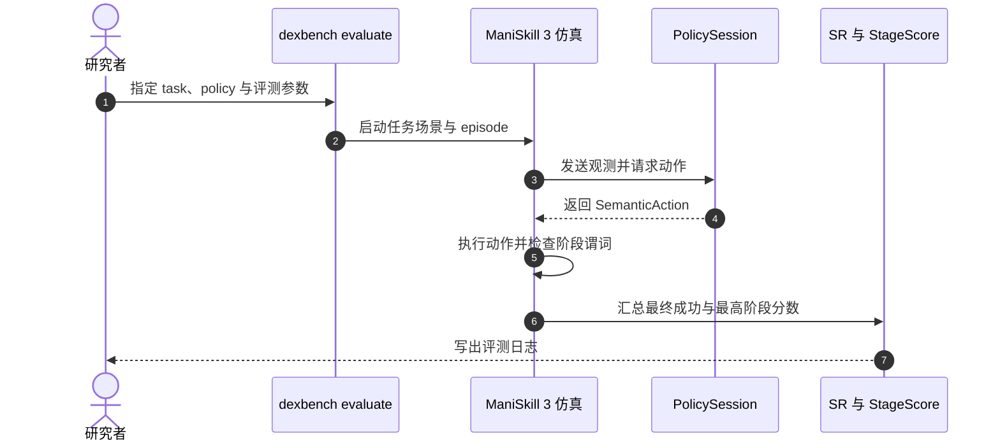

# Evo-DexBench（arXiv:2610.21180）

**Evo-DexBench**（*Evo-DexBench: Benchmarking Generalization across Related Tasks for Dexterous Manipulation*，[arXiv:2610.21180](https://arxiv.org/abs/2610.21180)，[官方代码](https://github.com/MINT-SJTU/Evo-DexBench)，[数据与资产](https://huggingface.co/collections/MINT-SJTU/evo-dexbench)）是一个灵巧操作基准，重点衡量策略能否把相关任务中学到的功能性交互迁移到同一功能家族的新任务。

## 英文缩写速查

| 缩写 | 英文全称 | 简要说明 |
|------|----------|----------|
| Core–Gen | Core tasks and Generalization tasks | 分别指相关源任务与少量目标示范的新任务 |
| SR | Success Rate | 完成最终任务谓词的 episode 比例 |
| VR | Virtual Reality | 支持 Quest 3 遥操作与示范采集 |
| HDF5 | Hierarchical Data Format 5 | 仓库采集与存储 episode 数据的格式 |

## 为什么重要

常见灵巧操作评测若给目标任务太多示范，或不控制源任务与目标任务的关系，就难以分辨模型是复用功能性交互知识，还是记住目标任务的动作。Evo-DexBench 把这两个变量纳入任务设计，能更直接地测试跨相关任务泛化。

## 方法与任务设计

Core–Gen 是该 benchmark 的关键设定：

1. **Core 任务**提供源知识，与目标任务共享功能性交互。
2. **Gen 任务**是同一功能家族中的新目标任务，只提供少量目标示范。
3. 评测比较模型如何利用 Core 数据与有限 Gen 数据完成新任务，并可检查 Core 数据是否与目标功能匹配。

官方资料给出的基准规模为 **30 个任务、6 个功能家族**，每项任务含三个日常场景布局；任务既包括单手，也包括双手操作。仓库任务目录区分单手 m01_v1–m15_v1 与双手 b01_v1–b15_v1，每个任务定义阶段谓词和最终成功谓词。

## 数据与接口

论文摘要报告发布数据包含 **1,248 条多模态示范**，由装有 **123 个 taxel** 的模拟 Shadow Hand 采集。官方仓库提供仿真基准、示范采集、验证、LeRobot 导出和可插拔策略接口。README 中的标准运行示例采用 **30 Hz 控制 / 120 Hz 仿真**；资产下载需单独取得 PartNet-Mobility 的访问权限。

## 源码运行时序图

按官方 README 的公开评测入口整理；策略推理可以在本地或独立服务中运行，KineDex 是示例集成之一。

## 实验与评测

- 摘要报告其评测范围内表现最好的方法平均 **SR 为 38.5%**，显示跨相关任务迁移仍有明显提升空间。
- 对两个任务的分析中，联合 Core+Gen 训练相较于“先用 Core 训练、再用 Gen 微调”，性能分别提升 **12%** 和 **38%**。摘要未明确说明这是相对百分比还是百分点，因此不作百分点解释。
- 官方评测报告 **Success Rate (SR)** 与 **StageScore**。SR 对应最终成功谓词；StageScore 是 episode 中达到的最高已配置阶段分数，可用于观察任务完成进度。

## 与其他工作对比

| 维度 | Evo-DexBench | 阅读提示 |
|------|--------------|----------|
| 评测重点 | 相关任务之间的功能性交互迁移 | 对照 Core 来源任务与少量 Gen 示范 |
| 任务结构 | 同一功能家族中组织源任务和新目标任务 | 关注任务相关性是否匹配 |
| 任务规模 | 30 个单手与双手任务，6 个功能家族 | 不应把摘要中的两个任务分析泛化到所有任务 |
| 工程入口 | ManiSkill 3 基准、遥操作采集、策略接口 | 需核对资产门控、环境依赖和评测参数 |

与 [Bench2Dex](./paper-bench2dex.md) 同属灵巧操作基准，但问题设定不同：Evo-DexBench 强调相关任务迁移；Bench2Dex 聚焦跨手型的视觉—触觉双臂操作与扰动评测。选择时应先按要验证的泛化问题匹配协议。

## 结论

**Evo-DexBench 的核心价值是把“源任务是否相关、目标示范是否有限”变成可检查的 benchmark 条件；它提供评测框架，不代表现有策略已解决灵巧操作泛化。**

1. 把 Core 与 Gen 的功能关系作为首要对照变量，不能只看合并后的平均成功率。
2. 读取 12% / 38% 时保留任务范围：这是摘要中两个任务的分析结果。
3. 将 SR 和 StageScore 一起看：最终成功衡量任务完成，阶段分数帮助判断失败发生在哪个阶段。
4. 复现前先对齐任务 ID、场景布局、示范预算和模拟频率，再比较策略。
5. 官方仓库代码及数据入口已发布；README 标注的独立项目页仍为 coming soon，PartNet-Mobility 资产另有访问门槛。

## 局限与风险

- 摘要中的最佳平均 SR 与两项任务提升不足以代表全部任务；应结合论文完整表格、任务级方差与评测设置判断。
- 数据来自模拟 Shadow Hand；对真实触觉硬件或真实机器人部署的迁移效果不能由该数据集本身推出。
- 任务集包含单手和双手两种设置，比较时需按 embodiment 与任务家族分层，避免将难度差异误当成方法差异。
- Hugging Face 页面中的具体文件清单、许可和门控状态应以各自数据卡为准；PartNet-Mobility 需要先取得访问权。

## 关联页面

- [灵巧操作任务](../tasks/manipulation.md)
- [Bench2Dex](./paper-bench2dex.md)
- [HandEdit](./paper-handedit.md)
- [具身大模型评测基准选型闭环](../queries/embodied-eval-benchmark-selection-loop.md) — Evo-DexBench 属其 ③ 策略任务成功率层（灵巧相关任务迁移）；SR 与 StageScore 并报，避免只看终局成功率。

## 参考来源

- [Evo-DexBench arXiv 论文归档](../../sources/papers/evo_dexbench_arxiv_2610_21180.md)
- [Evo-DexBench 官方仓库归档](../../sources/repos/evo_dexbench.md)
- [数据集与资产归档](../../sources/datasets/evo_dexbench_dataset.md)
- [项目页状态核查](../../sources/sites/evo-dexbench-project-page.md)

## 推荐继续阅读

- [Evo-DexBench 官方仓库与运行指南](https://github.com/MINT-SJTU/Evo-DexBench)
- [Evo-DexBench 数据与资产 collection](https://huggingface.co/collections/MINT-SJTU/evo-dexbench)
