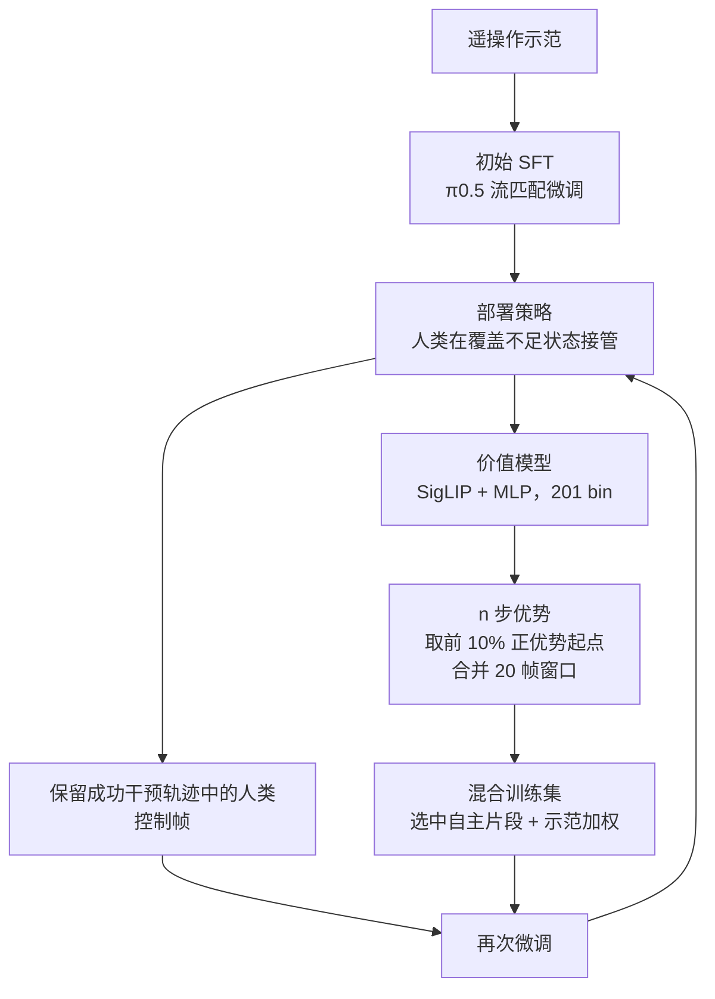
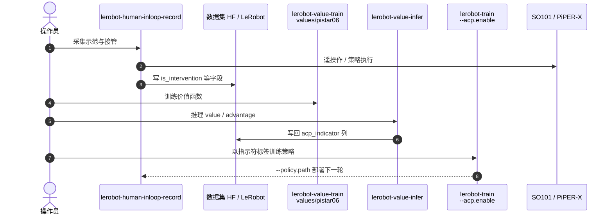

---

type: entity
tags: [paper, reinforcement-learning, real-world-rl, human-in-the-loop, vla, value-function, dataset, sjtu, csu, scnu, boden-ai]
status: complete
updated: 2026-10-12
arxiv: "2610.13345"
project_id: evo-rl
code: https://github.com/MINT-SJTU/Evo-RL
project: https://huggingface.co/datasets/MINT-SJTU/RW-RL-Dataset
venue: "arXiv 2026 (cs.RO)"
related:
  - ../overview/embodied-station-34-papers-spatial-grounding-technology-map.md
  - ../tasks/manipulation.md
  - ../methods/reinforcement-learning.md
  - ../methods/hil-hybrid-imitation-learning.md
  - ../methods/value-based-reinforcement-learning.md
  - ../concepts/safe-real-world-rl-fine-tuning.md
  - ./paper-real-time-chunking.md
  - ./lerobot.md
sources:
  - ../../sources/blogs/wechat_embodied_station_34_papers_spatial_grounding_2026-10-12.md
  - ../../sources/papers/evo_rl_arxiv_2610_13345.md
  - ../../sources/sites/huggingface-co-mint-sjtu-rw-rl-dataset.md
  - ../../sources/repos/evo-rl.md
summary: "Evo-RL（arXiv:2610.13345，SJTU 等）：以 π0.5 为底座，把人类接管的成功片段与价值模型筛出的正优势片段迭代并入训练；PiperX 螺钉插入成功率 88.24%（RECAP 57.78%），配套 RW-RL-Dataset 多本体真机数据已在 HF 发布，代码为 LeRobot 分支但论文的片段选择入口未核实。"
---

# Evo-RL：从有选择的经验中迭代改进真机策略

**Evo-RL**（*Iterative Robot Reinforcement Learning from Selective Experience*，[arXiv:2610.13345](https://arxiv.org/abs/2610.13345)，[代码](https://github.com/MINT-SJTU/Evo-RL)，[数据集](https://huggingface.co/datasets/MINT-SJTU/RW-RL-Dataset)）由 **上海交通大学人工智能学院**（Bo Zhao 通讯）联合 Central South University、South China Normal University、Boden AI 提出：在真机强化学习里不是“全收”经验，而是保留人类接管的成功片段，并用价值模型挑出正优势片段，迭代微调 π0.5 类策略。

## 一句话定义

**用任务专属视觉价值模型估计优势，只把人类成功接管片段与前 10% 正优势片段送回微调，从而用更少的真机时间换到更高的成功率。**

## 英文缩写速查

| 缩写 | 英文全称 | 简要说明 |
|------|----------|----------|
| RL | Reinforcement Learning | 真机迭代改进框架 |
| SFT | Supervised Fine-Tuning | 基线：仅示范微调 |
| ASR | Average Success Rate | 表中成功率指标（%） |
| TP | Throughput | 表中吞吐指标（论文表头缩写，具体单位原文提取中未给出） |
| RECAP | RL with Experience and Corrections via Advantage-conditioned Policies | 对照方法：二值优势指示符条件化策略 |
| RTC | Real-Time Chunking | 部署时的动作块执行方式 |

## 为什么重要

- **真机时间是瓶颈：** 论文显示 8 小时“示范+干预”混合约等于 16 小时纯示范 SFT。
- **经验价值不均：** 成功轨迹也含犹豫与重复尝试；按优势选片段比整条轨迹混用更精细。
- **成本差距大：** 微调约 4 h 52 min（1,511 步），RECAP 估计约 64 h（102,111 步）。
- **有配套数据：** RW-RL-Dataset 提供多本体真机干预与 rollout，便于离线 RL 研究。

## 方法栈 / 流程总览

## 方法

- **底座：** 沿用 π0.5（PaliGemma 骨干 + 流匹配动作专家），部署用 RTC。
- **干预数据：** 只保留成功干预轨迹中 control label 为人类的帧，训练块限制在连续人类片段内。
- **奖励：** 非终止帧 −1，接管前一转移加 −C_int，终止 0。
- **价值模型：** 视觉-only，SigLIP 编码器 + MLP，201 个 bin 覆盖 [−1, 0]，two-hot 交叉熵训练。
- **优势与选择：** n 步优势；示范和成功自主 rollout 中取正优势非终止起点的前 10%，20 帧窗口合并；选中的自主片段加入混合集，示范片段提高采样权重。每轮两次 SFT。
- **与 RECAP 的区别：** RECAP 把二值优势指示符作为条件；Evo-RL 用优势做经验选择与采样权重。

## 源码运行时序图

官方仓库 [MINT-SJTU/Evo-RL](https://github.com/MINT-SJTU/Evo-RL)（归档 [sources/repos/evo-rl.md](../../sources/repos/evo-rl.md)）是 LeRobot 分支，README 给出的是价值→优势→指示符→条件策略的迭代流程：

- **最短路径：** 装 LeRobot 分支 → `lerobot-human-inloop-record` → `lerobot-value-train` → `lerobot-value-infer` → `lerobot-train --acp.enable=true`。
- **注意：** 论文的“前 10% 正优势片段选择、窗口合并、示范加权”在 README 与检索到的脚本里没有对应入口（未核实是否已实现），README 流程是优势条件化路线。

## 工程实践

| 项 | 建议 |
|----|------|
| 硬件 | 仓库支持 SO101 与 AgileX PiPER/PiPER-X；先用其遥操作命令确认采集链路 |
| 数据 | 先看 RW-RL-Dataset 的 LeRobot 格式（parquet + MP4）再决定是否复用 |
| 价值模型 | 任务专属，需调奖励尺度与 C_int；论文无敏感性分析 |
| 开源状态 | **部分开源**：代码（Apache-2.0，tip 2026-09-15）与数据集已公开；模型权重 README 标 “Coming Soon”；论文徽章仍标 Coming Soon；README 的项目网站链接核对时 404 |

## 实验与评测

- **匹配预算（ASR % / TP）：** 2 h SFT 0.00/0.00 对 SFT+干预 46.15/7.20；4 h 27.03/12.00 对 51.52/20.40；8 h 43.68/50.17 对 78.00/53.04；16 h SFT 78.26/53.27。
- **PiperX 螺钉插入：** SFT 22.73；SFT+干预 78.72；SFT+RL 36.99；RECAP 57.78；Evo-RL 88.24；第二轮 92.16（TP 60.61→67.14）。Evo-RL 比 RECAP 高 30.46 个百分点。
- **SO-101 折叠：** SFT 55.56/75.78 → Evo-RL 76.67/90.00（仅与 SFT 对比）。
- **其他：** 人工控制时间占比 15.30%→9.56%；价值训练约 2 h 19 min（3×A100）。
- 试验量小（每单元 N=10，每阶段 N=20）。

## 结论

**把真机经验按价值筛过再训，比无差别混用或仅用条件指示符更省真机时间，但证据来自两任务两机器人且 RECAP 成本为估计值。**

1. **先收人类接管再做 RL** — 8 h 干预混合约等于 16 h SFT。
2. **只留成功干预的人类帧** — 避免学到失败前的策略动作。
3. **用优势筛片段** — PiperX 上 88.24% 对 RECAP 57.78%。
4. **价值模型要任务专属** — 奖励尺度与接管惩罚需调。
5. **复现先走仓库流程** — 但论文片段选择入口未核实，需自行补实现或联系作者。

## 局限与风险

- 无专门局限节；任务与本体少，RECAP 只在 PiperX 上比较，SO-101 仅对 SFT。
- RECAP 训练成本是估计而非实测。
- 摘要称检查点公开，但未给链接，仓库模型标 Coming Soon。
- 数据集卡未列 PiperX 目录，论文实验数据是否全包含未核实。

## 与其他工作对比

| 对照 | 差异读法 |
|------|----------|
| [Real-Time Chunking](./paper-real-time-chunking.md) | 部署侧动作块执行；Evo-RL 解决的是数据/训练侧经验筛选 |
| [HIL 混合模仿学习](../methods/hil-hybrid-imitation-learning.md) | 同属人类介入路线；Evo-RL 加入价值筛选 |
| [安全真机 RL 微调](../concepts/safe-real-world-rl-fine-tuning.md) | 站内真机 RL 总览 |
| [LeRobot](./lerobot.md) | 仓库所基于的框架 |

## 关联页面

- [34 篇空间落地技术地图（汇总页）](../overview/embodied-station-34-papers-spatial-grounding-technology-map.md)
- [强化学习](../methods/reinforcement-learning.md)
- [基于价值的强化学习](../methods/value-based-reinforcement-learning.md)
- [安全真机 RL 微调](../concepts/safe-real-world-rl-fine-tuning.md)
- [LeRobot](./lerobot.md)

## 参考来源

- [具身智能小站 34 篇周报](../../sources/blogs/wechat_embodied_station_34_papers_spatial_grounding_2026-10-12.md) — 线索来源
- [evo_rl_arxiv_2610_13345.md](../../sources/papers/evo_rl_arxiv_2610_13345.md) — 论文摘录
- [huggingface-co-mint-sjtu-rw-rl-dataset.md](../../sources/sites/huggingface-co-mint-sjtu-rw-rl-dataset.md) — 数据集卡核查
- [evo-rl.md](../../sources/repos/evo-rl.md) — 仓库归档
- [arXiv:2610.13345](https://arxiv.org/abs/2610.13345)

## 推荐继续阅读

- [Evo-RL GitHub](https://github.com/MINT-SJTU/Evo-RL)
- [RW-RL-Dataset](https://huggingface.co/datasets/MINT-SJTU/RW-RL-Dataset)
- [arXiv HTML 全文](https://arxiv.org/html/2610.13345v1)
