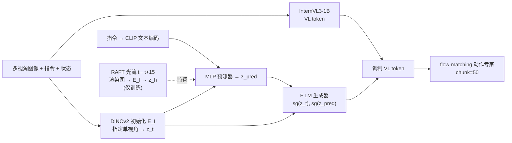
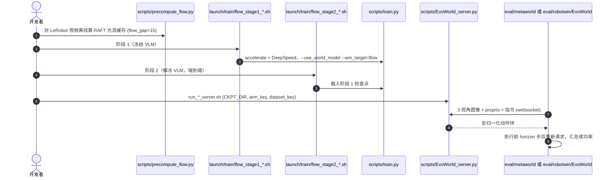

# Evo-World：用光流监督的轻量 VLA 未来运动预测

**Evo-World**（[arXiv:2610.12936](https://arxiv.org/abs/2610.12936)，[代码](https://github.com/MINT-SJTU/Evo-World)）来自上海交通大学 MINT 团队（作者栏另有浙江大学、电子科技大学、QuicRobot）：在 0.87B 参数的 VLA 上增加一条“预测未来运动”的辅助分支，目标不是未来图像，而是当前帧到未来第 15 帧的 **RAFT 光流渲染图**，使预测信号只含运动、不含静态外观。

## 一句话定义

**把“未来会怎么动”作为潜空间辅助任务，用光流而非 RGB 做监督，再通过 FiLM 调制 VL 特征喂给 flow-matching 动作专家，同时用 SIGReg 防坍缩、用 stop-gradient 隔离动作梯度。**

## 英文缩写速查

| 缩写 | 英文全称 | 简要说明 |
|------|----------|----------|
| VLA | Vision-Language-Action | 视觉-语言-动作模型 |
| RAFT | Recurrent All-Pairs Field Transforms | 本文离线计算光流目标所用的光流估计器 |
| FiLM | Feature-wise Linear Modulation | 用 (γ,β) 对 VL token 做逐通道缩放平移，注入运动表征 |
| SIGReg | Sketched Isotropic Gaussian Regularization | 来自 LeJEPA 的表征分布正则，本文用来防止运动表征坍缩 |
| MT50 | Meta-World MT50 | 50 任务多任务基准，按 Easy/Medium/Hard/Very Hard 分档 |
| SR | Success Rate | 成功率 |

## 为什么重要

- **轻量路线：** 全模型 0.87B，无机器人数据预训练，4 张 RTX 4090 训练；真机 GPU 显存 2.54 GB、6.16 Hz，说明“辅助预测”可以不靠大模型堆参数。
- **目标选择有对照：** 同一框架下只改预测目标，光流 91.1，未来 RGB 84.3，无辅助预测 80.6，把“为什么用光流”落在了数字上。
- **工程线索：** 梯度隔离与表征正则的消融（-8.9 / -5.3）说明辅助预测任务容易被动作损失污染，需要显式防护。

## 流程总览

## 方法

- **骨干与动作头：** InternVL3-1B（InternViT + InternVL3 LLM）；动作专家为 flow-matching Transformer，对 FiLM 调制后的 VL token 与 MLP 编码的状态 token 做 cross-attention，推理用前向 Euler 积分，动作块长度 50。
- **运动表征：** E_I 编码一个指定视角得 z_t，预测器输入 [z_t; 指令嵌入] 输出 z_pred；目标 z_h 由光流渲染图经同一 E_I 得到。光流渲染保留方向、对幅值裁剪，尺度取前 5 条 episode 的 99 分位。
- **条件注入：** (γ,β)=α·tanh(G([sg(z_t); sg(z_pred)]))，α=0.1，末层零初始化，所以训练起点等价于原 VLA。
- **损失：** L = L_action + 0.1·(L_pred + 0.09·L_SIGReg)；L_pred 是 z_pred 与 z_h 的 MSE；动作损失不回传到运动模块（stop-gradient）。
- **训练：** 阶段 1 共 10k 步冻结骨干；阶段 2 共 100k 步解冻。AdamW、学习率 1e-5、全局 batch 64、BF16、DeepSpeed ZeRO-2。
- **数据：** Meta-World MT50、RoboTwin 2.0；真机 AgileX 双臂每任务 100 条遥操作示范（共 300 条）。

## 源码运行时序图

官方仓库 [MINT-SJTU/Evo-World](https://github.com/MINT-SJTU/Evo-World)（归档见 [evo-world.md](../../sources/repos/evo-world.md)）提供光流预计算、两阶段训练与 websocket 推理服务；评测采用“服务端出动作、仿真端当客户端”的拆分。

- **最短路径：** 下载 README 指向的 HuggingFace 检查点（`MINT-SJTU/Evo-World-Metaworld` / `Evo-World-Robotwin`）→ 启服务端 → 在独立环境里跑客户端。仓库内未见 AgileX 真机数据与部署脚本。

## 实验与评测

**Meta-World MT50（分档平均成功率 %）：** Evo-World 91.1（Easy 93.2 / Medium 89.1 / Hard 88.3 / Very Hard 94.0）；对比 Evo-1 80.6、FabriVLA 90.0、LA4VLA 87.5、Evo-Depth 84.4、SmolVLA 68.2、π0 47.9。Very Hard 档 LA4VLA 为 100.0，高于 Evo-World。

**RoboTwin 2.0：** Evo-World Clean 67.1 / Random 16.5 / 平均 41.8；Evo-1 65.7 / 12.5 / 39.1；Xiaomi Robotics-0 平均 40.5（Random 18.2 更高）；π0 平均 31.4。

**AgileX 真机（每任务 20 次）：**

| 方法 | 参数 | 平均 SR | 显存 | 推理频率 |
|------|------|---------|------|----------|
| OpenVLA-OFT | 7.73B | 23.3 | 15.56 GB | 2.41 Hz |
| π0 | 3.50B | 51.7 | 6.69 GB | 5.42 Hz |
| Evo-World | 0.87B | 63.3（Floral 55 / Mug 70 / Microwave 65） | 2.54 GB | 6.16 Hz |

**消融（Meta-World 分档平均）：** 预测目标：无 80.6 / RGB 84.3 / 光流 91.1；融合方式：拼接 53.2 / cross-attention 86.4 / FiLM 91.1；去 SIGReg 85.8；去梯度分离 82.2（Hard 档 68.3）。

## 结论

**在 0.87B 量级上，光流监督的潜空间未来运动预测比预测 RGB 更有效，但收益依赖梯度隔离与表征正则，且论文自带的线性解码结果给“预测器确实学到了额外运动信息”留了疑问。**

1. 辅助预测的目标选光流而不是 RGB：同框架下 91.1 对 84.3。
2. 融合方式比预测本身更敏感：直接拼接 53.2，FiLM 91.1。
3. 动作梯度必须隔离（stop-gradient）：去掉后 -8.9，Hard 档 -20.0。
4. 表征正则（SIGReg）要保留：去掉后 -5.3。
5. 真机资源占用低（2.54 GB、6.16 Hz），但样本是 3 任务 × 20 次，别外推。
6. 附录线性解码里 z_t 反而比 z_pred 更可解码运动，因此“收益来自预测器”需更直接证据（论文自述）。

## 局限与风险

- **开源状态：** 已开源。代码与 Meta-World / RoboTwin 检查点见 [evo-world.md](../../sources/repos/evo-world.md)（2026-10-12 克隆核查；根目录未见 LICENSE，真机数据与部署脚本未见）。
- 运动目标是 2D 图像平面位移，无显式 3D 几何；运动分支只吃一个指定视角；光流需离线预计算且间隔固定为 15。
- 仿真基线数字大量引自其他报告，预训练与数据设定不一致；主表与消融未报告种子方差；真机每任务仅 20 次。
- 仿真示范数量、RAFT 具体权重名原文未报告。

## 与其他工作对比

| 对照 | 差异读法 |
|------|----------|
| [Evo-1](./paper-evo1-lightweight-vla.md) | 同属 MINT-SJTU 轻量 VLA 路线；Evo-World 在其 80.6 基础上加光流辅助分支（91.1） |
| [π0](./paper-pi0.md) | 3.5B 且带预训练；Evo-World 在三项真机任务上更省显存、频率更高 |
| [世界-动作模型](../concepts/world-action-models.md) | 多数 WAM 预测未来像素/视频；Evo-World 只在潜空间预测光流，不生成图像 |
| [RoboTwin](./robotwin.md) | 本文使用的双臂基准之一（2.0 Clean/Random） |

## 工程实践

| 项 | 建议 |
|----|------|
| 复现入口 | 先用公开检查点跑 `run_metaworld_server.sh` + 客户端，再考虑重训 |
| 训练前置 | 必须先跑 `precompute_flow.py`，光流缓存按 `flow_gap` 分目录 |
| 依赖 | `requirements.txt` 固定 torch 2.5.1；README 提示需匹配版本的 fast-atten |
| 迁移到自家机器人 | 需自行录示范、算 norm stats，并选定用于运动分支的单一视角 |

## 关联页面

- [34 篇空间落地论文技术地图](../overview/embodied-station-34-papers-spatial-grounding-technology-map.md) — 本文所在盘点
- [VLA 方法](../methods/vla.md)
- [Evo-1](./paper-evo1-lightweight-vla.md)
- [双臂操作任务](../tasks/bimanual-manipulation.md)
- [世界-动作模型](../concepts/world-action-models.md)

## 参考来源

- [微信盘点：具身智能小站 34 篇（2026-10-12）](../../sources/blogs/wechat_embodied_station_34_papers_spatial_grounding_2026-10-12.md)
- [evo_world_arxiv_2610_12936.md](../../sources/papers/evo_world_arxiv_2610_12936.md) — 论文摘录
- [evo-world.md](../../sources/repos/evo-world.md) — 仓库核查
- [arXiv:2610.12936](https://arxiv.org/abs/2610.12936)

## 推荐继续阅读

- [Evo-World GitHub](https://github.com/MINT-SJTU/Evo-World)
- [arXiv HTML 全文](https://arxiv.org/html/2610.12936v1)
- [RAFT 原论文](https://arxiv.org/abs/2003.12039)
