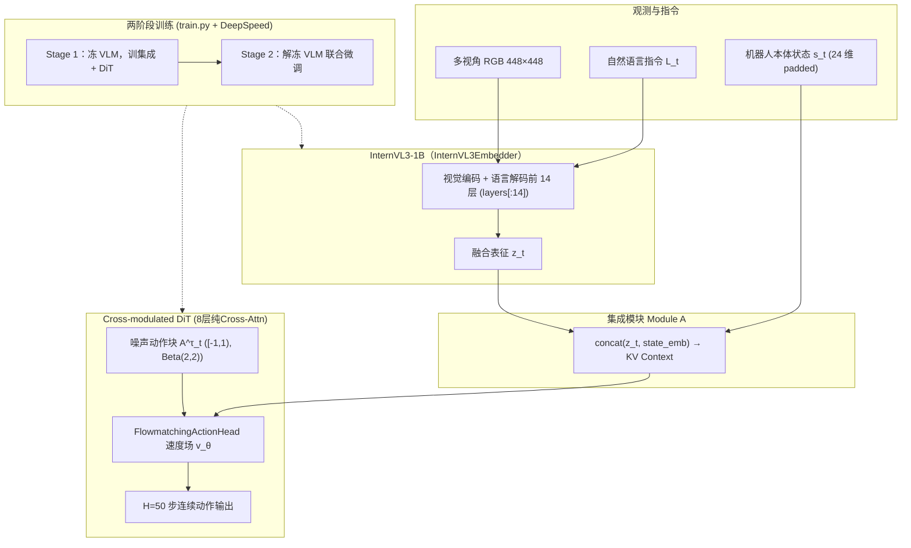
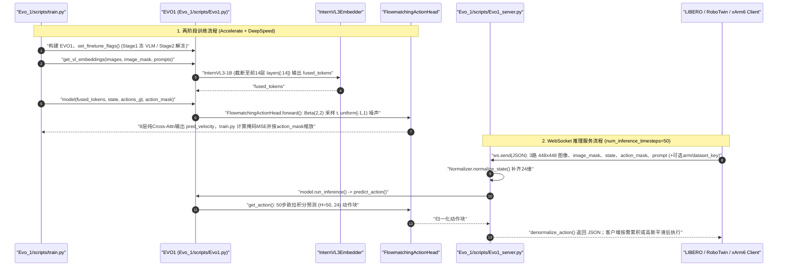

# Evo-1：轻量 VLA 与语义对齐保持

**Evo-1**（*Lightweight Vision-Language-Action Model with Preserved Semantic Alignment*，arXiv:[2511.04555](https://arxiv.org/abs/2511.04555)，**CVPR 2026**，Efficient CVPR Badge）由上海交通大学 MINT-SJTU 团队等提出：在仅 **0.77B** 参数下，用 **原生多模态 InternVL3-1B 骨干**、**cross-modulated DiT flow-matching 动作专家** 与 **跨注意力集成模块**，配合 **两阶段训练**（先冻 VLM 对齐动作头，再全量微调）**保持视觉–语言语义空间**，实现 **无需大规模机器人数据预训练** 的强仿真与真机表现，并 **官方集成 [LeRobot](./lerobot.md)** 支持 SO100/SO101 一条命令部署。

## 一句话定义

**用亚十亿 InternVL 骨干 + 纯 cross-attention DiT 动作头，分两阶段把「看懂指令」与「输出连续动作块」对齐，避免端到端微调把 VLM 语义训坏，从而在消费级 GPU 上做到高频推理与跨扰动泛化。**

## 英文缩写速查

| 缩写 | 英文全称 | 简要说明 |
|------|----------|----------|
| Evo-1 | Evo-1 VLA | 本文轻量视觉–语言–动作模型简称 |
| VLA | Vision-Language-Action | 视觉、语言与动作统一的多模态策略 |
| VLM | Vision-Language Model | 预训练视觉–语言骨干；本文用 InternVL3-1B |
| DiT | Diffusion Transformer | 扩散式 Transformer 动作解码器 |
| FM | Flow Matching | 流匹配生成范式，学习动作速度场 |
| BC | Behavior Cloning | 监督模仿；本文主训练范式 |
| CVPR | Conference on Computer Vision and Pattern Recognition | 计算机视觉顶会，本文录用 venue |

## 为什么重要

- **效率–性能新平衡点：** **0.77B** 无机器人预训练即在 **Meta-World 80.6%**、**LIBERO 94.8%**、**RoboTwin 37.8%** 超越更大模型（SmolVLA 2.25B、π₀ 3.5B 等），真机四任务平均 **78%**。
- **部署友好：** RTX 4090d 上 **2.3 GB 显存 / 16.4 Hz**，显著优于 OpenVLA 7B（15.1 GB / 7.9 Hz），适合 **实时交互式操作**。
- **语义保持训练可复现：** 两阶段范式 + 注意力可视化表明 **InternVL 语义聚焦不被机器人微调破坏**；相对 OpenVLA/Prismatic 的语义漂移，给出 **轻量 VLA 泛化** 的具体训练配方。
- **LeRobot 生态落地：** 数据 **LeRobot v2.1**、训练脚本与 **2026-07 并入官方 LeRobot 主仓**，降低「论文模型 → SO100/SO101 真机」摩擦。

## 核心原理

| 模块 | 论文设计与官方源码实现（`MINT-SJTU/Evo-1`） |
|------|------|
| **InternVL3-1B 骨干** | `InternVL3Embedder` 加载原生多模态模型（InternViT-300M + Qwen2.5-0.5B）；输入 `448×448` + pixel-unshuffle（4× 压缩视觉 token）；代码显式截取 `language_model` **前 14 层**（`layers[:14]`），提取跨模态对齐最强的中间语义 `z_t` |
| **Cross-modulated DiT 动作专家** | `FlowmatchingActionHead`（默认 8 层纯 cross-attention `BasicTransformerBlock`，无自注意力交替）；将噪声动作序列嵌入作为 Query，以融合 Context 作 Key/Value；时间步 `t ~ Beta(2, 2).clamp(0.02, 0.98)` 经 1000 档正弦编码注入；噪声均匀采样自 `[-1, 1)`；输出 `H=50` 步、`24 维 padded` 连续动作块（通过 `CategorySpecificMLP`/`MultiEmbodimentActionEncoder` 支持多本体） |
| **集成模块（Module A）** | 将第 14 层 VLM 表征 `z_t` 与 `state_encoder` 编码后的本体 `s_t` 直接 **序列拼接** 为 `context_tokens` 作 KV，优于共享投影、层间交错自注意力（Module B）、逐层配对（Module C）与联合 KV 拼接（Module D） |
| **Stage 1（动作头对齐）** | `--finetune_action_head`（`finetune_vlm=False`）：**冻结 VLM**，仅训练集成模块与 DiT 动作头（Meta-World 10k 步 / LIBERO 20k 步，lr `1e-5`），避免随机初始化噪声梯度破坏 VLM 语义空间 |
| **Stage 2（全量微调）** | `--finetune_vlm --finetune_action_head`：从 Stage 1 接续解冻 VLM 全量联合优化（Meta-World 65k 步 / LIBERO 80k 步），在保留图像–语言注意力聚焦的同时深化操作适配 |

## 流程总览

## 评测与对比

> 数字核对自 [arXiv:2511.04555v2](https://arxiv.org/abs/2511.04555) Table 1–3 与 [官方仓库](https://github.com/MINT-SJTU/Evo-1)。

| 基准 / 维度 | Evo-1（0.77B，无 Robo-Pretrain） | 关键对照基线 |
|------|----------------------------------|----------|
| **Meta-World（Table 1）** | **80.6%**（Easy 89.2 / Med 76.8 / Hard 77.2 / Very Hard 79.2） | 超 SmolVLA 2.25B（68.2%）、π₀ 3.5B（47.9%）、TinyVLA-H 1.3B（31.6%） |
| **LIBERO（Table 1）** | **94.8%**（Spatial 92.7 / Object 97.7 / Goal 96.3 / Long 92.3） | 超 π₀（94.2%）、GR00T N1（93.9%）、SmolVLA（88.8%）、OpenVLA（76.5%） |
| **RoboTwin 2.0 四任务均值（Table 1）** | **37.8%**（Click Alarmclock 77.0/58.0、Dump Bin 74.0/37.0 等） | 超 π₀（30.9%）、RDT 1.2B（25.8%）、DP（18.4%） |
| **真机 xArm6（Fig. 4 & Table 2）** | 四任务均值 **78.0%**（Pick&Place/Pour/Handover/Stack 各 20 trials） | 超 π₀（73.0%）、OpenVLA（55.0%）、SmolVLA（50.0%） |
| **真机泛化扰动（Table 3，Pick-and-Place Can）** | Base **95%**；未见物体 **80%**；黄桌布 **75%**；10/20/30mm 后移 **95/85/80%**；高度 **100/90/70%** | SmolVLA 同条件分别仅 75% / 65% / 60% / 75-60% / 75-60% |
| **RTX 4090d 推理效率（Table 2）** | **2.3 GB 显存 / 16.4 Hz** | SmolVLA 2.0 GB / 12.7 Hz；OpenVLA 15.1 GB / 7.9 Hz；π₀ 17.9 GB / 11.5 Hz |

*(注：第三方 LeRobot 检查点 `zuoxingdong/evo1_libero` 在 LeRobot 文档报告 96.65% 属独立训练配方，不可与论文 Table 1 的 94.8% 混比。)*

## 工程实践

1. **原仓库训练与归一化流水线（`Evo_1/`）：** 数据统一转 **LeRobot v2.1**（状态与动作补齐至 24 维，图像 `448×448`），先跑 `python -m dataset.compute_normstats`（大数据集改用 `compute_normstats_streaming.py`）生成 `norm_stats.json`；再经 `accelerate launch --deepspeed_config_file ds_config.json scripts/train.py` 分两阶段训练：Stage 1 传 `--finetune_action_head`，Stage 2 加 `--finetune_vlm --resume --resume_pretrain`。
2. **WebSocket 服务与跨平台客户端：** `Evo_1/scripts/Evo1_server.py`（默认端口 `9000`）加载 `config.json`、`norm_stats.json` 与 `mp_rank_00_model_states.pt`，强制设置 `num_inference_timesteps = 50` 步欧拉积分；`Evo1_client_xarm6.py`、`LIBERO_evaluation/libero_client_4tasks.py` 与 `RoboTwin_evaluation/policy/Evo1/deploy_policy.py`（含 per-task `dataset_key` 覆盖与 `kernel_size=9` 高斯时序平滑）发送 `[base, wrist, dummy]` 3 路图像与 `image_mask`/`action_mask`。
3. **官方生态集成（LeRobot + RLinf + Jetson）：**
   - **LeRobot 主仓（2026-07-05 并入）：** `pip install -e ".[training,evo1]"`，`--policy.type=evo1 --policy.training_stage=stage1|stage2`；SO100/SO101 可直接用 `lerobot-record --policy.path=MINT-SJTU/Evo1_SO100` 闭环，可选 `--inference.type=rtc`（仅 `predict_action_chunk` 路径）。
   - **RLinf（2026-08-05）：** 已支持基于 LIBERO 仿真的 Evo-1 全参 SFT 与 GRPO 强化后训练。
   - **关键陷阱：** 原仓库 README 反复强调 **`flash-attn` 必须编译安装**，缺省回退注意力会显著降低成功率并导致真机抖动；另注意客户端须根据任务动作空间决定是否把服务端输出累加为绝对位姿。

## 源码运行时序图

以下时序图直接对齐官方仓库 **`MINT-SJTU/Evo-1`** 核心源码入口（上游 LeRobot 主仓的 `Evo1Policy` 封装已验证采用相同的 `layers[:14]`、`Beta(2,2).clamp(0.02,0.98)`、1000 档时间编码与 `[-1,1)` 均匀噪声设计）：

## 结论

**Evo-1 的核心贡献是证明「先冻后解的两阶段训练 + 截断中间层原生 VLM + 纯 cross-attention DiT」即可在 0.77B 参数、无机器人预训练的前提下兼得低显存（2.3 GB）、高控制频率（16.4 Hz）与跨基准泛化。**

- **语义保持取决于训练次序：** Stage 1 冻结 `InternVL3-1B` 对齐集成模块与 `FlowmatchingActionHead`，Stage 2 再联合微调，可有效避免单阶段端到端训坏 VLM 注意力聚焦。
- **架构做减法换取吞吐与稳定：** 保留 `InternVL3` 前 14 层语言层、取消 DiT 中的自注意力交替块改用纯 cross-attention、拼接而非投影状态特征（Module A），结构简单但消融证明连续性最好。
- **工程生态已补齐闭环：** 官方已先后补发 RoboTwin 50 任务插件、`libero-plus-eval`、Jetson Orin Docker，并并入官方 [LeRobot](./lerobot.md) 与 **RLinf**（SFT + GRPO）。
- **真机可复现但有强前提：** `flash-attn` 缺失会破坏运动稳定性；同时客户端必须与 `norm_stats.json` 中的 `arm_key`/`dataset_key` 及相对/绝对动作空间约定严格一致。

## 局限与风险

- **基准以单/双臂桌面操作为主：** Meta-World、LIBERO、RoboTwin、xArm6 与 SO100/ALOHA 均聚焦固定基座机械臂桌面任务，向移动操作或全身人形 loco-manip 迁移仍需独立验证（此外论文正文 RoboTwin 仅报告 4 项代表任务 37.8%，全 50 任务评估代码于 2026-07 随仓库补发）。
- **依赖 `flash-attn` 算子兼容性：** 官方源码虽在未安装 `flash_attn` 时有标准注意力回退逻辑，但仓库 README 明确警示缺少 FlashAttention 会造成成功率显著下降与机械臂运动不稳定，受限于旧款显卡/ARM 边缘板编译环境时需提前实测。
- **长程绝对控制需要客户端后处理：** 服务端统一输出归一化增量动作（或固定 24 维 padded 动作块），面向绝对位置控制器（如部分 xArm6/Aloha 配置）时必须在客户端做累加或高斯平滑（如 RoboTwin `kernel_size=9`），且不同下游基准的 Stage 1/2 步数（如 Meta-World 10k/65k vs LIBERO 20k/80k vs SO101 5k/50k）需要按数据量手工调整。
- **论文 vs 开源实装微小差异常见易混淆点：** 开源 `FlowmatchingActionHead` 默认推理步数为 32 步而 `Evo1_server.py` 覆盖为 50 步；此外社区第三方 LeRobot 检查点（如 `zuoxingdong/evo1_libero` 96.65%）与论文 94.8% 并非同一检查点与超参配方。

## 与其他工作对比

| 对照对象 | Evo-1 的差异 |
|----------|-------------|
| **SmolVLA / TinyVLA** | 同为亚十亿轻量 VLA；Evo-1 强调 **语义保持两阶段训练** 与 **纯 cross-attention DiT**，复杂任务成功率更高 |
| **π₀ / OpenVLA** | 参数量与显存远小；**无机器人预训练** 仍可在多基准匹配或超越 |
| **MINT** | 同 MINT-SJTU 生态；MINT 解耦 **频域意图–执行 token**，Evo-1 解耦 **训练阶段上的感知 vs 控制** |
| **Green-VLA / Qwen-VLA** | 后者走 **多阶段大规模预训练通才**；Evo-1 走 **小模型 + 语义保持微调** 的部署优先路线 |
| **[FabriVLA](./paper-fabrivla.md)** | 同受轻量 InternVL+FM 启发；FabriVLA 用 **单阶段 + gated SA + shallow fusion**，MT50 **90.0%**（用 Evo-1 公开演示集），但主报告面更窄（Meta-World） |

## 关联页面

- [VLA（Vision-Language-Action）](../methods/vla.md) — 轻量 flow-VLA 与工程瓶颈语境。
- [LeRobot (Hugging Face)](./lerobot.md) — Evo-1 **官方内置策略** 与 SO100/SO101 部署路径。
- [MINT](./paper-mint-vla.md) — 同机构不同 VLA 泛化路线（频域意图分词）。
- [FabriVLA](./paper-fabrivla.md) — 单阶段轻量对照；MT50 更高、评测面更窄。
- [VLA SOTA Leaderboard](./vla-sota-leaderboard.md) — EvoMind/MINT-SJTU 社区多基准榜。
- [Diffusion Policy](../methods/diffusion-policy.md) — 连续动作扩散/流匹配策略族。
- [Action Chunking](../methods/action-chunking.md) — H 步动作块输出与平滑部署。
- [Behavior Cloning（行为克隆）](../methods/behavior-cloning.md) — 监督模仿学习范式。
- [Manipulation](../tasks/manipulation.md) — Meta-World / LIBERO / RoboTwin / 真机操作评测背景。

## 参考来源

- [Evo-1 论文归档（CVPR 2026 / arXiv:2511.04555v2）](../../sources/papers/evo1_arxiv_2511_04555.md)
- [MINT-SJTU/Evo-1 官方仓库归档](../../sources/repos/mint_sjtu_evo1.md)
- [LeRobot 集成参考归档（lerobot.md）](../../sources/repos/lerobot.md)：LeRobot 固定提交 `9e5ee98` 中的 `policy.type=evo1` 封装参考

## 推荐继续阅读

- 论文 PDF：<https://arxiv.org/pdf/2511.04555>
- 项目主页：<https://mint-sjtu.github.io/Evo-1.io/>
- 官方代码：<https://github.com/MINT-SJTU/Evo-1>
- Hugging Face 权重：<https://huggingface.co/MINT-SJTU/Evo1_LIBERO>
- RLinf 集成文档：<https://rlinf.readthedocs.io/en/latest/rst_source/examples/embodied/evo1.html>
