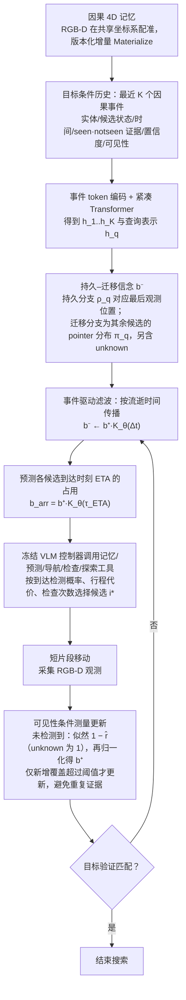

# EvolvingNav（arXiv:2609.39166）

**EvolvingNav**（*Beyond the Remembered World: Predictive 4D Belief for Persistent Navigation in Evolving Worlds*，[arXiv:2609.39166](https://arxiv.org/abs/2609.39166)，Mingjian Gao、Zhaocheng Li、Haoyang Huang 等；Deeprobotics、浙江大学、UCSD、CUHK；[官方项目页](https://developer.deeprobotics.cn/research/articles/evolving-nav/index.html)）。

## 流程总览

图依据：论文 §3.2 因果 4D 记忆、§3.3 持久–迁移信念、§3.4 预测式具身智能体（式 3–15）/ Fig.2。

## 一句话定义

**EvolvingNav 把已记住的世界当作假设：预测到达时仍成立的状态，只检查必要之处，用证据回路持续更新 4D 记忆。**

## 英文缩写速查

| 缩写 | 英文全称 | 简要说明 |
|------|----------|----------|
| EvolvingNav | Evolving-world Navigation | 本文方法（命名依标题） |
| 4D | 3D space + time | 带时间的三维信念 / 记忆 |
| EvoWorld-Bench | Evolving World Benchmark | 本文配套基准（命名依项目页） |
| HSSD / HM3D | Habitat 场景数据集 | 评测场景来源（项目页列出） |

## 核心方法

- 预测式导航、信念引导搜索、证据重规划、预测式时间 4D 记忆四个环节。
- EvoWorld-Bench 覆盖预测导航、搜索、重规划、在线动态、迁移与具身问答。

## 评测要点（项目页自报）

| 项 | 数值 |
|----|------|
| EvoWorld-Bench | 54 场景；803.68K 可执行任务实例 |
| 首次检查成功率 | 61.32% |
| 预算搜索成功率 | 86.18% |
| 真机 | 室内巡逻、送文件两段演示 |

## 与其他工作对比

- **相对「记住即真」的静态记忆导航：** 常规做法把历史建图结果当作当前世界；EvolvingNav 把记忆当作待验证假设，先预测到达时刻的状态，再用可见性限定的证据修正，适合物体会移动、消失的长期部署场景。
- **相对 [DR-WM](./paper-dr-wm.md)：** 同为云深处导航研究，DR-WM 预测动作造成的运动与未来观测以比较候选动作；EvolvingNav 关注的是世界状态本身随时间的变化与记忆更新，两者分别对应「动作后果」与「环境演化」两类预测。
- 具体基线与协议以论文为准，本页不跨论文比较数字。

## 开源状态

项目页提供 GitHub 代码链接；本页未逐文件核验。

## 结论

**数字为项目页汇总，对比基线与协议请读论文；真机仅展示演示。**

## 关联页面

- [DR-WM](./paper-dr-wm.md) — 云深处同批研究
- [云深处 rl_training](./deeprobotics-rl-training.md) — 同公司 RL 训练工程
- [hierarchical-quadruped-navigation-stack](../concepts/hierarchical-quadruped-navigation-stack.md)
- [具身大模型评测基准选型闭环知识链](../queries/embodied-eval-benchmark-selection-loop.md) — EvoWorld-Bench 属于③层任务成功率评测（动态世界导航 / 搜索 / 重规划）；真机仅演示，未覆盖④层 sim↔real gap 校准

## 参考来源

- [项目页归档](../../sources/sites/deeprobotics-evolvingnav.md)
- [arXiv 原文](https://arxiv.org/abs/2609.39166)
- [官方项目页](https://developer.deeprobotics.cn/research/articles/evolving-nav/index.html)
- [云深处前沿探索](https://developer.deeprobotics.cn/research/)
- [arXiv PDF](https://arxiv.org/pdf/2609.39166)：已通读方法部分（实验与附录以略读为准）：§1 引言、§3 方法（3.1–3.4）；§4 EvoWorld-Bench、实验与附录略读
