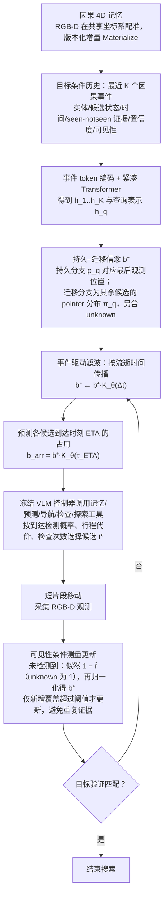
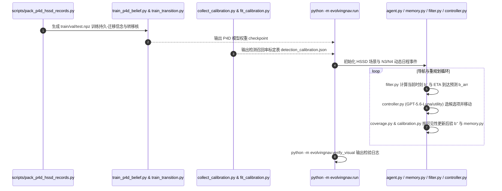

# EvolvingNav（arXiv:2609.39166）

**EvolvingNav**（*Beyond the Remembered World: Predictive 4D Belief for Persistent Navigation in Evolving Worlds*，[arXiv:2609.39166](https://arxiv.org/abs/2609.39166)，Mingjian Gao、Zhaocheng Li、Haoyang Huang 等；Deeprobotics、浙江大学、UCSD、CUHK；[官方项目页](https://developer.deeprobotics.cn/research/articles/evolving-nav/index.html)）。

## 一句话定义

**EvolvingNav 把已记住的世界当作假设：预测到达时仍成立的状态，只检查必要之处，用证据回路持续更新 4D 记忆。**

## 英文缩写速查

| 缩写 | 英文全称 | 简要说明 |
|------|----------|----------|
| EvolvingNav | Evolving-world Navigation | 本文方法（命名依标题） |
| 4D | 3D space + time | 带时间的三维信念 / 记忆 |
| EvoWorld-Bench | Evolving World Benchmark | 本文配套基准（命名依项目页） |
| HSSD / HM3D | Habitat 场景数据集 | 评测场景来源（项目页列出） |

## 为什么重要

- **直面真实家庭/办公「物体会移动、环境会演化」的持久化导航难题：** 常规语义建图假设旧记忆永远成立，一旦物体被带走或门状态改变即反复跑空；EvolvingNav 将记忆显式建模为会随时间流逝衰变并发生迁移的概率信念。
- **在「到达时刻（ETA）」而非「查询时刻」做决策：** 通过连续时间历史编码与转移核预测达到候选位置时的占用概率，使路径长度代偿与重检时机自然统一。
- **补齐长时程动态 benchmark 与真机对比证据：** EvoWorld-Bench 依托 CASAS/ARAS 等 6 套真实人类行为数据集驱动 54 场景 × 90 天演化（803.68k 任务），并在云深处 LYNX M20（64 次对比）、X30、Lite3 上完成实机验证。

## 流程总览

图依据：论文 §3.2 因果 4D 记忆、§3.3 持久–迁移信念、§3.4 预测式具身智能体（式 3–15）/ Fig.2。

## 核心方法

- 预测式导航、信念引导搜索、证据重规划、预测式时间 4D 记忆四个环节。
- EvoWorld-Bench 覆盖预测导航、搜索、重规划、在线动态、迁移与具身问答。

## 评测要点（项目页自报）

| 项 | 数值 |
|----|------|
| EvoWorld-Bench | 54 个 HSSD 场景 × 90 天（CASAS/ARAS/OPPORTUNITY/HD-EPIC/ParaHome/HOMER+ 标定）；**803,680** 可执行任务（P、N1–N5、VLN、EQA） |
| EvoWorld N1–N5 首次检查成功率 | **61.32%** |
| EvoWorld N1–N5 预算搜索成功率 | **86.18%** |
| EvoWorld N4 在线动态迁移 SR | **65.2%** |
| 真机实测（LYNX M20） | **64 次**物理对照试验 Search SR **48.4%**（Retrieval+Reasoning 基线 37.5%）；另展示 X30 / Lite3 室内巡逻与递送 |

## 与其他工作对比

- **相对「记住即真」的静态记忆导航：** 常规做法把历史建图结果当作当前世界；EvolvingNav 把记忆当作待验证假设，先预测到达时刻的状态，再用可见性限定的证据修正，适合物体会移动、消失的长期部署场景。
- **相对 [DR-WM](./paper-dr-wm.md)：** 同为云深处导航研究，DR-WM 预测动作造成的运动与未来观测以比较候选动作；EvolvingNav 关注的是世界状态本身随时间的变化与记忆更新，两者分别对应「动作后果」与「环境演化」两类预测。
- 具体基线与协议以论文为准，本页不跨论文比较数字。

## 开源状态

**已开源**：[ZJU4EmbodiedAI/EvolvingNav](https://github.com/ZJU4EmbodiedAI/EvolvingNav) 在 `code/` 目录下提供完整 PyTorch + Habitat-Sim 0.3.3 实现，覆盖 P4D-Nav 历史编码/转移核训练、检测器标定、N3/N4 评测脚本与单元测试（`tests/`），另有 Hugging Face 交互演示。

## 源码运行时序图

`ZJU4EmbodiedAI/EvolvingNav/code` 遵循「打包因果记录 → 训练信仰头与转移核 → 验证集拟合检测召回标定 → `evolvingnav.run` 闭环执行」：

## 工程实践

- **运行环境与依赖：** 官方指定 **Python 3.11 + Habitat-Sim 0.3.3**；须提前设置 `HSSD_ROOT`、`NAVMESH_ROOT`、`P4D_DATASET`、`NAV_TASKS` 并配置 `configs/perception.yaml`（Grounding DINO + SAM2 模型 ID）。
- **两套决策器切换：** 默认控制器调用 GPT-5.6-Luna，可通过 `--controller utility` 切换至纯效用策略消融成本或离线核查。
- **校准不可省略：** 在新场景/新检测器上跑闭环前，必须先跑 `scripts/collect_calibration.py` + `scripts/fit_calibration.py` 标定 `r̂`，否则“看到了没检出”的负证据权重会失真。

## 常见误区或局限

- **误区：不重开候选点的硬删除记忆足够用** — 若将未检出位置硬删除，当人把物品重新放回原处时智能体会失去线索；P4D-Nav 通过 `b^+` 与重开机制避免局部误杀。
- **演化规则偏人类居家作息与离散事件：** EvoWorld-Bench 虽基于 6 个人类活动数据集标定，但高频率物理级推挤遮挡（非语义级桌面/房间迁移）仍依赖真机与更细粒度物理引擎。
- **多组件链条成本较高：** 需同时维护 Grounding DINO + SAM2 分割、RGB-D 投影建图与云端 VLM 工具调用，真机上在 LYNX M20 等带算力平台测试仍需权衡推理耗时（Search SR 为 48.4%）。

## 结论

**EvolvingNav 将长期持久化导航问题从「静态找物」重构为「含时间演化的到达时刻信念规划」，给出从因果记忆到可见性贝叶斯更新的完整数学与开源链路。**

1. 持久化导航不能假定记忆冻结，ETA 预测信念 `b_arr` 才能真实反映抵达后的发现概率。
2. 未见证据必须按标定检出率 `r̂` 与实际视锥覆盖度折算，防止漏检误删真实目标。
3. 开源仓库提供可运行的 N3/N4 Habitat 测试与标定脚本，适合作为动态记忆基线接入。

## 关联页面

- [DR-WM](./paper-dr-wm.md) — 云深处同批研究
- [云深处 rl_training](./deeprobotics-rl-training.md) — 同公司 RL 训练工程
- [hierarchical-quadruped-navigation-stack](../concepts/hierarchical-quadruped-navigation-stack.md)
- [具身大模型评测基准选型闭环知识链](../queries/embodied-eval-benchmark-selection-loop.md) — EvoWorld-Bench 属于③层任务成功率评测（动态世界导航 / 搜索 / 重规划）

## 参考来源

- [EvolvingNav 论文原文通读（arXiv:2609.39166v4）](../../sources/papers/evolvingnav_arxiv_2609_39166.md)
- [项目页归档](../../sources/sites/deeprobotics-evolvingnav.md)
- [官方源码（ZJU4EmbodiedAI/EvolvingNav）](https://github.com/ZJU4EmbodiedAI/EvolvingNav)
- [官方项目页（云深处）](https://developer.deeprobotics.cn/research/articles/evolving-nav/index.html)

## 推荐继续阅读

- [ZJU4EmbodiedAI/EvolvingNav/code 运行文档](https://github.com/ZJU4EmbodiedAI/EvolvingNav/tree/main/code)
- [EvolvingNav Hugging Face 在线演示](https://huggingface.co/spaces/ZJU4EmbodiedAI/EvolvingNav)
