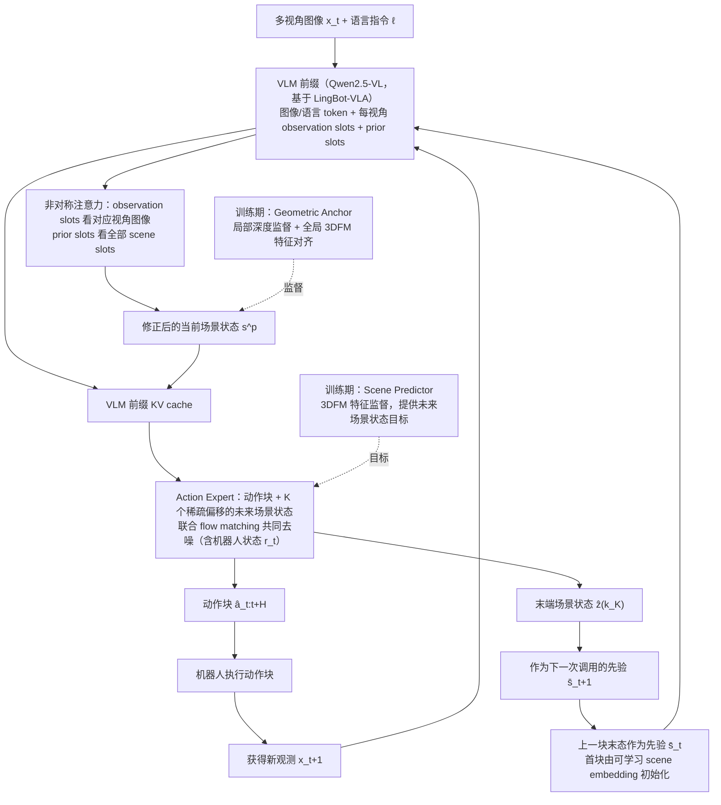

# EvoScene-VLA（arXiv:2605.21862）

**EvoScene-VLA**（*EvoScene-VLA: Evolving Scene Beliefs Inside the Action Decoder for Chunked Robot Control*，[arXiv:2605.21862](https://arxiv.org/abs/2605.21862)）收录于 [多模空间 · 一周 VLA 研究趋势简析（2026.08.10–08.16）第四篇](../../sources/blogs/wechat_duomo_vla_weekly_trends_2026-08-10_part4.md) **长程记忆** 段。

## 一句话定义

**动作块间保留可更新场景状态，VLM 融合新观测与动作形成的先验，解码器同时输出动作与紧凑场景更新（v2 2026-08-15）。**

## 英文缩写速查

| 缩写 | 英文全称 | 简要说明 |
|------|----------|----------|
| VLA | Vision-Language-Action | 视觉–语言–动作策略 |
| VLM | Vision-Language Model | 视觉–语言多模态模型 |
| RL | Reinforcement Learning | 强化学习 |
| PRM | Process Reward Model | 过程/进度奖励模型 |
| OOD | Out-of-Distribution | 分布外场景或轨迹 |

## 为什么重要

- 单帧 VLA 忽略自身动作引起的场景变化；EvoScene 在解码器内演化 scene belief。
- 策展机构：澳大利亚国立大学；昆士兰大学；北京师范大学
- 开源结论：**待核实**（步骤 2.5，2026-09-27）。

## 流程总览

图依据：论文 §3.1–§3.2 / Fig.2（训练期两支路来自 §3.1 概述，细节未展开）。

## 核心机制

| 项 | 内容 |
|----|------|
| **arXiv** | [2605.21862](https://arxiv.org/abs/2605.21862) |
| **开源** | **待核实** |
| **文内评测** | LIBERO、RoboTwin；Galaxea R1-Lite 实机 |

## 源码运行时序图

**不适用**（截至入库日未提供可运行官方代码入口，或仓库尚无可辨识训练/推理入口）。

## 实验与评测

- **文内口径：** LIBERO、RoboTwin；Galaxea R1-Lite 实机
- **读法：** 本页为 [公众号策展](../../sources/blogs/wechat_duomo_vla_weekly_trends_2026-08-10_part4.md) 摘要；逐项指标以 **原文 PDF** 为准。

## 与其他工作对比

| 对照 | 差异读法 |
|------|----------|
| [第四篇技术地图](../overview/vla-weekly-trends-2026-08-10-part4-technology-map.md) | 同批 14 篇横向索引；本文属 **长程记忆** |
| [VLA 方法页](../methods/vla.md) | 单篇机制细节以原文为准 |

## 结论

**EvoScene-VLA 适合作为本期「长程记忆」路线的快速索引页。**

1. 核心贡献：动作块间保留可更新场景状态，VLM 融合新观测与动作形成的先验，解码器同时输出动作与紧凑场景更新（v2 2026-08-15）。
2. 开源结论：**待核实** — 以项目页/仓库实际链接为准。
3. 横向对照见 [第四篇技术地图](../overview/vla-weekly-trends-2026-08-10-part4-technology-map.md)。

## 关联页面

- [VLA（Vision-Language-Action）](../methods/vla.md)
- [一周 VLA 趋势技术地图（第四篇）](../overview/vla-weekly-trends-2026-08-10-part4-technology-map.md)

## 参考来源

- [wechat_duomo_vla_weekly_trends_2026-08-10_part4.md](../../sources/blogs/wechat_duomo_vla_weekly_trends_2026-08-10_part4.md)
- [arXiv:2605.21862](https://arxiv.org/abs/2605.21862)
- [arXiv PDF](https://arxiv.org/pdf/2605.21862)：已通读方法部分（实验与附录以略读为准）：§1 贡献概述、§3.1 概述、§3.2 循环场景状态环路、§3.3 Geometric Anchor 开头，Fig.2

## 推荐继续阅读

- [VLA 方法页](../methods/vla.md)
- [arXiv PDF](https://arxiv.org/pdf/2605.21862)
