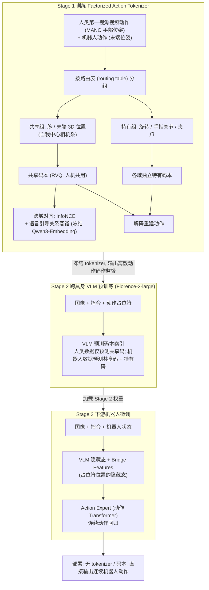

# EXE: Egocentric Cross-Embodiment Pretraining via Factorized Latent Actions for VLA Models

## 一句话定义

EXE 是一个**把人类第一视角手部动作与机器人动作分解为共享、专用两种离散潜在因子**的跨本体预训练方法，先学离散码本与视觉语言模型（VLM），再用 Action Expert 输出下游机器人的连续动作。

## 英文缩写速查

| 缩写 | 英文全称 | 简要说明 |
|------|----------|----------|
| EXE | Egocentric Cross-Embodiment Pretraining | 从人机示范中共享部分动作因子的框架 |
| VLA | Vision-Language-Action | 视觉与语言条件下学习机器人动作 |
| RVQ | Residual Vector Quantization | 学习离散共享与本体专用潜在动作码本 |
| VLM | Vision-Language Model | 阶段二预测离散潜在动作码 |
| MANO | Model with Articulated Hands | 人手姿态和关节参数建模的表示 |

## 为什么重要

人类视频含丰富的“抓起、放下、移动到目标”操作语义，但人手关节、机械臂夹爪和灵巧手的动作维度不同。EXE 让**腕部或末端在相机系中的 3D 平移**分享一个潜在码本，而把具体旋转、手指、夹爪动作交给本体专属码本，降低共享编码时的负迁移风险。与 [EgoX](./paper-egox-mxt-plus.md) 不同，EXE 以**显式动作因子化+离散预测**为主要迁移载体，而非共享 Transformer 主干的未来本体特征预测。

## 流程总览

图依据：论文 §III-A/B/C / Fig.1 / Fig.2

## 方法与核心原理

基于原文 §III 的三阶段结构：

1. **Factorized Action Tokenizer：** 通过路由表将人类 MANO 手部动作与机器人末端动作拆成“共同 3D 平移”及“私有旋转、手指/夹爪”。通过 RVQ 共享/专有码本重建动作，以对比损失及语言引导关系蒸馏让共享 token 更具跨本体语义。
2. **Cross-Embodiment VLM 预训练：** 利用图像、文本和动作 token 占位符，训练 Florence-2-large 主干预测动作码；人类数据主要监督共享码，机器人数据监督共享码和本体私有码。
3. **下游机器人微调：** 提取 VLM 桥接隐藏特征，连续动作专家回归机器人动作；**部署不依赖阶段一的离散码本**。此流程不能与 EgoX 的 DreamHead/EMA 目标混为一谈。

## 源码运行时序图

不适用：截至入库日未核实到可运行的官方实现。

## 工程实践

复现或评估时必须严格区分**人类手部坐标系→机器人末端位置**的共享动作维度与不同机械臂的手指/夹爪参数。训练链按原文 §III-A/B/C 分三阶段实施；下游测试应分别统计共享码对齐、动作回归与真实机器人成功率。**源码状态：** 截至本次核对未取得可核实的官方完整可运行训练入口；现有 Mermaid 为原文方法流程图，源码运行时序图暂不适用。

## 评测与结果

论文 §IV 评测 RoboTwin 2.0、RoboCasa GR1、真实 AgileX Piper 操作，并将 EXE 与无相应预训练的 EXE_base 对照。论文报告 RoboTwin 2.0 **76.2% vs 73.2%**，RoboCasa GR1 **56.6% vs 52.0%**；真实“扫垃圾”任务 ID 成功率 **80% vs 60%**、OOD **30% vs 10%**（每组 10 次，结果精度受小样本影响）。这些成功率来自特定任务/划分，不能外推为所有机器人的通用提升幅度。

## 结论

**EXE 展示了把跨本体动作分为共享平移与专用控制分量、用离散 token 预训练 VLM 的可行性，但需要按目标机器人评估控制与成功率。**

1. **共享位置，不强行共享关节：** 机器人/人类动作空间不必统一维度。
2. **区别分阶段角色：** 码本对齐→VLM 潜在动作预测→连续动作头微调；在线部署不运行原始码本。
3. **考虑真机样本量：** ID/OOD 真机结果各 10 次，不是稳定的大样本成功率。
4. **跨项目对比：** EXE 强化动作潜在因子，EgoX/MXT+ 则为异构模态共享 trunk 增加未来状态 Dreaming 目标。

## 局限与风险

- 真实平台实验规模有限，不应把 10 次 OOD 成功率作为大规模可靠性证据。
- 共享位置语义不意味着末端方向、手指几何或控制回路可以跨平台直接复用；仍需下游动作头与控制器。
- 本次已通读论文全文，但未确认到官方可运行的完整训练源码，源码时序图仅能保留“不适用”；本文不声称已复现。

## 与其他工作对比

与 [MimicAll](./paper-mimicall.md) 的跨机体运动跟踪相比，本工作关注不同层面的数据、动作表示或任务生成。

## 关联页面

- [EgoX / MXT+](./paper-egox-mxt-plus.md) — 模态共享 Transformer trunk、本体专用动作专家与未来状态 Dreaming；不同于 EXE 的潜在动作显式分解。

- [MimicAll](./paper-mimicall.md)
- [操作任务](../tasks/manipulation.md)

## 参考来源

- [来源归档](../../sources/papers/exe-cross-embodiment.md)
- [arXiv PDF](https://arxiv.org/pdf/2610.33685)：2026-11-13 已核对 v1 PDF 全文 9 页，包含实验、结论和参考文献；原始阅读记录见 sources/papers 归档

## 推荐继续阅读

- [论文原文](https://arxiv.org/abs/2610.33685)
