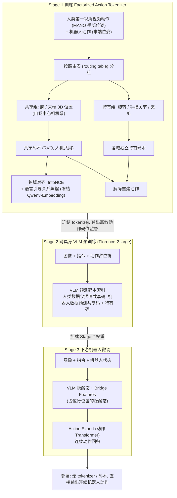

# EXE: Egocentric Cross-Embodiment Pretraining via Factorized Latent Actions for VLA Models

**一句话定义：** 将第一视角视频的潜在动作分解为可迁移的共享操作先验与具身特有运动学，借共享动作表示向不同机器人传递操作语义。

## 英文缩写速查

| 缩写 | 英文全称 | 简要说明 |
|------|----------|----------|
| VLA | Vision-Language-Action | 以视觉和语言条件生成动作的模型 |
| G1 | Unitree G1 | 人形机器人平台 |
| Sim2Real | Simulation to Real | 从仿真迁移到真实机器人 |

## 为什么重要

将第一视角视频的潜在动作分解为可迁移的共享操作先验与具身特有运动学，借共享动作表示向不同机器人传递操作语义。

## 流程总览

图依据：论文 §III-A/B/C / Fig.1 / Fig.2

## 方法与核心原理

将第一视角视频的潜在动作分解为可迁移的共享操作先验与具身特有运动学，借共享动作表示向不同机器人传递操作语义。

## 源码运行时序图

不适用：截至入库日未核实到可运行的官方实现。

## 工程实践

复现时先对齐训练数据、具身接口和评测设置；记录数据来源及运行环境。

## 评测与结果

论文报告相对无预训练基线，在 RoboTwin 2.0、RoboCasa GR1 与真实操作任务均有收益；同一预训练可惠及平行夹爪与灵巧手。

## 结论

**工程判断应结合论文的训练和评测条件。**

- 比较跨具身效果时应区分共享操作语义与具体手部运动学。
- 评估需覆盖不同末端执行器及真实任务。
- 人类视频预训练的收益应相对无预训练基线测量。

## 局限与风险

摘要未给出完整训练资源与开源入口；实验收益受任务、具身和数据分布影响。

## 与其他工作对比

与 [MimicAll](./paper-mimicall.md) 的跨机体运动跟踪相比，本工作关注不同层面的数据、动作表示或任务生成。

## 关联页面

- [MimicAll](./paper-mimicall.md)
- [操作任务](../tasks/manipulation.md)

## 参考来源

- [来源归档](../../sources/papers/exe-cross-embodiment.md)
- [arXiv PDF](https://arxiv.org/pdf/2610.33685)：已通读方法部分（实验与附录以略读为准）：摘要、§I、§III（三阶段）、§IV-A/B 实验设定

## 推荐继续阅读

- [论文原文](https://arxiv.org/abs/2610.33685)
