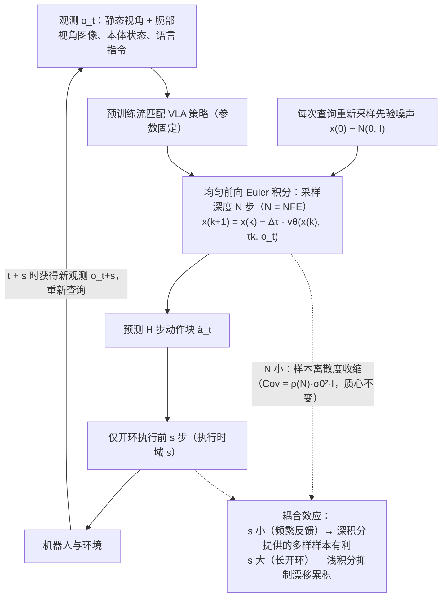

# Execution Horizon vs Sampling Depth（arXiv:2610.32102）

**Execution Horizon vs Sampling Depth**（*Coupling Execution Horizon and Sampling Depth in Flow-Matching VLA Policies*，[arXiv:2610.32102](https://arxiv.org/abs/2610.32102)，[项目页](https://jiabingyang01.github.io/Horizon-Depth-VLA/)）来自 [具身智能小站 2026-10-29 盘点](../../sources/blogs/wechat_embodied_station_58_papers_diverse_demonstrations_2026-10-29.md)，属「VLA、智能体与策略后训练」组。

## 一句话定义

**研究发现流匹配策略的采样深度与开环执行长度存在耦合；仿真及Franka实验提示，减少步数的效果随重规划频率变化，不能只看单次推理耗时。**

## 英文缩写速查

| 缩写 | 英文全称 | 简要说明 |
|------|----------|----------|
| Execution Horizon vs Sampling Depth | Coupling Execution Horizon and Sampling Depth in Flow-Matching VLA Policies | 本文方法 / 基准的简称 |
| VLA | Vision-Language-Action | 视觉–语言–动作策略 |

## 为什么重要

- VLA采样步数要和执行时域一起调。
- 开源结论：**项目页未列 GitHub**（步骤 2.5，2026-10-29）。项目页 HTTP 200，未列 GitHub，也无 coming soon 字样（脚本扫描）。
- 同期同组工作见 [多样成功示范、触觉工具链与预见式感知：具身智能小站 10-29 期 58 篇阅读坐标](../overview/embodied-station-2026-10-29-58-papers-technology-map.md)。

## 流程总览

图依据：论文 §III-A / §III-B / §III-C / Fig.2（虚线为论文对耦合机制的解释，非数据流）。

## 核心机制

| 项 | 内容 |
|----|------|
| **arXiv** | [2610.32102](https://arxiv.org/abs/2610.32102) |
| **开源** | **项目页未列 GitHub** |
| **要点** | 研究发现流匹配策略的采样深度与开环执行长度存在耦合；仿真及Franka实验提示，减少步数的效果随重规划频率变化，不能只看单次推理耗时。 |
| **文内指标** | 公众号未给具体数字，本页不引用。 |

## 源码运行时序图

**不适用（项目页未列 GitHub）** — 项目页 HTTP 200，未列 GitHub，也无 coming soon 字样（脚本扫描）。 不编造运行脚本；代码公开后再补。

## 实验与评测

- 公众号未给具体数字，本页不引用。
- **读法：** 本页为索引级摘要，依据公众号转述的官方摘要与仓库信息整理；逐项数字与 baseline 以原文 PDF 为准。

## 与其他工作对比

- 横向索引见 [多样成功示范、触觉工具链与预见式感知：具身智能小站 10-29 期 58 篇阅读坐标](../overview/embodied-station-2026-10-29-58-papers-technology-map.md)；同 arXiv 不重复造页。

## 结论

**VLA采样步数要和执行时域一起调：研究发现流匹配策略的采样深度与开环执行长度存在耦合；仿真及Franka实验提示，减少步数的效果随重规划频率变化，不能只看单次推理耗时。**

1. 开源边界：**项目页未列 GitHub** — 项目页 HTTP 200，未列 GitHub，也无 coming soon 字样（脚本扫描）。
2. 核心机制：研究发现流匹配策略的采样深度与开环执行长度存在耦合；仿真及Franka实验提示，减少步数的效果随重规划频率变化，不能只看单次推理耗时。
3. 复现与选型前核对任务协议、硬件与基准口径，勿直接横比公众号摘录数字。

## 关联页面

- [vla](../methods/vla.md)
- [imitation-learning](../methods/imitation-learning.md)
- [reinforcement-learning](../methods/reinforcement-learning.md)
- [diffusion-policy](../methods/diffusion-policy.md)
- [embodied-station-2026-10-29-58-papers-technology-map](../overview/embodied-station-2026-10-29-58-papers-technology-map.md)

## 参考来源

- [execution_horizon_vs_sampling_depth_arxiv_2610_32102.md](../../sources/papers/execution_horizon_vs_sampling_depth_arxiv_2610_32102.md)
- [wechat_embodied_station_58_papers_diverse_demonstrations_2026-10-29.md](../../sources/blogs/wechat_embodied_station_58_papers_diverse_demonstrations_2026-10-29.md)
- [arXiv:2610.32102](https://arxiv.org/abs/2610.32102)
- [arXiv PDF](https://arxiv.org/pdf/2610.32102)：已通读方法部分（实验与附录以略读为准）：§III Methodology（§III-A 流匹配 VLA 策略、§III-B 滚动时域动作分块、§III-C 耦合机制与命题 1）、§IV Experiments 略读（Table I）

## 推荐继续阅读

- [arXiv PDF](https://arxiv.org/pdf/2610.32102)
- [项目页](https://jiabingyang01.github.io/Horizon-Depth-VLA/)
