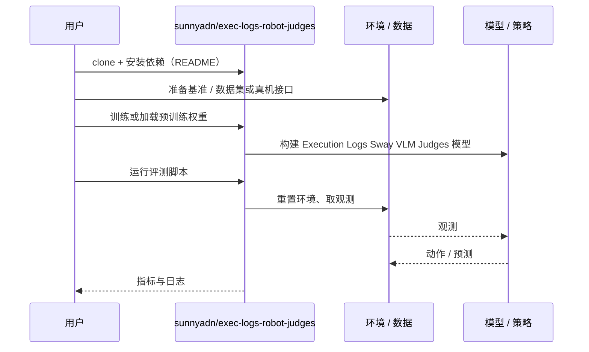

# Execution Logs Sway VLM Judges（arXiv:2610.34151）

**Execution Logs Sway VLM Judges**（*Execution Logs Sway VLM Judges of Robot Progress*，[arXiv:2610.34151](https://arxiv.org/abs/2610.34151)，[代码](https://github.com/sunnyadn/exec-logs-robot-judges)）来自 [具身智能小站 2026-10-28 盘点](../../sources/blogs/wechat_embodied_station_59_papers_human_video_to_robot_experience_2026-10-28.md)，属「评测与基准」组。

## 一句话定义

**在相同机器人视频旁加入相反进展声明，检验视觉语言裁判对文字的依赖。**

## 英文缩写速查

| 缩写 | 英文全称 | 简要说明 |
|------|----------|----------|
| Execution Logs Sway VLM Judges | Execution Logs Sway VLM Judges of Robot Progress | 本文方法 / 基准的简称 |
| VLM | Vision-Language Model | 视觉语言模型 |

## 为什么重要

- 执行日志会左右视觉裁判。一句日志即可改变部分判断，提醒评测时隔离未验证的执行叙述，并测试提示警告的缓解效果。
- 开源结论：**已开源**（步骤 2.5，2026-10-28）。仓库可达（git ls-remote）。
- 同期同组工作见 [潜在动作、免渲染事件仿真与机器人评测：具身智能小站 10-28 期 59 篇阅读坐标](../overview/embodied-station-2026-10-28-59-papers-technology-map.md)。

## 核心机制

| 项 | 内容 |
|----|------|
| **arXiv** | [2610.34151](https://arxiv.org/abs/2610.34151) |
| **开源** | **已开源** |
| **要点** | 在相同机器人视频旁加入相反进展声明，检验视觉语言裁判对文字的依赖。 |
| **文内指标** | 公众号转述：一句日志即可改变部分判断，提醒评测时隔离未验证的执行叙述，并测试提示警告的缓解效果。 |

## 源码运行时序图

以下为按仓库入口（`sunnyadn/exec-logs-robot-judges`）推断的通用运行链路；入库日仅核实仓库可达，未逐文件阅读，具体脚本名以 README 为准。

## 实验与评测

- 公众号转述：一句日志即可改变部分判断，提醒评测时隔离未验证的执行叙述，并测试提示警告的缓解效果。
- **读法：** 本页为索引级摘要，依据公众号转述的官方摘要与仓库信息整理；逐项数字与 baseline 以原文 PDF 为准。

## 与其他工作对比

- 横向索引见 [潜在动作、免渲染事件仿真与机器人评测：具身智能小站 10-28 期 59 篇阅读坐标](../overview/embodied-station-2026-10-28-59-papers-technology-map.md)；同 arXiv 不重复造页。

## 结论

**执行日志会左右视觉裁判：一句日志即可改变部分判断，提醒评测时隔离未验证的执行叙述，并测试提示警告的缓解效果。**

1. 开源边界：**已开源** — 仓库可达（git ls-remote）。
2. 核心机制：在相同机器人视频旁加入相反进展声明，检验视觉语言裁判对文字的依赖。
3. 复现与选型前核对任务协议、硬件与基准口径，勿直接横比公众号摘录数字。

## 关联页面

- [具身大模型评测基准选型闭环](../queries/embodied-eval-benchmark-selection-loop.md) — 本页可归入其 ③ 策略任务成功率评测层：揭示 VLM 裁判判成功时被文字进展声明带偏的风险
- [simulation-evaluation-infrastructure](../concepts/simulation-evaluation-infrastructure.md)
- [vla](../methods/vla.md)
- [manipulation](../tasks/manipulation.md)
- [llm-robotics-control-interfaces](../concepts/llm-robotics-control-interfaces.md)
- [embodied-station-2026-10-28-59-papers-technology-map](../overview/embodied-station-2026-10-28-59-papers-technology-map.md)

## 参考来源

- [execution_logs_sway_vlm_judges_arxiv_2610_34151.md](../../sources/papers/execution_logs_sway_vlm_judges_arxiv_2610_34151.md)
- [wechat_embodied_station_59_papers_human_video_to_robot_experience_2026-10-28.md](../../sources/blogs/wechat_embodied_station_59_papers_human_video_to_robot_experience_2026-10-28.md)
- [arXiv:2610.34151](https://arxiv.org/abs/2610.34151)

## 推荐继续阅读

- [arXiv PDF](https://arxiv.org/pdf/2610.34151)
- [https://github.com/sunnyadn/exec-logs-robot-judges](https://github.com/sunnyadn/exec-logs-robot-judges)
