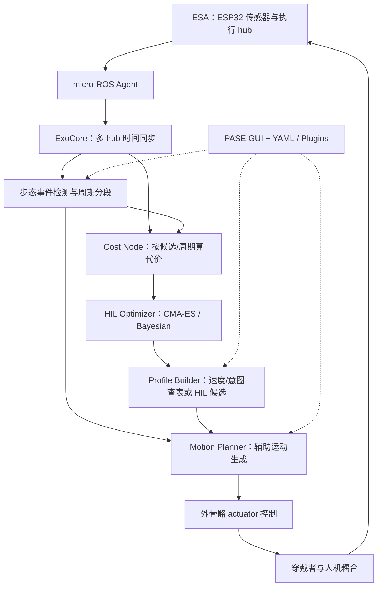
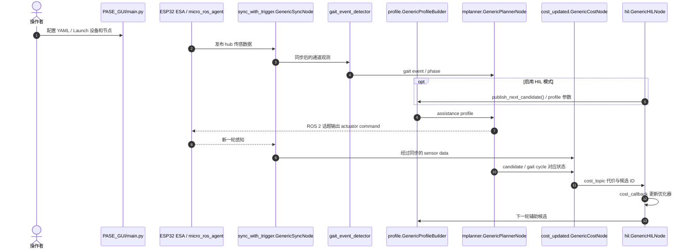

# ExoStack：面向可穿戴外骨骼的模块化 ROS 2 软件栈
**ExoStack: A Modular ROS 2 Framework for Wearable Robotics**

## 一句话定义

ExoStack 把**穿戴式 ESP32 感知/执行、ROS 2 步态和辅助控制、配置/算法插件，以及 human-in-the-loop 个性化调参**放进同一可重配管线，旨在减少每台外骨骼从零搭驱动和实验系统的工作。

## 英文缩写速查

| 缩写 | 英文全称 | 简要说明 |
|---|---|---|
| ROS 2 | Robot Operating System 2 | 中间件与节点/话题接口 |
| ESA | Embedded Sensing and Actuation | 可穿戴控制板上的微控制器传感与执行 |
| HIL | Human-in-the-Loop | 根据穿戴者实际代价反馈优化辅助参数 |
| PASE | ExoStack GUI 名称 | 配置、启动、实时显示的桌面控制台 |
| CMA-ES | Covariance Matrix Adaptation Evolution Strategy | 论文使用的无梯度个性化优化器之一 |
| IMU | Inertial Measurement Unit | 穿戴式运动测量传感器 |
| QoS | Quality of Service | ROS 2 的消息可靠性与队列策略 |

## 核心信息

| 维度 | 核验结果 |
|---|---|
| 论文 | [arXiv:2611.12306](https://arxiv.org/abs/2611.12306)（6 页） |
| 机构 | CSIR-Central Mechanical Engineering Research Institute（印度） |
| 官方源码 | [debadrata/ExoStack](https://github.com/debadrata/ExoStack) |
| 文档 | [ExoStack Documentation](https://debadrata.github.io/ExoStack_documentation/) |
| 运行环境 | Ubuntu 22.04、ROS 2 Humble、Python 3.10、ESP32 micro-ROS |
| **代码许可** | **PolyForm Noncommercial 1.0.0（仅许可范围内非商业用途）**；文档 CC BY-NC 4.0 |
| 验证平台 | 膝部 SoftEXOwalk 与髋部 flexion–extension 气动 exosuit |

## 为什么重要

外骨骼硬件项目会反复实现同一条流程：采集 IMU/接触等传感器数据、对齐时间戳、识别步态事件、下发辅助轨迹、记录人体反馈、根据候选参数迭代优化。ExoStack 以**配置驱动的 ROS 2 节点与多 MCU hub**统一这条链，适合研究「相同软件如何迁移到不同辅助关节」；它与 [LHNav](./paper-lhnav.md) 同属多层控制架构，但 **ExoStack 的人机反馈/实时协同**不是自主空间导航。

## 流程总览（官方架构和论文图示）

部署模式可不启用 HIL 优化器而从 lookup table 选择辅助参数。图中的人体与外骨骼接触闭环应在具体硬件上另行配置安全保护。

## 核心原理

### 1. ESA + micro-ROS：统一硬件接口

ESP32 板按 device list 注册模拟、数字、I²C 与 actuator；每个感知 hub 打包通道并发布消息，由 `micro_ros_agent` 进入 ROS 2。不同硬件节点数可以变，不要求复制整套上层逻辑。

### 2. ExoCore：配置驱动多节点

`sync_with_trigger.GenericSyncNode` 读取 `~/exo_stack_resources/config/sensors.yaml`，使用 `ApproximateTimeSynchronizer` 对齐 hub；`gait_event_detector` 给出步态状态；`profile.GenericProfileBuilder` 根据 `profile.yaml`、速度与意图或优化候选产出 profile；`mplanner.GenericPlannerNode` 加载特定 planner 插件并按 gait/profile 定期生成辅助指令。

### 3. HIL 候选归因

`hil.GenericHILNode` 依配置动态加载 `CMA_ES` 或 `BAYESIAN` 插件，`publish_next_candidate()` 产生候选，`cost_updated.GenericCostNode` 汇总该候选对应步态周期与传感数据；优化必须确认成本属于正确 profile/candidate，否则缓存的上一周期数据会污染个性化更新。

## 实验与评测

| 官方评测项 | 论文报告 |
|---|---|
| 8 感知 hub、目标 100 Hz | **99.5 ± 0.018 Hz** |
| planner 200–300 Hz | 达到配置频率的 **≥97%** |
| 延迟 | 实验配置中报告 **<18 ms** |
| 运行硬件 | Jetson AGX Orin、Jetson Orin Nano、LattePanda Delta |
| 穿戴系统 | 膝部 SoftEXOwalk（Bayesian HIL）及髋部 exosuit（CMA-ES） |

论文数据证明软件栈在所测配置的吞吐与两套设备上的可用性；不直接证明降低代谢成本、长期康复疗效或各种外骨骼的安全性。

## 与其他工作对比

- [步态生成](../concepts/gait-generation.md) 重在轨迹和相位的运动学/控制原理；ExoStack 提供实际消息与节点编排。
- [Locomotion](../tasks/locomotion.md) 面向足式自主移动；ExoStack 的辅助轨迹受穿戴者步态与人体反馈制约。
- [LHNav](./paper-lhnav.md) 为自主双足语义导航的分层系统，控制目标/数据采样与外骨骼 HIL 不同。
- [VLA Adaptation Chess](./paper-vla-adaptation-chess.md) 聚焦示范数据到操作策略的学习，本项目聚焦传感/执行链路与个性化优化。

## 源码运行时序图（依据实际 ROS 2 节点与入口）

这张图基于公开代码的节点职责、publisher/subscriber 与 launch **概念交互**，不是声明某个 ROS 2 topic 名在所有配置下固定；具体 topic 在用户 YAML 配置里。

## 工程实践

1. 按官方 README 建立 ROS 2 Humble 工作空间，克隆项目到 `~/ros2_ws/src/ExoStack`，安装 `exo_stack/requirements.txt`，`colcon build --packages-select exo_stack`。
2. 将 `exo_stack_resources` 复制到家目录，正确安装 ESP32 的 ESA Arduino 库、micro-ROS Humble Agent，再使用 `python3 PASE_GUI/main.py` 或逐个 launch 启动。
3. 打印并比对 `sensors.yaml` / `profile.yaml` / `mplanner.yaml` 的 topic、数据顺序、单位、QoS、时间戳与候选 ID。
4. 实码发现 `setup.py` 中存在部分未在当前 `exo_stack/exo_stack/` 目录看到的旧 console_script 指向；按实际 launch 和文件验证，不应把 README 命令视为已全部运行通过。
5. **商业/产品化使用须先获得合适授权**；PolyForm Noncommercial 不等同 Apache/MIT。

## 局限与风险

- 作者仅在两套气动 exosuit 上报告验证，不代表跨所有电机、驱动器、机械耦合方式即插即用。
- 所测实时性能受 ROS 2 QoS、板卡、网络/USB 和安全控制链影响；具体配置要重新测定。
- 人体穿戴安全、医疗/康复临床效益、合规认证未由此软件框架自行保证。
- 公开代码许可限制非商业范围；README arXiv 徽章仍留 `[ARXIV_ID]` 占位符，已根据实际原文校正本库引用。
- 本次未连接 ESP32 或实体外骨骼，不声称硬件复现。

## 结论

**ExoStack 的价值在于把外骨骼「传感 → 步态 → 辅助曲线 → 执行 → 人体成本 → 参数优化」串成可配置 ROS 2 流水线，但实时、安全与授权是三项独立验证工作。**

1. 先验收 hub 时间戳与 QoS，再调上层个性化优化，否则 cost 可能错配候选。
2. `HIL` 模式与静态 profile 部署模式应分别测量时延。
3. 报告硬件型号、控制率和人机实验人数；不要推广论文的 18ms 到所有硬件。
4. 使用前完成授权判断、执行输出限制、急停和人体安全监测。

## 关联页面

- [Locomotion](../tasks/locomotion.md)
- [步态生成](../concepts/gait-generation.md)
- [LHNav：另一种分层机器人系统](./paper-lhnav.md)
- [VLA Adaptation Chess：操作策略的数据适配](./paper-vla-adaptation-chess.md)

## 参考来源

- [ExoStack 论文全文](../../sources/papers/exostack_arxiv_2611_12306.md)
- [官方部署文档与许可核查](../../sources/sites/exostack-documentation.md)
- [ROS 2 源码运行入口核验](../../sources/repos/exostack-official.md)

## 推荐继续阅读

- [arXiv:2611.12306](https://arxiv.org/abs/2611.12306)
- [ExoStack 官方仓库](https://github.com/debadrata/ExoStack)
- [项目配置与接口文档](https://debadrata.github.io/ExoStack_documentation/)
