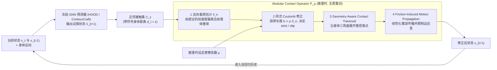

# Explicit Frictional Contact Modeling in Neural Garment Simulation

**一句话定义：** 神经布料预测器之后加入可调摩擦的接触算子，估计法向载荷、执行库仑修正并传播布料运动。

## 流程总览

图依据：论文 §3.3、§4.1-4.5 / Fig.2

## 英文缩写速查

| 缩写 | 英文全称 | 简要说明 |
|------|----------|----------|
| GNN | Graph Neural Network | 图神经网络 |
| MCO | Modular Contact Operator | 模块化接触算子 |
| WACV | Winter Conference on Applications of Computer Vision | 论文标注会议 |

## 方法

神经布料预测器之后加入可调摩擦的接触算子，估计法向载荷、执行库仑修正并传播布料运动。

## 评测与结果

在 HOOD 和 ContourCraft 上，摩擦系数增大时黏附增加、滑移减少；论文报告相对参考求解器约八分之一的运行时间。

## 结论

这项研究提供了显式摩擦布料仿真的一个具体方案。

- 复现时先对齐论文任务和评测条件。
- 将方法收益与实际应用条件分开验证。
- 对代码及数据的可用性持续跟踪。

## 与其他工作对比

- **vs 参考求解器：** 论文报告运行时间约为参考求解器的八分之一，代价是摩擦行为由后接的显式接触算子近似，而非完整求解。
- **vs 纯神经布料预测器（HOOD / ContourCraft）：** 原预测器不显式建模可调摩擦；本工作在其之后加入库仑修正，使摩擦系数成为可调旋钮（系数增大时黏附增加、滑移减少）。
- **vs [可微仿真](../concepts/differentiable-simulation.md)：** 可微仿真关注对 rollout 反传梯度；本工作关注前向接触物理的可控性，二者目标不同。

## 源码运行时序图

不适用：尚未核实可运行的官方实现。

## 局限与开放状态

结果针对论文所测的布料与人体接触；不能据此认定适用于任意机器人接触。项目页访问失败，代码与数据开放状态未核实。

## 关联页面

- [相关方法](../concepts/differentiable-simulation.md)
- [机器人仿真三层结构](../concepts/robot-simulation-three-layers.md)

## 参考来源

- [论文归档](../../sources/papers/explicit-friction_arxiv_2610_33492.md)
- [项目页核查](../../sources/sites/explicit-friction-ngs.md)
- [arXiv PDF](https://arxiv.org/pdf/2610.33492)：已通读方法部分（实验与附录以略读为准）：摘要、§1、§3、§4（四个阶段）、§5.1-5.3 实验设定与消融

## 推荐继续阅读

- [论文原文](https://arxiv.org/abs/2610.33492)
